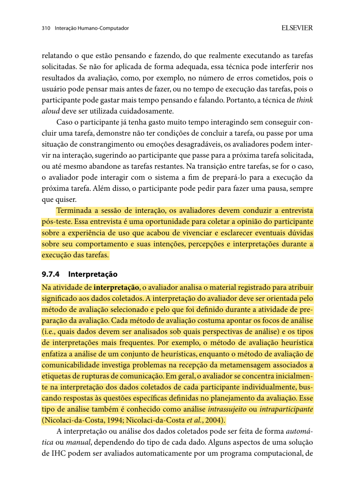
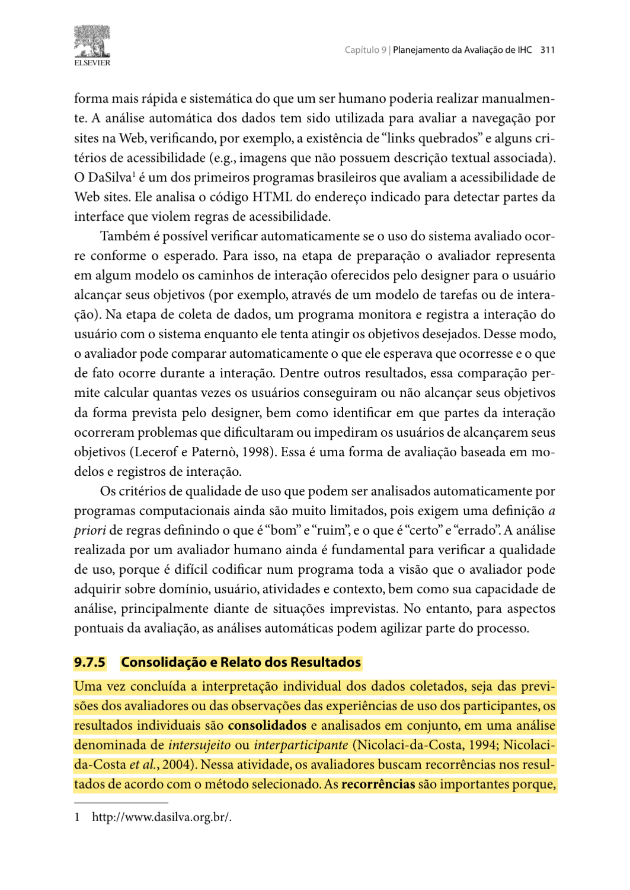
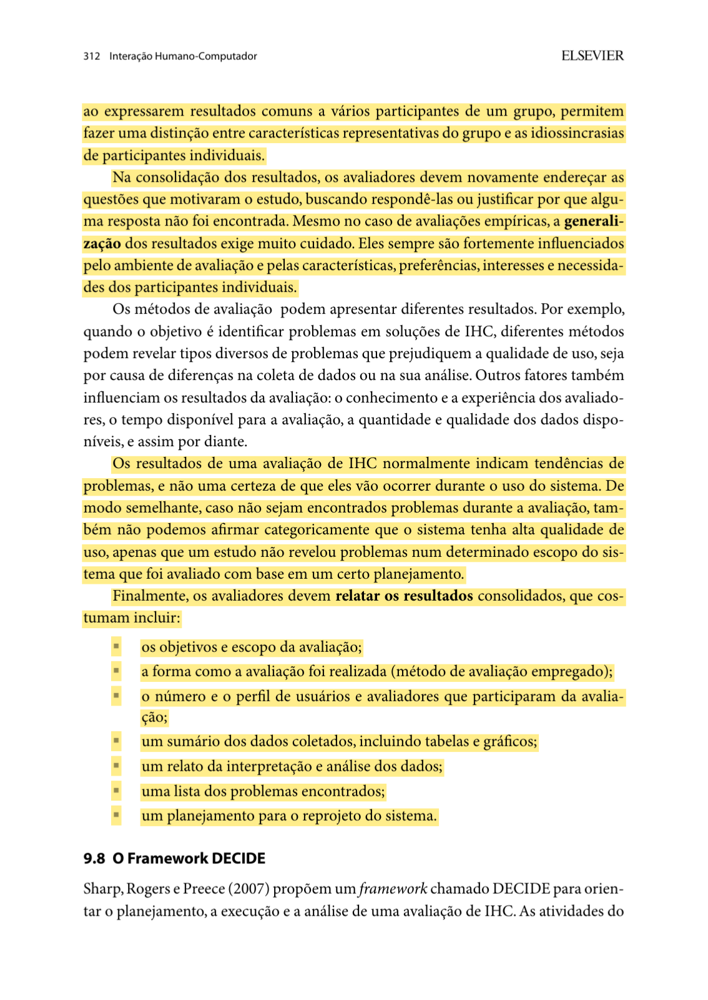
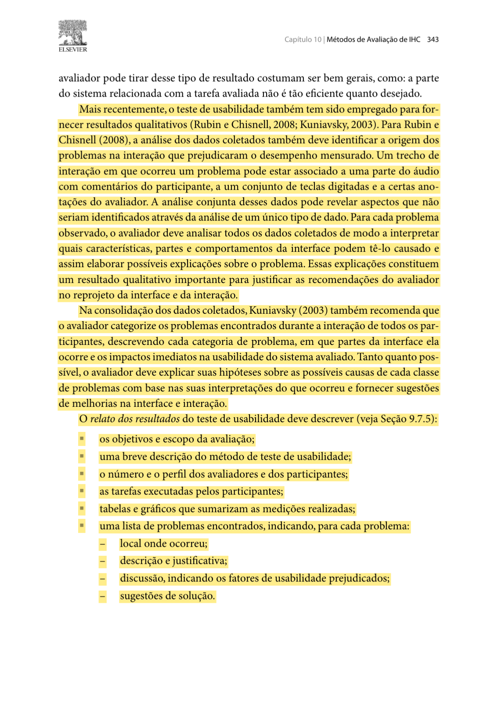
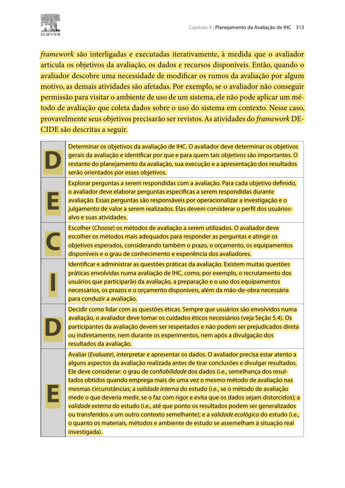

# Planejamento do Relato dos Resultados da Avaliação do Protótipo de Alta Fidelidade (TAR-07)

## Histórico de Versão

| Data | Versão | Descrição | Autor(es) | Revisor(es) | Declaração de ferramenta de IA |
| :---: | :---: | :--- | :--- | :--- | :--- |
| 01/11/2026 | `1.0` | Planejamento da consolidação e apresentação dos resultados da avaliação do protótipo de alta fidelidade da TAR-07. | [Arthur Mariani](https://github.com/arthur-mariani) | [Carlos Henrique](https://github.com/carloshfgit) | Google Gemini - apoio à estruturação em Markdown e revisão textual. |

---

## 1. Introdução

Este documento define como relatar os resultados da futura avaliação do fluxo de crédito de Vale-Transporte no protótipo de alta fidelidade, referente à [TAR-07](../../../../analise-de-requisitos/analise-de-tarefas/tar-07-credito-vale-transporte.md) e ao [Cenário 4](../../../../analise-de-requisitos/cenarios/cenario-4-credito-vale-transporte.md). Ele complementa o [planejamento da avaliação](arthur-planejamento-avaliacao-prototipo-alta-fidelidade.md), que define as perguntas P01–P06, as tarefas T1–T3, o método e a coleta.

O **contexto do Vale-Transporte** vem dos artefatos do projeto. A **forma de interpretar, consolidar e relatar** segue apenas Barbosa e Silva (2010, seções 9.7.4–9.8 e 10.2.1). As tabelas abaixo são modelos vazios; não houve sessão definitiva nem resultado a informar neste planejamento.

## 2. Fundamentação e evidências do livro

O livro orienta interpretar primeiro os dados de cada participante para responder às perguntas de avaliação e, depois, procurar recorrências entre participantes. Na consolidação, deve-se voltar às perguntas iniciais e justificar respostas que não puderam ser obtidas. O relato deve apresentar objetivos e escopo, método, participantes, dados, interpretação, problemas e plano de reprojeto (Barbosa; Silva, 2010, p. 310–312). Para o teste de usabilidade, o livro detalha tarefas, medições e descrição de cada problema com local, justificativa, efeito na usabilidade e sugestão de solução (Barbosa; Silva, 2010, p. 342–343). Os prints grifados dessas passagens estão reunidos na seção 8.

---

## 3. Objetivos do relato

1. Responder, com evidências, às perguntas P01–P06 do planejamento da avaliação.
2. Mostrar como cada participante executou T1–T3, incluindo conclusões, erros, hesitações e pedidos de ajuda.
3. Identificar problemas de usabilidade, sua localização e seus efeitos no entendimento do crédito e do próximo passo.
4. Organizar recorrências e diferenças entre participantes sem transformar a amostra em estatística representativa.
5. Propor mudanças rastreáveis no protótipo e registrar perguntas que permaneçam sem resposta.

## 4. Estrutura do futuro relato

| Seção | Conteúdo a apresentar após as sessões |
| :--- | :--- |
| **Identificação e escopo** | Versão do protótipo, datas, ambiente, tarefas T1–T3 e limites da simulação. |
| **Método e participantes** | Teste de usabilidade, quantidade e perfil agregado dos participantes, papéis dos avaliadores, piloto e desvios do plano. |
| **Dados coletados** | Resumo por tarefa: conclusão, tempo aproximado, erros, retornos, ajuda e comentários. |
| **Interpretação** | Respostas a P01–P06 e explicação de cada achado a partir das evidências. |
| **Problemas encontrados** | Tela, descrição, evidência, impacto na usabilidade, recorrência e sugestão de solução. |
| **Reprojeto** | Mudanças propostas, prioridade, responsável e pendências de validação. |
| **Limitações e conclusão** | Influência da amostra, ambiente, protótipo e estados simulados; perguntas inconclusivas. |

Essa composição corresponde aos itens de relato indicados pelo livro (Barbosa; Silva, 2010, p. 312–313, 343).

## 5. Registro planejado da execução

### 5.1 Identificação

| Campo | Registro após a avaliação |
| :--- | :--- |
| Data(s), horário(s) e local | A preencher |
| Versão e acesso ao protótipo | A preencher |
| Dispositivo e condições de uso | A preencher |
| Número de participantes | A preencher |
| Perfil agregado relevante | A preencher, sem dados identificáveis |
| Condutor e observador | A preencher |
| Registro autorizado | Anotações; áudio ou vídeo somente se autorizados |
| Alterações após o piloto | A preencher |
| Desvios do roteiro definitivo | A preencher |

Os dados do piloto não integrarão o resultado; serão registradas apenas as alterações feitas no procedimento. Essa separação segue a seção 9.7.2 do livro (Barbosa; Silva, 2010, p. 307).

### 5.2 Dados a consolidar por tarefa

| Participante | Tarefa | Conclusão | Tempo aproximado | Erros, retornos ou ajuda | Evidência descritiva |
| :---: | :---: | :--- | :---: | :--- | :--- |
| P01 | T1 | A preencher | A preencher | A preencher | A preencher |
| P01 | T2 | A preencher | A preencher | A preencher | A preencher |
| P01 | T3 | A preencher | A preencher | A preencher | A preencher |

Repete-se o conjunto de três linhas para cada participante. A coluna **conclusão** usará `sem ajuda`, `com ajuda` ou `não concluída`; o relato explicará qualquer intervenção do avaliador. O livro apresenta conclusão, tempo, erros e uso de ajuda como medidas possíveis e recomenda examinar os comentários para entender a origem dos problemas (Barbosa; Silva, 2010, p. 342–343).

## 6. Interpretação e consolidação

### 6.1 Respostas às perguntas DECIDE

| Pergunta | Evidência por participante | Síntese interpretativa | Situação da resposta |
| :---: | :--- | :--- | :--- |
| P01 — Acesso à orientação | A preencher | A preencher | Respondida / Parcial / Inconclusiva |
| P02 — Compreensão das mensagens | A preencher | A preencher | Respondida / Parcial / Inconclusiva |
| P03 — Próximo passo | A preencher | A preencher | Respondida / Parcial / Inconclusiva |
| P04 — Continuidade do atendimento | A preencher | A preencher | Respondida / Parcial / Inconclusiva |
| P05 — Erros e hesitações | A preencher | A preencher | Respondida / Parcial / Inconclusiva |
| P06 — Opinião após o uso | A preencher | A preencher | Respondida / Parcial / Inconclusiva |

Primeiro serão preenchidos os registros individuais; depois, serão buscadas recorrências e diferenças entre participantes. Quando não houver evidência suficiente, a resposta será **inconclusiva**, com justificativa. Esse procedimento segue a interpretação intraparticipante e a consolidação interparticipante descritas por Barbosa e Silva (2010, p. 310–312; **Figuras 1–3**).

### 6.2 Registro dos problemas e pontos positivos

| ID | Tipo | Tela/controle | Evidência observada | Participantes afetados | Consequência na tarefa | Hipótese de causa | Sugestão de solução |
| :---: | :--- | :--- | :--- | :--- | :--- | :--- | :--- |
| AF-01 | Problema / ponto positivo | A preencher | A preencher | A preencher | A preencher | A preencher | A preencher |

Um problema recorrente aparecerá **uma vez**, com os códigos dos participantes afetados e as variações observadas. O campo de hipótese não será apresentado como fato comprovado: deverá ser sustentado por ações, comentários ou trechos de interação. O livro recomenda descrever a categoria, a parte da interface, o impacto imediato e possíveis causas antes de sugerir melhorias (Barbosa; Silva, 2010, p. 343; **Figura 4**).

### 6.3 Priorização e reprojeto

| ID do problema | Mudança proposta | Evidência que a justifica | Impacto na tarefa | Recorrência observada | Prioridade | Responsável | Estado |
| :---: | :--- | :--- | :--- | :--- | :---: | :--- | :--- |
| AF-01 | A preencher | A preencher | A preencher | A preencher | A definir | A definir | Planejada |

A equipe definirá a prioridade considerando impacto e recorrência. Problemas que impeçam encontrar orientação ou induzam interpretação errada do próximo passo deverão ser discutidos primeiro. Esta é uma **regra de trabalho do projeto**, aplicada à orientação do livro de incluir um plano de reprojeto no relato (Barbosa; Silva, 2010, p. 312); não é uma escala atribuída aos autores.

## 7. Limitações e cuidados na apresentação

O relato explicitará: número e perfil efetivos dos participantes; condições do ambiente; versão do protótipo; eventuais respostas simuladas; falhas técnicas; e desvios do roteiro. Diferenças de tempo serão usadas como indícios descritivos. Com uma amostra pequena e tarefas delimitadas, não serão feitas afirmações sobre todos os usuários do Vale-Transporte. Também não se concluirá que um procedimento institucional está correto apenas porque o protótipo o exibiu.

Esses cuidados aplicam o DECIDE ao examinar confiabilidade e validades interna, externa e ecológica antes da divulgação dos resultados, e acompanham a cautela do livro quanto à generalização (Barbosa; Silva, 2010, p. 312–313; **Figuras 3 e 5**).

---

## 8. Evidências do livro — trechos grifados

As áreas amarelas destacam os trechos usados como base para as afirmações e decisões metodológicas deste planejamento. A numeração nas legendas corresponde às referências a figuras no texto.

<strong>Figura 1</strong> — Interpretação dos dados de cada participante (p. 310).

<em>Fonte: Barbosa e Silva (2010, p. 310).</em>

<strong>Figura 2</strong> — Início da consolidação dos resultados (p. 311).

<em>Fonte: Barbosa e Silva (2010, p. 311).</em>

<strong>Figura 3</strong> — Consolidação, cautela na generalização e itens do relato (p. 312).

<em>Fonte: Barbosa e Silva (2010, p. 312).</em>

<strong>Figura 4</strong> — Análise qualitativa e descrição dos problemas em teste de usabilidade (p. 343).

<em>Fonte: Barbosa e Silva (2010, p. 343).</em>

<strong>Figura 5</strong> — Etapa final do DECIDE: avaliar, interpretar e apresentar dados (p. 313).

<em>Fonte: Barbosa e Silva (2010, p. 313).</em>

<strong>Figura 6</strong> — Descarte dos dados do teste-piloto (p. 307).

<em>Fonte: Barbosa e Silva (2010, p. 307).</em>

<strong>Figura 7</strong> — Dados de conclusão, tempo, erros e uso de ajuda (p. 342).

<em>Fonte: Barbosa e Silva (2010, p. 342).</em>

---

## 9. Referências bibliográficas

* BARBOSA, Simone Diniz Junqueira; SILVA, Bruno Santana da. **Interação Humano-Computador**. Rio de Janeiro: Elsevier/Campus, 2010. Cap. 9, seções 9.7.2, 9.7.4–9.8, p. 307, 310–313; cap. 10, seção 10.2.1, p. 342–343.

---