# Planejamento da Avaliação do Protótipo de Alta Fidelidade (TAR-06)

## Histórico de Versão

| Data | Versão | Descrição | Autor(es) | Revisor(es) | Declaração de uso de IA |
| :---: | :---: | :--- | :--- | :--- | :--- |
| 02/11/2026 | `1.0` | Criação do planejamento individual da avaliação do Protótipo de Alta Fidelidade da TAR-06 via DECIDE. | [Carlos Costa](https://github.com/carloshfgit) | [Arthur Mariani](https://github.com/arthur-mariani) | Claude Code (Anthropic) - apoio à redação e à formatação em Markdown a partir das decisões de planejamento do autor |
| 10/11/2026 | `1.1` | Troca da plataforma do protótipo de Figma para HTML navegável, executado no navegador do celular, com a justificativa da troca (seção 5.1), e atualização da Tabela 5, do teste piloto e da declaração de uso de IA. | [Carlos Costa](https://github.com/carloshfgit) | [Arthur Mariani](https://github.com/arthur-mariani) | Claude Code (Anthropic) - apoio à redação e à formatação em Markdown a partir das decisões do autor |

---

Neste documento, apresenta-se o **Planejamento da Avaliação do Protótipo de Alta Fidelidade** referente à **[TAR-06 (Consulta de ônibus em tempo real no DF no Ponto)](../../../../analise-de-requisitos/analise-de-tarefas/tar-06-df-no-ponto.md)**. Trata-se de um planejamento individual para orientar a avaliação formativa do protótipo navegável, construído em **HTML navegável** e executado no navegador do celular, da consulta em tempo real que aparece no [Cenário 2](../../../../analise-de-requisitos/cenarios/cenario-2-viagem-matutina.md) e no [Storyboard 08](../../../nivel1/storyboards.md#38-storyboard-08-consulta-do-onibus-em-tempo-real-no-df-no-ponto).

O protótipo de alta fidelidade dá continuidade ao [Planejamento da Avaliação do Protótipo de Papel](../../../nivel2/planejamentos-individuais/Carlos/carlos-planejamento-av-prototipo-papel.md). Ele reaproveita as telas e peças do papel (Tabela 3 daquele documento) e incorpora os ajustes indicados no relato dos resultados da avaliação em papel. A avaliação envolve participantes do perfil da persona [João Pedro Carvalho](../../../../analise-de-requisitos/personas/joao-pedro-carvalho.md) e é estruturada pelo **Framework DECIDE** (Barbosa e Silva, 2010, p. 313) ([Figura 2](#figura-2)).

---

## 1. Fundamentação

A Tabela 1 relaciona as decisões deste planejamento com os trechos do livro que as fundamentam. As fotos dos trechos grifados estão na [seção 9](#9-fotos-de-referencia).

<strong>Tabela 1</strong> — Decisões do planejamento e base bibliográfica

| Decisão deste planejamento | Base no livro | Figura |
| :--- | :--- | :---: |
| Partir dos objetivos e das perguntas para escolher o método | Barbosa e Silva (2010, Seção 9.7, p. 303) | [1](#figura-1) |
| Organizar o planejamento pelas seis atividades do DECIDE | Barbosa e Silva (2010, Seção 9.8, p. 313) | [2](#figura-2) |
| Avaliar apenas as partes da interface ligadas à TAR-06 | Barbosa e Silva (2010, Seção 9.7.2, p. 304) | [3](#figura-3) |
| Usar o teste de usabilidade com observação das tarefas | Barbosa e Silva (2010, Seção 10.2.1, p. 341–342) | [4](#figura-4) e [6](#figura-6) |
| Usar o mesmo material e as mesmas orientações com todos os participantes | Barbosa e Silva (2010, Seção 9.7.2, p. 306) | [5](#figura-5) |
| Recrutar participantes semelhantes ao público-alvo | Barbosa e Silva (2010, Seção 9.7.2, p. 305) | [7](#figura-7) |
| Fazer teste piloto e descartar os dados dele | Barbosa e Silva (2010, Seção 9.7.2, p. 306–307); Barbosa et al. (2021, Seção 11.7.2, p. 260) | [8](#figura-8) e [11](#figura-11) |
| Garantir consentimento, anonimato, conforto e liberdade de desistência | Barbosa e Silva (2010, Seção 5.4, p. 140–141) | [9](#figura-9) e [10](#figura-10) |

<em>Fonte: Elaborado por Carlos Costa (2026).</em>

---

## 2. D — Determinar os Objetivos da Avaliação

Segundo Barbosa e Silva (2010, p. 303), os objetivos e as perguntas da avaliação orientam a escolha do método ([Figura 1](#figura-1)). O escopo desta avaliação é a consulta da previsão de chegada de uma linha, desde a busca até a decisão de ir ao ponto, e os atalhos para as próximas consultas. Outras funções do aplicativo não serão avaliadas.

### 2.1 Objetivo Geral

Verificar se estudantes que usam ônibus no DF conseguem, no protótipo de alta fidelidade, descobrir quando o ônibus chega, avaliar se a previsão é confiável, decidir o que fazer e salvar a linha para as próximas manhãs, sem ajuda do avaliador.

### 2.2 Objetivos Específicos

* **Identificar problemas de usabilidade e navegação** nas telas de busca, resultados, detalhe da linha e alternativas.
* **Verificar se os ajustes vindos do protótipo de papel funcionam** quando as telas têm cores, tipografia e interação reais.
* **Avaliar a indicação de última atualização e o aviso de posição desatualizada**, que respondem às hipóteses H4 e H5 da TAR-06.
* **Avaliar os atalhos de linhas favoritas e do aviso de atraso** (objetivo 5 da HTA e hipótese H2).
* **Verificar a busca por ponto de referência com um usuário novo** (hipótese H6, que não pôde ser avaliada na Etapa 5).
* **Verificar a conformidade com o [Guia de Estilo](../../../../analise-de-requisitos/guia-de-estilo/introducao.md) do Grupo 05**, especialmente os [elementos de interface](../../../../analise-de-requisitos/guia-de-estilo/elementos-de-interface.md), os [elementos de ação](../../../../analise-de-requisitos/guia-de-estilo/elementos-de-acao.md) e o [vocabulário](../../../../analise-de-requisitos/guia-de-estilo/vocabulario-e-padroes.md).

---

## 3. E — Explorar as Perguntas a Serem Respondidas

As perguntas da Tabela 2 transformam os objetivos em pontos observáveis, conforme o DECIDE (Barbosa e Silva, 2010, p. 313) ([Figura 2](#figura-2)).

<strong>Tabela 2</strong> — Perguntas da avaliação do protótipo de alta fidelidade

| ID | Foco | Pergunta de avaliação | Elemento da TAR-06 | Dado a registrar |
| :---: | :--- | :--- | :--- | :--- |
| **P01** | Busca | O participante encontra a linha, pelo número ou por um ponto de referência, sem ajuda? | HTA 2.1; H2 e H6 | Caminho de busca escolhido, hesitações e pedidos de ajuda. |
| **P02** | Seleção | O participante seleciona a linha e o ponto corretos na lista de resultados? | HTA 2.2; H3 | Toques em resultados errados e correções feitas sozinho. |
| **P03** | Previsão | O participante lê o tempo previsto e localiza o ônibus no mapa? | HTA 3.1 | Resposta dada ao condutor e tempo até encontrá-la. |
| **P04** | Confiabilidade | O participante nota e entende a indicação "atualizado há X"? | HTA 3.2; H4 | Explicação com as próprias palavras. |
| **P05** | Informação defasada | Diante do aviso de posição desatualizada, o participante entende o aviso e decide o que fazer? | HTA 4; H5 | Ação escolhida e justificativa. |
| **P06** | Próximas consultas | O participante encontra como favoritar a linha e ativar o aviso de atraso? | HTA 5; H2 | Conclusão das duas ações, erros e retornos. |
| **P07** | Guia de Estilo e experiência | Os rótulos, os botões e as cores do Guia de Estilo são entendidos, e o participante se sente informado enquanto espera? | Guia de Estilo; H7 | Comentários espontâneos e respostas da entrevista pós-teste. |

<em>Fonte: Elaborado por Carlos Costa (2026).</em>

---

## 4. C — Choose (Escolher) os Métodos de Avaliação

O método escolhido é o **teste de usabilidade**, com observação do uso do protótipo navegável e entrevista breve ao final. Segundo Barbosa e Silva (2010, p. 341), o teste de usabilidade avalia a usabilidade com a participação de usuários que executam tarefas, e o avaliador registra o desempenho e as opiniões deles ([Figura 4](#figura-4)). As atividades do método (preparação, coleta, interpretação, consolidação e relato) estão na Tabela 10.4 do livro (p. 342) ([Figura 6](#figura-6)).

* **Justificativa:** o protótipo de alta fidelidade tem aparência e comportamento próximos do aplicativo real. Por isso é possível medir conclusão, tempo, erros e uso de ajuda, o que não era possível com a simulação em papel.
* **Técnica complementar:** o participante é incentivado a **pensar em voz alta**, como na avaliação em papel, para que o observador entenda a origem das hesitações.
* **Comparação com o papel:** as tarefas mantêm o mesmo cenário da avaliação em papel. Assim, é possível verificar se os problemas encontrados no papel foram resolvidos.

### 4.1 Tarefas Propostas ao Participante

As tarefas são lidas pelo condutor e entregues em um cartão, com o mesmo texto para todos os participantes (Barbosa e Silva, 2010, p. 306) ([Figura 5](#figura-5)). O contexto é o do Cenário 2: *"Você está no ponto de manhã e precisa chegar à UnB Gama para a primeira aula."*

<strong>Tabela 3</strong> — Tarefas da sessão com o protótipo de alta fidelidade

| ID | Enunciado entregue ao participante | Critério de conclusão | Objetivos da HTA | Perguntas |
| :---: | :--- | :--- | :---: | :---: |
| **AF1** | "Descubra em quanto tempo chega o próximo ônibus da sua linha para a UnB Gama." | Informa o tempo previsto da linha correta. | 1, 2 e 3.1 | P01, P02, P03 |
| **AF2** | "O aplicativo mostrou um aviso sobre a posição do ônibus. Decida o que fazer." | Explica o aviso e escolhe consultar de novo ou ver alternativas, com justificativa. | 3.2 e 4 | P04, P05 |
| **AF3** | "Deixe essa linha pronta para as próximas manhãs e peça para ser avisado se ela atrasar." | Vê as confirmações de linha salva e de aviso de atraso ativado. | 5 | P06 |

<em>Fonte: Elaborado por Carlos Costa (2026).</em>

O aviso de posição desatualizada (AF2) é um estado simulado: ele aparece em um momento definido no protótipo, e não por falha real do rastreador. O condutor não explica o aviso nem indica caminhos. Se o participante tocar em algo que não foi implementado, isso é registrado como limitação do protótipo.

### 4.2 Dados Registrados

Para cada tarefa, o observador registra:

* **Conclusão:** sem ajuda, com ajuda ou não concluída;
* **Tempo** do início da leitura da tarefa até o critério de conclusão;
* **Erros e retornos:** toques em elementos errados e uso do botão voltar;
* **Pedidos de ajuda** ao condutor;
* **Comentários** espontâneos e falas do pensar em voz alta.

Esses dados estão entre os que o livro indica para o teste de usabilidade (Barbosa e Silva, 2010, p. 342) ([Figura 6](#figura-6)). Com três participantes, o tempo é usado de forma **descritiva**, sem meta numérica.

---

## 5. I — Identificar e Administrar as Questões Práticas

### 5.1 Protótipo em HTML Navegável

* **Telas:** tela inicial com busca por linha ou por ponto de referência e área de linhas favoritas; resultados da busca; detalhe da linha com tempo previsto, mapa, indicação "atualizado há X" e botões "favoritar" e "avisar atraso"; aviso de posição desatualizada; alternativas para o mesmo destino; e mensagens de confirmação.
* **Origem:** as telas correspondem às peças T1–T4, N1 e N2 do protótipo de papel, com os ajustes indicados no relato da avaliação em papel.
* **Guia de Estilo:** cores, tipografia, botões com verbo de ação e vocabulário seguem o Guia de Estilo do Grupo 05.
* **Versão testada:** o protótipo fica versionado no repositório do projeto e publicado no GitHub Pages. O relato registra o link e o *commit* exato usados nas sessões.
* **Implementação:** o código (HTML, CSS e JavaScript em um único arquivo) foi implementado com o Claude Code (Anthropic) a partir da especificação de telas, das tarefas e do Guia de Estilo definidos pelo autor, que revisa, testa e aprova cada tela.

**Por que HTML e não Figma.** A versão `1.0` previa o protótipo no Figma. A plataforma do protótipo da TAR-06 foi trocada pelos motivos abaixo. A decisão vale apenas para este planejamento; os demais planejamentos de alta fidelidade do Grupo 05 mantêm a plataforma definida por seus autores.

* **Limite da conta:** a conta do autor no Figma é gratuita, com assento de visualização, e permite poucas chamadas mensais ao conector usado para montar as telas com apoio de IA. O número de chamadas necessário para construir e conferir as telas da TAR-06 passaria desse limite.
* **Interações mais realistas:** no HTML, a indicação "atualizado há X" conta o tempo de verdade, o aviso de posição desatualizada (AF2) aparece em um momento definido, a busca responde ao que é digitado e "Favoritar" e "Avisar atraso" mostram confirmações reais. Isso aproxima o protótipo do comportamento do aplicativo e dá mais base às respostas de P03–P05.
* **Caminhos garantidos:** todos os caminhos de AF1–AF3, inclusive os de erro e o botão voltar, ficam programados e podem ser testados antes do piloto.
* **Ajustes rápidos:** os ajustes pedidos no teste piloto podem ser aplicados no código antes da primeira sessão.
* **Contingência já prevista:** a Tabela 5 da versão `1.0` já previa o protótipo aberto no navegador. A troca promove essa alternativa a plano principal.

As tarefas, as perguntas, os participantes, os papéis, os cuidados éticos e a escala de severidade **não mudam**; muda apenas a ferramenta em que o protótipo é construído.

### 5.2 Recrutamento e Perfil dos Participantes

* **Perfil:** estudantes da FCTE/UnB Gama que usam ônibus no DF, com o perfil da persona João Pedro Carvalho. **Pelo menos um** participante nunca deve ter usado o DF no Ponto, para avaliar a hipótese H6.
* **Quantidade:** **3 participantes.** Barbosa e Silva (2010, p. 305) apresentam cinco participantes como referência de custo-benefício para encontrar problemas ([Figura 7](#figura-7)). Este planejamento usa três por causa do prazo da Etapa 7. O número menor é declarado como limitação no relato, e as conclusões valem só para o protótipo e as tarefas testadas.
* **Exclusão:** integrantes do Grupo 05, a participante da avaliação do Storyboard 08 (P04) e o participante da avaliação do protótipo de papel, que já conhecem a proposta.
* **Recrutamento:** convite direto a colegas de curso da FCTE/UnB Gama, feito por Carlos Costa.

### 5.3 Papéis na Sessão

* **Condutor — Carlos Costa:** recebe o participante, apresenta o TCLE, lê as tarefas, cronometra e conduz a entrevista final, sem dar dicas.
* **Observador — integrante do Grupo 05 a confirmar:** anota ações, erros, hesitações e falas na ficha de observação.
* **Participante:** usa o protótipo no celular e fala o que está pensando.

### 5.4 Infraestrutura e Cronograma

<strong>Tabela 4</strong> — Cronograma e logística da avaliação

| Atividade | Data e horário | Participante | Duração prevista |
| :--- | :--- | :--- | :---: |
| **Teste piloto** | 10/11/2026, 14:00 | Integrante do Grupo 05 que não participou da construção do protótipo | 30 min |
| **Sessão 1** | 11/11/2026, 14:00 | Participante 1 (P01) | 30 min |
| **Sessão 2** | 11/11/2026, 15:00 | Participante 2 (P02) | 30 min |
| **Sessão 3** | 12/11/2026, 14:00 | Participante 3 (P03) | 30 min |

<em>Fonte: Elaborado por Carlos Costa (2026).</em>

Os horários serão confirmados com cada participante, mantendo as datas da Tabela 4.

<strong>Tabela 5</strong> — Recursos da avaliação

| Parâmetro | Detalhamento |
| :--- | :--- |
| **Local** | Presencial, em sala de estudos ou ambiente tranquilo da FCTE/UnB Gama. |
| **Dispositivo** | Smartphone com o protótipo aberto no navegador (Chrome) pelo link publicado no GitHub Pages, conectado à internet, e carregador. |
| **Gravação** | Gravação da tela do celular com áudio. O rosto do participante não é gravado. |
| **Contingência** | Arquivo do protótipo salvo no próprio celular, que abre sem internet, ou notebook com o protótipo aberto no navegador em modo de visualização de celular. |
| **Materiais** | TCLE impresso, cartão com o cenário e as tarefas, ficha de observação, roteiro da entrevista e cronômetro. |
| **Etapas da sessão** | Recepção e TCLE (5 min), perguntas sobre o uso de ônibus e de aplicativos (3 min), tarefas AF1–AF3 (15 min) e entrevista pós-teste (7 min). |
| **Orçamento** | **R\$ 0,00** (código próprio, hospedagem gratuita no GitHub Pages e equipamentos próprios). |

<em>Fonte: Elaborado por Carlos Costa (2026).</em>

### 5.5 Roteiro da Entrevista Pós-Teste

1. O que significava a informação "atualizado há X"? Ela mudou a sua confiança na previsão? (P04)
2. O que você entendeu quando apareceu o aviso sobre a posição do ônibus? (P05)
3. Teve algum botão, palavra ou cor que você não entendeu ou que te confundiu? (P07)
4. Usando esse aplicativo no ponto, você se sentiria informado enquanto espera? Por quê? (P07, H7)
5. O que você mudaria nessas telas?

---

## 6. Teste Piloto

Antes das sessões, é feito um **teste piloto** completo (Barbosa e Silva, 2010, p. 306–307; Barbosa et al., 2021, p. 260) ([Figura 8](#figura-8) e [Figura 11](#figura-11)):

* **Data e participante:** 10/11/2026, às 14:00, com um integrante do Grupo 05 que não participou da construção do protótipo.
* **O que é verificado:**
  * se todos os caminhos das tarefas AF1–AF3 funcionam no protótipo HTML, inclusive os de erro e o botão voltar;
  * se o aviso de posição desatualizada aparece no momento certo;
  * se o texto das tarefas está claro;
  * a duração da sessão;
  * a qualidade da gravação da tela e do áudio;
  * se a ficha de observação permite responder às perguntas P01–P07.
* **Dados do piloto:** servem **apenas para ajustar** o protótipo, o roteiro e os materiais e **não entram nos resultados** da avaliação. O relato registra apenas os ajustes feitos depois do piloto.

---

## 7. D — Decidir como Lidar com as Questões Éticas

Os cuidados seguem Barbosa e Silva (2010, p. 140–141) ([Figura 9](#figura-9) e [Figura 10](#figura-10)) e a Resolução nº 510/2016 do CNS:

1. **TCLE:** antes de começar, o participante lê e assina o [Termo de Consentimento Livre e Esclarecido](../../../../assets/PDFs/TCLE_Pesquisa_Transporte.pdf). O condutor explica o objetivo acadêmico, as tarefas, o que é gravado e como os dados serão usados.
2. **Gravação:** só é feita com autorização. Sem ela, apenas as anotações do observador são usadas.
3. **Anonimato:** os participantes são identificados como P01, P02 e P03. Nome, linha de ônibus real, endereço ou outros dados pessoais não são registrados.
4. **Liberdade:** o participante pode pedir pausa ou parar a qualquer momento, sem prejuízo.
5. **Foco no protótipo:** o condutor explica que é o protótipo que está sendo testado, não o participante, e encerra uma tarefa se houver desconforto.

---

## 8. E — Avaliar, Interpretar e Apresentar os Dados

1. **Revisão das gravações e das anotações:** logo depois de cada sessão, condutor e observador comparam os registros e preenchem a ficha de cada participante.
2. **Interpretação por participante:** os dados de cada participante são usados para responder às perguntas P01–P07.
3. **Consolidação:** as respostas são comparadas entre os três participantes. Problemas que se repetem são registrados uma vez, com os participantes afetados.
4. **Severidade:** cada problema recebe um nível de 0 a 4 na escala de Nielsen (1994), a mesma usada no relato do protótipo de papel.
5. **Hipóteses da TAR-06:** o relato registra se as sessões reforçam ou contradizem as hipóteses H2 a H7.
6. **Relato:** os resultados seguem a estrutura definida no [Planejamento do Relato dos Resultados da Avaliação do Protótipo de Alta Fidelidade](carlos-planejamento-relato-prot-alta-fidel.md).

---

## 9. Fotos de Referência

Os trechos grifados em amarelo fundamentam as decisões deste planejamento.

<strong>Figura 1</strong> — Objetivos e perguntas orientam a escolha do método (p. 303).

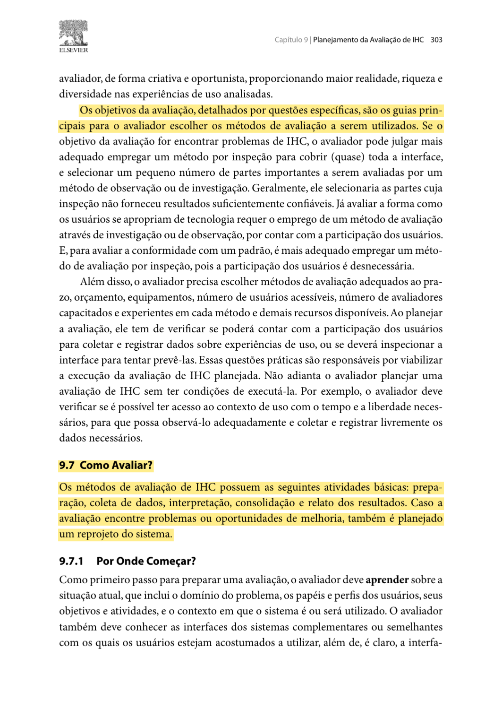

<em>Fonte: Barbosa e Silva (2010, p. 303).</em>

<strong>Figura 2</strong> — As seis atividades do framework DECIDE (p. 313).

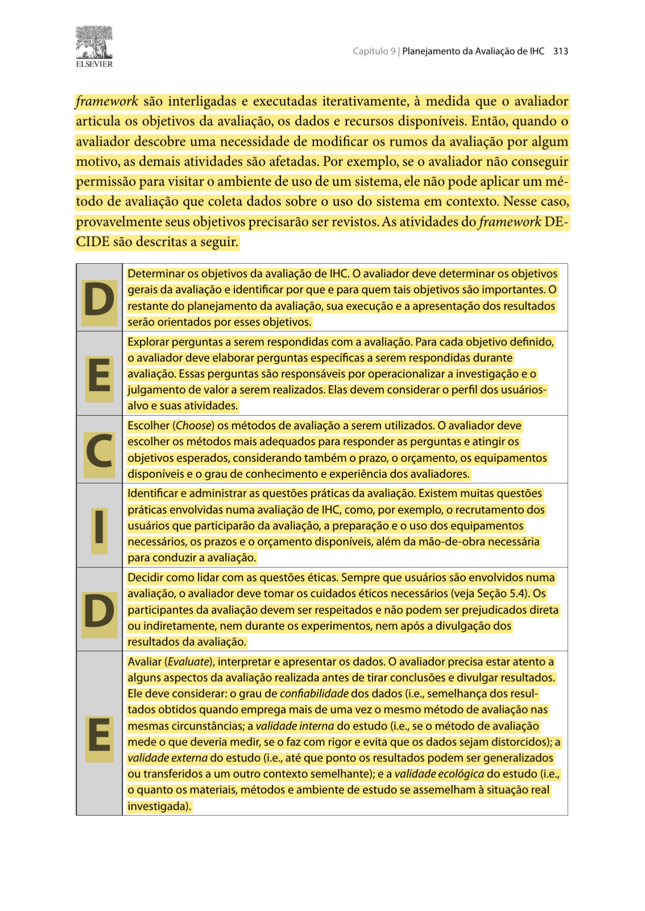

<em>Fonte: Barbosa e Silva (2010, p. 313).</em>

<strong>Figura 3</strong> — Delimitação do escopo e das tarefas da avaliação (p. 304).

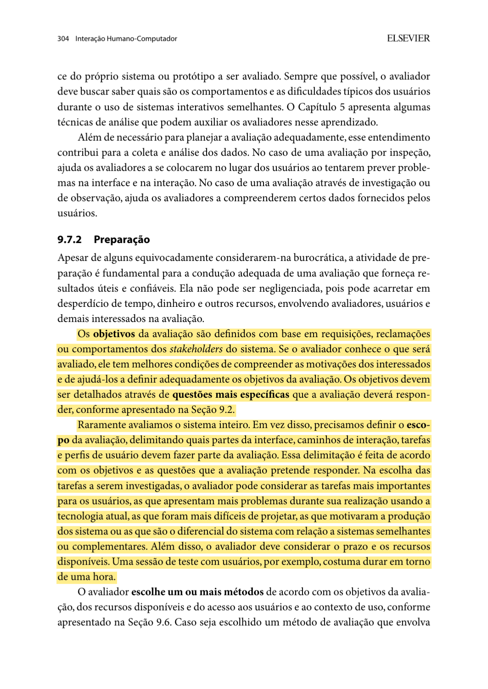

<em>Fonte: Barbosa e Silva (2010, p. 304).</em>

<strong>Figura 4</strong> — Definição do teste de usabilidade (p. 341).

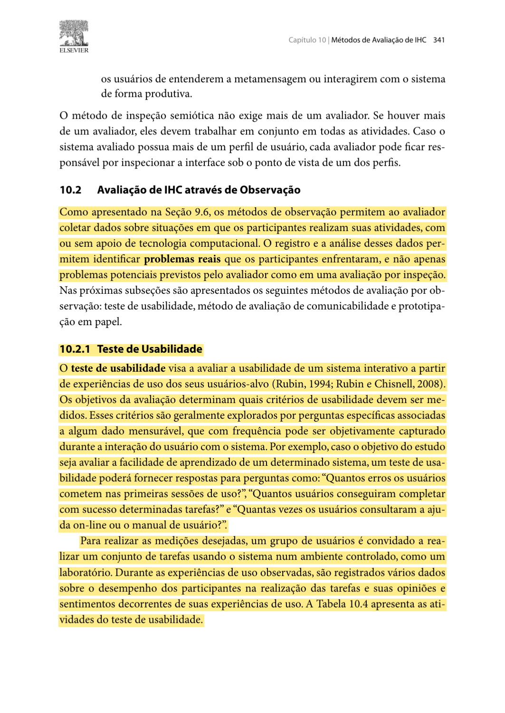

<em>Fonte: Barbosa e Silva (2010, p. 341).</em>

<strong>Figura 5</strong> — Mesmo material e mesmas orientações para todos os participantes (p. 306).

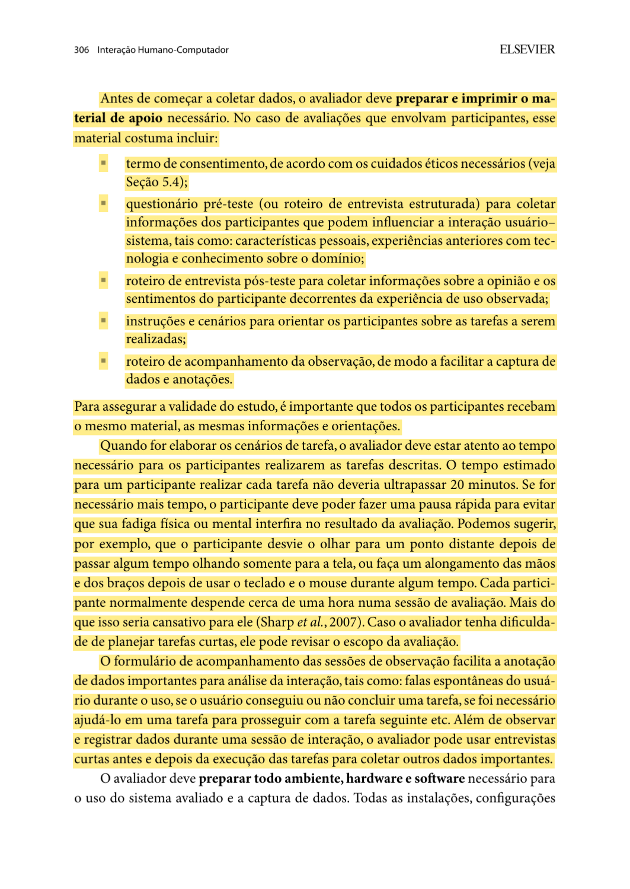

<em>Fonte: Barbosa e Silva (2010, p. 306).</em>

<strong>Figura 6</strong> — Atividades e dados coletados no teste de usabilidade (p. 342).

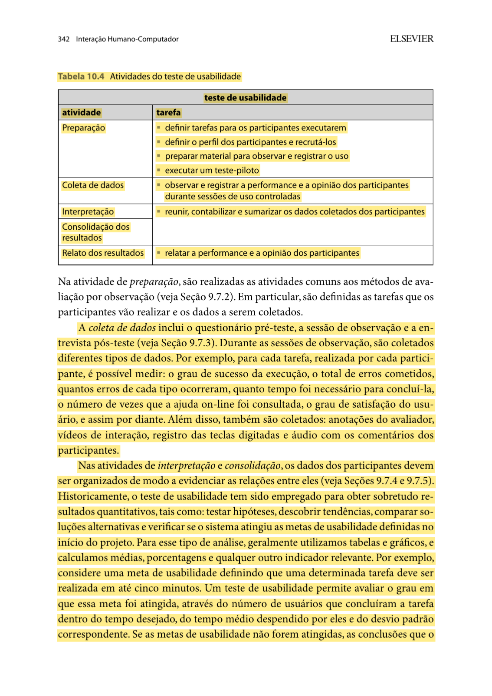

<em>Fonte: Barbosa e Silva (2010, p. 342).</em>

<strong>Figura 7</strong> — Perfil e quantidade de participantes (p. 305).

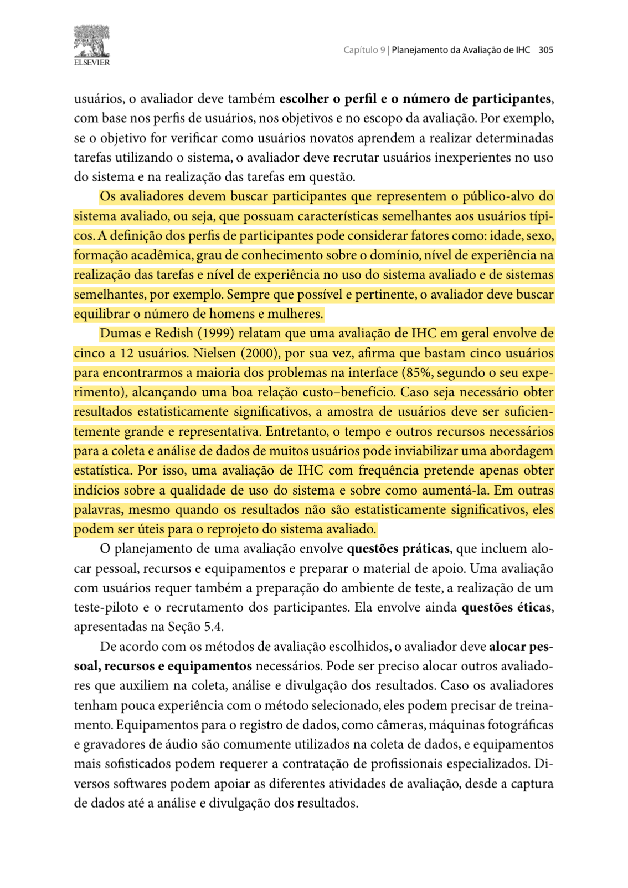

<em>Fonte: Barbosa e Silva (2010, p. 305).</em>

<strong>Figura 8</strong> — Finalidade do teste piloto e descarte dos seus dados (p. 307).

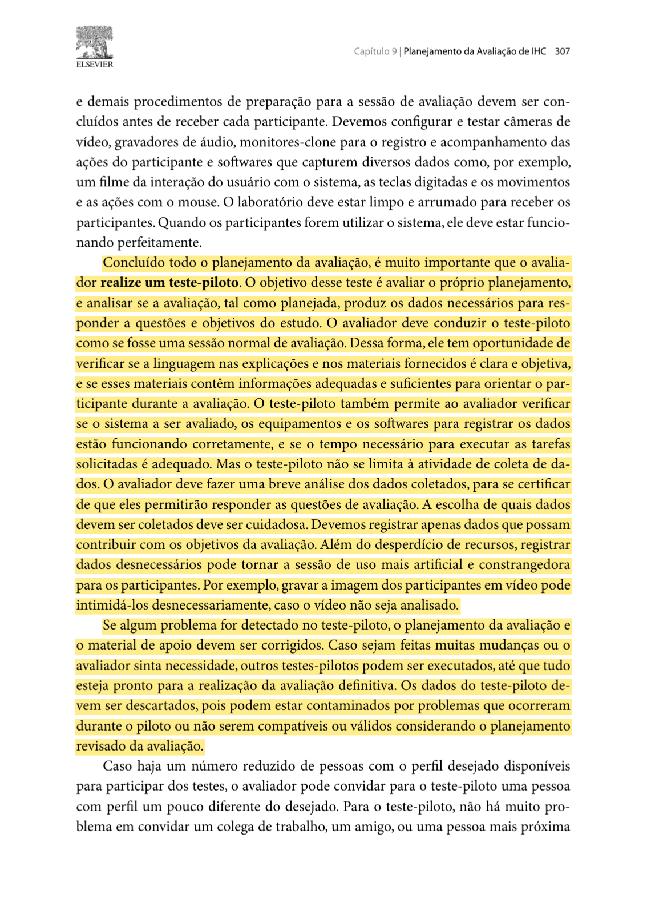

<em>Fonte: Barbosa e Silva (2010, p. 307).</em>

<strong>Figura 9</strong> — Privacidade, anonimato e autorização para gravação (p. 140).

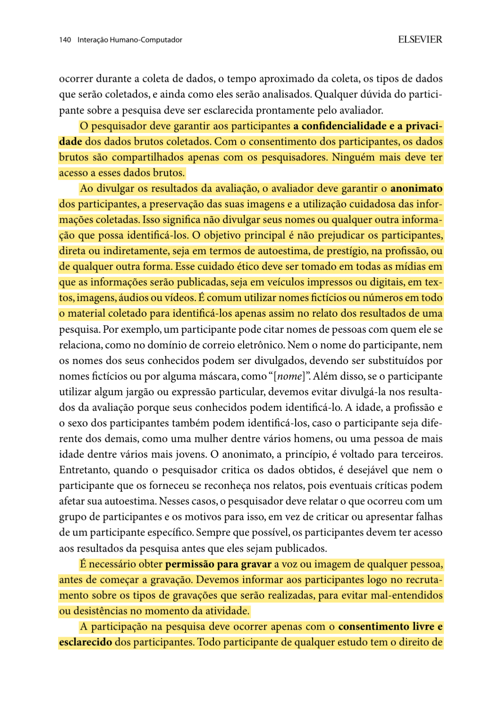

<em>Fonte: Barbosa e Silva (2010, p. 140).</em>

<strong>Figura 10</strong> — Consentimento, conforto e direito de interromper a participação (p. 141).

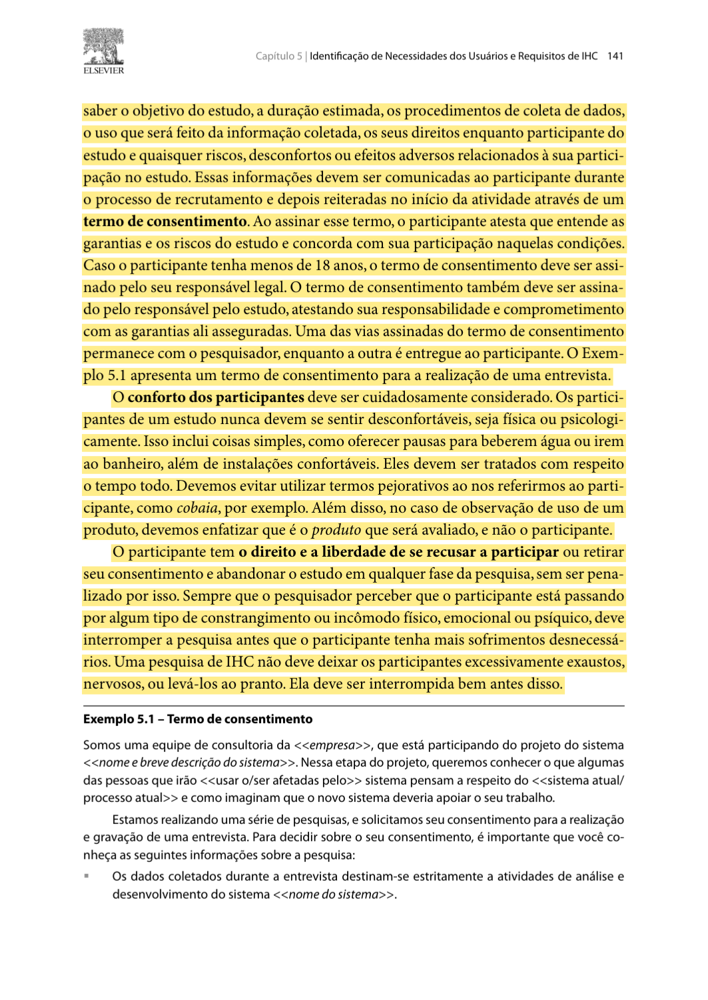

<em>Fonte: Barbosa e Silva (2010, p. 141).</em>

<strong>Figura 11</strong> — Teste piloto (Barbosa et al., 2021, Seção 11.7.2, p. 260).

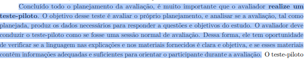

<em>Fonte: Barbosa et al. (2021, p. 260).</em>

---

## 10. Declaração sobre o Uso de IA Generativa

Em cumprimento ao Plano de Ensino e ao Código de Conduta da SBC, declara-se que a ferramenta **Claude Code (Anthropic)** foi utilizada para apoiar a redação e a formatação do texto em Markdown. Na versão `1.1`, a mesma ferramenta foi usada para implementar o protótipo navegável em HTML a partir da especificação de telas, das tarefas e do Guia de Estilo definidos pelo autor, que revisou, testou e aprovou cada tela. As decisões de planejamento e de design (escopo, tarefas, telas, quantidade e perfil dos participantes, datas, local e formato das sessões) são de Carlos Costa, que revisou o texto e responde integralmente pelo conteúdo.

---

## 11. Referências Bibliográficas

* BARBOSA, Simone Diniz Junqueira; SILVA, Bruno Santana da. **Interação Humano-Computador**. Rio de Janeiro: Elsevier/Campus, 2010. Cap. 5, seção 5.4, p. 140–141; cap. 9, seções 9.7–9.8, p. 303–307 e 313; cap. 10, seção 10.2.1, p. 341–342.
* BARBOSA, Simone Diniz Junqueira; SILVA, Bruno Santana da; SILVEIRA, Milene Selbach; GASPARINI, Isabela; DARIN, Ticianne; BARBOSA, Gabriel Diniz Junqueira. **Interação Humano-Computador e Experiência do Usuário**. Rio de Janeiro: Autopublicação, 2021. ISBN 978-65-00-19677-1. Capítulo 11, seção 11.7.2, p. 260.
* BRASIL. Conselho Nacional de Saúde. **Resolução nº 510, de 07 de abril de 2016**. Regulamenta as pesquisas em Ciências Humanas e Sociais. Brasília: Diário Oficial da União, 2016.
* NIELSEN, Jakob. **Usability Engineering**. San Francisco: Morgan Kaufmann, 1994.
* SALES, André Barros de. **Plano de Ensino: Interação Humano Computador**. Brasília: Universidade de Brasília, Faculdade UnB Gama (FCTE/UnB), 2026.

---
**Autor:** [Carlos Costa](https://github.com/carloshfgit)  
**Revisor:** [Arthur Mariani](https://github.com/arthur-mariani)
