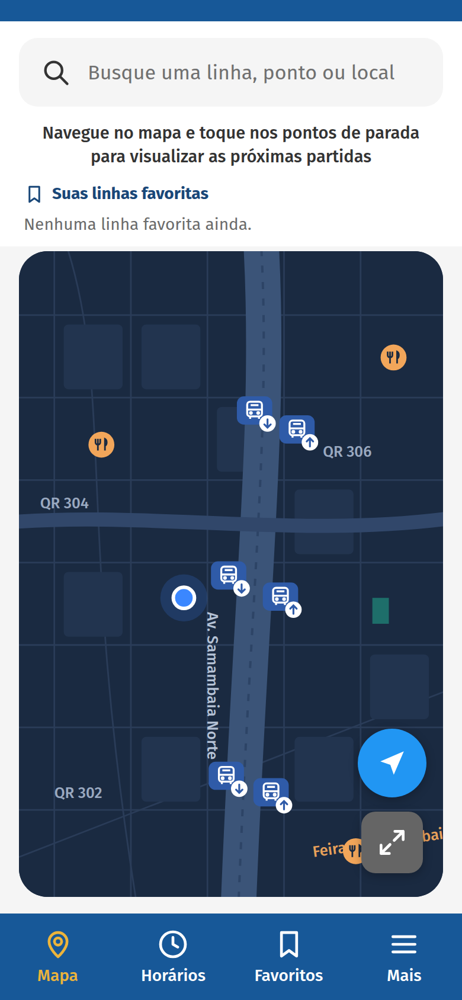
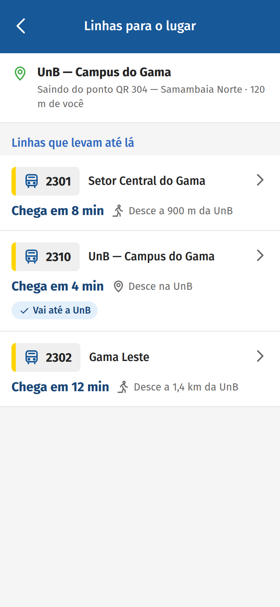
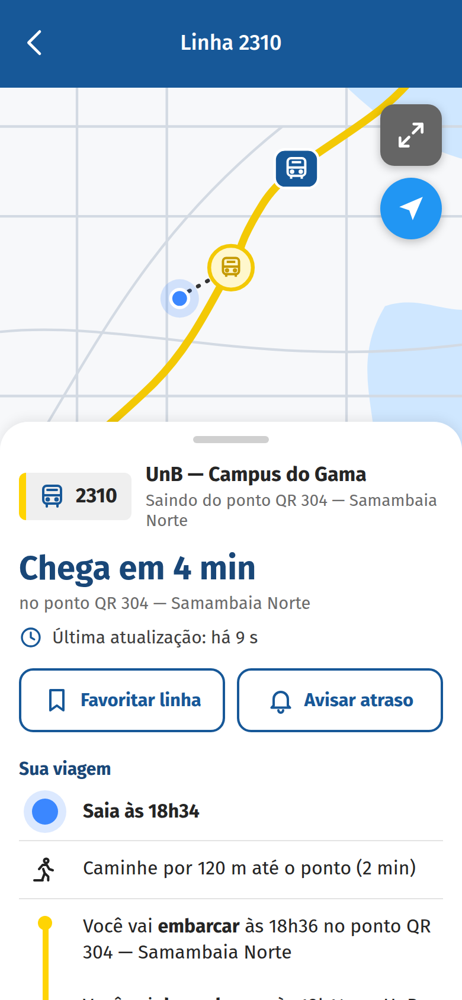
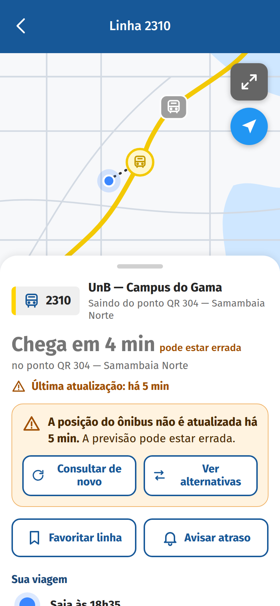
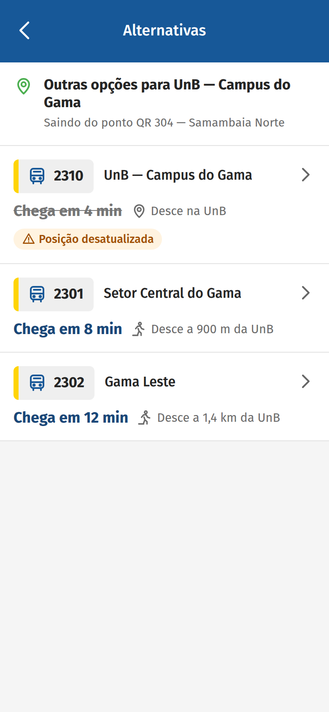
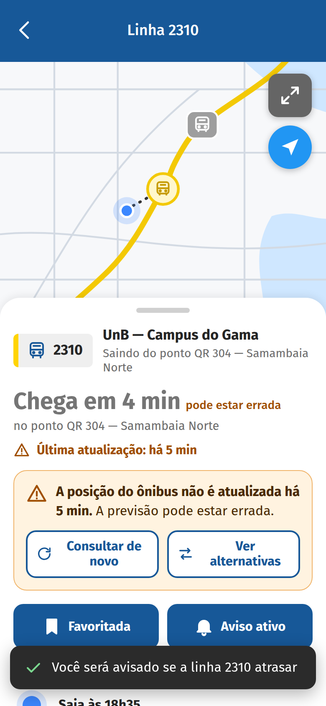
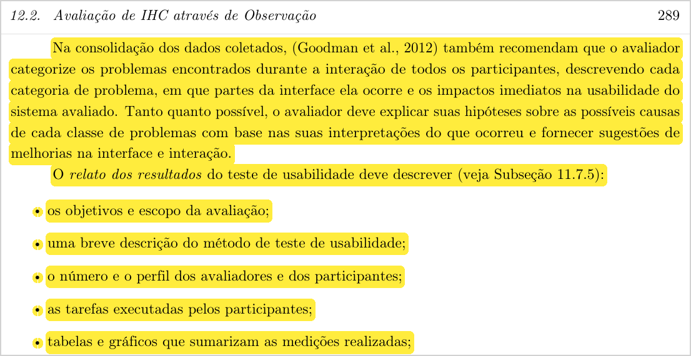
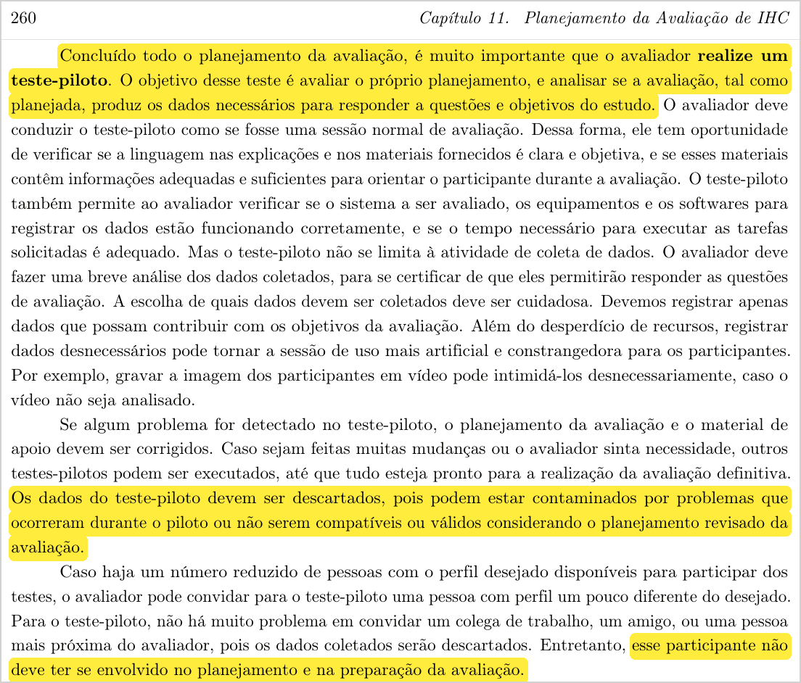

## Histórico de Versão e Contribuição

| Data | Versão | Descrição | Autor(es) | Revisor(es) | Declaração de Uso de IA |
| :---: | :---: | :--- | :--- | :--- | :--- |
| 02/11/2026 | `1.0` | Criação do planejamento individual do relato dos resultados da avaliação do Protótipo de Alta Fidelidade da TAR-06. | [Carlos Costa](https://github.com/carloshfgit) | [Arthur Mariani](https://github.com/arthur-mariani) | Claude (Anthropic) - apoio à redação e à formatação em Markdown a partir das decisões de planejamento do autor |
| 10/11/2026 | `1.1` | Troca da plataforma do protótipo de Figma para HTML navegável: versão testada passa a ser o link publicado e o *commit*, e o reprojeto passa a ser feito no código do protótipo. | [Carlos Costa](https://github.com/carloshfgit) | [Arthur Mariani](https://github.com/arthur-mariani) | Claude (Anthropic) - apoio à redação e à formatação em Markdown a partir das decisões do autor |
| 19/11/2026 | `1.2` | Padronização da estrutura (histórico no topo, conteúdo, fotos de referência e referências ao final); declaração de IA levada para o histórico; autor e revisor retirados do rodapé; retirada das referências que não são o livro da disciplina nem material do professor. Inclusão das telas do protótipo avaliado, com links para o protótipo e para o artefato relacionado. Inclusão do bloco de artefatos relacionados (persona, cenário, análise de tarefas, storyboard, planejamentos, relatos e protótipos da funcionalidade). | [Gabriel Melo](https://github.com/gabriellcardone-06) | Pendente de revisão | Claude (Anthropic) — apoio na padronização da estrutura do artefato, na revisão das referências e na formatação em Markdown; apoio na inclusão das telas do protótipo.; apoio na inclusão dos links entre artefatos |

---

# Planejamento do Relato dos Resultados da Avaliação do Protótipo de Alta Fidelidade (TAR-06)

Neste documento, apresenta-se o **Planejamento do Relato dos Resultados da Avaliação do Protótipo de Alta Fidelidade** referente à **[TAR-06 (Consulta de ônibus em tempo real no DF no Ponto)](../../../../analise-de-requisitos/analise-de-tarefas/tar-06-df-no-ponto.md)**. O documento define como os dados das sessões serão organizados, interpretados e apresentados no relato da Etapa 7. Ele complementa o [Planejamento da Avaliação do Protótipo de Alta Fidelidade](carlos-planejamento-av-prot-alta-fidel.md), que define as perguntas P01–P07, as tarefas AF1–AF3 e os três participantes. Desde a versão `1.1`, o protótipo avaliado é uma página em **HTML navegável**, executada no navegador do celular, e não um arquivo do Figma.

As tabelas abaixo são **modelos vazios**. Nenhuma sessão foi realizada e nenhum resultado é antecipado neste planejamento.

**Artefatos relacionados — fluxo da funcionalidade TAR-06 (Consulta do Ônibus em Tempo Real no DF no Ponto):**

* **Persona:** [João Pedro Carvalho](../../../../analise-de-requisitos/personas/joao-pedro-carvalho.md); [Mariana Borges Almeida](../../../../analise-de-requisitos/personas/mariana-borges-almeida.md)
* **Cenário:** [Cenário 2](../../../../analise-de-requisitos/cenarios/cenario-2-viagem-matutina.md); [Cenário 10](../../../../analise-de-requisitos/cenarios/cenario-10-viagem-ideal.md)
* **Análise de tarefas:** [TAR-06](../../../../analise-de-requisitos/analise-de-tarefas/tar-06-df-no-ponto.md)
* **Storyboard:** [Storyboard 08](../../../nivel1/storyboards.md#38-storyboard-08-consulta-do-onibus-em-tempo-real-no-df-no-ponto)
* **Nível 1 — avaliação do storyboard e da análise de tarefas:** [Planejamento da avaliação](../../../nivel1/planejamentos-individuais/Carlos/carlos-planejamento-avaliacao.md) · Planejamento do relato (*não disponível — pendente de correção manual*) · [Relato dos resultados](../../../nivel1/relatos-individuais/carlos/relato-resultados-storyboard-tarefas.md)
* **Nível 2 — protótipo de papel (baixa fidelidade):** [Planejamento da avaliação](../../../nivel2/planejamentos-individuais/Carlos/carlos-planejamento-av-prototipo-papel.md) · [Planejamento do relato](../../../nivel2/planejamentos-individuais/Carlos/carlos-planejamento-relato-prot-papel.md) · [Relato dos resultados](../../../nivel2/relatos-individuais/carlos/relato-resultados-prot-papel.md)
* **Nível 3 — protótipo de alta fidelidade:** [Planejamento da avaliação](carlos-planejamento-av-prot-alta-fidel.md) · Planejamento do relato (*esta página*) · [Relato dos resultados](../../relatos-individuais/carlos/relato-resultados-prot-alta-fidel.md)
* **Telas do protótipo de papel:** [telas no planejamento da avaliação](../../../nivel2/planejamentos-individuais/Carlos/carlos-planejamento-av-prototipo-papel.md#8-telas-do-prototipo-avaliado)
* **Protótipo de alta fidelidade navegável:** [acessar o protótipo](https://carloshfgit.github.io/prototipo-tar06-df-no-ponto/)

---

## 1. Objetivos do Relato dos Resultados

1. **Responder às perguntas P01–P07** do planejamento da avaliação, com evidências de cada participante.
2. **Apresentar o desempenho por tarefa:** conclusão, tempo, erros, retornos e uso de ajuda nas tarefas AF1–AF3.
3. **Listar os problemas de usabilidade** com a tela afetada, a severidade, os participantes afetados e uma sugestão de solução.
4. **Comparar com o protótipo de papel:** indicar quais problemas da avaliação em papel foram resolvidos e quais continuam.
5. **Atualizar a situação das hipóteses H2 a H7** da TAR-06.
6. **Propor o reprojeto** das telas do protótipo HTML e registrar as perguntas que ficaram sem resposta.

Segundo Barbosa et al. (2021), primeiro se interpretam os dados de cada participante e depois se consolidam os resultados de todos, voltando às perguntas iniciais ([Figura 7](#figura-7), [Figura 8](#figura-8) e [Figura 9](#figura-9)).

---

## 2. Estrutura do Relato Final

<strong>Tabela 1</strong> — Estrutura do relato dos resultados

| Seção | Conteúdo |
| :--- | :--- |
| **1. Objetivos e escopo** | Objetivos da avaliação, escopo da TAR-06, link publicado e *commit* do protótipo HTML testado. |
| **2. Método** | Breve descrição do teste de usabilidade e do pensar em voz alta. |
| **3. Participantes e avaliadores** | Quantidade e perfil agregado dos participantes (sem dados pessoais), papéis do condutor e do observador. |
| **4. Execução** | Datas, horários, local, dispositivo, ajustes feitos após o teste piloto e desvios do planejamento. |
| **5. Desempenho por tarefa** | Tabela 3 preenchida. |
| **6. Respostas às perguntas** | Tabela 4 preenchida. |
| **7. Problemas encontrados** | Tabela 5 preenchida, ordenada por severidade. |
| **8. Comparação com o protótipo de papel** | Tabela 6 preenchida. |
| **9. Hipóteses da TAR-06** | Tabela 7 preenchida. |
| **10. Reprojeto e limitações** | Mudanças no protótipo HTML, prioridade, perguntas sem resposta e limites da amostra. |
| **11. Vídeos** | Gravações das sessões incorporadas do YouTube, com autorização dos participantes. |

<em>Fonte: Elaborado por Carlos Costa (2026), com base em Barbosa et al. (2021, pp. 263–289).</em>

Essa estrutura segue os itens de relato indicados por Barbosa et al. (2021) ([Figura 9](#figura-9)) e a descrição dos problemas no teste de usabilidade (p. 343) ([Figura 10](#figura-10)).

---

## 3. Escala de Severidade dos Problemas

Os problemas serão classificados pela escala de severidade de Nielsen (1994 apud BARBOSA et al., 2021), a mesma usada no relato do protótipo de papel.

<strong>Tabela 2</strong> — Escala de severidade

| Nível | Classificação | Impacto no protótipo de alta fidelidade |
| :---: | :--- | :--- |
| **0** | Sem importância | Não afeta a tarefa; comentário estético ou opcional. |
| **1** | Leve | Hesitação breve; o participante conclui a tarefa sozinho. |
| **2** | Moderado | Toque errado ou retorno de tela, corrigido pelo participante, com perda de eficiência. |
| **3** | Grave | O participante só conclui a tarefa com muita dificuldade ou com ajuda do condutor. |
| **4** | Catastrófico | O participante não consegue concluir a tarefa. |

<em>Fonte: Adaptado de Nielsen (1994 apud BARBOSA et al., 2021).</em>

---

## 4. Modelos de Tabelas para Consolidação dos Resultados

### 4.1 Desempenho por Tarefa

A coluna "Conclusão" usa os valores **sem ajuda**, **com ajuda** ou **não concluída**. Conclusão, tempo, erros e uso de ajuda estão entre os dados indicados para o teste de usabilidade (Barbosa et al., 2021, p. 289) ([Figura 11](#figura-11)).

<strong>Tabela 3</strong> — Desempenho dos participantes nas tarefas

| Participante | Tarefa | Conclusão | Tempo | Erros e retornos | Pedidos de ajuda | Comentários relevantes |
| :---: | :---: | :--- | :---: | :--- | :---: | :--- |
| P01 | AF1 | *[a preencher]* | *[a preencher]* | *[a preencher]* | *[a preencher]* | *[a preencher]* |
| P01 | AF2 | *[a preencher]* | *[a preencher]* | *[a preencher]* | *[a preencher]* | *[a preencher]* |
| P01 | AF3 | *[a preencher]* | *[a preencher]* | *[a preencher]* | *[a preencher]* | *[a preencher]* |

<em>Fonte: Elaborado por Carlos Costa (2026).</em>

O bloco de três linhas se repete para P02 e P03.

### 4.2 Respostas às Perguntas da Avaliação

<strong>Tabela 4</strong> — Respostas às perguntas P01–P07

| Pergunta | Evidências (P01, P02, P03) | Síntese | Situação |
| :---: | :--- | :--- | :---: |
| **P01** — Busca | *[a preencher]* | *[a preencher]* | Respondida / Parcial / Inconclusiva |
| **P02** — Seleção | *[a preencher]* | *[a preencher]* | Respondida / Parcial / Inconclusiva |
| **P03** — Previsão | *[a preencher]* | *[a preencher]* | Respondida / Parcial / Inconclusiva |
| **P04** — Confiabilidade | *[a preencher]* | *[a preencher]* | Respondida / Parcial / Inconclusiva |
| **P05** — Informação defasada | *[a preencher]* | *[a preencher]* | Respondida / Parcial / Inconclusiva |
| **P06** — Próximas consultas | *[a preencher]* | *[a preencher]* | Respondida / Parcial / Inconclusiva |
| **P07** — Guia de Estilo e experiência | *[a preencher]* | *[a preencher]* | Respondida / Parcial / Inconclusiva |

<em>Fonte: Elaborado por Carlos Costa (2026).</em>

Quando não houver evidência suficiente, a pergunta é marcada como **inconclusiva**, com a justificativa (Barbosa et al., 2021, pp. 262–263).

### 4.3 Registro e Priorização dos Problemas

<strong>Tabela 5</strong> — Problemas encontrados no protótipo de alta fidelidade

| ID | Tela / componente | Descrição do problema | Evidência observada | Participantes afetados | Severidade (0–4) | Sugestão de solução no protótipo |
| :---: | :--- | :--- | :--- | :---: | :---: | :--- |
| **AF-01** | *[a preencher]* | *[a preencher]* | *[a preencher]* | *[a preencher]* | *[0 a 4]* | *[a preencher]* |
| **AF-02** | *[a preencher]* | *[a preencher]* | *[a preencher]* | *[a preencher]* | *[0 a 4]* | *[a preencher]* |

<em>Fonte: Elaborado por Carlos Costa (2026).</em>

Um problema que aparece em mais de um participante é registrado **uma vez**, com os códigos dos participantes afetados. A descrição separa o que foi observado da possível causa na interface, como orienta Barbosa et al. (2021) ([Figura 10](#figura-10)).

### 4.4 Comparação com o Protótipo de Papel

<strong>Tabela 6</strong> — Problemas do protótipo de papel × resultado na alta fidelidade

| Problema do papel | Ajuste feito no protótipo | Resultado na alta fidelidade |
| :--- | :--- | :---: |
| *[ID e descrição do relato do papel]* | *[a preencher]* | Resolvido / Persiste / Não observado |

<em>Fonte: Elaborado por Carlos Costa (2026).</em>

### 4.5 Situação das Hipóteses da TAR-06

<strong>Tabela 7</strong> — Hipóteses da TAR-06 após a avaliação de alta fidelidade

| Hipótese | Descrição resumida | Pergunta | Situação após a avaliação |
| :---: | :--- | :---: | :---: |
| **H2** | A busca exige lembrar a linha; um atalho para linhas usadas ajudaria. | P01, P06 | *[a preencher]* |
| **H3** | Itens próximos na lista levam à seleção errada. | P02 | *[a preencher]* |
| **H4** | A hora da última atualização ajuda a avaliar a confiabilidade. | P04 | *[a preencher]* |
| **H5** | O usuário trata uma posição defasada como atual. | P05 | *[a preencher]* |
| **H6** | O usuário novo não sabe que existe a busca por ponto de referência. | P01 | *[a preencher]* |
| **H7** | Com a consulta em tempo real, o passageiro não se sente sem informação enquanto espera. | P07 | *[a preencher]* |

<em>Fonte: Elaborado por Carlos Costa (2026), com base na Tabela 5 da TAR-06.</em>

Os valores possíveis são **confirmada**, **parcialmente confirmada**, **não confirmada** e **não avaliada**. A situação da TAR-06 é atualizada em uma nova versão do documento, mantendo Rodrigo Barbosa como autor da análise.

---

## 5. Reprojeto e Limitações

1. **Prioridade:** problemas de severidade 3 e 4 são corrigidos primeiro no protótipo HTML; os de severidade 1 e 2 entram na lista de melhorias; os de severidade 0 são registrados.
2. **Registro das mudanças:** cada mudança indica o ID do problema que a justifica, a tela alterada e o *commit* do protótipo HTML que contém a mudança.
3. **Limitações:** o relato informa o número e o perfil reais dos participantes, os estados simulados no protótipo (como o aviso de posição desatualizada), falhas técnicas e desvios do roteiro. Com três participantes, as conclusões valem só para o protótipo e as tarefas testadas (Barbosa et al., 2021, pp. 263–264) ([Figura 9](#figura-9) e [Figura 12](#figura-12)).
4. **Teste piloto:** os dados do piloto não entram no relato; só os ajustes feitos depois dele são registrados (Barbosa et al., 2021, p. 260) ([Figura 13](#figura-13)).

## 6. Telas do Protótipo Avaliado

As Figuras 1 a 6 mostram as telas do protótipo de alta fidelidade da [TAR-06](../../../../analise-de-requisitos/analise-de-tarefas/tar-06-df-no-ponto.md), também apresentadas no [relato dos resultados da avaliação](../../../nivel3/relatos-individuais/carlos/relato-resultados-prot-alta-fidel.md).

* **Protótipo navegável:** [Acessar o protótipo da TAR-06](https://carloshfgit.github.io/prototipo-tar06-df-no-ponto/)

<strong>Figura 1</strong> — A1 Início

{ width="300" }

<em>Fonte: Elaborado por Carlos Costa (2026).</em>

<strong>Figura 2</strong> — A3 Resultados por lugar

{ width="300" }

<em>Fonte: Elaborado por Carlos Costa (2026).</em>

<strong>Figura 3</strong> — A4 Linha

{ width="300" }

<em>Fonte: Elaborado por Carlos Costa (2026).</em>

<strong>Figura 4</strong> — N1 Aviso de posição desatualizada

{ width="300" }

<em>Fonte: Elaborado por Carlos Costa (2026).</em>

<strong>Figura 5</strong> — A5 Alternativas

{ width="300" }

<em>Fonte: Elaborado por Carlos Costa (2026).</em>

<strong>Figura 6</strong> — N2 Confirmação do aviso de atraso

{ width="300" }

<em>Fonte: Elaborado por Carlos Costa (2026).</em>

---
---

## 7. Fotos de Referência
Os trechos grifados em amarelo fundamentam as decisões deste planejamento.

<strong>Figura 7</strong> — Interpretação dos dados de cada participante (p. 262).

<em>Fonte: BARBOSA et al. (2021, p. 262). Recorte e grifo: <a href="https://github.com/gabriellcardone-06">Gabriel Melo</a> (2026).</em>

<strong>Figura 8</strong> — Início da consolidação dos resultados (p. 263).

<em>Fonte: BARBOSA et al. (2021, p. 263). Recorte e grifo: <a href="https://github.com/gabriellcardone-06">Gabriel Melo</a> (2026).</em>

<strong>Figura 9</strong> — Consolidação, cautela na generalização e itens do relato (p. 263).

<em>Fonte: BARBOSA et al. (2021, p. 263). Recorte e grifo: <a href="https://github.com/gabriellcardone-06">Gabriel Melo</a> (2026).</em>

<strong>Figura 10</strong> — Descrição dos problemas encontrados no teste de usabilidade (p. 289).

<em>Fonte: BARBOSA et al. (2021, p. 289). Recorte e grifo: <a href="https://github.com/gabriellcardone-06">Gabriel Melo</a> (2026).</em>

<strong>Figura 11</strong> — Dados de conclusão, tempo, erros e uso de ajuda (p. 289).

<em>Fonte: BARBOSA et al. (2021, p. 289). Recorte e grifo: <a href="https://github.com/gabriellcardone-06">Gabriel Melo</a> (2026).</em>

<strong>Figura 12</strong> — Etapa final do DECIDE: avaliar, interpretar e apresentar os dados (p. 264).

<em>Fonte: BARBOSA et al. (2021, p. 264). Recorte e grifo: <a href="https://github.com/gabriellcardone-06">Gabriel Melo</a> (2026).</em>

<strong>Figura 13</strong> — Descarte dos dados do teste piloto (p. 260).

<em>Fonte: BARBOSA et al. (2021, p. 260). Recorte e grifo: <a href="https://github.com/gabriellcardone-06">Gabriel Melo</a> (2026).</em>

---

## 8. Referências Bibliográficas
* BARBOSA, Simone Diniz Junqueira; SILVA, Bruno Santana da; SILVEIRA, Milene Selbach; GASPARINI, Isabela; DARIN, Ticianne; BARBOSA, Gabriel Diniz Junqueira. **Interação Humano-Computador e Experiência do Usuário**. Rio de Janeiro: Autopublicação, 2021. ISBN 978-65-00-19677-1.
* SALES, André Barros de. **Plano de Ensino: Interação Humano Computador**. Brasília: Universidade de Brasília, Faculdade UnB Gama (FCTE/UnB), 2026.
