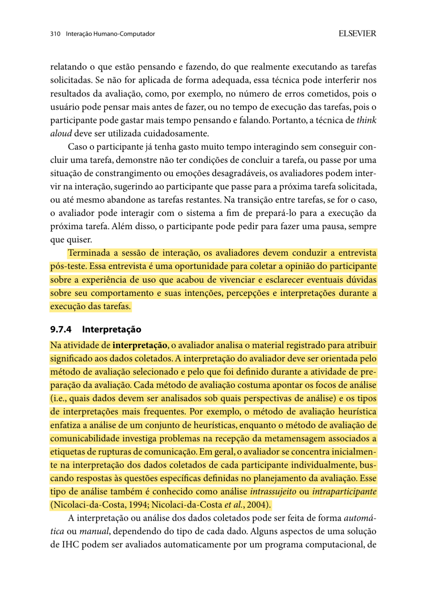
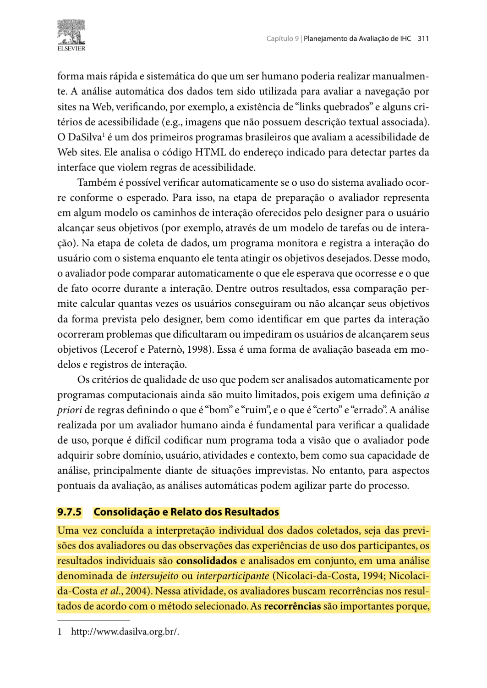
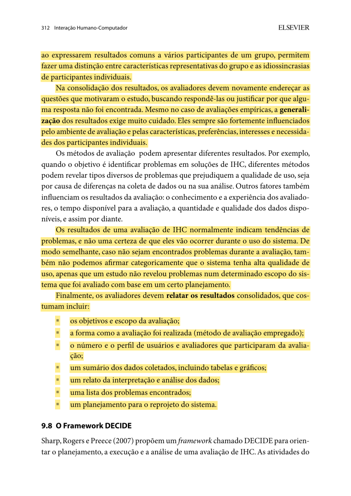
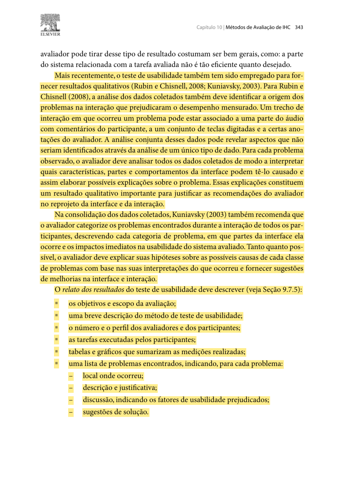
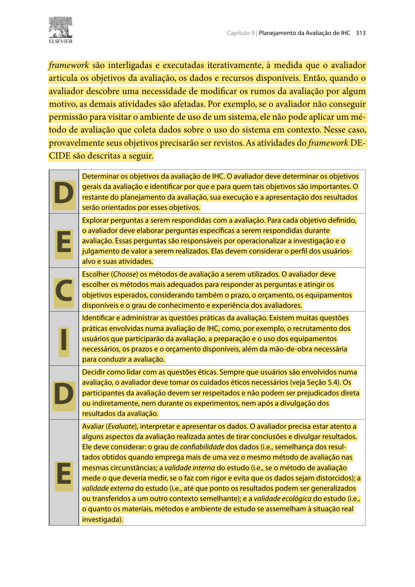

## Histórico de Versão

| Data | Versão | Descrição | Autor(es) | Revisor(es) | Declaração de uso de IA |
| :---: | :---: | :--- | :--- | :--- | :--- |
| 02/11/2026 | `1.0` | Criação do planejamento individual do relato dos resultados da avaliação do Protótipo de Alta Fidelidade da TAR-06. | [Carlos Costa](https://github.com/carloshfgit) | [Arthur Mariani](https://github.com/arthur-mariani) | Claude Code (Anthropic) - apoio à redação e à formatação em Markdown a partir das decisões de planejamento do autor |

---

# Planejamento do Relato dos Resultados da Avaliação do Protótipo de Alta Fidelidade (TAR-06)

Neste documento, apresenta-se o **Planejamento do Relato dos Resultados da Avaliação do Protótipo de Alta Fidelidade** referente à **[TAR-06 (Consulta de ônibus em tempo real no DF no Ponto)](../../../../analise-de-requisitos/analise-de-tarefas/tar-06-df-no-ponto.md)**. O documento define como os dados das sessões serão organizados, interpretados e apresentados no relato da Etapa 7. Ele complementa o [Planejamento da Avaliação do Protótipo de Alta Fidelidade](carlos-planejamento-av-prot-alta-fidel.md), que define as perguntas P01–P07, as tarefas AF1–AF3 e os três participantes.

As tabelas abaixo são **modelos vazios**. Nenhuma sessão foi realizada e nenhum resultado é antecipado neste planejamento.

---

## 1. Objetivos do Relato dos Resultados

1. **Responder às perguntas P01–P07** do planejamento da avaliação, com evidências de cada participante.
2. **Apresentar o desempenho por tarefa:** conclusão, tempo, erros, retornos e uso de ajuda nas tarefas AF1–AF3.
3. **Listar os problemas de usabilidade** com a tela afetada, a severidade, os participantes afetados e uma sugestão de solução.
4. **Comparar com o protótipo de papel:** indicar quais problemas da avaliação em papel foram resolvidos e quais continuam.
5. **Atualizar a situação das hipóteses H2 a H7** da TAR-06.
6. **Propor o reprojeto** das telas no Figma e registrar as perguntas que ficaram sem resposta.

Segundo Barbosa e Silva (2010, p. 310–312), primeiro se interpretam os dados de cada participante e depois se consolidam os resultados de todos, voltando às perguntas iniciais ([Figura 1](#figura-1), [Figura 2](#figura-2) e [Figura 3](#figura-3)).

---

## 2. Estrutura do Relato Final

<strong>Tabela 1</strong> — Estrutura do relato dos resultados

| Seção | Conteúdo |
| :--- | :--- |
| **1. Objetivos e escopo** | Objetivos da avaliação, escopo da TAR-06, versão e link do protótipo no Figma. |
| **2. Método** | Breve descrição do teste de usabilidade e do pensar em voz alta. |
| **3. Participantes e avaliadores** | Quantidade e perfil agregado dos participantes (sem dados pessoais), papéis do condutor e do observador. |
| **4. Execução** | Datas, horários, local, dispositivo, ajustes feitos após o teste piloto e desvios do planejamento. |
| **5. Desempenho por tarefa** | Tabela 3 preenchida. |
| **6. Respostas às perguntas** | Tabela 4 preenchida. |
| **7. Problemas encontrados** | Tabela 5 preenchida, ordenada por severidade. |
| **8. Comparação com o protótipo de papel** | Tabela 6 preenchida. |
| **9. Hipóteses da TAR-06** | Tabela 7 preenchida. |
| **10. Reprojeto e limitações** | Mudanças no Figma, prioridade, perguntas sem resposta e limites da amostra. |
| **11. Vídeos** | Gravações das sessões incorporadas do YouTube, com autorização dos participantes. |

<em>Fonte: Elaborado por Carlos Costa (2026), com base em Barbosa e Silva (2010, p. 312 e 343).</em>

Essa estrutura segue os itens de relato indicados por Barbosa e Silva (2010, p. 312) ([Figura 3](#figura-3)) e a descrição dos problemas no teste de usabilidade (p. 343) ([Figura 4](#figura-4)).

---

## 3. Escala de Severidade dos Problemas

Os problemas serão classificados pela escala de severidade de Nielsen (1994), a mesma usada no relato do protótipo de papel.

<strong>Tabela 2</strong> — Escala de severidade

| Nível | Classificação | Impacto no protótipo de alta fidelidade |
| :---: | :--- | :--- |
| **0** | Sem importância | Não afeta a tarefa; comentário estético ou opcional. |
| **1** | Leve | Hesitação breve; o participante conclui a tarefa sozinho. |
| **2** | Moderado | Toque errado ou retorno de tela, corrigido pelo participante, com perda de eficiência. |
| **3** | Grave | O participante só conclui a tarefa com muita dificuldade ou com ajuda do condutor. |
| **4** | Catastrófico | O participante não consegue concluir a tarefa. |

<em>Fonte: Adaptado de Nielsen (1994).</em>

---

## 4. Modelos de Tabelas para Consolidação dos Resultados

### 4.1 Desempenho por Tarefa

A coluna "Conclusão" usa os valores **sem ajuda**, **com ajuda** ou **não concluída**. Conclusão, tempo, erros e uso de ajuda estão entre os dados indicados para o teste de usabilidade (Barbosa e Silva, 2010, p. 342) ([Figura 5](#figura-5)).

<strong>Tabela 3</strong> — Desempenho dos participantes nas tarefas

| Participante | Tarefa | Conclusão | Tempo | Erros e retornos | Pedidos de ajuda | Comentários relevantes |
| :---: | :---: | :--- | :---: | :--- | :---: | :--- |
| P01 | AF1 | *[a preencher]* | *[a preencher]* | *[a preencher]* | *[a preencher]* | *[a preencher]* |
| P01 | AF2 | *[a preencher]* | *[a preencher]* | *[a preencher]* | *[a preencher]* | *[a preencher]* |
| P01 | AF3 | *[a preencher]* | *[a preencher]* | *[a preencher]* | *[a preencher]* | *[a preencher]* |

<em>Fonte: Elaborado por Carlos Costa (2026).</em>

O bloco de três linhas se repete para P02 e P03.

### 4.2 Respostas às Perguntas da Avaliação

<strong>Tabela 4</strong> — Respostas às perguntas P01–P07

| Pergunta | Evidências (P01, P02, P03) | Síntese | Situação |
| :---: | :--- | :--- | :---: |
| **P01** — Busca | *[a preencher]* | *[a preencher]* | Respondida / Parcial / Inconclusiva |
| **P02** — Seleção | *[a preencher]* | *[a preencher]* | Respondida / Parcial / Inconclusiva |
| **P03** — Previsão | *[a preencher]* | *[a preencher]* | Respondida / Parcial / Inconclusiva |
| **P04** — Confiabilidade | *[a preencher]* | *[a preencher]* | Respondida / Parcial / Inconclusiva |
| **P05** — Informação defasada | *[a preencher]* | *[a preencher]* | Respondida / Parcial / Inconclusiva |
| **P06** — Próximas consultas | *[a preencher]* | *[a preencher]* | Respondida / Parcial / Inconclusiva |
| **P07** — Guia de Estilo e experiência | *[a preencher]* | *[a preencher]* | Respondida / Parcial / Inconclusiva |

<em>Fonte: Elaborado por Carlos Costa (2026).</em>

Quando não houver evidência suficiente, a pergunta é marcada como **inconclusiva**, com a justificativa (Barbosa e Silva, 2010, p. 311–312).

### 4.3 Registro e Priorização dos Problemas

<strong>Tabela 5</strong> — Problemas encontrados no protótipo de alta fidelidade

| ID | Tela / componente | Descrição do problema | Evidência observada | Participantes afetados | Severidade (0–4) | Sugestão de solução no Figma |
| :---: | :--- | :--- | :--- | :---: | :---: | :--- |
| **AF-01** | *[a preencher]* | *[a preencher]* | *[a preencher]* | *[a preencher]* | *[0 a 4]* | *[a preencher]* |
| **AF-02** | *[a preencher]* | *[a preencher]* | *[a preencher]* | *[a preencher]* | *[0 a 4]* | *[a preencher]* |

<em>Fonte: Elaborado por Carlos Costa (2026).</em>

Um problema que aparece em mais de um participante é registrado **uma vez**, com os códigos dos participantes afetados. A descrição separa o que foi observado da possível causa na interface, como orienta Barbosa e Silva (2010, p. 343) ([Figura 4](#figura-4)).

### 4.4 Comparação com o Protótipo de Papel

<strong>Tabela 6</strong> — Problemas do protótipo de papel × resultado na alta fidelidade

| Problema do papel | Ajuste feito no Figma | Resultado na alta fidelidade |
| :--- | :--- | :---: |
| *[ID e descrição do relato do papel]* | *[a preencher]* | Resolvido / Persiste / Não observado |

<em>Fonte: Elaborado por Carlos Costa (2026).</em>

### 4.5 Situação das Hipóteses da TAR-06

<strong>Tabela 7</strong> — Hipóteses da TAR-06 após a avaliação de alta fidelidade

| Hipótese | Descrição resumida | Pergunta | Situação após a avaliação |
| :---: | :--- | :---: | :---: |
| **H2** | A busca exige lembrar a linha; um atalho para linhas usadas ajudaria. | P01, P06 | *[a preencher]* |
| **H3** | Itens próximos na lista levam à seleção errada. | P02 | *[a preencher]* |
| **H4** | A hora da última atualização ajuda a avaliar a confiabilidade. | P04 | *[a preencher]* |
| **H5** | O usuário trata uma posição defasada como atual. | P05 | *[a preencher]* |
| **H6** | O usuário novo não sabe que existe a busca por ponto de referência. | P01 | *[a preencher]* |
| **H7** | Com a consulta em tempo real, o passageiro não se sente sem informação enquanto espera. | P07 | *[a preencher]* |

<em>Fonte: Elaborado por Carlos Costa (2026), com base na Tabela 5 da TAR-06.</em>

Os valores possíveis são **confirmada**, **parcialmente confirmada**, **não confirmada** e **não avaliada**. A situação da TAR-06 é atualizada em uma nova versão do documento, mantendo Rodrigo Barbosa como autor da análise.

---

## 5. Reprojeto e Limitações

1. **Prioridade:** problemas de severidade 3 e 4 são corrigidos primeiro no Figma; os de severidade 1 e 2 entram na lista de melhorias; os de severidade 0 são registrados.
2. **Registro das mudanças:** cada mudança indica o ID do problema que a justifica, a tela alterada e a nova versão do arquivo do Figma.
3. **Limitações:** o relato informa o número e o perfil reais dos participantes, os estados simulados no protótipo (como o aviso de posição desatualizada), falhas técnicas e desvios do roteiro. Com três participantes, as conclusões valem só para o protótipo e as tarefas testadas (Barbosa e Silva, 2010, p. 312–313) ([Figura 3](#figura-3) e [Figura 6](#figura-6)).
4. **Teste piloto:** os dados do piloto não entram no relato; só os ajustes feitos depois dele são registrados (Barbosa e Silva, 2010, p. 307) ([Figura 7](#figura-7)).

---

## 6. Fotos de Referência

Os trechos grifados em amarelo fundamentam as decisões deste planejamento.

<strong>Figura 1</strong> — Interpretação dos dados de cada participante (p. 310).

<em>Fonte: Barbosa e Silva (2010, p. 310).</em>

<strong>Figura 2</strong> — Início da consolidação dos resultados (p. 311).

<em>Fonte: Barbosa e Silva (2010, p. 311).</em>

<strong>Figura 3</strong> — Consolidação, cautela na generalização e itens do relato (p. 312).

<em>Fonte: Barbosa e Silva (2010, p. 312).</em>

<strong>Figura 4</strong> — Descrição dos problemas encontrados no teste de usabilidade (p. 343).

<em>Fonte: Barbosa e Silva (2010, p. 343).</em>

<strong>Figura 5</strong> — Dados de conclusão, tempo, erros e uso de ajuda (p. 342).

<em>Fonte: Barbosa e Silva (2010, p. 342).</em>

<strong>Figura 6</strong> — Etapa final do DECIDE: avaliar, interpretar e apresentar os dados (p. 313).

<em>Fonte: Barbosa e Silva (2010, p. 313).</em>

<strong>Figura 7</strong> — Descarte dos dados do teste piloto (p. 307).

<em>Fonte: Barbosa e Silva (2010, p. 307).</em>

---

## 7. Declaração sobre o Uso de IA Generativa

Em cumprimento ao Plano de Ensino e ao Código de Conduta da SBC, declara-se que a ferramenta **Claude Code (Anthropic)** foi utilizada para apoiar a redação e a formatação do texto em Markdown. As decisões sobre a estrutura do relato e os critérios de análise são de Carlos Costa, que revisou o texto e responde integralmente pelo conteúdo.

---

## 8. Referências Bibliográficas

* BARBOSA, Simone Diniz Junqueira; SILVA, Bruno Santana da. **Interação Humano-Computador**. Rio de Janeiro: Elsevier/Campus, 2010. Cap. 9, seções 9.7.2 e 9.7.4–9.8, p. 307 e 310–313; cap. 10, seção 10.2.1, p. 342–343.
* NIELSEN, Jakob. **Usability Engineering**. San Francisco: Morgan Kaufmann, 1994.
* SALES, André Barros de. **Plano de Ensino: Interação Humano Computador**. Brasília: Universidade de Brasília, Faculdade UnB Gama (FCTE/UnB), 2026.

---
**Autor:** [Carlos Costa](https://github.com/carloshfgit)  
**Revisor:** [Arthur Mariani](https://github.com/arthur-mariani)
