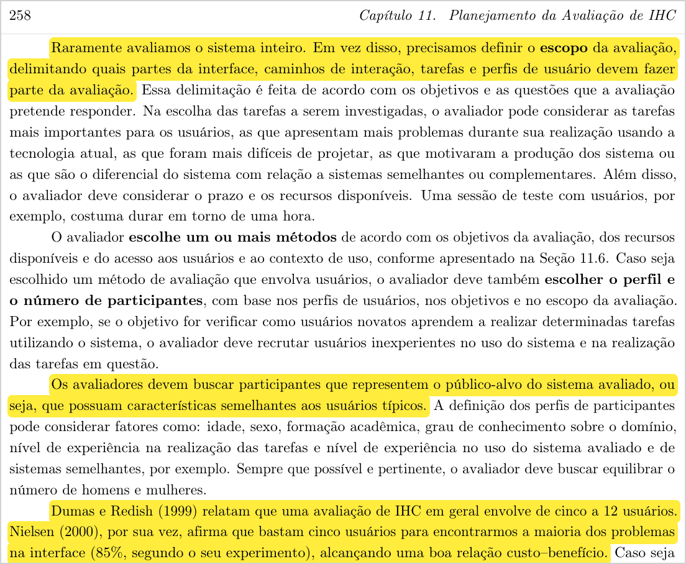

## Histórico de Versão e Contribuição

| Data | Versão | Descrição | Autor(es) | Revisor(es) | Declaração de Uso de IA |
| :---: | :---: | :--- | :--- | :--- | :--- |
| 02/11/2026 | `1.0` | Criação do planejamento individual da avaliação do Protótipo de Alta Fidelidade (TAR-02) via DECIDE, por meio de teste de usabilidade. | [Gabriel Cardone](https://github.com/gabriellcardone-06) | [Igor Dantas Araújo](https://github.com/IgorDARAUJO) | Claude (Anthropic) - usado para apoio na formatação markdown da página e correções ortográficas. |
| 15/11/2026 | `1.1` | Alteração do dispositivo do teste de computador para celular (Seções 4.1, 4.2 e 4.4). | [Gabriel Cardone](https://github.com/gabriellcardone-06) | — | Claude (Anthropic) - usado para apoio na edição do texto. |
| 19/11/2026 | `1.2` | Padronização da estrutura (histórico no topo, conteúdo, fotos de referência e referências ao final); declaração de IA levada para o histórico; inclusão de fotos de referência grifadas. Inclusão do bloco de artefatos relacionados (persona, cenário, análise de tarefas, storyboard, planejamentos, relatos e protótipos da funcionalidade). | [Gabriel Melo](https://github.com/gabriellcardone-06) | Pendente de revisão | Claude (Anthropic) — apoio na padronização da estrutura do artefato, na revisão das referências e na formatação em Markdown.; apoio na inclusão dos links entre artefatos |

!!! warning "Observação para correção manual"
    A justificativa do número de participantes citava Steve Krug, que não é referência do livro da disciplina. O trecho foi reescrito com base em Barbosa et al. (2021, pp. 258–259), que citam Nielsen (2000 apud BARBOSA et al., 2021) e Dumas e Redish (1999 apud BARBOSA et al., 2021). O autor deve revisar se a nova redação mantém o sentido pretendido.

!!! warning "Observação para correção manual"
    Faltam as telas e o link do protótipo de alta fidelidade da TAR-02 no Figma. O autor deve exportar as telas do Figma, incluí-las (com título e fonte) numa seção "Telas do Protótipo Avaliado" e adicionar o link de apresentação do protótipo.

---

# Planejamento da Avaliação do Protótipo de Alta Fidelidade (TAR-02)

Neste documento, apresenta-se o **Planejamento da Avaliação do Protótipo de Alta Fidelidade** referente à **[TAR-02 (Pré-agendamento no Programa DF Acessível)](../../../../analise-de-requisitos/analise-de-tarefas/tar-02-df-acessivel.md)**. Trata-se de um planejamento individual desenvolvido para orientar a avaliação do protótipo digital interativo construído no **Figma**, que representa, na versão para celular do site da **SEMOB-DF**, a funcionalidade proposta de pré-agendamento de viagens do Programa DF Acessível.

O protótipo de alta fidelidade dá continuidade ao protótipo de papel avaliado no nível anterior. Conforme o [Relato dos Resultados da Avaliação do Protótipo de Papel](../../../nivel2/relatos-individuais/gabriel/relato-resultado-prot-papel.md), o fluxo em três etapas foi concluído sem pedidos de ajuda e não exigiu alterações. Por isso, ele foi mantido e agora recebe o acabamento visual definido no [Guia de Estilo](../../../../analise-de-requisitos/guia-de-estilo/introducao.md) do projeto.

O planejamento foi estruturado aplicando o **Framework DECIDE** (Preece et al., 2002 *apud* Barbosa et al., 2021, Seção 11.8), que organiza o estudo em seis etapas: **D**eterminar objetivos, **E**xplorar perguntas, **C**hoose (Escolher) métodos, **I**dentificar questões práticas, **D**ecidir questões éticas e **E**valuate (Avaliar e interpretar dados).

**Artefatos relacionados — fluxo da funcionalidade TAR-02 (Pré-agendamento no Programa DF Acessível):**

* **Persona:** [Larissa Ferreira Lima](../../../../analise-de-requisitos/personas/larissa-ferreira-lima.md)
* **Cenário:** [Cenário 1](../../../../analise-de-requisitos/cenarios/cenario-1-pre-agendamento-df-acessivel.md)
* **Análise de tarefas:** [TAR-02](../../../../analise-de-requisitos/analise-de-tarefas/tar-02-df-acessivel.md)
* **Storyboard:** [Storyboard 02](../../../nivel1/storyboards.md#32-storyboard-02-pre-agendamento-no-programa-df-acessivel)
* **Nível 1 — avaliação do storyboard e da análise de tarefas:** [Planejamento da avaliação](../../../nivel1/planejamentos-individuais/Gabriel/gabriel-planejamento-avaliacao.md) · [Planejamento do relato](../../../nivel1/planejamentos-individuais/Gabriel/gabriel-planejamento-relato-resultados-avaliacao.md) · [Relato dos resultados](../../../nivel1/relatos-individuais/gabriel/relato-resultados-storyboard-tarefas.md)
* **Nível 2 — protótipo de papel (baixa fidelidade):** [Planejamento da avaliação](../../../nivel2/planejamentos-individuais/Gabriel/gabriel-planejamento-av-prototipo-papel.md) · [Planejamento do relato](../../../nivel2/planejamentos-individuais/Gabriel/gabriel-planejamento-relato-prot-papel.md) · [Relato dos resultados](../../../nivel2/relatos-individuais/gabriel/relato-resultado-prot-papel.md)
* **Nível 3 — protótipo de alta fidelidade:** Planejamento da avaliação (*esta página*) · [Planejamento do relato](planejamento-relato-prot-alta-fidel.md) · [Relato dos resultados](../../relatos-individuais/gabriel/relato-resultados-prot-alta-fidel.md)
* **Telas do protótipo de papel:** [telas no planejamento da avaliação](../../../nivel2/planejamentos-individuais/Gabriel/gabriel-planejamento-av-prototipo-papel.md#9-telas-do-prototipo-avaliado)
* **Protótipo de alta fidelidade navegável:** *não disponível — pendente de correção manual*

---

## 1. D — Determinar os Objetivos da Avaliação

Segundo Barbosa et al. (2021, p. 288), o teste de usabilidade avalia a usabilidade de um sistema interativo a partir de experiências de uso dos seus usuários-alvo, e os objetivos da avaliação determinam quais critérios de usabilidade devem ser medidos. Nesta etapa, a avaliação continua sendo **formativa**: seu propósito é encontrar problemas no design detalhado antes da implementação.

### 1.1 Objetivos Principais
* **Avaliar a eficácia e a eficiência das três etapas do fluxo:** Verificar se os participantes escolhem os postos de embarque e de desembarque, escolhem o dia e enviam o laudo e o comprovante de residência sem ajuda, medindo o tempo, os erros e os pedidos de ajuda em cada etapa.
* **Confirmar a compreensão dos rótulos com acabamento final:** Verificar se os termos validados no papel ("Posto de embarque", "Posto de desembarque", "Concluir pré-agendamento", entre outros) continuam claros com tipografia, cores e componentes definitivos.
* **Verificar a conformidade com o Guia de Estilo:** Avaliar se os componentes do Figma seguem os padrões do projeto, como rótulos que informam o efeito da ação, diferença visual entre elementos de seleção e de ação, e feedback depois de cada ação (Guia de Estilo, [Elementos de Ação](../../../../analise-de-requisitos/guia-de-estilo/elementos-de-acao.md), Seções 4.1 a 4.3).
* **Avaliar aspectos de acessibilidade relevantes para a persona:** Verificar a legibilidade dos textos, o contraste e o tamanho das áreas de toque para o público da persona [Larissa Ferreira Lima](../../../../analise-de-requisitos/personas/larissa-ferreira-lima.md), que tem mobilidade reduzida.
* **Subsidiar o refinamento final:** Coletar dados quantitativos e qualitativos para ajustar o protótipo no Figma.

### 1.2 Metas de Usabilidade

Barbosa et al. (2021, p. 289) explicam que o teste de usabilidade permite verificar se o sistema atingiu metas de usabilidade definidas previamente. Para esta avaliação, foram estabelecidas as seguintes metas:

<strong>Tabela 1</strong> — Metas de Usabilidade da Avaliação

| ID | Fator de Usabilidade | Meta |
| :---: | :--- | :--- |
| **M01** | Eficácia | Pelo menos **2 dos 3 participantes** concluem cada uma das três tarefas sem pedir ajuda. |
| **M02** | Eficiência | O fluxo completo (TAR-02.1 a TAR-02.3) é concluído em até **3 minutos** por participante. |
| **M03** | Erros | No máximo **1 erro** (toque em elemento errado ou volta de tela não intencional) por tarefa, em média. |
| **M04** | Satisfação | Nenhum participante classifica a experiência como difícil na entrevista pós-teste. |

<em>Fonte: Elaborado por Gabriel Cardone (2026).</em>

---

## 2. E — Explorar as Perguntas a Serem Respondidas

Para operacionalizar os objetivos, foram elaboradas perguntas investigativas respondidas pela observação das interações no Figma e pela entrevista pós-teste (Barbosa et al., 2021, p. 288–289). As perguntas Q01 e Q02 mantêm o mesmo foco da avaliação do protótipo de papel, o que permite comparar os resultados dos dois níveis.

<strong>Tabela 2</strong> — Roteiro de Perguntas Investigativas da Avaliação

| ID | Categoria / Foco | Pergunta de Investigação da Avaliação | Critério de Aceitação / Resposta Esperada |
| :---: | :--- | :--- | :--- |
| **Q01** | **Envio de Documentos** | O participante consegue enviar o laudo do profissional de saúde e o comprovante de residência e entende que cada documento foi enviado? | O participante envia os dois documentos sem pedir ajuda e reconhece a confirmação de envio de cada um. |
| **Q02** | **Interpretação de Rótulos** | Os termos da interface ("Pré-agendamento", "Posto de embarque", "Posto de desembarque", "Recursos de acessibilidade", "Concluir pré-agendamento") são compreensíveis? Com suas palavras, explique o que são cada um dos termmos. | O participante explica com suas palavras o que é o pré-agendamento, a diferença entre os postos e o que cada rótulo indica, sem pedir explicações. |
| **Q03** | **Conformidade com o Guia de Estilo** | Os botões de ação, os cartões de seleção de posto e o calendário são reconhecidos como elementos clicáveis e diferenciados entre si? | O participante distingue o que seleciona uma opção do que avança no fluxo, sem tocar em elementos não interativos. |
| **Q04** | **Acessibilidade e Legibilidade** | Os textos, o contraste das cores e o tamanho das áreas de toque são adequados para o participante? | O participante lê as informações sem aproximar a tela ou pedir ajuda e acerta os toques na primeira tentativa. |
| **Q05** | **Satisfação** | Como o participante avalia a facilidade de uso e o visual da funcionalidade? | O participante descreve a experiência como fácil ou muito fácil e diz que usaria a funcionalidade na vida real. |

<em>Fonte: Elaborado por Gabriel Cardone (2026).</em>

---

## 3. C — Choose (Escolher) os Métodos de Avaliação

O método selecionado é o **Teste de Usabilidade** (Barbosa et al., 2021, Seção 12.2.1), enquadrado como um **método de observação de uso (empírico)** com o protótipo interativo do Figma.

* **Justificativa:** Com o protótipo de alta fidelidade, a interface já tem aparência e comportamento próximos do produto final. Isso permite medir dados objetivos, como tempo, erros e taxa de sucesso, para cada tarefa e cada participante (Barbosa et al., 2021, p. 289), e compará-los com as metas da Tabela 1. A prototipação em papel, usada no nível anterior, é mais adequada a soluções de baixa e média fidelidade (Barbosa et al., 2021, p. 303).
* **Técnica Complementar:** Durante as tarefas, o participante será estimulado a **pensar em voz alta** (*think aloud*), verbalizando o que procura, o que espera que aconteça e suas dúvidas. Esses comentários ajudam a identificar a origem dos problemas observados (Barbosa et al., 2021, p. 289).
* **Entrevista Pós-teste:** Ao final das tarefas, será feita uma breve entrevista com as perguntas Q01 a Q05.

---

## 4. I — Identificar e Administrar as Questões Práticas

### 4.1 Protótipo no Figma
O protótipo será disponibilizado no modo de apresentação do Figma (*Prototype mode*), aberto diretamente no navegador de um celular, e reproduzirá as mesmas telas do protótipo de papel:

1. **Apresentação do pré-agendamento**, com a explicação do serviço, as etapas e o botão "Agendar transporte";
2. **Posto de embarque**, com um mapa mostrando todos os postos disponíveis e a localização atual do aparelho;
3. **Posto de desembarque**, com um mapa mostrando todos os postos disponíveis;
4. **Dia**, com o calendário do mês em áreas de toque amplas;
5. **Documentos**, com os campos "Laudo do profissional de saúde" e "Comprovante de residência", com um botão "Selecionar arquivo", dois campos para preenchimento de telefone e email e o botão "Continuar";
6. **Comprovante**, com a mensagem de confirmação e pedido para verificação de celular e email.

As telas seguirão a sequência de diálogo "Pré-agendar viagem no DF Acessível" do Guia de Estilo ([Vocabulário e Padrões](../../../../analise-de-requisitos/guia-de-estilo/vocabulario-e-padroes.md), Seção 4.3), com estados interativos para seleção de posto, marcação do dia e confirmação de envio de cada documento.

### 4.2 Definição dos Papéis da Equipe na Sessão

* **Avaliador Condutor (Gabriel Cardone):** Recebe o participante, apresenta o TCLE e o cenário, conduz a entrevista pós-teste e **ajuda somente se for solicitado** durante as tarefas.
* **Avaliador Observador (Gabriel Cardone)** Cronometra cada tarefa e registra na ficha de observação os erros, os pedidos de ajuda, as hesitações e os comentários do participante.
* **Participante:** Interage com o protótipo no celular, tocando na tela como faria no site real.

### 4.3 Recrutamento e Perfil dos Participantes
* **Quantidade:** **3 participantes**, conforme a justificativa da Seção 4.3.1, com base em Barbosa et al. (2021, pp. 258–259).
* **Perfil Prioritário:** Pessoas com mobilidade reduzida (temporária ou permanente) que usam ou já precisaram de transporte adaptado, representantes da persona [Larissa Ferreira Lima](../../../../analise-de-requisitos/personas/larissa-ferreira-lima.md).
* **Critério de Exclusão:** O participante do protótipo de papel não será convidado novamente, pois já conhece o fluxo.

#### 4.3.1 Justificativa do Número de Participantes

A literatura de usabilidade não tem consenso sobre quantos participantes um teste deve ter. Diante do **tempo escasso** do cronograma da disciplina, adotaram-se **3 participantes**, considerando as orientações de Barbosa et al. (2021, pp. 258–259): o número de participantes deve considerar os perfis, os objetivos e o escopo da avaliação, e o tempo e os recursos disponíveis podem inviabilizar amostras maiores. Os motivos são:

1. **Detecção da maioria dos problemas:** Com três ou quatro participantes, a maioria dos problemas de usabilidade já é detectada. Os problemas mais graves tendem a aparecer logo nos primeiros participantes.
2. **Análise no mesmo dia:** Um número reduzido de sessões permite que os resultados sejam analisados e consolidados no mesmo dia dos testes, o que é compatível com o prazo da entrega.
3. **Custo-benefício:** Nielsen (2000 apud BARBOSA et al., 2021) afirma que bastam cinco usuários para encontrar a maioria dos problemas, com boa relação custo–benefício. É mais útil fazer rodadas pequenas e frequentes do que um único teste grande.

### 4.4 Infraestrutura e Equipamentos
* **Local:** Ambiente reservado, tranquilo e acessível (sala na FCTE/UnB ou local de preferência do participante, para não exigir deslocamento de quem tem mobilidade reduzida).
* **Dispositivo:** Celular com o protótipo aberto no navegador, pelo link de apresentação do Figma.
* **Gravação:** Gravação da tela do celular e do participante interagindo com o celular.
* **Material de Apoio:** TCLE, folha com o cenário e as tarefas, ficha de observação e dois arquivos PDF fictícios (laudo e comprovante de residência, sem dados reais) disponíveis no seletor de arquivos simulado do protótipo.

### 4.5 Roteiro de Tarefas da Sessão
As tarefas serão apresentadas uma de cada vez, a partir do [Cenário 1](../../../../analise-de-requisitos/cenarios/cenario-1-pre-agendamento-df-acessivel.md): *"Você precisa de transporte adaptado para ir à fisioterapia, em Taguatinga, daqui a um mês. Você mora em Ceilândia e já abriu, no celular, a página 'Agendar DF Acessível' do site da SEMOB-DF. Faça o pré-agendamento da viagem."*

<strong>Tabela 3</strong> — Tarefas do Teste de Usabilidade

| ID Tarefa | Descrição da Tarefa | Operações Relacionadas (HTA/CTT) | Perguntas Investigadas | Metas |
| :---: | :--- | :--- | :--- | :--- |
| **TAR-02.1** | Escolher o posto de embarque perto de casa e o posto de desembarque perto da clínica. | HTA 1 (1.1 e 1.2) / CTT Ramo 1 (1.1 a 1.4) | Q02, Q03, Q04 | M01, M03 |
| **TAR-02.2** | Escolher o dia da viagem. | HTA 2 / CTT Ramo 2 (2.1 a 2.3) | Q03, Q04 | M01, M03 |
| **TAR-02.3** | Enviar o laudo e o comprovante de residência, adicionar telefone e email e concluir o pré-agendamento. | HTA 3 (3.1 a 3.3) / CTT 3.1 a 3.4 | Q01, Q02, Q03 | M01, M03 |

<em>Fonte: Elaborado por Gabriel Cardone (2026).</em>

### 4.6 Cronograma das Sessões

<strong>Tabela 4</strong> — Cronograma do Teste-Piloto e das Sessões

| Sessão | Participante | Perfil | Data e Horário | Duração Prevista |
| :---: | :--- | :--- | :---: | :---: |
| **Piloto** | Integrante do Grupo 05 | Participante simulado | 04/11/2026 às 14:00 | 10 min |
| **Sessão 1** | P1 | Perfil prioritário | 02/11/2026 às 20:00 | 5 min |
| **Sessão 2** | P2 | Perfil prioritário ou alternativo | 06/11/2026 às 14:30 | 5 min |
| **Sessão 3** | P3 | Perfil prioritário ou alternativo | 06/11/2026 às 15:00 | 5 min |

<em>Fonte: Elaborado por Gabriel Cardone (2026).</em>

---

## 5. D — Decidir como Lidar com as Questões Éticas

A condução do teste atende às diretrizes éticas do livro-texto (Barbosa et al., 2021, Seção 7.4):

1. **Assinatura do TCLE:** Antes de iniciar, o participante lerá e assinará o [Termo de Consentimento Livre e Esclarecido (TCLE)](../../../../assets/PDFs/TCLE_Pesquisa_Transporte.pdf), sendo informado sobre os objetivos acadêmicos da pesquisa.
2. **Autorização de Gravação:** A gravação da tela e do áudio só começa depois do aceite do participante.
3. **Anonimato:** Os participantes serão identificados apenas pelos códigos P1, P2 e P3  tanto no relato quanto na fala do avaliador durante a gravação.
4. **Cuidado com Informações de Saúde:** O participante não é obrigado a relatar diagnóstico ou condição de saúde. Qualquer informação desse tipo dita espontaneamente será tratada como dado sensível e registrada de forma anonimizada.
5. **Direito de Interrupção:** O participante pode interromper a sessão a qualquer momento, sem justificativa e sem prejuízo.
6. **Foco no Artefato:** Será reforçado que o objeto da avaliação é o protótipo, e não o participante.

---

## 6. E — Avaliar, Interpretar e Apresentar os Dados

Os dados serão analisados combinando abordagens quantitativas e qualitativas (Barbosa et al., 2021, p. 289):

1. **Análise Quantitativa:** Para cada participante e cada tarefa, serão registrados o sucesso sem ajuda, o tempo, a quantidade de erros e os pedidos de ajuda. Os resultados serão comparados com as metas da Tabela 1.
2. **Análise Qualitativa:** As gravações, os comentários feitos em voz alta e as anotações do observador serão analisados em conjunto para identificar a origem de cada problema na interface (Barbosa et al., 2021, p. 289).
3. **Classificação de Severidade:** Os problemas encontrados serão classificados na escala de severidade de Nielsen (1994 *apud* Barbosa et al., 2021, p. 270), considerando a frequência, o impacto e a persistência de cada um:
    * **0 — Não é problema:** os avaliadores concluem que não se trata de um problema de usabilidade.
    * **1 — Cosmético:** não precisa ser corrigido, a menos que haja tempo no cronograma.
    * **2 — Pequeno:** a correção pode receber baixa prioridade.
    * **3 — Grande:** importante de ser corrigido, com alta prioridade.
    * **4 — Catastrófico:** precisa ser corrigido antes do lançamento, pois impede o usuário de concluir a tarefa.
4. **Encaminhamento para o Relato:** Os resultados serão apresentados no *Relato dos Resultados da Avaliação do Protótipo de Alta Fidelidade*, conforme o [Planejamento do Relato](planejamento-relato-prot-alta-fidel.md).

---

## 7. Fotos de Referência

As Figuras 1 a 4 mostram os trechos que fundamentam este artefato, recortados e grifados em amarelo diretamente do livro da disciplina (BARBOSA et al., 2021).

<strong>Figura 1</strong> — 11.8 Framework DECIDE

<em>Fonte: BARBOSA et al. (2021, p. 264). Recorte e grifo: [Gabriel Melo](https://github.com/gabriellcardone-06) (2026).</em>

<strong>Figura 2</strong> — Representação de interface em alta fidelidade

<em>Fonte: BARBOSA et al. (2021, p. 210). Recorte e grifo: [Gabriel Melo](https://github.com/gabriellcardone-06) (2026).</em>

<strong>Figura 3</strong> — 12.2.1 Teste de usabilidade: objetivo, atividades e medidas por tarefa

<em>Fonte: BARBOSA et al. (2021, pp. 288–289). Recorte e grifo: [Gabriel Melo](https://github.com/gabriellcardone-06) (2026).</em>

<strong>Figura 4</strong> — 11.7.2 Escopo da avaliação, perfil e número de participantes

<em>Fonte: BARBOSA et al. (2021, p. 258). Recorte e grifo: [Gabriel Melo](https://github.com/gabriellcardone-06) (2026).</em>

---

## 8. Referências Bibliográficas

* BARBOSA, Simone Diniz Junqueira; SILVA, Bruno Santana da; SILVEIRA, Milene Selbach; GASPARINI, Isabela; DARIN, Ticianne; BARBOSA, Gabriel Diniz Junqueira. **Interação Humano-Computador e Experiência do Usuário**. 1. ed. Rio de Janeiro: Autopublicação, 2021. ISBN 978-65-00-19677-1. Cap. 7, Seção 7.4, p. 126–129; Cap. 11, p. 245–265; Cap. 12, Seções 12.1.1 e 12.2.1, p. 267–290.
* SALES, André Barros de. **Plano de Ensino: Interação Humano Computador**. Brasília: Universidade de Brasília, FCTE/UnB, 2026.
