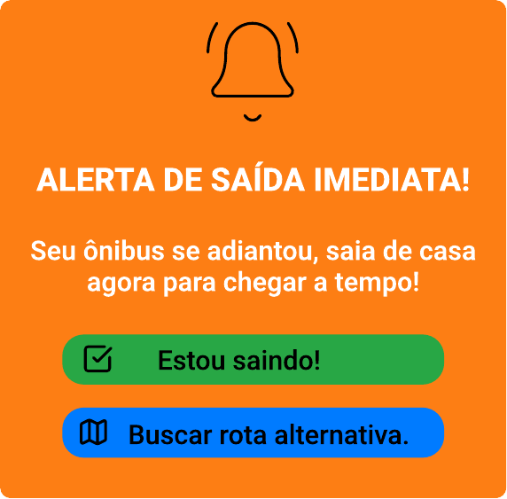
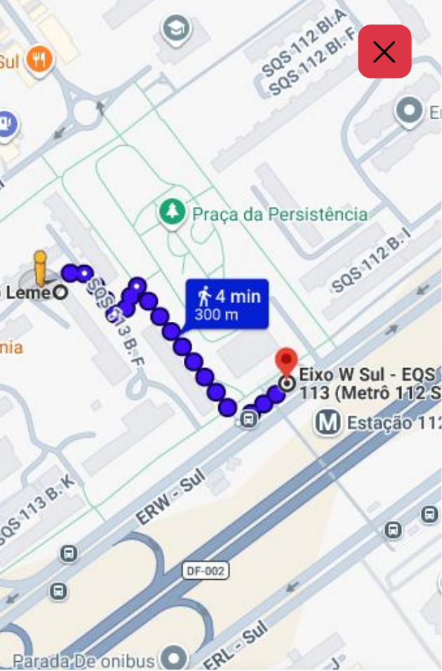
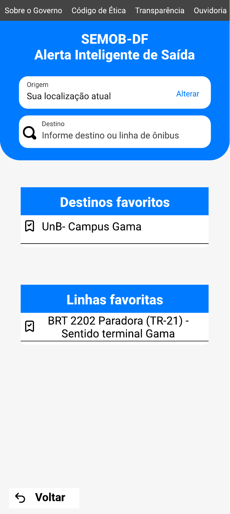
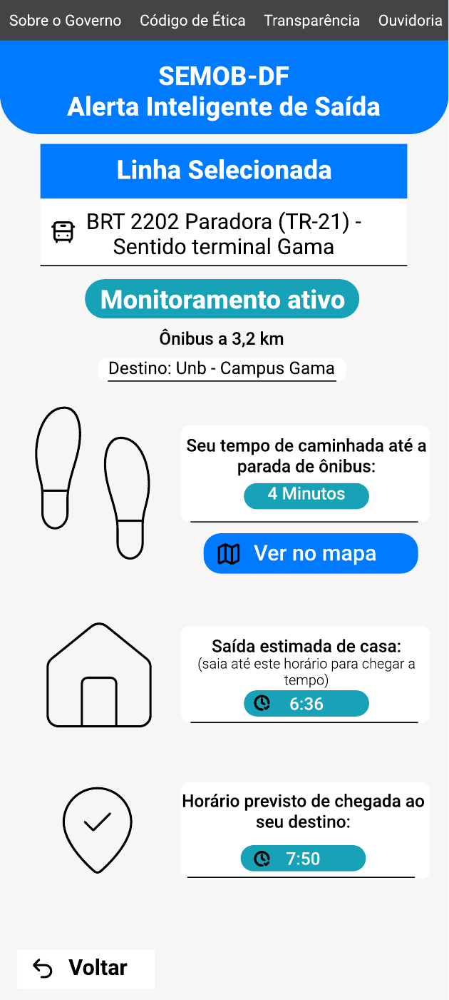
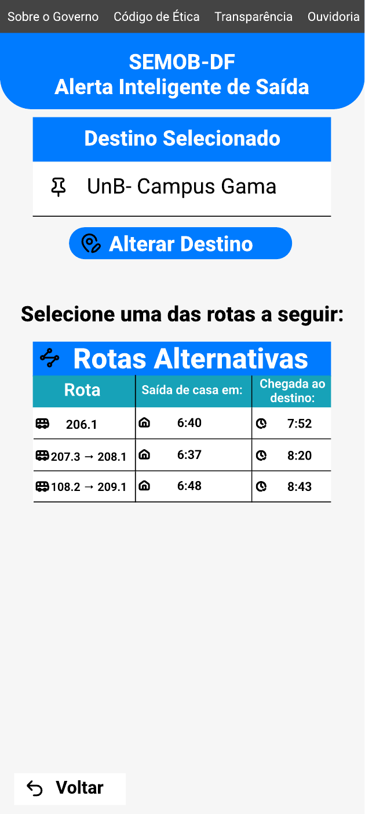
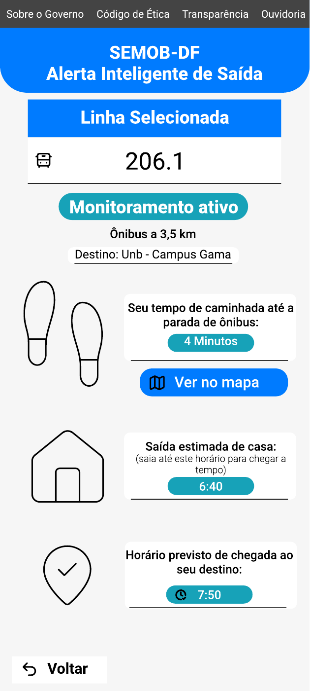
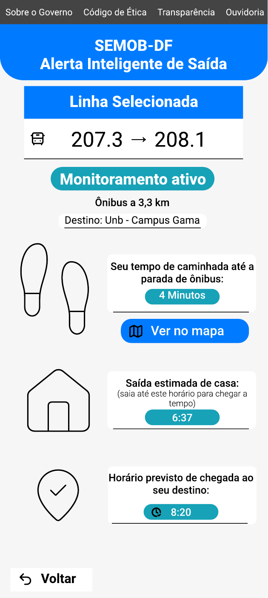
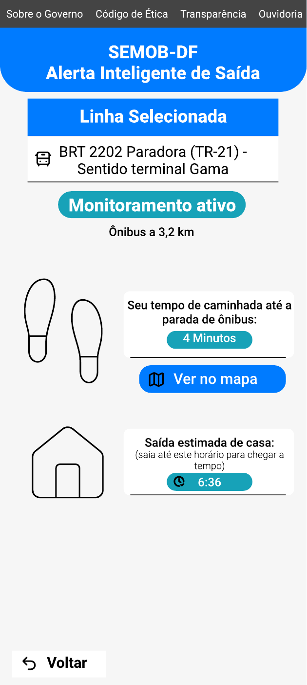

## Histórico de Versão e Contribuição

| Data | Versão | Descrição | Autor(es) | Revisor(es) | Declaração de Uso de IA |
| :---: | :---: | :--- | :--- | :--- | :--- |
| 01/11/2026 | `1.0` | Criação do planejamento individual do relato dos resultados da avaliação do Protótipo de Alta Fidelidade (Figma) da TAR-01. | [Igor Dantas Araújo](https://github.com/IgorDARAUJO) | [Gabriel Cardone](https://github.com/gabriellcardone-06) | Google Gemini - utilizado para auxílio na estruturação das tabelas em Markdown e revisão gramatical. |
| 19/11/2026 | `1.1` | Padronização da estrutura (histórico no topo, conteúdo, fotos de referência e referências ao final); declaração de IA levada para o histórico; autor e revisor retirados do rodapé; retirada das referências que não são o livro da disciplina nem material do professor; inclusão de fotos de referência grifadas. Inclusão das telas do protótipo avaliado, com links para o protótipo e para o artefato relacionado. Inclusão do bloco de artefatos relacionados (persona, cenário, análise de tarefas, storyboard, planejamentos, relatos e protótipos da funcionalidade). | [Gabriel Melo](https://github.com/gabriellcardone-06) | Pendente de revisão | Claude (Anthropic) — apoio na padronização da estrutura do artefato, na revisão das referências e na formatação em Markdown; apoio na inclusão das telas do protótipo.; apoio na inclusão dos links entre artefatos |

---

# Planejamento do Relato dos Resultados da Avaliação do Protótipo de Alta Fidelidade (TAR-01)

Neste documento, apresenta-se o **Planejamento do Relato dos Resultados da Avaliação do Protótipo de Alta Fidelidade** referente à **[TAR-01 (Alerta Inteligente de Saída de Casa)](https://interacao-humano-computador.github.io/2026.2-Grupo05/analise-de-requisitos/analise-de-tarefas/tar-01-alerta-saida/#tar-01-alerta-inteligente-de-saida)**. Trata-se de um planejamento individual desenvolvido para estruturar, padronizar e orientar a futura compilação, análise e apresentação dos dados quantitativos e qualitativos colhidos durante os testes de usabilidade realizados no **Figma**.

A estrutura do relato foi concebida com base nos preceitos da literatura de Interação Humano-Computador (Barbosa et al., 2021, Cap. 11, Seção 11.7.5 e Cap. 12, Seção 12.2.1), assegurando a rastreabilidade das evidências e a aplicação de melhorias no arquivo interativo do grupo.

**Artefatos relacionados — fluxo da funcionalidade TAR-01 (Alerta Inteligente de Saída de Casa):**

* **Persona:** [João Pedro Carvalho](../../../../analise-de-requisitos/personas/joao-pedro-carvalho.md)
* **Cenário:** [Cenário 2](../../../../analise-de-requisitos/cenarios/cenario-2-viagem-matutina.md)
* **Análise de tarefas:** [TAR-01](../../../../analise-de-requisitos/analise-de-tarefas/tar-01-alerta-saida.md)
* **Storyboard:** [Storyboard 01](../../../nivel1/storyboards.md#31-storyboard-01-alerta-inteligente-de-saida-de-casa)
* **Nível 1 — avaliação do storyboard e da análise de tarefas:** [Planejamento da avaliação](../../../nivel1/planejamentos-individuais/Igor/igor-planejamento-avaliacao.md) · [Planejamento do relato](../../../nivel1/planejamentos-individuais/Igor/igor-planejamento-relato-resultados-avaliacao.md) · [Relato dos resultados](../../../nivel1/relatos-individuais/igor/relato-resultados-storyboard-tarefas.md)
* **Nível 2 — protótipo de papel (baixa fidelidade):** [Planejamento da avaliação](../../../nivel2/planejamentos-individuais/Igor/igor-planejamento-av-prototipo-papel.md) · [Planejamento do relato](../../../nivel2/planejamentos-individuais/Igor/igor-planejamento-relato-prot-papel.md) · [Relato dos resultados](../../../nivel2/relatos-individuais/igor/relato-resultados-prot-papel.md)
* **Nível 3 — protótipo de alta fidelidade:** [Planejamento da avaliação](planejamento-av-prot-alta-fidel.md) · Planejamento do relato (*esta página*) · [Relato dos resultados](../../relatos-individuais/igor/relato-resultados-prot-alta-fidel.md)
* **Telas do protótipo de papel:** [telas no planejamento da avaliação](../../../nivel2/planejamentos-individuais/Igor/igor-planejamento-av-prototipo-papel.md#9-telas-do-prototipo-avaliado)
* **Protótipo de alta fidelidade navegável:** [acessar o protótipo](https://www.figma.com/proto/00YEuKWtN4N1rBzpC8V7Gd/prototipo-de-igor?node-id=0-1&t=S9Z2PNsKlHC3LlTt-1)

---

## 1. Objetivos do Relato dos Resultados

O documento final de relato dos resultados terá como finalidades principais:

1. **Sintetizar as métricas de usabilidade e desempenho:** Apresentar a taxa de conclusão das tarefas sem ajuda, o tempo médio de execução, a contagem de erros de clique fora da área interativa no Figma e o nível de satisfação dos **3 participantes recrutados** (conforme o planejamento da avaliação).
2. **Validar a conformidade com o Guia de Estilo do Grupo 05:** Avaliar em que medida o protótipo digital atendeu aos padrões estabelecidos pela equipe (alvos de toque *mobile-first*, botões com rótulos `[Verbo + Ação]`, contraste de cores e cálculo automático do tempo de caminhada via GPS).
3. **Mapear e classificar os problemas de IHC:** Registrar detalhadamente todas as falhas de comunicabilidade, hesitações e dificuldades observadas nas interações das telas digitais, atribuindo a cada problema um nível na escala de severidade de Nielsen (1994 apud BARBOSA et al., 2021).
4. **Guia de Reprojeto no Figma:** Fornecer recomendações concretas e acionáveis para orientar o refinamento final das telas e componentes interativos da aplicação da **SEMOB-DF / BRB Mobilidade**.

---

## 2. Estrutura Padronizada do Relatório Final

Em conformidade com a literatura de IHC (Barbosa et al., 2021, pp. 263, 289–290) e o Plano de Ensino da disciplina, o documento final de consolidação dos resultados observará rigorosamente a seguinte estrutura:

1. **Introdução e Objetivos da Avaliação:** Síntese do escopo avaliado na TAR-01 e das perguntas de pesquisa do Framework DECIDE.
2. **Metodologia Aplicada:** Descrição do método de Teste de Usabilidade no Figma e da técnica de *Think Aloud* (pensar em voz alta).
3. **Caracterização dos Participantes e Justificativa de Amostragem:** Apresentação da tabela de perfil dos **3 participantes recrutados**, acompanhada da justificativa do número de participantes (Barbosa et al., 2021, pp. 258–259).
4. **Sumário dos Dados Quantitativos de Desempenho:** Tabela consolidada, por sub-tarefa da TAR-01, do sucesso sem ajuda de cada participante, da taxa de conclusão, dos erros críticos observados e da avaliação geral do desempenho.
5. **Consolidação das Respostas da Entrevista Pós-Teste:** Compilação das respostas dadas às perguntas Q01 a Q06 do roteiro de avaliação.
6. **Tabela de Registro e Priorização de Problemas de IHC:** Tabela padronizada com a classificação de severidade (níveis 0 a 4) e impacto na experiência de uso.
7. **Avaliação de Conformidade com o Guia de Estilo:** Análise do cumprimento das diretrizes de design visual e comportamental do Grupo 05.
8. **Plano de Reprojeto e Ciclo de Iteração no Figma:** Recomendações de ajustes e lista de alterações aplicadas no arquivo do Figma.
9. **Conclusão:** Síntese das lições aprendidas e validação da funcionalidade.

---

## 3. Metodologia de Análise e Critérios de Severidade

A análise dos dados combinará **triangulação de dados quantitativos** (tempos e taxas de erro) e **análise qualitativa e interpretativa** das gravações de tela e áudio (*Think Aloud* e respostas da entrevista).

Para classificar o impacto dos problemas de usabilidade encontrados no Figma, adotar-se-á a **Escala de Severidade de Problemas** de Nielsen (1994 apud BARBOSA et al., 2021) e Barbosa et al. (2021, p. 270):

<strong>Tabela 1</strong> — Escala de Severidade de Problemas de Usabilidade

| Nível de Severidade | Classificação | Descrição do Impacto na Interação no Figma |
| :---: | :--- | :--- |
| **0** | **Sem Importância** | Não afeta a execução da tarefa; comentário opcional ou sugestão estética pontual. |
| **1** | **Leve** | Causa pequena hesitação visual, mas o participante conclui a tarefa sozinho e sem atraso significativo. |
| **2** | **Moderado** | Provoca incerteza ou clique em componente incorreto, reduzindo a eficiência sem bloquear o fluxo. |
| **3** | **Grave** | Dificulta bastante a realização da tarefa, exigindo elevado esforço para a recuperação do caminho. |
| **4** | **Catastrófico** | Impede totalmente o participante de concluir a tarefa no protótipo interativo (bloqueio do fluxo). |

<em>Fonte: Adaptado de Nielsen (1994 apud BARBOSA et al., 2021) e Barbosa et al. (2021).</em>

---

## 4. Modelos de Tabelas para Consolidação dos Resultados

Para garantir a padronização e o rigor da entrega, o relatório final utilizará os seguintes modelos de tabelas:

---

### 4.1 Modelo de Tabela 1: Consolidação das Respostas da Entrevista Pós-Teste

<strong>Tabela 2</strong> — Respostas Consolidadas da Entrevista Pós-Teste (DECIDE)

| ID | Tópico Avaliado | Pergunta Aplicada aos 3 Participantes | Resumo Qualitativo das Respostas | Avaliação da Interface |
| :---: | :--- | :--- | :--- | :---: |
| **Q01** | Conformidade Visual | *"Os botões e rótulos pareceram claros e fáceis de identificar no celular?"* | *[Síntese do feedback dos 3 participantes]* | **[Conforme / Ajustar]** |
| **Q02** | Busca Flexível | *"A busca por nome ou número da linha funcionou de forma intuitiva?"* | *[Síntese do feedback dos 3 participantes]* | **[Conforme / Ajustar]** |
| **Q03** | Automação GPS | *"Como você avalia o fato de o sistema calcular a caminhada sozinho?"* | *[Síntese do feedback dos 3 participantes]* | **[Conforme / Ajustar]** |
| **Q04** | Alerta Proativo | *"A notificação de saída imediata deixou claro o que você devia fazer?"* | *[Síntese do feedback dos 3 participantes]* | **[Conforme / Ajustar]** |
| **Q05** | Rota Alternativa | *"A opção de sugerir rota alternativa em 1 toque pareceu útil?"* | *[Síntese do feedback dos 3 participantes]* | **[Conforme / Ajustar]** |
| **Q06** | Satisfação Geral | *"Como você avalia o visual e a facilidade de uso geral do app no Figma?"* | *[Síntese do feedback dos 3 participantes]* | **[Positivo / Neutro / Negativo]** |

<em>Fonte: Elaborado por Igor Dantas Araújo (2026).</em>

---

### 4.2 Modelo de Tabela 2: Registro e Priorização de Problemas de IHC

<strong>Tabela 3</strong> — Tabela de Registro e Priorização de Problemas de Usabilidade

| ID Problema | Descrição da Dificuldade / Erro Observado | Tela / Componente Afetado no Figma | Severidade (0 a 4) | Fatores de Usabilidade Prejudicados | Recomendação de Reprojeto / Ação no Figma |
| :---: | :--- | :--- | :---: | :--- | :--- |
| **PROB-F01** | *[Descrição do erro ou dúvida de clique]* | *[Ex.: Tela de Busca / Dropdown]* | **[0 a 4]** | *[Ex.: Visibilidade, Clareza]* | *[Ação corretiva a ser realizada no Figma]* |
| **PROB-F02** | *[Descrição do erro ou dúvida de clique]* | *[Ex.: Card de Notificação]* | **[0 a 4]** | *[Ex.: Feedback visual]* | *[Ação corretiva a ser realizada no Figma]* |

<em>Fonte: Elaborado por Igor Dantas Araújo (2026).</em>

---

### 4.3 Modelo de Tabela 3: Avaliação de Conformidade com o Guia de Estilo do Grupo 05

<strong>Tabela 4</strong> — Verificação de Conformidade com o Guia de Estilo do Grupo 05

| Diretriz do Guia de Estilo | Padrão Esperado no Figma | Resultado nos Testes com os 3 Usuários | Status de Conformidade |
| :--- | :--- | :--- | :---: |
| **Padrão de Rótulos** | Botões com sintaxe `[Verbo + Ação]` (ex.: `[ 🔔 Ativar alerta ]`). | Participantes identificaram a ação imediata do botão sem dúvida. | **[Conforme / Ajustar]** |
| **Alvos de Toque** | Botões e áreas clicáveis largas (mínimo 44x44 dp para mobile). | Nenhum erro de clique fora do componente interativo foi registrado. | **[Conforme / Ajustar]** |
| **Automação GPS** | Exibição do card com cálculo de caminhada automático sem digitação. | Usuários aprovaram a redução de esforço cognitivo ao usar o app. | **[Conforme / Ajustar]** |
| **Contraste e Cores** | Paleta com contraste adequado e ícones auxiliares de apoio. | Nenhuma reclamação de legibilidade ou fadiga visual foi relatada. | **[Conforme / Ajustar]** |

<em>Fonte: Elaborado por Igor Dantas Araújo (2026).</em>

---

## 5. Planejamento do Reprojeto e Ciclo de Iteração no Figma

Com base na consolidação dos problemas na Tabela 5, os resultados serão processados através de um ciclo de refinamento iterativo no **Figma** (Barbosa et al., 2021, Cap. 6):

1. **Ajustes Prioritários (Severidade 3 e 4):** Falhas que bloqueiem a execução da tarefa ou gerem rupturas de navegabilidade serão corrigidas imediatamente no arquivo do Figma do grupo.
2. **Refinamentos Visuais e Estéticos (Severidade 1 e 2):** Ajustes finos de espaçamento, alinhamento de texto e transições de tela serão aplicados no componente correspondente do sistema de design.
3. **Registro da Versão Final:** Todas as modificações aprovadas serão documentadas no histórico de versão do arquivo do Figma e divulgadas no site do projeto.

## 6. Telas do Protótipo Avaliado

As Figuras 1 a 9 mostram as telas do protótipo de alta fidelidade da [TAR-01](../../../../analise-de-requisitos/analise-de-tarefas/tar-01-alerta-saida.md), também apresentadas no [relato dos resultados da avaliação](../../../nivel3/relatos-individuais/igor/relato-resultados-prot-alta-fidel.md).

* **Protótipo interativo no Figma:** [Acessar o protótipo no Figma](https://www.figma.com/proto/00YEuKWtN4N1rBzpC8V7Gd/prototipo-de-igor?node-id=0-1&t=S9Z2PNsKlHC3LlTt-1)
* **Telas do protótipo (PDF):** [Visualizar PDF das telas do protótipo](../../../../assets/PDFs/Igor_telas_prototipo_alta_fidel.pdf)

<strong>Figura 1</strong> — Alerta de saída imediata, com as opções "Estou saindo!" e "Buscar rota alternativa" (página 1 do PDF das telas)

{ width="320" }

<em>Fonte: Elaborado por Igor Dantas Araújo (2026). Telas extraídas do [PDF das telas do protótipo](../../../../assets/PDFs/Igor_telas_prototipo_alta_fidel.pdf).</em>

<strong>Figura 2</strong> — Mapa do trajeto a pé até a parada (página 2 do PDF das telas)

{ width="320" }

<em>Fonte: Elaborado por Igor Dantas Araújo (2026). Telas extraídas do [PDF das telas do protótipo](../../../../assets/PDFs/Igor_telas_prototipo_alta_fidel.pdf).</em>

<strong>Figura 3</strong> — Tela inicial com origem, destino, destinos favoritos e linhas favoritas (página 3 do PDF das telas)

{ width="320" }

<em>Fonte: Elaborado por Igor Dantas Araújo (2026). Telas extraídas do [PDF das telas do protótipo](../../../../assets/PDFs/Igor_telas_prototipo_alta_fidel.pdf).</em>

<strong>Figura 4</strong> — Monitoramento ativo da linha BRT 2202 (TR-21) (página 4 do PDF das telas)

{ width="320" }

<em>Fonte: Elaborado por Igor Dantas Araújo (2026). Telas extraídas do [PDF das telas do protótipo](../../../../assets/PDFs/Igor_telas_prototipo_alta_fidel.pdf).</em>

<strong>Figura 5</strong> — Rotas alternativas para o destino UnB – Campus Gama (página 5 do PDF das telas)

{ width="320" }

<em>Fonte: Elaborado por Igor Dantas Araújo (2026). Telas extraídas do [PDF das telas do protótipo](../../../../assets/PDFs/Igor_telas_prototipo_alta_fidel.pdf).</em>

<strong>Figura 6</strong> — Monitoramento ativo da rota 206.1 (página 6 do PDF das telas)

{ width="320" }

<em>Fonte: Elaborado por Igor Dantas Araújo (2026). Telas extraídas do [PDF das telas do protótipo](../../../../assets/PDFs/Igor_telas_prototipo_alta_fidel.pdf).</em>

<strong>Figura 7</strong> — Monitoramento ativo da rota 207.3 → 208.1 (página 7 do PDF das telas)

{ width="320" }

<em>Fonte: Elaborado por Igor Dantas Araújo (2026). Telas extraídas do [PDF das telas do protótipo](../../../../assets/PDFs/Igor_telas_prototipo_alta_fidel.pdf).</em>

<strong>Figura 8</strong> — Monitoramento ativo da rota 108.2 → 209.1 (página 8 do PDF das telas)

{ width="320" }

<em>Fonte: Elaborado por Igor Dantas Araújo (2026). Telas extraídas do [PDF das telas do protótipo](../../../../assets/PDFs/Igor_telas_prototipo_alta_fidel.pdf).</em>

<strong>Figura 9</strong> — Monitoramento ativo da linha BRT 2202 (TR-21) (página 9 do PDF das telas)

{ width="320" }

<em>Fonte: Elaborado por Igor Dantas Araújo (2026). Telas extraídas do [PDF das telas do protótipo](../../../../assets/PDFs/Igor_telas_prototipo_alta_fidel.pdf).</em>

---
---

## 7. Fotos de Referência
As Figuras 10 a 11 mostram os trechos que fundamentam este artefato, recortados e grifados em amarelo diretamente do livro da disciplina (BARBOSA et al., 2021).

<strong>Figura 10</strong> — 11.7.5 Consolidação e relato dos resultados

<em>Fonte: BARBOSA et al. (2021, p. 263). Recorte e grifo: [Gabriel Melo](https://github.com/gabriellcardone-06) (2026).</em>

<strong>Figura 11</strong> — 12.2.1 Teste de usabilidade: objetivo, atividades e medidas por tarefa

<em>Fonte: BARBOSA et al. (2021, pp. 288–289). Recorte e grifo: [Gabriel Melo](https://github.com/gabriellcardone-06) (2026).</em>

---

## 8. Referências Bibliográficas
* BARBOSA, Simone Diniz Junqueira; SILVA, Bruno Santana da; SILVEIRA, Milene Selbach; GASPARINI, Isabela; DARIN, Ticianne; BARBOSA, Gabriel Diniz Junqueira. **Interação Humano-Computador e Experiência do Usuário**. Rio de Janeiro: Autopublicação, 2021. ISBN 978-65-00-19677-1. (Capítulo 11, p. 245–266; Capítulo 12, Seção 12.2.1, p. 288–291).
* SALES, André Barros de. **Plano de Ensino: Interação Humano Computador**. Brasília: Universidade de Brasília, Faculdade UnB Gama (FCTE/UnB), 2026.
