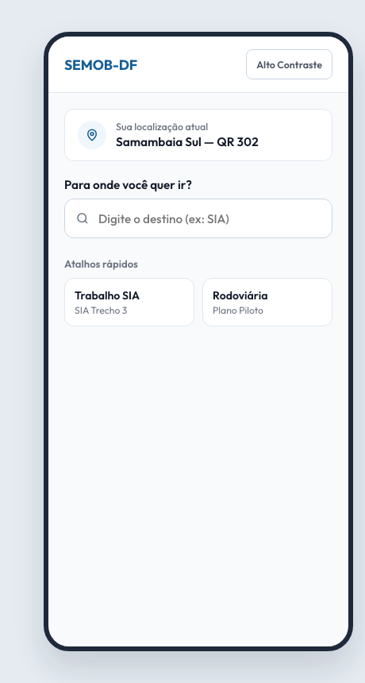
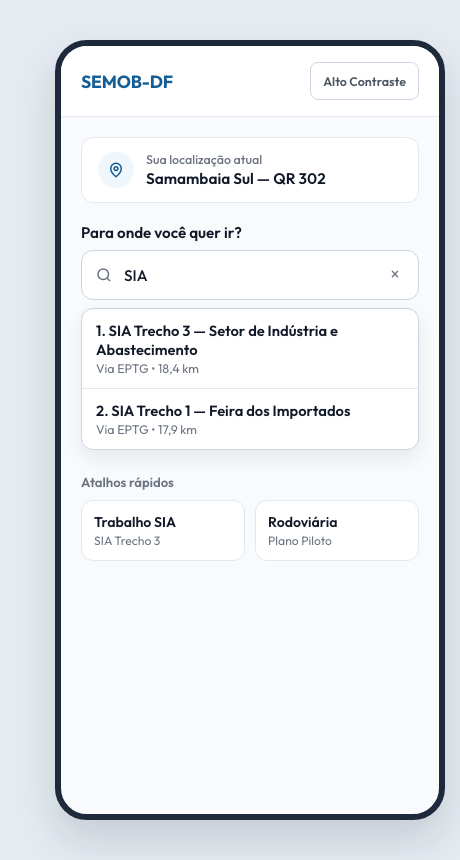
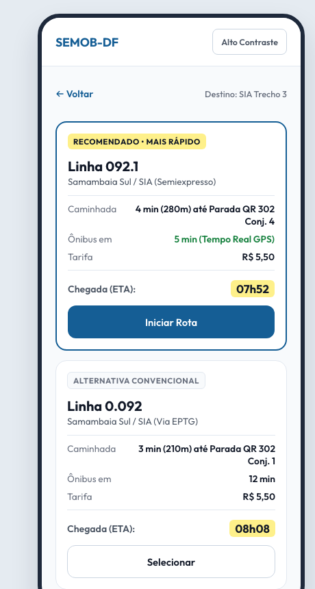
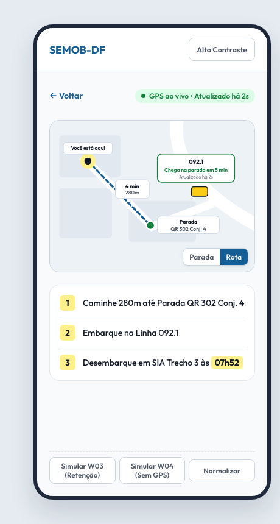
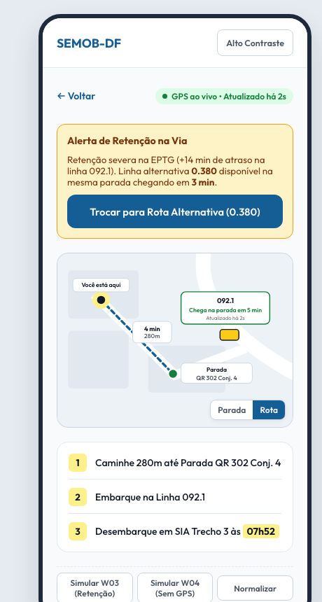
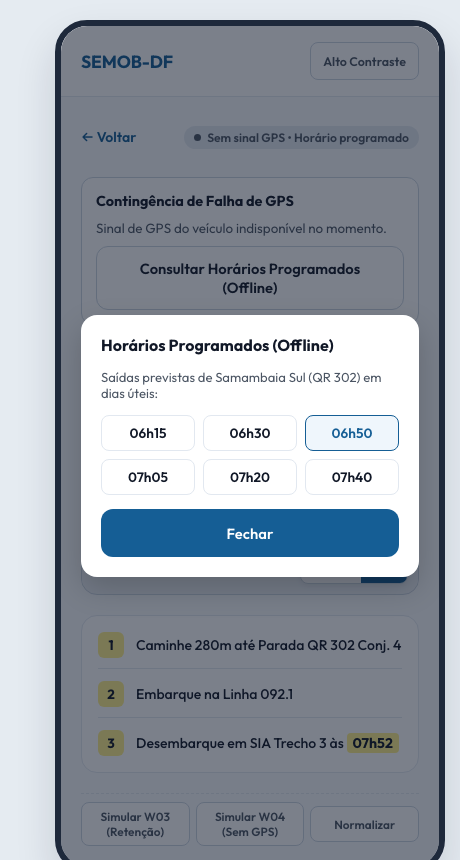
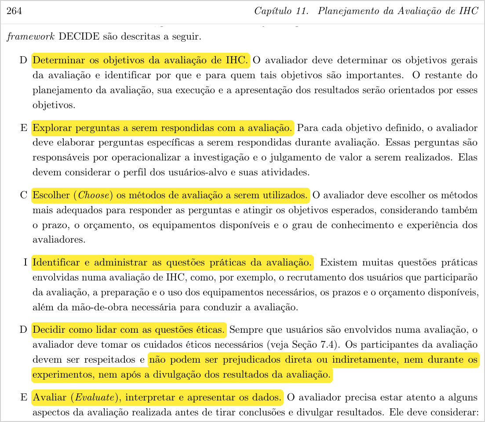

## Histórico de Versão e Contribuição

| Data | Versão | Descrição | Autor(es) | Revisor(es) | Declaração de Uso de IA |
| :---: | :---: | :--- | :--- | :--- | :--- |
| 01/11/2026 | `1.0` | Criação do planejamento individual da avaliação do Protótipo de Alta Fidelidade (TAR-03) via framework DECIDE, com amostragem fundamentada na teoria de Steve Krug e referências do livro-texto. | [Lucas Araújo Lima](https://github.com/Lucasaraujoszz) | [Arthur Mariani](https://github.com/arthur-mariani) | Google Gemini: utilizado apenas para formatação em Markdown |
| 10/11/2026 | `1.1` | Transição da plataforma de prototipação de alta fidelidade do Figma para protótipo em código navegável (HTML5, CSS3 e JavaScript), atualização do protocolo técnico de execução e adição de justificativa metodológica. | [Lucas Araújo Lima](https://github.com/Lucasaraujoszz) | [Arthur Mariani](https://github.com/arthur-mariani) | Google Gemini: utilizado apenas para formatação em Markdown |

---

# Planejamento da Avaliação do Protótipo de Alta Fidelidade (TAR-03)

Neste documento, apresenta-se o **Planejamento da Avaliação do Protótipo de Alta Fidelidade** referente à **[TAR-03: Planejamento de Rota Completa (Porta a Porta) por Destino com Indicação de Paradas e Previsão de Chegada](https://interacao-humano-computador.github.io/2026.2-Grupo05/analise-de-requisitos/analise-de-tarefas/tar-03-planejamento-rota/#tar-03-planejamento-de-rota-completa-porta-a-porta-por-destino-com-indicacao-de-paradas-e-previsao-de-chegada)**. Trata-se do planejamento individual elaborado por Lucas Araújo Lima para orientar a avaliação formativa e empírica do protótipo digital interativo de alta fidelidade construído em **HTML navegável** (utilizando a stack web padrão: **HTML5, CSS3 e JavaScript**), representando a proposta de redesign da interface móvel da **SEMOB-DF / DF no Ponto**.

O protótipo de alta fidelidade incorpora os aprendizados colhidos na avaliação anterior em papel (Nível 2) e observa estritamente o **[Guia de Estilo](../../../../analise-de-requisitos/guia-de-estilo/introducao.md)** estabelecido pelo Grupo 05 (paleta cromática com contraste WCAG AA, tipografia legível, alvos de toque *mobile-first* de no mínimo 48×48 px, botões padronizados na sintaxe `[Verbo + Ação]` e automação do cálculo de caminhada e telemetria via GPS). A avaliação será conduzida com usuários reais seguindo o **Framework DECIDE** (Barbosa et al., 2021, Seção 11.8, pp. 264–265), estruturado nas seis atividades interdependentes: **D**eterminar objetivos, **E**xplorar perguntas, **C**hoose (Escolher) métodos, **I**dentificar questões práticas, **D**ecidir questões éticas e **E**valuate (Avaliar, interpretar e apresentar dados).

**Artefatos relacionados — fluxo da funcionalidade TAR-03 (Planejamento de Rota por Origem e Destino):**

* **Persona:** [Marcos Paulo Vieira](../../../../analise-de-requisitos/personas/marcos-paulo-vieira.md)
* **Cenário:** [Cenário 3](../../../../analise-de-requisitos/cenarios/cenario-3-planejamento-origem-destino.md)
* **Análise de tarefas:** [TAR-03](../../../../analise-de-requisitos/analise-de-tarefas/tar-03-planejamento-rota.md)
* **Storyboard:** [Storyboard 03](../../../nivel1/storyboards.md#33-storyboard-03-planejamento-de-rota-por-origem-e-destino-com-monitoramento-em-tempo-real)
* **Nível 1: avaliação do storyboard e da análise de tarefas:** Planejamento da avaliação (*não realizado*) · Planejamento do relato (*não realizado*) · [Relato dos resultados](../../../nivel1/relatos-individuais/lucas/relato-resultados-storyboard-tarefas.md) · [Planejamento individual de tarefas](../../../nivel1/planejamentos-individuais/Lucas/planejamento-individual-lucas.md) · [Questões práticas e éticas](../../../nivel1/planejamentos-individuais/Lucas/questoes-praticas-e-eticas.md)
* **Nível 2: protótipo de papel (baixa fidelidade):** [Planejamento da avaliação](../../../nivel2/planejamentos-individuais/Lucas/lucas-planejamento-av-prototipo-papel.md) · [Planejamento do relato](../../../nivel2/planejamentos-individuais/Lucas/lucas-planejamento-relato-prot-papel.md) · [Relato dos resultados](../../../nivel2/relatos-individuais/lucas/relato-resultados-prot-papel.md)
* **Nível 3: protótipo de alta fidelidade:** Planejamento da avaliação (*esta página*) · [Planejamento do relato](planejamento-relato-prot-alta-fidel.md) · [Relato dos resultados](../../relatos-individuais/lucas/relato-resultados-prot-alta-fidel.md)
* **Telas do protótipo de papel:** [telas no planejamento da avaliação](../../../nivel2/planejamentos-individuais/Lucas/lucas-planejamento-av-prototipo-papel.md#9-telas-do-prototipo-avaliado)
* **Protótipo de alta fidelidade navegável:** [acessar o protótipo](../../../../prototipos/tar-03/index.html)

---

## 1. D: Determinar os Objetivos da Avaliação

De acordo com Mayhew (1999 apud BARBOSA et al., 2021) e Barbosa et al. (2021), a avaliação do protótipo de alta fidelidade situa-se no Nível 3 do ciclo de vida da Engenharia de Usabilidade. Seu propósito central é inspecionar e validar empiricamente o projeto detalhado de telas interativas em condições visuais, estéticas e funcionais próximas ao software final antes da implementação definitiva em produção.

### 1.1 Objetivos Principais e Específicos
1. **Verificar a conformidade com o Guia de Estilo do Grupo 05:** Avaliar se a aplicação das cores institucionais, hierarquia tipográfica, espaçamento de *cards*, ícones semióticos e botões de ação no padrão `[Verbo + Ação]` (ex.: `[ 🧭 Iniciar Rota ]`, `[ 🗺️ Trocar para Rota Alternativa ]`) proporcionam reconhecimento imediato e previnem erros de toque no smartphone.
2. **Validar a usabilidade e a eficiência do fluxo completo da TAR-03 no protótipo navegável:** Medir o desempenho dos usuários ao planejar o deslocamento porta a porta (*Samambaia Sul → SIA Trecho 3*) a partir da busca direta na Home com detecção automática de origem via GPS, verificando se a meta preditiva do modelo KLM (redução de esforço e tempo) se confirma na interação real.
3. **Avaliar a clareza comparativa dos cartões de rota e indicação da melhor parada:** Investigar se a distinção visual na interface entre a linha semiexpressa recomendada (`092.1`) e a linha convencional (`0.092`) — exibindo tempo de caminhada até a parada recomendada, tempo de chegada do veículo via GPS, tarifa e horário final de chegada (ETA) — apoia a tomada de decisão rápida sem sobrecarga cognitiva.
4. **Inspecionar a comunicabilidade do mapa interativo e dos mecanismos de contingência:** Verificar se o usuário compreende no protótipo digital o trajeto tracejado a pé até a parada, o deslocamento em tempo real do ônibus com selo de atualização (*"Atualizado há 10s"*), o banner proativo de retenção viária na EPTG com troca de rota em 1 toque e a distinção visual por cores entre **previsão GPS ao vivo** (verde) e **horário programado *offline*** (cinza).
5. **Coletar métricas quantitativas e qualitativas para o produto final:** Subsidiar ajustes finos de microinterações, *modais* e transições diretamente no código-fonte do protótipo em HTML antes da entrega final do projeto.

---

## 2. E: Explorar as Perguntas a Serem Respondidas

Para operacionalizar os objetivos traçados, foram formuladas seis perguntas investigativas que serão respondidas por meio da observação direta da interação no protótipo HTML e da entrevista pós-teste (Barbosa et al., 2021):

<strong>Tabela 1</strong>: Perguntas Investigativas para Avaliação do Protótipo de Alta Fidelidade (TAR-03)

| ID | Categoria / Foco | Pergunta Investigativa da Avaliação | Critério de Aceitação / Resposta Esperada no Protótipo HTML |
| :---: | :--- | :--- | :--- |
| **QF01** | **Conformidade com o Guia de Estilo e Home** | Na tela inicial do protótipo em HTML, o participante reconhece imediatamente o card de localização atual via GPS e aciona a barra *"Para onde você quer ir?"* sem hesitação visual? | O participante clica/toca no campo de busca de destino em menos de 5 segundos e seleciona *"SIA Trecho 3"* no menu de autocompletar na primeira tentativa. |
| **QF02** | **Comparação de Rotas e Escolha da Parada** | A hierarquia visual dos cartões de rota no protótipo (selo *"Mais Rápida"*, tempo a pé em destaque, linha e ETA final) permite identificar qual opção garante chegada ao SIA antes das 08h00? | O participante compara os cards `092.1` (ETA `07h52`) e `0.092` (ETA `08h08`), verbaliza a escolha da linha `092.1` e clica em `[ 🧭 Iniciar Rota ]` sem erros. |
| **QF03** | **Rastreamento Ao Vivo e Caminhada no Mapa** | Na tela do mapa interativo de alta fidelidade, o participante distingue com clareza o percurso tracejado a pé (`4 min / 280m` até a *Parada QR 302 Conj. 4*) e a posição em tempo real do ônibus? | O participante identifica corretamente para qual parada deve caminhar e reconhece o indicador de telemetria ativa (*"GPS ao vivo • Chega em 5 min"*). |
| **QF04** | **Alerta de Retenção e Rota Alternativa em 1 Toque** | Ao surgir o componente de alerta de retenção severa na EPTG (`+14 min`), o participante compreende o impacto no seu horário e aciona o botão `[ 🗺️ Trocar para Linha 0.380 Agora ]`? | O participante lê a notificação de incidente e realiza a troca de rota em 1 clique/toque, sem precisar retornar à tela inicial para refazer a busca. |
| **QF05** | **Contingência de Falha de GPS (Cores e Status)** | Diante do estado simulado de perda de sinal de satélite do veículo, o participante percebe a mudança cromática (de verde ao vivo para cinza programado) e consulta a grade horária *offline*? | O participante compreende que o rastreamento em tempo real caiu e aciona `[ 🕒 Ver Horários Programados (Offline) ]` com segurança. |
| **QF06** | **Satisfação Estética e Qualidade de Uso** | Como o participante avalia o acabamento visual, o contraste de cores, a legibilidade e a fluidez das transições do protótipo em HTML em comparação ao sistema atual da SEMOB-DF? | O participante atribui avaliação positiva de satisfação subjetiva, destacando a interface como moderna, confiável e superior ao portal atual. |

<em>Fonte: Elaborado por Lucas Araújo Lima (2026).</em>

---

## 3. C: Choose (Escolher) os Métodos de Avaliação

O método selecionado para esta etapa é o **Teste de Usabilidade (Observação de Uso Empírica em Ambiente Controlado)** utilizando o protótipo interativo de alta fidelidade em **código navegável (HTML5, CSS3 e JavaScript)** (Barbosa et al., 2021, Seção 12.2.1, pp. 288–291; Barbosa et al., 2021, Seção 12.2.1).

* **Justificativa Metodológica:** Conforme a Tabela 12.10 de Barbosa et al. (2021), o teste de usabilidade possui adequação máxima (`+++`) para avaliar a **apropriação de tecnologia** e identificar **problemas de IHC** em protótipos interativos de alta fidelidade. A execução direta em navegador web móvel/desktop proporciona realismo operacional superior: permite campos de texto reais com digitação e autocompletar dinâmico, renderização responsiva fiel ao motor de renderização do smartphone, temporizadores de telemetria reais via JavaScript e navegação sem falsos cliques ou limitações de ferramentas de design. Isso viabiliza a coleta rigorosa de tempo de tarefa, identificação de erros de navegação e avaliação precisa de satisfação do usuário.
* **Técnicas Complementares Combinadas:**
  1. **Protocolo *Think Aloud* (Pensar em Voz Alta):** Durante a navegação pelas telas e componentes do protótipo em HTML, o participante será estimulado a verbalizar continuamente seu raciocínio, expectativas e eventuais dúvidas antes de cada toque/clique (Barbosa et al., 2021).
  2. **Entrevista Pós-Teste Semiestruturada:** Ao final da execução das tarefas no protótipo, o avaliador aplicará as perguntas investigativas (`QF01` a `QF06`) para captar a percepção qualitativa sobre o design visual e a utilidade prática da solução.

---

## 4. I: Identificar e Administrar as Questões Práticas

### 4.1 Planejamento do Recrutamento dos Entrevistados: Fundamentação em Steve Krug e justificativa do número de participantes

O dimensionamento da amostra combina as orientações de Barbosa et al. (2021, pp. 258–259) sobre perfil, escopo e recursos com a proposta de testes pequenos e recorrentes de Steve Krug. Krug (2000, cap. 9) recomenda três ou quatro participantes por rodada para identificar os principais problemas e permitir a correção do produto antes de uma nova rodada. Assim, três participantes correspondem ao limite inferior dessa recomendação e são compatíveis com o prazo da disciplina:

* **Quantidade de Participantes:** Serão recrutados **3 participantes** pertencentes ao perfil primário de passageiros do transporte público coletivo do Distrito Federal.
* **Fundamentação Teórica (Barbosa et al., 2021, pp. 258–259):** o perfil e o número de participantes são escolhidos com base nos perfis de usuários, nos objetivos e no escopo da avaliação. Nielsen (2000 apud BARBOSA et al., 2021) afirma que bastam cinco usuários para encontrar a maioria dos problemas na interface, e o livro observa que o tempo e os recursos disponíveis podem inviabilizar amostras maiores. Com base nisso:
  1. **Detecção dos problemas mais graves:** a amostra de **3 participantes** busca revelar os problemas de usabilidade mais severos do fluxo avaliado, próxima da referência de cinco usuários de Nielsen (2000 apud BARBOSA et al., 2021).
  2. **Agilidade de Consolidação e Reprojeto no Mesmo Ciclo:** Testar com 3 usuários evita o acúmulo de observações repetitivas, permitindo que a equipe analise as gravações, consolide o relatório e aplique as correções diretamente no código-fonte do protótipo em HTML imediatamente após a rodada.
  3. **Relação custo-benefício:** Nielsen (2000 apud BARBOSA et al., 2021) associa amostras pequenas a uma boa relação custo–benefício; amostras maiores exigiriam tempo e recursos que o cronograma da disciplina não comporta (Barbosa et al., 2021, p. 259).
* **Perfil dos 3 Participantes Recrutados:**
  * Jovens ou adultos (18 a 45 anos), estudantes ou trabalhadores que utilizam regularmente as linhas de ônibus da **SEMOB-DF** em deslocamentos pendulares no Distrito Federal e possuem familiaridade cotidiana com aplicativos móveis em smartphones Android/iOS, espelhando o perfil e as necessidades da persona primária **[Marcos Paulo Vieira ("Marquinhos")](../../../../analise-de-requisitos/personas/marcos-paulo-vieira.md)**.

---

### 4.2 Especificação do Protótipo de Alta Fidelidade em HTML Navegável (TAR-03)

O protótipo digital interativo foi desenvolvido com tecnologias web padronizadas (**HTML5 semântico, CSS3 e JavaScript puro / Vanilla JS**), executado em modo de visualização móvel (*Mobile Viewport* com largura de referência de 390 px) diretamente no navegador web do smartphone ou emulador desktop:

1. **Stack Tecnológica Adotada:**
   * **HTML5:** Estruturação semântica de cabeçalhos, formulários de busca, botões acessíveis e listas de rotas.
   * **CSS3:** Implementação integral do Guia de Estilo (paleta cromática institucional da SEMOB-DF, tipografia, elevações/sombras de *cards*, áreas de toque mínimas de 48×48 px e animações de transição suaves).
   * **JavaScript (Vanilla JS):** Gerenciamento de estados da interface (troca de telas sem recarregamento, simulação de GPS, autocompletar reativo de destino, cronômetro de telemetria *"Atualizado há X segundos"*, ativação do alerta de retenção viária na EPTG e alternância para grade horária *offline*).
2. **Localização e Publicação:**
   * O protótipo reside no repositório oficial em [`docs/prototipos/tar-03/index.html`](../../../../prototipos/tar-03/index.html) e é publicado automaticamente via GitHub Pages, permitindo acesso universal por link web direto nos smartphones dos participantes.
3. **Fluxo Interativo Completo da TAR-03:**
   * **Tela 01 (Home SEMOB-DF Digital):** Barra superior institucional com opção de alto contraste, card de geolocalização ativa (*"📍 Origem: Samambaia Sul - QR 302"*), campo de busca interativo *"Para onde você quer ir?"* com abertura de lista preditiva ao digitar *"SIA"* e seleção de *"SIA Trecho 3"*.
   * **Tela 02 (Comparador de Rotas Porta a Porta):** Cards estruturados conforme o Guia de Estilo, destacando com badge verde *"Recomendada • Mais Rápida"* a linha `092.1 (Semiexpresso)` (`🚶 4 min / 280m até Parada QR 302 Conj. 4` • `🚌 Passa em 5 min (GPS)` • `💰 R$ 5,50` • `🏁 Chegada: 07h52`) em comparação ao card secundário da linha `0.092 (Via EPTG)` (`🏁 Chegada: 08h08`).
   * **Tela 03 (Mapa de Navegação Ao Vivo e Painel Passo a Passo):** Mapa vetorial detalhado exibindo a rota pontilhada azul de caminhada até a parada, o marcador animado do ônibus `092.1` com badge verde *"Ao vivo • Atualizado há 10s"* e painel inferior com as etapas do trajeto.
   * **Componentes de Contingência (TAR-03.3):** Banner superior de alerta em tom semântico de atenção (*"⚠️ Retenção severa na EPTG: +14 min. Linha 0.380 disponível em 3 min"*) com botão primário `[ 🗺️ Trocar para Linha 0.380 Agora ]`, e estado de queda de telemetria com selo cinza *"Horário Programado (Sem sinal GPS)"* e modal da tabela horária *offline*.

---

### 4.3 Papéis da Equipe e Infraestrutura Tecnológica

* **Avaliador Facilitador / Condutor ([Lucas Araújo Lima](https://github.com/Lucasaraujoszz)):** Recepciona cada participante, apresenta o TCLE, contextualiza o cenário de uso da persona Marcos Paulo Vieira, entrega o roteiro das tarefas e conduz a entrevista pós-teste mantendo postura estritamente neutra (sem fornecer dicas de onde clicar).
* **Avaliador Observador / Revisor ([Arthur Mariani](https://github.com/arthur-mariani)):** Acompanha a sessão, verifica a captura de tela/áudio, cronometra o tempo de conclusão de cada sub-tarefa e registra hesitações, cliques em elementos não interativos ou desvios no fluxo do código HTML.
* **Equipamentos e Ferramentas:**
  * **Plataforma:** Navegador web (Google Chrome / Safari) abrindo o link do protótipo em HTML hospedado no GitHub Pages (com cópia local salva em dispositivo como plano de contingência).
  * **Gravação:** Software de captura de tela com áudio (OBS Studio / gravador nativo do sistema móvel) ou câmera focada na interação com a tela, preservando a privacidade facial do participante.
  * **Apoio Documental:** Termo de Consentimento Livre e Esclarecido (TCLE) impresso/digital e planilha de coleta de métricas.
  * **Custo/Orçamento:** R$ 0,00 (código aberto próprio, hospedagem gratuita no GitHub Pages e execução em navegadores padrão).

---

### 4.4 Cronograma das Sessões de Avaliação (Etapa 7)

<strong>Tabela 2</strong>: Cronograma Planejado para as Sessões de Teste de Usabilidade no Protótipo em HTML (TAR-03)

| Sessão / Atividade | Participante / Envolvidos | Perfil | Data e Horário Previstos | Duração Estimada | Local / Modalidade |
| :---: | :--- | :--- | :---: | :---: | :--- |
| **Teste Piloto** | Integrante interno do Grupo 05 | Avaliador de calibração | **10/11/2026 às 19h00** | 10 min | Presencial / Remoto síncrono |
| **Sessão 01** | **Participante 01** | Usuário cotidiano do STPC/DF (Perfil Marcos Paulo) | **11/11/2026 às 14h00** | 10 min | Presencial (UnB Gama / Samambaia) |
| **Sessão 02** | **Participante 02** | Usuário cotidiano do STPC/DF (Perfil Marcos Paulo) | **11/11/2026 às 14h30** | 10 min | Presencial (UnB Gama / Samambaia) |
| **Sessão 03** | **Participante 03** | Usuário cotidiano do STPC/DF (Perfil Marcos Paulo) | **12/11/2026 às 14h00** | 10 min | Presencial (UnB Gama / Samambaia) |

<em>Fonte: Elaborado por Lucas Araújo Lima (2026).</em>

---

### 4.5 Planejamento do Teste Piloto

Em estrita observância ao **Item 11 do Checklist do Plano de Ensino** e às recomendações de Barbosa et al. (2021, Seção 11.7.2, p. 260), antes da realização das sessões com os 3 usuários externos será executado um **Teste Piloto**:

* **Objetivo do Teste Piloto:** Verificar se todos os elementos interativos, formulários, transições de estado via JavaScript e modais do protótipo em HTML/CSS/JS estão funcionando sem falhas ou becos sem saída, testar o áudio e a gravação de tela, validar a clareza do enunciado das tarefas e aferir se a sessão cabe confortavelmente na janela de 10 minutos.
* **Data de Realização:** **10/11/2026 às 19h00**, conduzido por Lucas Araújo Lima com o apoio de Arthur Mariani.
* **Declaração Formal de Isenção dos Dados (Conformidade com o Item 12 do Checklist):** Declara-se expressamente que todos os tempos, observações e gravações gerados durante o Teste Piloto destinam-se **exclusivamente à verificação técnica do protótipo em HTML e calibração do protocolo**, sendo integralmente descartados e **jamais incluídos ou contabilizados no relato final dos resultados da avaliação**.

---

## 5. D: Decidir como Lidar com as Questões Éticas

A condução dos testes de usabilidade em alta fidelidade obedecerá rigorosamente às diretrizes éticas da Resolução CNS nº 466/2012 e nº 510/2016, bem como aos quatro princípios bioéticos documentados em [Questões Práticas e Éticas das Avaliações](../../../nivel1/planejamentos-individuais/Lucas/questoes-praticas-e-eticas.md) (Barbosa et al., 2021, Seção 7.4):

1. **Termo de Consentimento Livre e Esclarecido (TCLE):** Antes de iniciar a sessão, cada um dos 3 participantes lerá e assinará (ou manifestará concordância gravada) o [TCLE oficial do projeto](../../../../assets/PDFs/TCLE_Pesquisa_Transporte.pdf), autorizando a captura da interação na tela e da voz para fins estritamente acadêmicos na UnB.
2. **Autonomia e Direito de Desistência:** O participante será informado de que sua colaboração é voluntária e que pode interromper o teste ou retirar seu consentimento a qualquer momento, sem necessidade de justificativa e sem qualquer prejuízo.
3. **Não-Maleficência e Conforto Psicológico:** O avaliador esclarecerá no início da sessão que **o objeto em avaliação é exclusivamente a interface do protótipo em HTML, e nunca a habilidade do participante**. Qualquer dificuldade de clique ou navegação será tratada como oportunidade de melhoria do design.
4. **Confidencialidade e Anonimato:** Os dados pessoais serão protegidos, divulgando-se apenas o primeiro nome ou identificador codificado (`P01`, `P02`, `P03`) e gravando-se prioritariamente a tela do dispositivo e o áudio.

---

## 6. E: Avaliar, Interpretar e Apresentar os Dados

Conforme preconizado por Barbosa et al. (2021), a etapa final do framework DECIDE envolve a triangulação de métricas quantitativas e evidências qualitativas:

1. **Métricas Quantitativas de Desempenho:**
   * *Taxa de conclusão sem ajuda (%):* Proporção dos 3 participantes que finalizam as sub-tarefas `TAR-03.1`, `TAR-03.2` e `TAR-03.3` sem intervenção do facilitador.
   * *Tempo de execução (segundos):* Tempo despendido em cada sub-tarefa no protótipo HTML, permitindo comparar o desempenho empírico com a predição analítica do modelo KLM (`9,70 s` para o fluxo principal de busca e seleção).
   * *Contagem de erros / cliques incorretos:* Quantidade de toques fora das áreas interativas (*misclicks*) ou escolhas equivocadas de rota.
2. **Análise Qualitativa e Escala de Severidade:**
   * As verbalizações do *Think Aloud* e as respostas às questões `QF01` a `QF06` serão categorizadas e cruzadas com as diretrizes do Guia de Estilo.
   * Todo problema de usabilidade identificado será classificado segundo a **Escala de Severidade de Nielsen (1994 apud BARBOSA et al., 2021)** de **0 (Sem importância)** a **4 (Catastrófico)**, definindo sua prioridade de correção no código do protótipo.
3. **Validade e Confiabilidade do Estudo (DECIDE):**
   * *Validade Interna:* Assegurada pela padronização do cenário, uso do mesmo link do protótipo HTML publicado no GitHub Pages para os 3 participantes e neutralidade do facilitador.
   * *Validade Ecológica:* Promovida pela representação fiel das linhas reais do DF (`092.1`, `0.092` e `0.380`), tarifas vigentes (`R$ 5,50`) e viewport móvel idêntico ao uso cotidiano em smartphones.
   * *Apresentação dos Resultados:* Consolidada no documento formal planejado em [Planejamento do Relato dos Resultados da Avaliação do Protótipo de Alta Fidelidade (TAR-03)](planejamento-relato-prot-alta-fidel.md).

---

## 7. Justificativa Metodológica da Adoção de HTML/CSS/JS em Substituição ao Figma

A decisão técnica e metodológica de implementar o protótipo de alta fidelidade da **TAR-03** em **HTML5, CSS3 e JavaScript puro**, em substituição ao uso de ferramentas visuais proprietárias como o Figma, apoia-se em quatro pilares fundamentais:

1. **Fidelidade Funcional e Realismo Interativo Superior:**
   Em uma tarefa complexa como a TAR-03 (planejamento porta a porta com GPS, autocompletar e alerta dinâmico de trânsito), ferramentas de design gráfico limitam-se a transições estáticas entre telas pré-configuradas. No protótipo em HTML/CSS/JS:
   * O campo de busca de destino é um `<input>` real onde o usuário digita no teclado do dispositivo e visualiza a lista reativa de sugestões (*autocompletar verdadeiro*).
   * Os contadores de tempo (*"Atualizado há 10s"*) e previsões de chegada funcionam com cronômetros dinâmicos em JavaScript.
   * O acionamento de rotas alternativas (`0.380`) e o modo *offline* operam com controle real de estados da aplicação.
2. **Aderência ao Guia de Estilo e Acessibilidade:**
   A estilização direta em CSS3 permite validar o contraste de cores (WCAG AA), a hierarquia tipográfica e as áreas de toque móveis (mínimo de 48×48 px) diretamente no motor de renderização dos navegadores reais.
3. **Independência de Ferramentas Proprietárias e Custo Zero:**
   Elimina qualquer restrição relacionada a cotas de chamadas, limitações de contas gratuitas ou dependência de conectores externos para compartilhamento de telas, assegurando autonomia completa de desenvolvimento para a equipe.
4. **Versionamento e Rastreabilidade Integral no Git:**
   Por ser composto por arquivos de texto puro (`.html`, `.css`, `.js`), todo o protótipo é versionado nativamente no repositório do projeto, viabilizando associar a avaliação empírica a um *commit* exato e publicar o protótipo funcional diretamente via GitHub Pages sem necessidade de infraestrutura adicional.

---

## 8. Fundamentação Teórica e Prints de Referência Bibliográfica

Em atendimento ao rigor metodológico exigido no Plano de Ensino da disciplina, apresentam-se os registros visuais (*prints* das obras de referência) que fundamentam o uso do **Framework DECIDE**, do **Teste de Usabilidade** e do **Teste Piloto**:

### 8.1 O Framework DECIDE no Planejamento da Avaliação de IHC
Na Seção 11.8 (*O Framework DECIDE*, p. 264), Barbosa et al. (2021) sintetizam as seis atividades propostas por Sharp, Rogers e Preece (2002 apud BARBOSA et al., 2021) para estruturar avaliações de IHC:

  
  
<strong>Figura 1</strong>: Síntese das seis atividades interdependentes do Framework DECIDE

  
<em>Fonte: BARBOSA et al. (2021, Seção 11.8, p. 264).</em>

### 8.2 Escolha de Métodos de Observação e Teste de Usabilidade
Na Seção 11.8 e na Tabela 12.10 (p. 306), os autores demonstram a adequação dos métodos de observação e teste de usabilidade para avaliar problemas de IHC e apropriação de tecnologia em protótipos interativos:

  
  
<strong>Figura 2</strong>: Critérios para escolha do método de avaliação e administração de questões práticas no DECIDE

  
<em>Fonte: BARBOSA et al. (2021, Seção 11.8, p. 264).</em>

### 8.3 Obrigatoriedade e Finalidade do Teste Piloto
Na preparação da avaliação (Seção 11.7.2), a literatura enfatiza a execução do teste piloto para verificar equipamentos, materiais e roteiro antes da sessão real:

  
  
<strong>Figura 3</strong>: Fundamentação da execução do Teste Piloto para calibração prévia da avaliação

  
<em>Fonte: BARBOSA et al. (2021, Seção 11.7.2, p. 260).</em>

## 9. Telas do Protótipo Avaliado

As Figuras 4 a 9 mostram as telas do protótipo de alta fidelidade da [TAR-03](../../../../analise-de-requisitos/analise-de-tarefas/tar-03-planejamento-rota.md), também apresentadas no [relato dos resultados da avaliação](../../../nivel3/relatos-individuais/lucas/relato-resultados-prot-alta-fidel.md).

* **Protótipo navegável:** [Acessar o protótipo da TAR-03](../../../../prototipos/tar-03/index.html)

<strong>Figura 4</strong>: T1 Home e Origem GPS

{ width="300" }

<em>Fonte: Elaborado por Lucas Araújo Lima (2026).</em>

<strong>Figura 5</strong>: T2 Busca Preditiva ("SIA")

{ width="300" }

<em>Fonte: Elaborado por Lucas Araújo Lima (2026).</em>

<strong>Figura 6</strong>: T3 Comparador de Rotas

{ width="300" }

<em>Fonte: Elaborado por Lucas Araújo Lima (2026).</em>

<strong>Figura 7</strong>: T4 Mapa Ao Vivo (Linha 092.1)

{ width="300" }

<em>Fonte: Elaborado por Lucas Araújo Lima (2026).</em>

<strong>Figura 8</strong>: T5 Alerta de Retenção (+14 min)

{ width="300" }

<em>Fonte: Elaborado por Lucas Araújo Lima (2026).</em>

<strong>Figura 9</strong>: T6 Grade Horária Offline

{ width="300" }

<em>Fonte: Elaborado por Lucas Araújo Lima (2026).</em>

---
---

## 10. Fotos de Referência
As Figuras 10 a 13 mostram os trechos que fundamentam este artefato, recortados e grifados em amarelo diretamente do livro da disciplina (BARBOSA et al., 2021).

<strong>Figura 10</strong>: 11.8 Framework DECIDE

<em>Fonte: BARBOSA et al. (2021, p. 264).</em>

<strong>Figura 11</strong>: Representação de interface em alta fidelidade

<em>Fonte: BARBOSA et al. (2021, p. 210).</em>

<strong>Figura 12</strong>: 12.2.1 Teste de usabilidade: objetivo, atividades e medidas por tarefa

<em>Fonte: BARBOSA et al. (2021, pp. 288–289).</em>

<strong>Figura 13</strong>: 11.7.2 Escopo da avaliação, perfil e número de participantes

<em>Fonte: BARBOSA et al. (2021, p. 258).</em>

---

## 11. Referências Bibliográficas
* BARBOSA, Simone Diniz Junqueira; SILVA, Bruno Santana da; SILVEIRA, Milene Selbach; GASPARINI, Isabela; DARIN, Ticianne; BARBOSA, Gabriel Diniz Junqueira. **Interação Humano-Computador e Experiência do Usuário**. Rio de Janeiro: Autopublicação, 2021. ISBN 978-65-00-19677-1. (Capítulo 11, p. 245–266; Capítulo 12, Seção 12.2.1, p. 288–291).
* SALES, André Barros de. **Plano de Ensino: Interação Humano Computador**. Brasília: Universidade de Brasília, Faculdade UnB Gama (FCTE/UnB), 2026.
* KRUG, Steve. **Don't Make Me Think! A Common Sense Approach to Web Usability**. Indianapolis: New Riders, 2000. Cap. 9.
