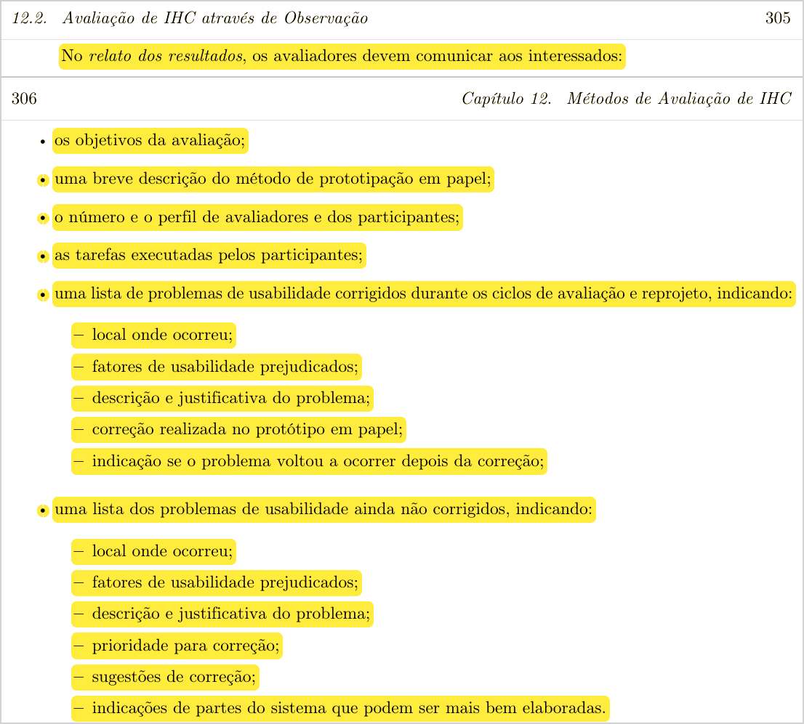
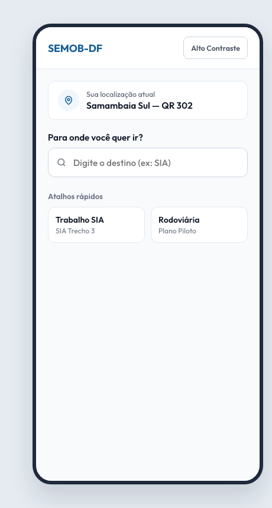
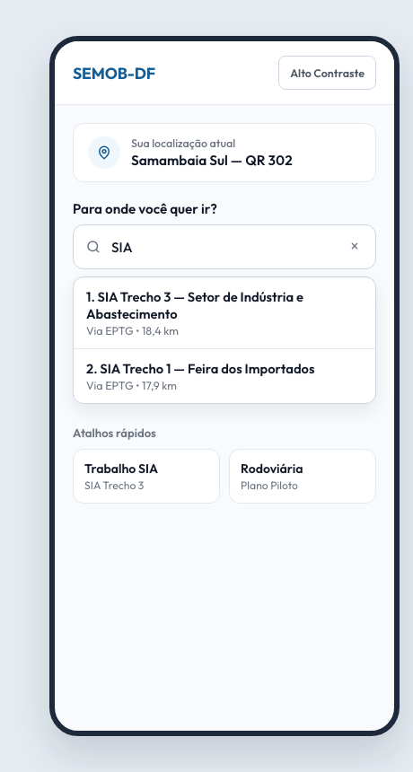
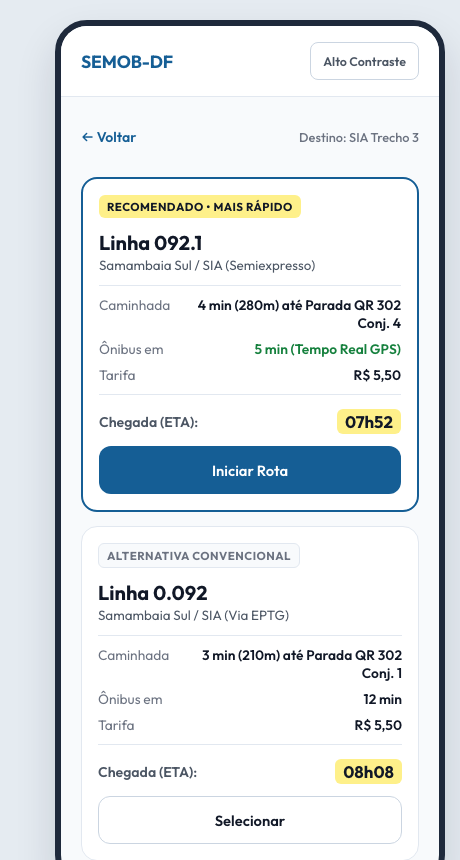
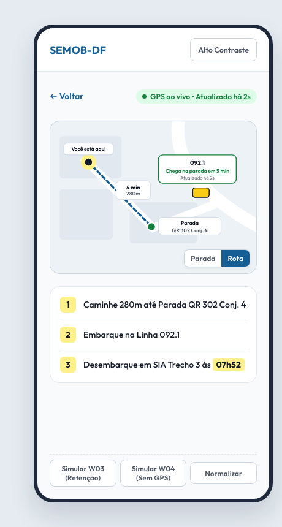
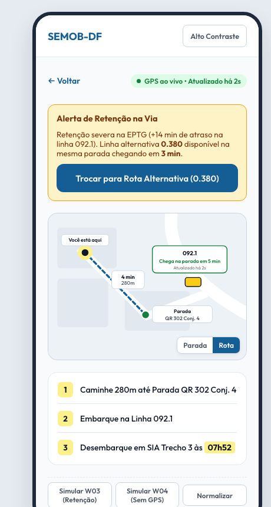
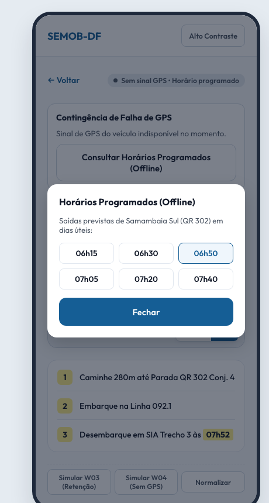

## Histórico de Versão e Contribuição

| Data | Versão | Descrição | Autor(es) | Revisor(es) | Declaração de Uso de IA |
| :---: | :---: | :--- | :--- | :--- | :--- |
| 01/11/2026 | `1.0` | Criação do planejamento individual do relato dos resultados da avaliação do Protótipo de Alta Fidelidade da TAR-03 com modelos de tabelas e referências do livro-texto. | [Lucas Araújo Lima](https://github.com/Lucasaraujoszz) | [Arthur Mariani](https://github.com/arthur-mariani) | Google Gemini — utilizado apenas para formatação em Markdown |
| 10/11/2026 | `1.1` | Adequação metodológica do planejamento do relato para avaliação baseada em protótipo de alta fidelidade em código navegável (HTML5, CSS3 e JavaScript), adaptando modelos de tabelas e diretrizes de reprojeto. | [Lucas Araújo Lima](https://github.com/Lucasaraujoszz) | [Arthur Mariani](https://github.com/arthur-mariani) | Google Gemini — utilizado apenas para formatação em Markdown |
| 19/11/2026 | `1.2` | Padronização da estrutura (histórico no topo, conteúdo, fotos de referência e referências ao final); declaração de IA levada para o histórico; autor e revisor retirados do rodapé; retirada das referências que não são o livro da disciplina nem material do professor; inclusão de fotos de referência grifadas. Inclusão das telas do protótipo avaliado, com links para o protótipo e para o artefato relacionado. Inclusão do bloco de artefatos relacionados (persona, cenário, análise de tarefas, storyboard, planejamentos, relatos e protótipos da funcionalidade). Correção das páginas e seções citadas do livro da disciplina (edição de 2021). | [Gabriel Melo](https://github.com/gabriellcardone-06) | Pendente de revisão | Claude (Anthropic) — apoio na padronização da estrutura do artefato, na revisão das referências e na formatação em Markdown; apoio na inclusão das telas do protótipo.; apoio na inclusão dos links entre artefatos |

---

# Planejamento do Relato dos Resultados da Avaliação do Protótipo de Alta Fidelidade (TAR-03)

Neste documento, apresenta-se o **Planejamento do Relato dos Resultados da Avaliação do Protótipo de Alta Fidelidade** referente à **[TAR-03 — Planejamento de Rota Completa (Porta a Porta) por Destino com Indicação de Paradas e Previsão de Chegada](https://interacao-humano-computador.github.io/2026.2-Grupo05/analise-de-requisitos/analise-de-tarefas/tar-03-planejamento-rota/#tar-03-planejamento-de-rota-completa-porta-a-porta-por-destino-com-indicacao-de-paradas-e-previsao-de-chegada)**. Trata-se de um documento metodológico individual elaborado por Lucas Araújo Lima para estruturar, padronizar e orientar a compilação, análise e apresentação dos dados quantitativos e qualitativos colhidos durante os testes de usabilidade no **protótipo em HTML navegável** (Etapa 7).

A estrutura deste planejamento fundamenta-se diretamente nos preceitos de **Consolidação e Relato dos Resultados** de Barbosa et al. (2021, Seção 11.7.5, Seção 12.2.1, pp. 262–290), garantindo rastreabilidade entre os achados empíricos, o **[Guia de Estilo](../../../../analise-de-requisitos/guia-de-estilo/introducao.md)** e as melhorias aplicadas no protótipo de alta fidelidade da **SEMOB-DF / DF no Ponto**.

**Artefatos relacionados — fluxo da funcionalidade TAR-03 (Planejamento de Rota por Origem e Destino):**

* **Persona:** [Marcos Paulo Vieira](../../../../analise-de-requisitos/personas/marcos-paulo-vieira.md)
* **Cenário:** [Cenário 3](../../../../analise-de-requisitos/cenarios/cenario-3-planejamento-origem-destino.md)
* **Análise de tarefas:** [TAR-03](../../../../analise-de-requisitos/analise-de-tarefas/tar-03-planejamento-rota.md)
* **Storyboard:** [Storyboard 03](../../../nivel1/storyboards.md#33-storyboard-03-planejamento-de-rota-por-origem-e-destino-com-monitoramento-em-tempo-real)
* **Nível 1 — avaliação do storyboard e da análise de tarefas:** Planejamento da avaliação (*não disponível — pendente de correção manual*) · Planejamento do relato (*não disponível — pendente de correção manual*) · [Relato dos resultados](../../../nivel1/relatos-individuais/lucas/relato-resultados-storyboard-tarefas.md) · [Planejamento individual de tarefas](../../../nivel1/planejamentos-individuais/Lucas/planejamento-individual-lucas.md) · [Questões práticas e éticas](../../../nivel1/planejamentos-individuais/Lucas/questoes-praticas-e-eticas.md)
* **Nível 2 — protótipo de papel (baixa fidelidade):** [Planejamento da avaliação](../../../nivel2/planejamentos-individuais/Lucas/lucas-planejamento-av-prototipo-papel.md) · [Planejamento do relato](../../../nivel2/planejamentos-individuais/Lucas/lucas-planejamento-relato-prot-papel.md) · [Relato dos resultados](../../../nivel2/relatos-individuais/lucas/relato-resultados-prot-papel.md)
* **Nível 3 — protótipo de alta fidelidade:** [Planejamento da avaliação](planejamento-av-prot-alta-fidel.md) · Planejamento do relato (*esta página*) · [Relato dos resultados](../../relatos-individuais/lucas/relato-resultados-prot-alta-fidel.md)
* **Telas do protótipo de papel:** [telas no planejamento da avaliação](../../../nivel2/planejamentos-individuais/Lucas/lucas-planejamento-av-prototipo-papel.md#9-telas-do-prototipo-avaliado)
* **Protótipo de alta fidelidade navegável:** [acessar o protótipo](../../../../prototipos/tar-03/index.html)

---

## 1. Objetivos do Relato dos Resultados

O documento final de relato dos resultados da avaliação do protótipo de alta fidelidade terá como finalidades principais:

1. **Sintetizar as métricas quantitativas de desempenho e eficiência:** Apresentar a taxa de conclusão sem auxílio das sub-tarefas `TAR-03.1`, `TAR-03.2` e `TAR-03.3`, o tempo médio de execução (comparado ao tempo preditivo de `9,70 s` modelado via GOMS/KLM na análise de tarefas) e a contagem de cliques/toques incorretos (*misclicks*) dos **3 participantes recrutados** (conforme o planejamento da avaliação).
2. **Validar empiricamente a conformidade com o Guia de Estilo do Grupo 05:** Aferir em que medida os componentes visuais e interativos implementados em HTML5 e CSS3 atenderam às diretrizes da equipe (contraste WCAG AA, alvos de toque de no mínimo 48×48 px, botões no padrão `[Verbo + Ação]`, destaque do cartão *"Mais Rápida"* e automação da localização e caminhada via GPS).
3. **Classificar e priorizar os problemas de usabilidade no protótipo:** Registrar todas as hesitações, dúvidas de interpretação, erros de entrada de dados ou falhas comportamentais observadas durante o protocolo *Think Aloud*, classificando cada ocorrência segundo a escala de severidade de Nielsen (1994 apud BARBOSA et al., 2021) e mapeando os fatores de qualidade de uso afetados.
4. **Orientar o ciclo final de reprojeto no código do protótipo:** Converter os problemas priorizados em ajustes de estilos (CSS) e refinamentos lógicos (JavaScript) diretamente no repositório para consolidar a versão final da proposta para a SEMOB-DF.

---

## 2. Estrutura Padronizada do Relatório Final (Etapa 7)

Em estrita observância à lista de tópicos exigidos por Barbosa et al. (2021, pp. 263–290) e ao Plano de Ensino da disciplina, o documento final de consolidação dos resultados da alta fidelidade será estruturado nas **9 seções padronizadas** a seguir:

1. **Introdução e Objetivos da Avaliação:** Contextualização do escopo avaliado na TAR-03 no protótipo navegável em HTML e retomada das perguntas investigativas (`QF01` a `QF06`) estabelecidas no [Planejamento da Avaliação do Protótipo de Alta Fidelidade](planejamento-av-prot-alta-fidel.md).
2. **Metodologia e Protocolo Executado:** Descrição da aplicação do Teste de Usabilidade combinado ao protocolo *Think Aloud*, com links para o protótipo funcional em HTML hospedado no GitHub Pages (com identificação do *commit* exato testado) e para as gravações em vídeo das sessões.
3. **Caracterização dos Avaliadores e dos 3 Participantes:** Tabela de perfil demográfico e comportamental dos **3 usuários avaliados** (alinhados à persona [Marcos Paulo Vieira](../../../../analise-de-requisitos/personas/marcos-paulo-vieira.md)), justificativa da amostra (Barbosa et al., 2021, pp. 258–259) e confirmação de assinatura do TCLE.
4. **Sumário Quantitativo de Desempenho nas Tarefas:** Tabelas consolidando o tempo de execução, taxa de sucesso sem ajuda e número de erros por participante em cada sub-tarefa da TAR-03.
5. **Consolidação Qualitativa da Entrevista Pós-Teste:** Síntese das respostas dos 3 participantes às perguntas `QF01` a `QF06` do roteiro DECIDE.
6. **Registro e Priorização de Problemas de Usabilidade (Escala de Nielsen):** Tabela detalhada dos problemas detectados no protótipo HTML (local/componente, fatores prejudicados, descrição, severidade de 0 a 4 e recomendação de correção no código).
7. **Verificação de Conformidade com o Guia de Estilo do Grupo 05:** Matriz de avaliação dos padrões visuais, tipográficos, semióticos e de ação aplicados na TAR-03.
8. **Plano de Reprojeto e Refinamentos Aplicados no Código:** Lista de alterações efetivadas no protótipo em HTML/CSS/JS após a rodada de testes, com registro de *commits* e comparativo *antes vs. depois*.
9. **Análise de Limitações e Conclusão:** Balanço da validade ecológica do estudo e validação final da solução proposta.

---

## 3. Metodologia de Análise e Escala de Severidade

A análise dos dados coletados nas 3 sessões combinará a **consolidação quantitativa** (médias de tempo, taxas de conclusão e contagem de erros de toque) com a **interpretação qualitativa** dos vídeos de interação e das verbalizações do *Think Aloud* (Barbosa et al., 2021, Seção 11.7.4, p. 263).

Para priorizar a correção das falhas identificadas no protótipo navegável em HTML, será utilizada a **Escala de Severidade de Problemas de Usabilidade** de Nielsen (1994 apud BARBOSA et al., 2021), adotada como padrão pelo Grupo 05:

<strong>Tabela 1</strong> — Escala de Severidade de Problemas de Usabilidade no Protótipo de Alta Fidelidade

| Nível | Classificação de Severidade | Critério de Julgamento na Interação no Protótipo HTML (TAR-03) |
| :---: | :--- | :--- |
| **0** | **Sem Importância** | Comentário estético ou preferência individual que não prejudica a compreensão nem a fluidez da navegação. |
| **1** | **Problema Cosmético / Leve** | Pequeno desalinhamento visual em CSS ou texto pouco contrastante; o usuário conclui a tarefa sem atraso relevante. |
| **2** | **Problema Simples / Moderado** | Provoca hesitação momentânea ou toque/clique em elemento não interativo do protótipo, reduzindo a eficiência, mas o usuário se recupera sozinho. |
| **3** | **Problema Grave** | Dificulta seriamente a conclusão da tarefa (ex.: não perceber o alerta de retenção na EPTG ou confundir o horário previsto com o tempo de espera), exigindo alto esforço. |
| **4** | **Problema Catastrófico** | Bloqueia totalmente o fluxo interativo no protótipo (falha de script ou travamento de navegação), impedindo o participante de planejar a rota ou levando à escolha de uma linha que causa atraso crítico. |

<em>Fonte: Adaptado de Nielsen (1994 apud BARBOSA et al., 2021) e Barbosa et al. (2021).</em>

---

## 4. Modelos de Tabelas para Consolidação e Relato dos Resultados

A seguir, apresentam-se os **quatro modelos de tabelas** que serão preenchidos no relatório final da Etapa 7 com os dados empíricos dos 3 participantes avaliados.

### 4.1 Modelo de Tabela 1: Sumário Quantitativo de Desempenho por Sub-tarefa e Participante

<strong>Tabela 2</strong> — Modelo de Sumário de Desempenho dos 3 Participantes nas Sub-tarefas da TAR-03 no Protótipo HTML

| Sub-tarefa (TAR-03) | Participante | Concluiu sem Ajuda? | Tempo Gasto (s) | Meta KLM / Referência | Cliques Incorretos (*Misclicks*) | Avaliação de Eficiência |
| :--- | :---: | :---: | :---: | :---: | :---: | :---: |
| **TAR-03.1:** Informar destino *"SIA Trecho 3"* na Home com origem automática via GPS. | **P01** **P02** **P03** | *[Sim/Não]* *[Sim/Não]* *[Sim/Não]* | *[s]* *[s]* *[s]* | ≤ 6,0 s | *[qtd]* *[qtd]* *[qtd]* | *[Satisfatório / Revisar]* |
| **TAR-03.2:** Comparar cartões de rota, verificar parada recomendada e iniciar rota `092.1`. | **P01** **P02** **P03** | *[Sim/Não]* *[Sim/Não]* *[Sim/Não]* | *[s]* *[s]* *[s]* | ≤ 10,0 s | *[qtd]* *[qtd]* *[qtd]* | *[Satisfatório / Revisar]* |
| **TAR-03.3:** Acompanhar ônibus ao vivo no mapa e acionar rota alternativa (`0.380`) ou grade *offline*. | **P01** **P02** **P03** | *[Sim/Não]* *[Sim/Não]* *[Sim/Não]* | *[s]* *[s]* *[s]* | ≤ 12,0 s | *[qtd]* *[qtd]* *[qtd]* | *[Satisfatório / Revisar]* |

<em>Fonte: Elaborado por Lucas Araújo Lima (2026).</em>

---

### 4.2 Modelo de Tabela 2: Consolidação das Respostas da Entrevista Pós-Teste (DECIDE)

<strong>Tabela 3</strong> — Modelo de Consolidação das Respostas às Perguntas Investigativas (`QF01` a `QF06`)

| ID | Foco Investigado | Pergunta Aplicada aos 3 Participantes | Síntese Qualitativa das Respostas (`P01`, `P02`, `P03`) | Status de Validação |
| :---: | :--- | :--- | :--- | :---: |
| **QF01** | **Home e Origem Automática GPS** | *"Foi imediato perceber que sua localização já estava preenchida pelo GPS e iniciar a busca pelo destino 'SIA'?"* | *[Síntese das respostas dos 3 participantes]* | **[Conforme / Ajustar]** |
| **QF02** | **Comparação de Rotas e Parada Ideal** | *"Os cartões de rota deixaram clara a diferença entre a linha semiexpressa (092.1) e a convencional (0.092), incluindo para qual parada caminhar?"* | *[Síntese das respostas dos 3 participantes]* | **[Conforme / Ajustar]** |
| **QF03** | **Mapa Ao Vivo e Trajeto a Pé** | *"No mapa interativo, ficou clara a linha tracejada de caminhada até a parada e a posição do ônibus em tempo real?"* | *[Síntese das respostas dos 3 participantes]* | **[Conforme / Ajustar]** |
| **QF04** | **Alerta de Retenção e Troca em 1 Toque** | *"Ao surgir o aviso de trânsito severo na EPTG, o botão de trocar para a linha alternativa em 1 toque foi fácil de entender e acionar?"* | *[Síntese das respostas dos 3 participantes]* | **[Conforme / Ajustar]** |
| **QF05** | **Contingência de Queda de GPS** | *"A diferença visual entre o horário em tempo real (verde) e o horário programado offline (cinza) transmitiu segurança quando o GPS caiu?"* | *[Síntese das respostas dos 3 participantes]* | **[Conforme / Ajustar]** |
| **QF06** | **Satisfação e Acabamento Visual** | *"Como você avalia as cores, o tamanho dos botões e o visual geral do protótipo em HTML em relação ao site atual da SEMOB?"* | *[Síntese das respostas dos 3 participantes]* | **[Positivo / Neutro / Negativo]** |

<em>Fonte: Elaborado por Lucas Araújo Lima (2026).</em>

---

### 4.3 Modelo de Tabela 3: Registro e Priorização de Problemas de IHC no Protótipo HTML

<strong>Tabela 4</strong> — Modelo de Registro e Priorização de Problemas de Usabilidade Detectados no Protótipo HTML

| ID Problema | Local / Componente no Protótipo HTML | Fatores de Usabilidade Prejudicados | Descrição e Justificativa do Problema (Ocorrência em `P01`/`P02`/`P03`) | Severidade (0 a 4) | Ação Corretiva / Reprojeto no Código HTML/CSS/JS |
| :---: | :--- | :--- | :--- | :---: | :--- |
| **PROB-H01** | *[Ex.: Tela 02 — Card da Linha 092.1]* | *[Ex.: Eficiência / Visibilidade]* | *[Descrição do comportamento observado e quantos participantes enfrentaram a dúvida]* | **[0 a 4]** | *[Ajuste específico no código HTML/CSS do componente]* |
| **PROB-H02** | *[Ex.: Tela 03 — Modal de Retenção na EPTG]* | *[Ex.: Prevenção de erros / Satisfação]* | *[Descrição do comportamento observado e quantos participantes enfrentaram a dúvida]* | **[0 a 4]** | *[Ajuste no script JS ou na folha de estilos CSS]* |

<em>Fonte: Elaborado por Lucas Araújo Lima (2026), baseado em Barbosa et al. (2021).</em>

---

### 4.4 Modelo de Tabela 4: Verificação de Conformidade com o Guia de Estilo do Grupo 05

<strong>Tabela 5</strong> — Modelo de Avaliação de Conformidade com o Guia de Estilo na TAR-03

| Diretriz do Guia de Estilo | Especificação Implementada no Protótipo HTML (TAR-03) | Evidência Observada com os 3 Participantes | Status |
| :--- | :--- | :--- | :---: |
| **Sintaxe de Botões (`[Verbo + Ação]`)** | Rótulos explícitos: `[ 🧭 Iniciar Rota ]`, `[ 🗺️ Trocar para Linha 0.380 Agora ]`, `[ 🕒 Ver Horários Offline ]`. | *[Registro de reconhecimento imediato pelos usuários]* | **[Conforme / Ajustar]** |
| **Alvos de Toque (*Mobile-First*)** | Botões e cards com altura mínima de 48 px e espaçamento de segurança entre opções em CSS. | *[Ausência ou presença de toques acidentais]* | **[Conforme / Ajustar]** |
| **Código Semântico de Cores e Ícones** | Verde para telemetria GPS ativa, amarelo/laranja para alerta de retenção na via e cinza para grade estática *offline*. | *[Compreensão dos estados sem depender apenas de texto]* | **[Conforme / Ajustar]** |
| **Redução de Carga Cognitiva (GPS)** | Preenchimento automático da origem e cálculo de distância/tempo a pé (`4 min / 280m`) até a parada recomendada. | *[Validação subjetiva da praticidade pelos 3 usuários]* | **[Conforme / Ajustar]** |

<em>Fonte: Elaborado por Lucas Araújo Lima (2026).</em>

---

## 5. Planejamento do Reprojeto e Ciclo de Iteração no Protótipo HTML

A partir do preenchimento da Tabela 4 após as sessões de teste, o refinamento do protótipo de alta fidelidade seguirá o ciclo iterativo preconizado por Mayhew (1999 apud BARBOSA et al., 2021):

1. **Correção Imediata de Problemas Graves ou Catastróficos (Severidade 3 e 4):** Qualquer barreira que impeça a escolha correta da parada ou a reação ao alerta de retenção viária será corrigida prioritariamente nos arquivos de código (`index.html`, `styles.css` e `app.js`).
2. **Polimento de Problemas Simples e Cosméticos (Severidade 1 e 2):** Ajustes de contraste, peso tipográfico, microtextos (*microcopy*) e tempos de transição serão aplicados diretamente nas folhas de estilo CSS e scripts do protótipo.
3. **Rastreabilidade de Versão e Commits:** Cada alteração realizada no código será documentada com identificador de *commit* no Git e comparativo *antes vs. depois* (com capturas de tela) no relatório final da Etapa 7.

---

## 6. Fundamentação Teórica e Prints de Referência do Livro-Texto

Para atender integralmente às exigências de fundamentação teórica da disciplina, apresentam-se a seguir os *prints* extraídos diretamente do livro-texto oficial — **BARBOSA, S. D. J. et al. *Interação Humano-Computador e Experiência do Usuário*. Rio de Janeiro: Autopublicação, 2021** (Capítulo 11) — que embasam a consolidação e o relato dos resultados:

### 6.1 Consolidação dos Resultados e Cuidados Analíticos (Seção 11.7.5)
Na Seção 11.7.5 (pp. 262–263), os autores destacam que a consolidação deve responder às questões que motivaram o estudo, distinguir características do grupo de idiossincrasias individuais e evitar generalizações indevidas:

  
  
<strong>Figura 1</strong> — Diretrizes para consolidação dos resultados e estrutura obrigatória do relatório de avaliação de IHC

  
<em>Fonte: BARBOSA et al. (2021, Seção 11.7.5, p. 263). Recorte e grifo: <a href="https://github.com/gabriellcardone-06">Gabriel Melo</a> (2026).</em>

### 6.2 Elementos Obrigatórios da Lista de Problemas e Priorização
Nas páginas 305 e 306 (Seção 12.2.3) e na Seção 12.2.1 (Teste de Usabilidade, pp. 289–290), Barbosa et al. (2021) especificam os atributos que devem compor o relato de cada problema encontrado (local, fatores de usabilidade prejudicados, descrição/justificativa, prioridade de correção e sugestões de reprojeto):

  
  
<strong>Figura 2</strong> — Atributos obrigatórios para documentação de problemas de usabilidade e Tabela 12.10 (adequação máxima do Teste de Usabilidade)

  
<em>Fonte: BARBOSA et al. (2021, Seção 12.2.3, pp. 305–306). Recorte e grifo: <a href="https://github.com/gabriellcardone-06">Gabriel Melo</a> (2026).</em>

### 6.3 Avaliar, Interpretar e Apresentar os Dados no Framework DECIDE
Na página 313, a etapa **E (*Evaluate*)** do Framework DECIDE estabelece os critérios de confiabilidade, validade interna, validade externa e validade ecológica que orientam o julgamento final dos dados no relatório:

  
  
<strong>Figura 3</strong> — Critérios de confiabilidade e validade na etapa de interpretação e apresentação dos dados do DECIDE

  
<em>Fonte: BARBOSA et al. (2021, Seção 11.8, p. 264). Recorte e grifo: <a href="https://github.com/gabriellcardone-06">Gabriel Melo</a> (2026).</em>

## 7. Telas do Protótipo Avaliado

As Figuras 4 a 9 mostram as telas do protótipo de alta fidelidade da [TAR-03](../../../../analise-de-requisitos/analise-de-tarefas/tar-03-planejamento-rota.md), também apresentadas no [relato dos resultados da avaliação](../../../nivel3/relatos-individuais/lucas/relato-resultados-prot-alta-fidel.md).

* **Protótipo navegável:** [Acessar o protótipo da TAR-03](../../../../prototipos/tar-03/index.html)

<strong>Figura 4</strong> — T1 Home e Origem GPS

{ width="300" }

<em>Fonte: Elaborado por Lucas Araújo Lima (2026).</em>

<strong>Figura 5</strong> — T2 Busca Preditiva ("SIA")

{ width="300" }

<em>Fonte: Elaborado por Lucas Araújo Lima (2026).</em>

<strong>Figura 6</strong> — T3 Comparador de Rotas

{ width="300" }

<em>Fonte: Elaborado por Lucas Araújo Lima (2026).</em>

<strong>Figura 7</strong> — T4 Mapa Ao Vivo (Linha 092.1)

{ width="300" }

<em>Fonte: Elaborado por Lucas Araújo Lima (2026).</em>

<strong>Figura 8</strong> — T5 Alerta de Retenção (+14 min)

{ width="300" }

<em>Fonte: Elaborado por Lucas Araújo Lima (2026).</em>

<strong>Figura 9</strong> — T6 Grade Horária Offline

{ width="300" }

<em>Fonte: Elaborado por Lucas Araújo Lima (2026).</em>

---
---

## 8. Fotos de Referência
As Figuras 10 a 11 mostram os trechos que fundamentam este artefato, recortados e grifados em amarelo diretamente do livro da disciplina (BARBOSA et al., 2021).

<strong>Figura 10</strong> — 11.7.5 Consolidação e relato dos resultados

<em>Fonte: BARBOSA et al. (2021, p. 263). Recorte e grifo: [Gabriel Melo](https://github.com/gabriellcardone-06) (2026).</em>

<strong>Figura 11</strong> — 12.2.1 Teste de usabilidade: objetivo, atividades e medidas por tarefa

<em>Fonte: BARBOSA et al. (2021, pp. 288–289). Recorte e grifo: [Gabriel Melo](https://github.com/gabriellcardone-06) (2026).</em>

---

## 9. Referências Bibliográficas
* BARBOSA, Simone Diniz Junqueira; SILVA, Bruno Santana da; SILVEIRA, Milene Selbach; GASPARINI, Isabela; DARIN, Ticianne; BARBOSA, Gabriel Diniz Junqueira. **Interação Humano-Computador e Experiência do Usuário**. Rio de Janeiro: Autopublicação, 2021. ISBN 978-65-00-19677-1. (Capítulo 11, Seção 11.7.5, p. 263–264; Capítulo 12, Seção 12.2.1, p. 288–291).
* SALES, André Barros de. **Plano de Ensino: Interação Humano Computador**. Brasília: Universidade de Brasília, Faculdade UnB Gama (FCTE/UnB), 2026.
