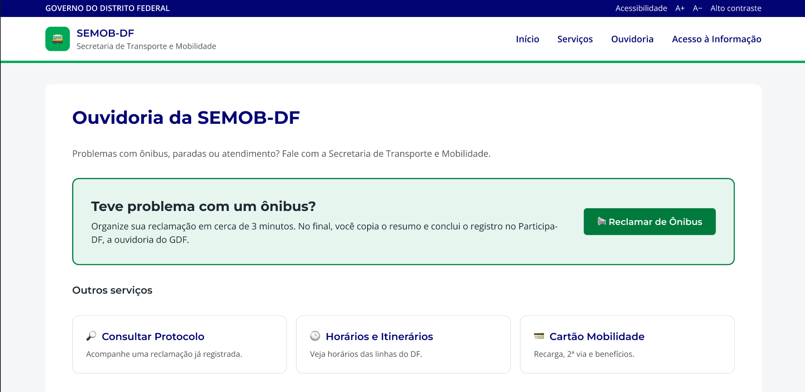
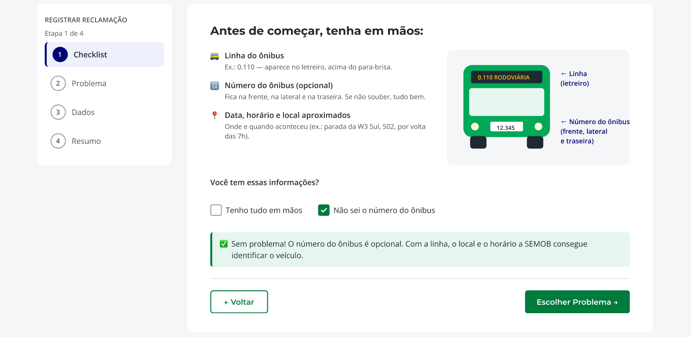
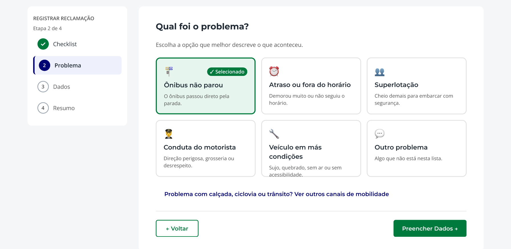
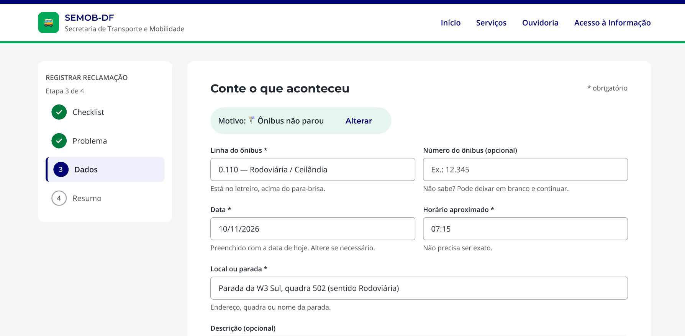
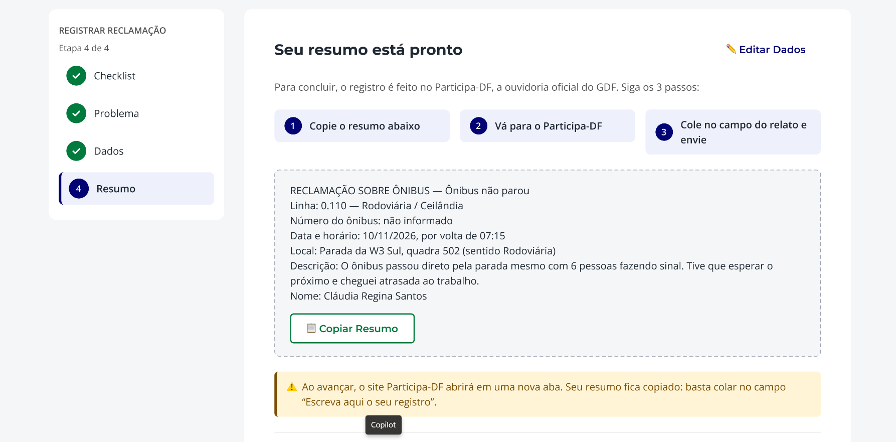
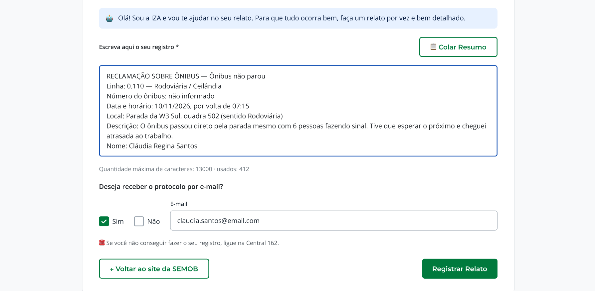
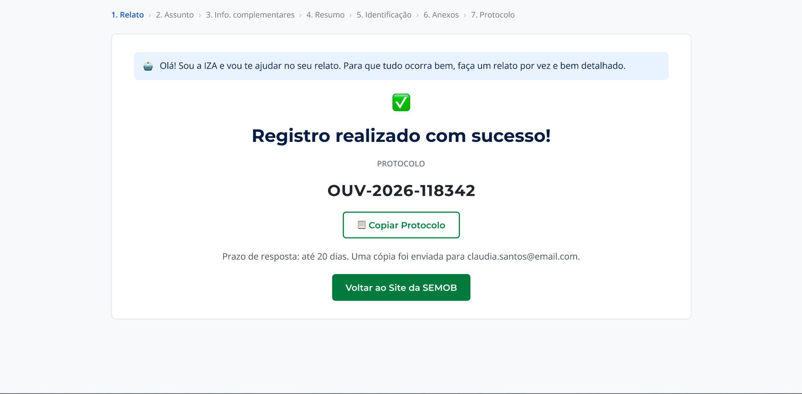

## Histórico de Versão e Contribuição

| Data | Versão | Descrição | Autor(es) | Revisor(es) | Declaração de Uso de IA |
| :---: | :---: | :--- | :--- | :--- | :--- |
| 02/11/2026 | `1.0` | Criação do planejamento individual da avaliação do Protótipo de Alta Fidelidade (Figma) da TAR-08 via DECIDE, com amostragem fundamentada na teoria de Steve Krug. | [Rodrigo Barbosa](https://github.com/RodrigoCBarbosa) | [Carlos Costa](https://github.com/carloshfgit) | Google Gemini - estruturação sintática em Markdown e suporte na revisão gramatical. |
| 03/11/2026 | `1.1` | Correção do caminho do link para o planejamento do protótipo de papel (Nível 2), que quebrava o `mkdocs build --strict`. | [Carlos Costa](https://github.com/carloshfgit) | — | Claude (Anthropic) - apenas corrigiu o link em Markdown |
| 19/11/2026 | `1.2` | Padronização da estrutura (histórico no topo, conteúdo, fotos de referência e referências ao final); declaração de IA levada para o histórico; autor e revisor retirados do rodapé; retirada das referências que não são o livro da disciplina nem material do professor; inclusão de fotos de referência grifadas. Inclusão das telas do protótipo avaliado, com links para o protótipo e para o artefato relacionado. Inclusão do bloco de artefatos relacionados (persona, cenário, análise de tarefas, storyboard, planejamentos, relatos e protótipos da funcionalidade). | [Gabriel Melo](https://github.com/gabriellcardone-06) | Pendente de revisão | Claude (Anthropic) — apoio na padronização da estrutura do artefato, na revisão das referências e na formatação em Markdown; apoio na inclusão das telas do protótipo.; apoio na inclusão dos links entre artefatos |

!!! warning "Observação para correção manual"
    A justificativa do número de participantes citava Steve Krug, que não é referência do livro da disciplina. O trecho foi reescrito com base em Barbosa et al. (2021, pp. 258–259), que citam Nielsen (2000 apud BARBOSA et al., 2021) e Dumas e Redish (1999 apud BARBOSA et al., 2021). O autor deve revisar se a nova redação mantém o sentido pretendido.

!!! warning "Observação para correção manual"
    Falta o link do protótipo de alta fidelidade da TAR-08 no Figma. O autor deve incluir o link de apresentação do Figma junto às telas do protótipo.

---

# Planejamento da Avaliação do Protótipo de Alta Fidelidade (TAR-08)

Neste documento, apresenta-se o **Planejamento da Avaliação do Protótipo de Alta Fidelidade** referente à **[TAR-08 (Registro de Reclamação sobre Ônibus a partir do Site da Semob)](../../../../analise-de-requisitos/analise-de-tarefas/tar-08-reclamacao-onibus.md)**. Trata-se de um planejamento individual desenvolvido para orientar a avaliação formativa e empírica do protótipo digital interativo construído na ferramenta **Figma**, representando a interface móvel aprimorada para o canal de manifestações da **SEMOB-DF**.

O protótipo de alta fidelidade consolida o ciclo evolutivo iniciado na avaliação do [Storyboard 06](../../../nivel1/storyboards.md#36-storyboard-06-reclamacao-sobre-onibus-a-partir-do-site-da-semob) (Cenário 11) e refinado na prototipação em papel do [Nível 2](../../../nivel2/planejamentos-individuais/Rodrigo/rodrigo-planejamento-av-prototipo-papel.md). Naquelas fases, foram validadas a eliminação do redirecionamento para login externo (mitigando o problema `PROB-01`) e a flexibilização do preenchimento da ocorrência ao tornar o número de ordem do ônibus opcional (mitigando o problema `PROB-02`). Agora, a solução recebe o design detalhado no Figma, em estrita conformidade com o **[Guia de Estilo](../../../../analise-de-requisitos/guia-de-estilo/introducao.md)** do Grupo 05 (com padrões de alvos de toque *mobile-first*, botões com rótulos `[Verbo + Ação]`, paleta cromática com contraste adequado e tipografia legível).

A avaliação será realizada com usuários reais utilizando o **Framework DECIDE** (Barbosa et al., 2021), estruturado em seis etapas: **D**eterminar objetivos, **E**xplorar perguntas, **C**hoose (Escolher) métodos, **I**dentificar questões práticas, **D**ecidir questões éticas e **E**valuate (Avaliar e interpretar dados).

**Artefatos relacionados — fluxo da funcionalidade TAR-08 (Reclamação sobre Ônibus):**

* **Persona:** [Cláudia Regina Santos](../../../../analise-de-requisitos/personas/claudia-regina-santos.md)
* **Cenário:** [Cenário 11](../../../../analise-de-requisitos/cenarios/cenario-11-reclamacao-onibus.md)
* **Análise de tarefas:** [TAR-08](../../../../analise-de-requisitos/analise-de-tarefas/tar-08-reclamacao-onibus.md)
* **Storyboard:** [Storyboard 06](../../../nivel1/storyboards.md#36-storyboard-06-reclamacao-sobre-onibus-a-partir-do-site-da-semob)
* **Nível 1 — avaliação do storyboard e da análise de tarefas:** [Planejamento da avaliação](../../../nivel1/planejamentos-individuais/Rodrigo/rodrigo-planejamento-avaliacao.md) · [Planejamento do relato](../../../nivel1/planejamentos-individuais/Rodrigo/rodrigo-planejamento-relato-resultados-avaliacao.md) · [Relato dos resultados](../../../nivel1/relatos-individuais/rodrigo/relato-resultados-storyboard-tarefas.md)
* **Nível 2 — protótipo de papel (baixa fidelidade):** [Planejamento da avaliação](../../../nivel2/planejamentos-individuais/Rodrigo/rodrigo-planejamento-av-prototipo-papel.md) · [Planejamento do relato](../../../nivel2/planejamentos-individuais/Rodrigo/rodrigo-planejamento-relato-prot-papel.md) · [Relato dos resultados](../../../nivel2/relatos-individuais/rodrigo/relato-resultado-prot-papel.md)
* **Nível 3 — protótipo de alta fidelidade:** Planejamento da avaliação (*esta página*) · [Planejamento do relato](rodrigo-planejamento-relato-prot-alta-fidel.md) · [Relato dos resultados](../../relatos-individuais/rodrigo/relato-resultados-prot-alta-fidel.md)
* **Telas do protótipo de papel:** [telas no planejamento da avaliação](../../../nivel2/planejamentos-individuais/Rodrigo/rodrigo-planejamento-av-prototipo-papel.md#8-telas-do-prototipo-avaliado)
* **Protótipo de alta fidelidade navegável:** *não disponível — pendente de correção manual*

---

## 1. D — Determinar os Objetivos da Avaliação

De acordo com Mayhew (1999 apud BARBOSA et al., 2021) e Barbosa et al. (2021, Cap. 6, p. 106; Cap. 11, p. 248), a avaliação do protótipo de alta fidelidade ocorre no Nível 3 do ciclo de vida da engenharia de usabilidade. Seu propósito é validar o design detalhado da interface interativa em um ambiente próximo do produto final antes do desenvolvimento de software executável.

### 1.1 Objetivos Principais

* **Verificar a conformidade com o Guia de Estilo do Grupo 05:** Avaliar se a paleta de cores, tipografia, dimensões mínimas dos alvos de toque (mínimo de 44x44 dp), padronização dos botões de ação primária e secundária (`[Verbo + Ação]`) e disposição dos cards do Figma atendem com precisão aos padrões consolidados pela equipe.
* **Avaliar a usabilidade da funcionalidade TAR-08 no Figma:** Identificar hesitações, desvios de fluxo ou cliques fora da área interativa durante a navegação pelo assistente de reclamação, seleção do motivo e envio da manifestação.
* **Validar a eficácia do formulário com identificação flexível:** Verificar se o participante compreende com naturalidade que o campo do número do ônibus é opcional e se consegue concluir a reclamação informando apenas a Linha, Parada/Local e Horário aproximado.
* **Avaliar a comunicabilidade e o feedback do sistema:** Verificar se as transições de tela, mensagens de confirmação e a entrega imediata do código de protocolo (com opção de copiar em 1 clique) transmitem clareza, transparência e segurança.
* **Subsidiar o produto final:** Coletar métricas quantitativas e observações qualitativas para guiar os ajustes finais de layout e comportamento interativo no Figma.

---

## 2. E — Explorar as Perguntas a Serem Respondidas

Para operacionalizar os objetivos definidos, estruturou-se um roteiro de perguntas investigativas a serem respondidas por meio da observação direta das interações no Figma e da entrevista pós-teste (Barbosa et al., 2021):

<strong>Tabela 1</strong> — Roteiro de Perguntas para Avaliação do Protótipo de Alta Fidelidade

| ID | Categoria / Foco | Pergunta Investigativa da Avaliação | Critério de Aceitação / Resposta Esperada |
| :---: | :--- | :--- | :--- |
| **Q01** | **Conformidade com Guia de Estilo** | Os botões, cards e tipografia na interface móvel do Figma apresentam leitura confortável, alvos de toque adequados e rótulos expressivos no padrão `[Verbo + Ação]`? | O participante identifica os componentes visuais e aciona botões como `[ 📢 Reclamar de Ônibus ]` e `[ Confirmar Envio ]` sem hesitação visual. |
| **Q02** | **Acesso ao Canal de Reclamação** | O ponto de entrada para o assistente de reclamações no menu/tela inicial do portal da SEMOB-DF é facilmente localizado? | O participante encontra e clica no card/botão de reclamação em menos de 10 segundos. |
| **Q03** | **Seleção Guiada do Motivo** | A apresentação das categorias de problemas em cards visuais selecionáveis (ex.: *Ônibus não parou*, *Atraso*, *Superlotação*) facilita a escolha da ocorrência? | O participante identifica a opção correspondente ao seu caso ("Ônibus não parou") no primeiro toque. |
| **Q04** | **Facultatividade do Veículo** | O formulário deixa evidente que a identificação do número de ordem do ônibus é opcional, evitando que a falta desse dado cause desistência? | O participante preenche linha, local e horário com tranquilidade, sem interrupções ou dúvidas sobre o número do veículo. |
| **Q05** | **Feedback e Código de Protocolo** | A tela de confirmação de envio no Figma apresenta claramente o número do protocolo gerado, o prazo de resposta e a opção de copiar? | O participante identifica o protocolo em destaque e aciona `[ 📋 Copiar Protocolo ]` ou `[ Concluir ]` com segurança. |
| **Q06** | **Satisfação e Estética Geral** | Como o participante avalia a experiência geral, a estética visual e a fluidez do assistente em comparação com os canais tradicionais de ouvidoria? | O participante expressa avaliações positivas de satisfação, destacando a rapidez, a clareza e o alívio de não ser redirecionado para outro site. |

<em>Fonte: Elaborado por Rodrigo Barbosa (2026).</em>

---

## 3. C — Choose (Escolher) os Métodos de Avaliação

O método selecionado é o **Teste de Usabilidade (Empírico / Observação de Uso em Ambiente Controlado)** utilizando o protótipo digital interativo no **Figma** (Barbosa et al., 2021, Seção 12.2.1).

* **Justificativa do Método:** O teste de usabilidade em protótipo de alta fidelidade permite registrar com fidelidade as ações reais de interação do usuário com uma interface que reproduz visualmente e comportamentalmente a aplicação definitiva. A ferramenta Figma permite simular animações, microinterações, estados ativos de botões e navegação entre frames, viabilizando a mensuração precisa de tempos, erros e percepções.
* **Técnica Complementar:** Durante a realização do teste, adotar-se-á a técnica de **Pensar em Voz Alta (*Think Aloud*)**, na qual o participante verbaliza seus raciocínios, expectativas e interpretações a cada clique na tela.

---

## 4. I — Identificar e Administrar as Questões Práticas

### 4.1 Planejamento do Recrutamento dos Entrevistados: Fundamentação e Justificativa do Número de Participantes

O recrutamento dos participantes para esta avaliação de alta fidelidade segue as orientações de Barbosa et al. (2021, pp. 258–259) sobre o perfil e o número de participantes:

* **Quantidade de Entrevistados:** Serão recrutados **3 participantes** representantes do público-alvo primário.
* **Fundamentação Teórica (Barbosa et al., 2021, pp. 258–259):** o perfil e o número de participantes são escolhidos com base nos perfis de usuários, nos objetivos e no escopo da avaliação. Nielsen (2000 apud BARBOSA et al., 2021) afirma que bastam cinco usuários para encontrar a maioria dos problemas na interface, e o livro observa que o tempo e os recursos disponíveis podem inviabilizar amostras maiores. Com base nisso:
  1. **Detecção dos problemas mais graves:** a amostra de **3 participantes** busca revelar os problemas de usabilidade mais severos do fluxo avaliado, próxima da referência de cinco usuários de Nielsen (2000 apud BARBOSA et al., 2021).
  2. **Análise Rápida e Acionável no Mesmo Dia:** Manter a amostra em 3 participantes impede a saturação de dados redundantes, viabilizando que a equipe condense os resultados e efetue os ajustes no arquivo do Figma no mesmo dia da avaliação.
  3. **Relação custo-benefício:** Nielsen (2000 apud BARBOSA et al., 2021) associa amostras pequenas a uma boa relação custo–benefício; amostras maiores exigiriam tempo e recursos que o cronograma da disciplina não comporta (Barbosa et al., 2021, p. 259).

* **Perfil dos 3 Participantes Recrutados:**
  * Passageiros regulares das linhas de ônibus do Distrito Federal que utilizam smartphones no seu dia a dia, com perfil alinhado à persona [Cláudia Regina Santos](../../../../analise-de-requisitos/personas/claudia-regina-santos.md) (usuários que já vivenciaram situações de irregularidade no transporte e valorizam canais rápidos e objetivos de manifestação).

---

### 4.2 Protótipo no Figma e Aplicação do Guia de Estilo
O protótipo interativo de alta fidelidade será executado no modo de apresentação do Figma (*Figma Prototype Mode*), incorporando as diretrizes do Guia de Estilo do Grupo 05:
* **Dimensões e Viewport:** Layout móvel responsivo (*Frame padrão smartphone*).
* **Componentes de Ação:** Botões primários largos com cantos arredondados e rótulos no padrão `[Verbo + Ação]` (ex.: `[ 📢 Reclamar de Ônibus ]`, `[ Confirmar Envio ]`).
* **Cores e Contraste:** Cores institucionais com contraste acessível (WCAG AA), evitando depender unicamente de cor para transmitir status.
* **Formulário Inteligente:** Campos limpos com indicação visual clara de obrigatoriedade e aviso destacado de campo opcional para o número do veículo.

---

### 4.3 Definição dos Papéis da Equipe na Sessão de Avaliação
* **Avaliador Facilitador / Condutor ([Rodrigo Barbosa](https://github.com/RodrigoCBarbosa)):** Recepciona o participante, apresenta as orientações iniciais e o cenário da tarefa, entrega o smartphone/computador com o protótipo e conduz a entrevista pós-teste de forma neutra, sem dar dicas de interação.
* **Avaliador Observador ([Carlos Costa](https://github.com/carloshfgit)):** Acompanha a transmissão/gravação de tela e áudio, cronometra a execução e registra na ficha de avaliação os cliques errados, hesitações e comentários do usuário.
* **Participante (Entrevistado):** Interage diretamente com as telas do Figma.

---

### 4.4 Ferramentas e Infraestrutura Tecnológica
* **Plataforma de Prototipação:** Figma (Protótipo Interativo com transições, animações de clique e overlays).
* **Ambiente de Teste:** Computador ou smartphone conectado à internet em sala reservada presencial.
* **Captura de Áudio e Vídeo:** Câmera e software de gravação de tela.
* **Materiais de Apoio:** Termo de Consentimento Livre e Esclarecido (TCLE) impresso/digital e roteiro de observação.

---

### 4.5 Cronograma e Logística das Sessões com os 3 Participantes

<strong>Tabela 2</strong> — Agendamento das Sessões

| Sessão | Participante Recrutado | Perfil do Participante | Data e Horário | Duração Prevista |
| :---: | :--- | :--- | :---: | :---: |
| **Sessão 1** | **Participante 1** | Usuário regular de ônibus no DF (perfil da persona) | 05/11/2026 às 14:00 | 5 a 10 min |
| **Sessão 2** | **Participante 2** | Usuário regular de ônibus no DF (perfil da persona) | 05/11/2026 às 14:30 | 5 a 10 min |
| **Sessão 3** | **Participante 3** | Usuário regular de ônibus no DF (perfil da persona) | 05/11/2026 às 15:00 | 5 a 10 min |

<em>Fonte: Elaborado por Rodrigo Barbosa (2026).</em>

---

### 4.6 Planejamento do Teste-Piloto

Em cumprimento rigoroso ao **Item 11 do checklist do Plano de Ensino** e às recomendações da literatura (Barbosa et al., 2021, p. 260), será realizado um **teste-piloto** antes das sessões oficiais:

* **Objetivo do Teste-Piloto:** Testar a cadeia de interações e hotspots do protótipo no Figma, verificar a qualidade de captação de tela e áudio, avaliar a clareza do texto de instrução e calibrar o tempo médio da tarefa.
* **Data do Piloto:** **04/11/2026 às 16:30**, realizado com um integrante do Grupo 05 simulando o papel de usuário.
* **Declaração Formal de Isenção de Dados (Item 12 do Checklist):** Declara-se formalmente que os dados e a gravação decorrentes do teste-piloto servirão **exclusivamente para calibração e aprimoramento dos instrumentos e do protótipo no Figma**, **não sendo computados nem integrados aos resultados finais da avaliação**.

---

## 5. D — Decidir como Lidar com as Questões Éticas

A condução da avaliação atende com rigor às Resoluções nº 466/2012 e nº 510/2016 do Conselho Nacional de Saúde (CNS) e às diretrizes éticas em IHC (Barbosa et al., 2021, Seção 7.4):

1. **Apresentação e Assinatura do TCLE:** Antes do início do teste, o participante lerá o [Termo de Consentimento Livre e Esclarecido (TCLE)](../../../../assets/PDFs/TCLE_Pesquisa_Transporte.pdf), sendo informado sobre os objetivos acadêmicos da pesquisa, a garantia de confidencialidade e a ausência de riscos físicos ou financeiros.
2. **Autorização de Gravação:** A gravação da tela e do áudio só terá início após a concordância explícita e registrada do entrevistado.
3. **Direito de Interrupção:** O participante possui total liberdade para interromper o teste ou recusar qualquer pergunta a qualquer momento, sem necessidade de justificativa e sem qualquer ônus.

---

## 6. E — Avaliar, Interpretar e Apresentar os Dados

A análise dos resultados combinará abordagens quantitativas e qualitativas (Barbosa et al., 2021, Seção 12.2.1):

1. **Análise Quantitativa:** Contabilização da taxa de sucesso na conclusão da manifestação sem intervenção do facilitador, medição do tempo gasto em cada tela e contagem de cliques incorretos ou fora das áreas clicáveis no Figma.
2. **Análise Qualitativa e Triangulação:** Identificação de hesitações e dúvidas verbalizadas pelo método *Think Aloud*, confrontando as observações com os princípios do Guia de Estilo do Grupo 05.
3. **Escala de Severidade de Problemas:** Os problemas identificados nos testes com os 3 participantes serão classificados de acordo com a escala de severidade de Nielsen (1994 apud BARBOSA et al., 2021):
   * **0 — Sem importância:** Questão meramente estética que não compromete o fluxo.
   * **1 — Leve:** Pequena hesitação visual que não atrasa significativamente a tarefa.
   * **2 — Moderado:** Incerteza relevante ou clique em elemento secundário, reduzindo a eficiência sem bloquear.
   * **3 — Grave:** Dificulta consideravelmente a realização da tarefa no Figma.
   * **4 — Catastrófico:** Impede a conclusão da reclamação ou trava o fluxo interativo no Figma.
4. **Encaminhamento para o Relato:** Os resultados fundamentarão o relatório final denominado *Relato dos Resultados da Avaliação do Protótipo de Alta Fidelidade*, orientando as correções a serem implementadas no arquivo do Figma.

## 7. Telas do Protótipo Avaliado

As Figuras 1 a 7 mostram as telas do protótipo de alta fidelidade da [TAR-08](../../../../analise-de-requisitos/analise-de-tarefas/tar-08-reclamacao-onibus.md), também apresentadas no [relato dos resultados da avaliação](../../../nivel3/relatos-individuais/rodrigo/relato-resultados-prot-alta-fidel.md).

<strong>Figura 1</strong> — Tela inicial da Ouvidoria da SEMOB-DF

{ width="800" }

<em>Fonte: Elaborado por Rodrigo Barbosa (2026).</em>

<strong>Figura 2</strong> — Etapa 1 — Checklist “Antes de começar, tenha em mãos”

{ width="800" }

<em>Fonte: Elaborado por Rodrigo Barbosa (2026).</em>

<strong>Figura 3</strong> — Etapa 2 — Seleção do motivo da reclamação

{ width="800" }

<em>Fonte: Elaborado por Rodrigo Barbosa (2026).</em>

<strong>Figura 4</strong> — Etapa 3 — Preenchimento dos dados da ocorrência

{ width="800" }

<em>Fonte: Elaborado por Rodrigo Barbosa (2026).</em>

<strong>Figura 5</strong> — Etapa 4 — Resumo pronto para cópia

{ width="800" }

<em>Fonte: Elaborado por Rodrigo Barbosa (2026).</em>

<strong>Figura 6</strong> — Registro do relato no Participa-DF

{ width="800" }

<em>Fonte: Elaborado por Rodrigo Barbosa (2026).</em>

<strong>Figura 7</strong> — Tela de sucesso com o protocolo gerado

{ width="800" }

<em>Fonte: Elaborado por Rodrigo Barbosa (2026).</em>

---
---

## 8. Fotos de Referência
As Figuras 8 a 11 mostram os trechos que fundamentam este artefato, recortados e grifados em amarelo diretamente do livro da disciplina (BARBOSA et al., 2021).

<strong>Figura 8</strong> — 11.8 Framework DECIDE

<em>Fonte: BARBOSA et al. (2021, p. 264). Recorte e grifo: [Gabriel Melo](https://github.com/gabriellcardone-06) (2026).</em>

<strong>Figura 9</strong> — Representação de interface em alta fidelidade

<em>Fonte: BARBOSA et al. (2021, p. 210). Recorte e grifo: [Gabriel Melo](https://github.com/gabriellcardone-06) (2026).</em>

<strong>Figura 10</strong> — 12.2.1 Teste de usabilidade: objetivo, atividades e medidas por tarefa

<em>Fonte: BARBOSA et al. (2021, pp. 288–289). Recorte e grifo: [Gabriel Melo](https://github.com/gabriellcardone-06) (2026).</em>

<strong>Figura 11</strong> — 11.7.2 Escopo da avaliação, perfil e número de participantes

<em>Fonte: BARBOSA et al. (2021, p. 258). Recorte e grifo: [Gabriel Melo](https://github.com/gabriellcardone-06) (2026).</em>

---

## 9. Referências Bibliográficas
* BARBOSA, Simone Diniz Junqueira; SILVA, Bruno Santana da; SILVEIRA, Milene Selbach; GASPARINI, Isabela; DARIN, Ticianne; BARBOSA, Gabriel Diniz Junqueira. **Interação Humano-Computador e Experiência do Usuário**. Rio de Janeiro: Autopublicação, 2021. ISBN 978-65-00-19677-1. (Capítulo 11, p. 245–266; Capítulo 12, Seção 12.2.1, p. 288–291).
* SALES, André Barros de. **Plano de Ensino: Interação Humano Computador**. Brasília: Universidade de Brasília, FCTE/UnB, 2026.
