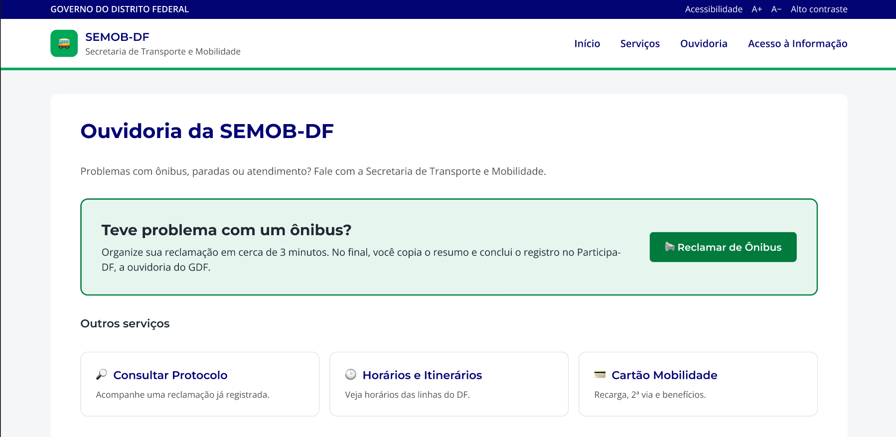
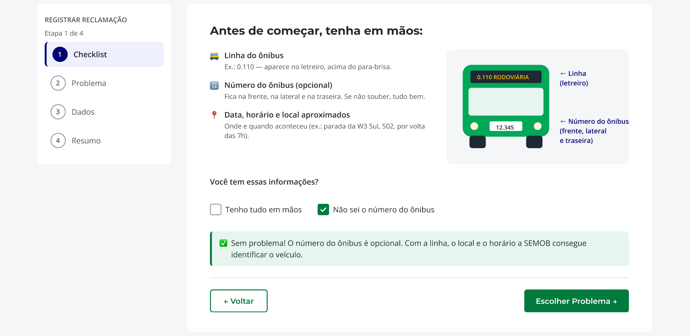
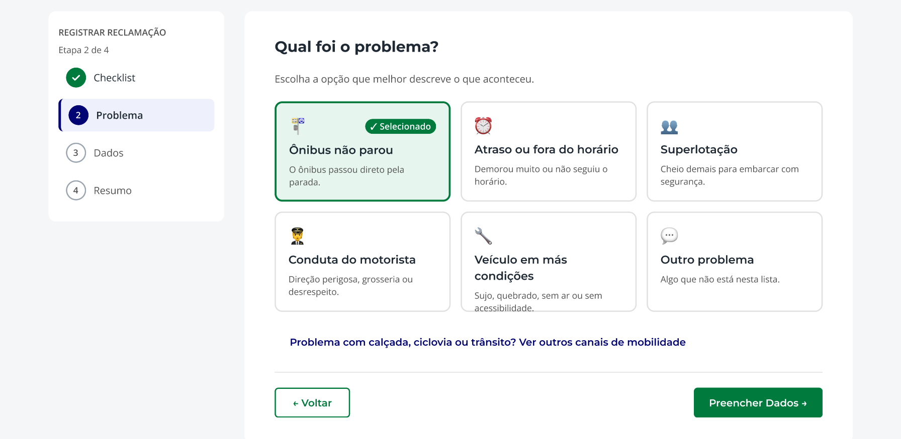
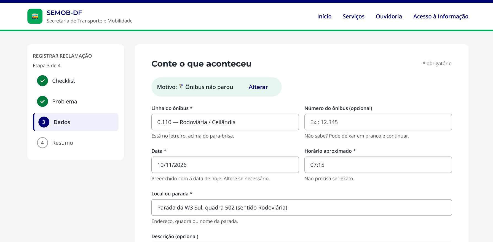
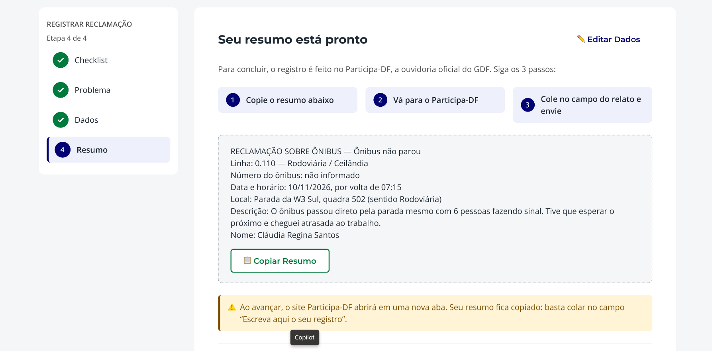
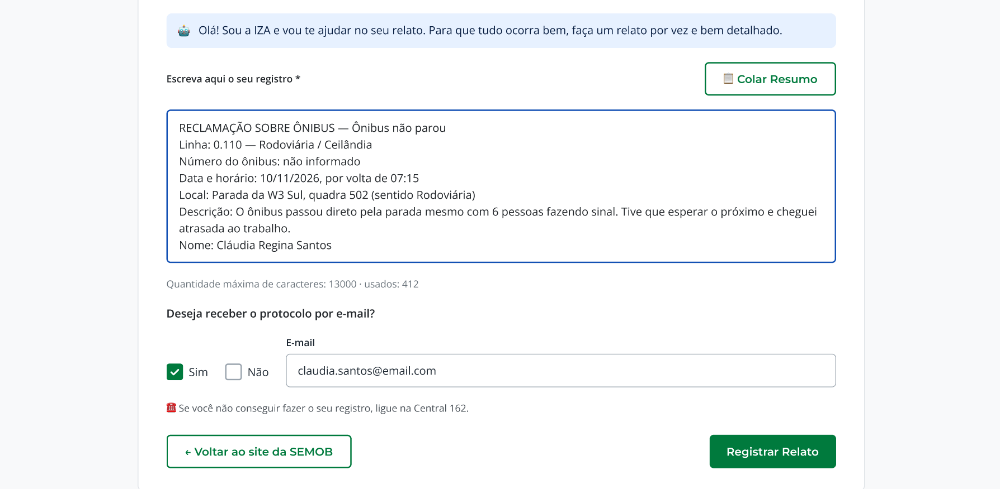
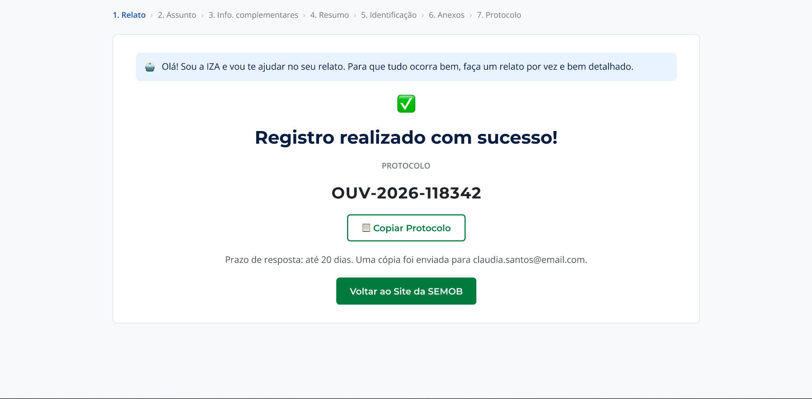

## Histórico de Versão e Contribuição

| Data | Versão | Descrição | Autor(es) | Revisor(es) | Declaração de Uso de IA |
| :---: | :---: | :--- | :--- | :--- | :--- |
| 02/11/2026 | `1.0` | Criação do planejamento individual do relato dos resultados da avaliação do Protótipo de Alta Fidelidade (Figma) da TAR-08. | [Rodrigo Barbosa](https://github.com/RodrigoCBarbosa) | [Carlos Costa](https://github.com/carloshfgit) | Google Gemini - estruturação sintática em Markdown e suporte na revisão gramatical. |

---

# Planejamento do Relato dos Resultados da Avaliação do Protótipo de Alta Fidelidade (TAR-08)

Neste documento, apresenta-se o **Planejamento do Relato dos Resultados da Avaliação do Protótipo de Alta Fidelidade** referente à **[TAR-08 (Registro de Reclamação sobre Ônibus a partir do Site da Semob)](../../../../analise-de-requisitos/analise-de-tarefas/tar-08-reclamacao-onibus.md)**. Trata-se de um planejamento individual desenvolvido para estruturar, padronizar e orientar a futura compilação, análise quantitativa e qualitativa e apresentação dos dados colhidos durante os testes de usabilidade realizados no **Figma**.

A formulação deste documento orienta-se pela literatura consolidada de Interação Humano-Computador (Barbosa et al., 2021, Cap. 11, Seção 11.7.5 e Cap. 12, Seção 12.2.1), assegurando rigor metodológico, rastreabilidade dos achados e diretrizes concretas para o reprojeto do protótipo interativo do grupo.

**Artefatos relacionados — fluxo da funcionalidade TAR-08 (Reclamação sobre Ônibus):**

* **Persona:** [Cláudia Regina Santos](../../../../analise-de-requisitos/personas/claudia-regina-santos.md)
* **Cenário:** [Cenário 11](../../../../analise-de-requisitos/cenarios/cenario-11-reclamacao-onibus.md)
* **Análise de tarefas:** [TAR-08](../../../../analise-de-requisitos/analise-de-tarefas/tar-08-reclamacao-onibus.md)
* **Storyboard:** [Storyboard 06](../../../nivel1/storyboards.md#36-storyboard-06-reclamacao-sobre-onibus-a-partir-do-site-da-semob)
* **Nível 1: avaliação do storyboard e da análise de tarefas:** [Planejamento da avaliação](../../../nivel1/planejamentos-individuais/Rodrigo/rodrigo-planejamento-avaliacao.md) · [Planejamento do relato](../../../nivel1/planejamentos-individuais/Rodrigo/rodrigo-planejamento-relato-resultados-avaliacao.md) · [Relato dos resultados](../../../nivel1/relatos-individuais/rodrigo/relato-resultados-storyboard-tarefas.md)
* **Nível 2: protótipo de papel (baixa fidelidade):** [Planejamento da avaliação](../../../nivel2/planejamentos-individuais/Rodrigo/rodrigo-planejamento-av-prototipo-papel.md) · [Planejamento do relato](../../../nivel2/planejamentos-individuais/Rodrigo/rodrigo-planejamento-relato-prot-papel.md) · [Relato dos resultados](../../../nivel2/relatos-individuais/rodrigo/relato-resultado-prot-papel.md)
* **Nível 3: protótipo de alta fidelidade:** [Planejamento da avaliação](rodrigo-planejamento-av-prot-alta-fidel.md) · Planejamento do relato (*esta página*) · [Relato dos resultados](../../relatos-individuais/rodrigo/relato-resultados-prot-alta-fidel.md)
* **Telas do protótipo de papel:** [telas no planejamento da avaliação](../../../nivel2/planejamentos-individuais/Rodrigo/rodrigo-planejamento-av-prototipo-papel.md#8-telas-do-prototipo-avaliado)
* **Protótipo de alta fidelidade navegável:** *não disponível*

---

## 1. Objetivos do Relato dos Resultados

O relatório final de consolidação dos resultados da avaliação de alta fidelidade terá como objetivos principais:

1. **Sintetizar as métricas de usabilidade e desempenho:** Apresentar a taxa de conclusão bem-sucedida do registro da reclamação sem intervenção externa, o tempo médio de execução em cada tela, a contagem de cliques fora das áreas interativas do Figma e o nível de satisfação dos **3 participantes recrutados** (conforme o planejamento da avaliação).
2. **Validar a conformidade com o Guia de Estilo do Grupo 05:** Verificar o atendimento às diretrizes visuais e comportamentais da equipe (alvos de toque *mobile-first* com no mínimo 44x44 dp, botões com rótulos `[Verbo + Ação]`, paleta institucional com contraste WCAG AA e clareza no preenchimento do formulário).
3. **Mapear e classificar os problemas de IHC:** Documentar detalhadamente todas as hesitações de navegação, ambiguidades de vocabulário ou ruídos na percepção das mensagens de feedback, categorizando cada ocorrência segundo a escala de severidade de Nielsen (1994 apud BARBOSA et al., 2021).
4. **Guia de Reprojeto no Figma:** Apresentar recomendações acionáveis e priorizadas para guiar o refinamento dos componentes e fluxos interativos da aplicação da **SEMOB-DF**.

---

## 2. Estrutura Padronizada do Relatório Final

Em conformidade com Barbosa et al. (2021, pp. 263, 289–290) e o Plano de Ensino da disciplina, o documento final de relato dos resultados observará a seguinte estrutura estruturada em tópicos:

1. **Introdução e Objetivos da Avaliação:** Síntese do escopo avaliado na TAR-08 e das perguntas investigativas do Framework DECIDE.
2. **Metodologia Aplicada:** Descrição do método de Teste de Usabilidade no Figma e da técnica de *Think Aloud* (pensar em voz alta).
3. **Caracterização dos Participantes e Justificativa de Amostragem:** Apresentação da tabela de perfil dos **3 participantes recrutados**, acompanhada da justificativa do número de participantes (Barbosa et al., 2021, pp. 258–259).
4. **Sumário dos Dados Quantitativos de Desempenho:** Tabelas consolidadas do tempo de execução, taxa de conclusão sem apoio e contagem de cliques fora de área interativa.
5. **Consolidação das Respostas da Entrevista Pós-Teste:** Compilação das respostas dadas às perguntas Q01 a Q06 do roteiro de avaliação.
6. **Tabela de Registro e Priorização de Problemas de IHC:** Tabela padronizada com a classificação de severidade (níveis 0 a 4) e impacto na experiência de uso.
7. **Avaliação de Conformidade com o Guia de Estilo:** Análise do cumprimento das diretrizes visuais e de interação do Grupo 05.
8. **Plano de Reprojeto e Ciclo de Iteração no Figma:** Recomendações de ajustes e lista de alterações aplicadas no arquivo do Figma.
9. **Conclusão:** Síntese das lições aprendidas e validação da funcionalidade.

---

## 3. Metodologia de Análise e Critérios de Severidade

A análise dos dados combinará **triangulação de dados quantitativos** (tempos de tela e taxas de cliques errados) e **análise qualitativa e interpretativa** das gravações de tela e áudio (*Think Aloud* e respostas da entrevista pós-teste).

Para classificar e priorizar as correções dos problemas de usabilidade encontrados no Figma, adotar-se-á a **Escala de Severidade de Problemas** de Nielsen (1994 apud BARBOSA et al., 2021) e Barbosa et al. (2021, p. 270):

<strong>Tabela 1</strong>: Escala de Severidade de Problemas de Usabilidade

| Nível de Severidade | Classificação | Descrição do Impacto na Interação no Figma |
| :---: | :--- | :--- |
| **0** | **Sem Importância** | Não afeta a execução da tarefa; comentário meramente estético ou sugestão opcional. |
| **1** | **Leve** | Provoca ligeira hesitação visual, mas o participante conclui a etapa sozinho e sem atraso considerável. |
| **2** | **Moderado** | Provoca incerteza ou clique em elemento secundário, reduzindo a eficiência sem bloquear o fluxo. |
| **3** | **Grave** | Dificulta consideravelmente a realização da tarefa, exigindo elevado esforço cognitivo para recuperação. |
| **4** | **Catastrófico** | Impede totalmente a conclusão da manifestação no protótipo interativo (bloqueio de fluxo ou falha crítica). |

<em>Fonte: Adaptado de Nielsen (1994 apud BARBOSA et al., 2021) e Barbosa et al. (2021).</em>

---

## 4. Modelos de Tabelas para Consolidação dos Resultados

Para garantir a padronização e o rigor da entrega, o relatório final utilizará os seguintes modelos padronizados de tabelas:

---

### 4.1 Modelo de Tabela 1: Consolidação das Respostas da Entrevista Pós-Teste

<strong>Tabela 2</strong>: Respostas Consolidadas da Entrevista Pós-Teste (DECIDE)

| ID | Tópico Avaliado | Pergunta Aplicada aos 3 Participantes | Resumo Qualitativo das Respostas | Avaliação da Interface |
| :---: | :--- | :--- | :--- | :---: |
| **Q01** | Conformidade Visual | *"Os botões e rótulos pareceram legíveis, claros e fáceis de identificar no celular?"* | *[Síntese do feedback dos 3 participantes]* | **[Conforme / Ajustar]** |
| **Q02** | Acesso ao Canal | *"A opção de registrar a reclamação foi encontrada com facilidade na página inicial?"* | *[Síntese do feedback dos 3 participantes]* | **[Conforme / Ajustar]** |
| **Q03** | Seleção do Motivo | *"A escolha da categoria do problema (ônibus não parou, atraso etc.) foi simples e direta?"* | *[Síntese do feedback dos 3 participantes]* | **[Conforme / Ajustar]** |
| **Q04** | Campo Opcional | *"Como você avalia o fato de o número do ônibus não ser obrigatório?"* | *[Síntese do feedback dos 3 participantes]* | **[Conforme / Ajustar]** |
| **Q05** | Confirmação e Protocolo | *"O comprovante com o número do protocolo e a opção de copiar deixaram a manifestação clara?"* | *[Síntese do feedback dos 3 participantes]* | **[Conforme / Ajustar]** |
| **Q06** | Satisfação Geral | *"Como você avalia a facilidade de uso geral e a rapidez do assistente no Figma?"* | *[Síntese do feedback dos 3 participantes]* | **[Positivo / Neutro / Negativo]** |

<em>Fonte: Elaborado por Rodrigo Barbosa (2026).</em>

---

### 4.2 Modelo de Tabela 2: Registro e Priorização de Problemas de IHC

<strong>Tabela 3</strong>: Tabela de Registro e Priorização de Problemas de Usabilidade

| ID Problema | Descrição da Dificuldade / Erro Observado | Tela / Componente Afetado no Figma | Severidade (0 a 4) | Fatores de Usabilidade Prejudicados | Recomendação de Reprojeto / Ação no Figma |
| :---: | :--- | :--- | :---: | :--- | :--- |
| **PROB-F01** | *[Descrição do erro ou dúvida de clique]* | *[Ex.: Tela Inicial / Card de Acesso]* | **[0 a 4]** | *[Ex.: Visibilidade, Clareza de Rótulo]* | *[Ação corretiva a ser implementada no Figma]* |
| **PROB-F02** | *[Descrição do erro ou dúvida de clique]* | *[Ex.: Tela de Formulário / Campo Veículo]* | **[0 a 4]** | *[Ex.: Carga Cognitiva, Feedback]* | *[Ação corretiva a ser implementada no Figma]* |

<em>Fonte: Elaborado por Rodrigo Barbosa (2026).</em>

---

### 4.3 Modelo de Tabela 3: Avaliação de Conformidade com o Guia de Estilo do Grupo 05

<strong>Tabela 4</strong>: Verificação de Conformidade com o Guia de Estilo do Grupo 05

| Diretriz do Guia de Estilo | Padrão Esperado no Figma | Resultado nos Testes com os 3 Usuários | Status de Conformidade |
| :--- | :--- | :--- | :---: |
| **Padrão de Rótulos** | Botões de ação no padrão `[Verbo + Ação]` (ex.: `[ 📢 Reclamar de Ônibus ]`, `[ Confirmar Envio ]`). | Participantes identificaram a finalidade do botão sem dúvidas de vocabulário. | **[Conforme / Ajustar]** |
| **Alvos de Toque** | Botões e cards clicáveis com dimensões mínimas de 44x44 dp para toque móvel. | Nenhum erro de toque acidental ou clique fora do componente registrado. | **[Conforme / Ajustar]** |
| **Formulário Otimizado** | Apresentação clara de campo opcional para dados não memorizáveis (número do ônibus). | Usuários relataram alívio ao perceberem que podiam prosseguir sem o número do ônibus. | **[Conforme / Ajustar]** |
| **Contraste e Cores** | Paleta institucional com contraste WCAG AA e apoio por ícones contextuais. | Nenhuma queixa de legibilidade em ambientes de teste móvel relatada. | **[Conforme / Ajustar]** |

<em>Fonte: Elaborado por Rodrigo Barbosa (2026).</em>

---

## 5. Planejamento do Reprojeto e Ciclo de Iteração no Figma

Com base na compilação dos problemas, os resultados alimentarão o ciclo de refinamento iterativo no **Figma** (Barbosa et al., 2021, Cap. 6):

1. **Ajustes Críticos (Severidade 3 e 4):** Falhas que bloqueiem a continuidade do envio ou gerem confusão irreversível serão tratadas imediatamente no arquivo do Figma.
2. **Refinamentos Visuais e Estéticos (Severidade 1 e 2):** Melhorias de espaçamento, hierarquia tipográfica e microinterações de feedback serão aplicadas nos componentes globais do design system.
3. **Rastreabilidade e Versão Final:** Todas as correções aprovadas serão documentadas no histórico de versão do arquivo do Figma e integradas ao site do projeto.

## 6. Telas do Protótipo Avaliado

As Figuras 1 a 7 mostram as telas do protótipo de alta fidelidade da [TAR-08](../../../../analise-de-requisitos/analise-de-tarefas/tar-08-reclamacao-onibus.md), também apresentadas no [relato dos resultados da avaliação](../../../nivel3/relatos-individuais/rodrigo/relato-resultados-prot-alta-fidel.md).

<strong>Figura 1</strong>: Tela inicial da Ouvidoria da SEMOB-DF

{ width="800" }

<em>Fonte: Elaborado por Rodrigo Barbosa (2026).</em>

<strong>Figura 2</strong>: Etapa 1 — Checklist “Antes de começar, tenha em mãos”

{ width="800" }

<em>Fonte: Elaborado por Rodrigo Barbosa (2026).</em>

<strong>Figura 3</strong>: Etapa 2 — Seleção do motivo da reclamação

{ width="800" }

<em>Fonte: Elaborado por Rodrigo Barbosa (2026).</em>

<strong>Figura 4</strong>: Etapa 3 — Preenchimento dos dados da ocorrência

{ width="800" }

<em>Fonte: Elaborado por Rodrigo Barbosa (2026).</em>

<strong>Figura 5</strong>: Etapa 4 — Resumo pronto para cópia

{ width="800" }

<em>Fonte: Elaborado por Rodrigo Barbosa (2026).</em>

<strong>Figura 6</strong>: Registro do relato no Participa-DF

{ width="800" }

<em>Fonte: Elaborado por Rodrigo Barbosa (2026).</em>

<strong>Figura 7</strong>: Tela de sucesso com o protocolo gerado

{ width="800" }

<em>Fonte: Elaborado por Rodrigo Barbosa (2026).</em>

---
---

## 7. Fotos de Referência
As Figuras 8 a 9 mostram os trechos que fundamentam este artefato, recortados e grifados em amarelo diretamente do livro da disciplina (BARBOSA et al., 2021).

<strong>Figura 8</strong>: 11.7.5 Consolidação e relato dos resultados

<em>Fonte: BARBOSA et al. (2021, p. 263).</em>

<strong>Figura 9</strong>: 12.2.1 Teste de usabilidade: objetivo, atividades e medidas por tarefa

<em>Fonte: BARBOSA et al. (2021, pp. 288–289).</em>

---

## 8. Referências Bibliográficas
* BARBOSA, Simone Diniz Junqueira; SILVA, Bruno Santana da; SILVEIRA, Milene Selbach; GASPARINI, Isabela; DARIN, Ticianne; BARBOSA, Gabriel Diniz Junqueira. **Interação Humano-Computador e Experiência do Usuário**. Rio de Janeiro: Autopublicação, 2021. ISBN 978-65-00-19677-1. (Capítulo 11, p. 245–266; Capítulo 12, Seção 12.2.1, p. 288–291).
* SALES, André Barros de. **Plano de Ensino: Interação Humano Computador**. Brasília: Universidade de Brasília, Faculdade UnB Gama (FCTE/UnB), 2026.
