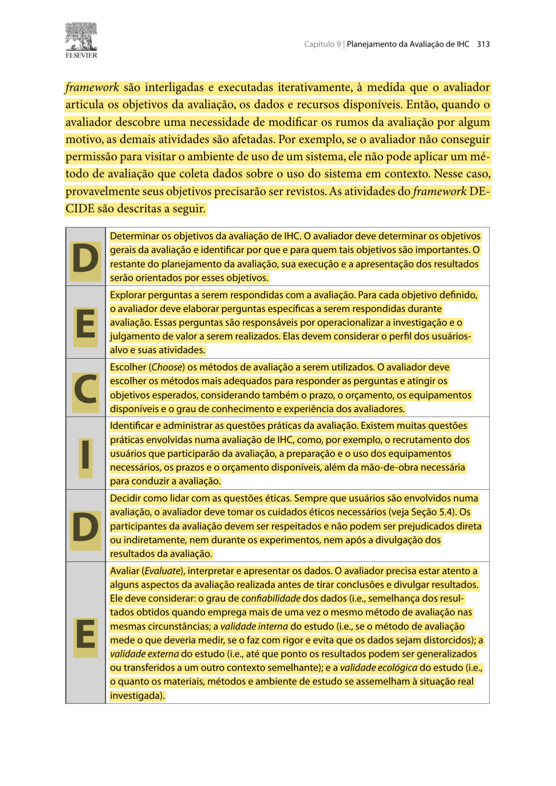
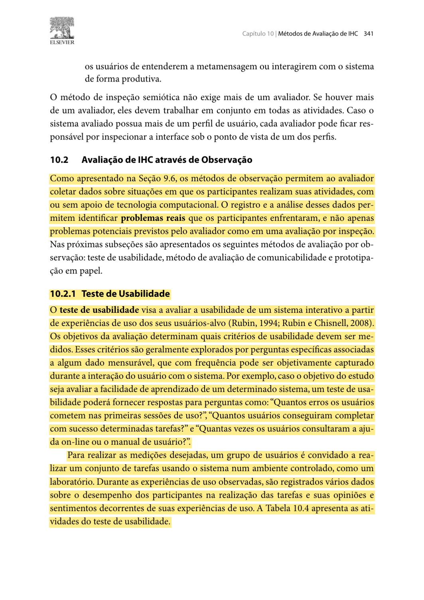
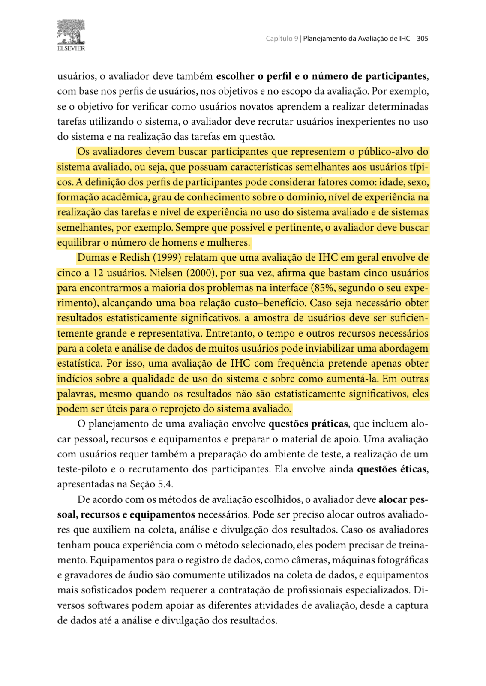
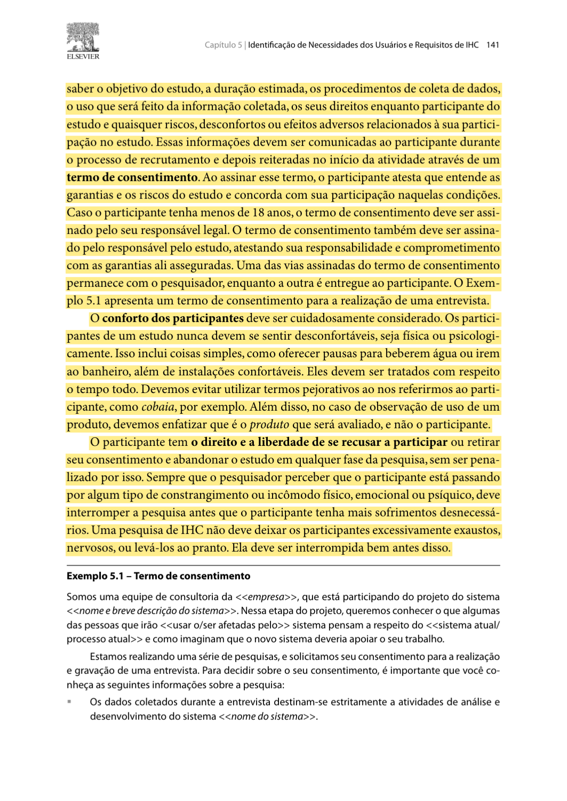

# Planejamento da Avaliação do Protótipo de Alta Fidelidade (TAR-09)

## Histórico de Versão

| Data | Versão | Descrição | Autor(es) | Revisor(es) | Declaração de uso de IA |
| :---: | :---: | :--- | :--- | :--- | :--- |
| 03/11/2026 | `1.0` | Criação do planejamento individual da avaliação do Protótipo de Alta Fidelidade (Figma) da TAR-09 (Pedido de aumento do limite diário do Vale-Transporte) via DECIDE. | [Tomás Rocho](https://github.com/TomasRocho) | [Rodrigo Carvalho](https://github.com/RodrigoCBarbosa) | Claude (Anthropic) - usado para estruturação do texto e formatação Markdown da página |

---

Neste documento, apresenta-se o **Planejamento da Avaliação do Protótipo de Alta Fidelidade** referente à **[TAR-09 (Solicitar Aumento do Limite Diário de Uso do Vale-Transporte)](../../../../analise-de-requisitos/analise-de-tarefas/tar-09-limite-vale-transporte.md)**. O protótipo será construído no **Figma**, no formato de tela de celular, e representa o fluxo **"Meu Vale-Transporte foi recusado"** no site da SEMOB-DF: o passageiro descobre por que o cartão foi recusado, pede mais passagens por dia pelo celular, recebe um protocolo e acompanha o pedido.

Este é o terceiro ciclo de design e avaliação da TAR-09. O fluxo apareceu primeiro no [Storyboard 05](../../../nivel1/storyboards.md) (Nível 1) e depois foi representado em papel, conforme o [Planejamento da Avaliação do Protótipo de Papel](../../../nivel2/planejamentos-individuais/Tomas/tomas-planejamento-av-prototipo-papel.md) (Nível 2). Agora as telas ganham a aparência, os textos e a navegação que se espera do produto final, seguindo o [Guia de Estilo](../../../../analise-de-requisitos/guia-de-estilo/introducao.md) do Grupo 05.

A avaliação será feita com representantes da persona [Heitor Santos Júnior](../../../../analise-de-requisitos/personas/heitor-santos-junior.md). O planejamento segue o **Framework DECIDE** (Barbosa; Silva, 2010, p. 312–313; Preece; Rogers; Sharp, 2005), em seis etapas: **D**eterminar objetivos, **E**xplorar perguntas, **C**hoose (Escolher) métodos, **I**dentificar questões práticas, **D**ecidir questões éticas e **E**valuate (Avaliar e interpretar os dados).

---

## 1. Fundamentação: por que um protótipo de alta fidelidade agora

Preece, Rogers e Sharp (2005, Cap. 8) explicam que protótipos de baixa fidelidade são usados no início do design e que os de fidelidade mais alta, como implementações limitadas em *software*, são usados mais tarde (p. 281). O protótipo de alta fidelidade "utiliza materiais que você espera que estejam no produto final" e "se parece muito mais com algo acabado" (p. 265).

A Tabela 1 resume o que o capítulo diz sobre esse tipo de protótipo e como isso afeta este planejamento.

<strong>Tabela 1</strong> — O que o Capítulo 8 de Preece, Rogers e Sharp (2005) muda neste planejamento

| O que o livro diz | Página | Consequência para a avaliação da TAR-09 |
| :--- | :---: | :--- |
| O protótipo de alta fidelidade é **totalmente interativo**, tem **uso conduzido pelo usuário**, **define o esquema de navegação** e tem o **mesmo *look and feel*** do produto final (Tabela 8.1). | 266 | Diferente do papel, não haverá "computador" humano. O próprio participante toca no celular, e a avaliação pode verificar a navegação, os textos e o visual definitivos. |
| A prototipação **vertical** oferece bastante detalhe para poucas funções; a **horizontal** oferece muitas funções com pouco detalhe. | 266 | O protótipo é **vertical**: apenas o fluxo da TAR-09, com todos os estados (erro de foto, documento faltando, protocolo, aviso). Os outros atalhos da página inicial existem só para não induzir a escolha. |
| Segundo Rettig (1994), em alta fidelidade os revisores **comentam aspectos superficiais** em vez do conteúdo, **um único *bug* pode interromper o teste** e o protótipo pode **elevar demais as expectativas**. | 265–266 | (a) as perguntas focam na tarefa, e não em cores; (b) todos os caminhos são conferidos no teste piloto; (c) o participante é avisado de que é um protótipo e que nenhum pedido real é enviado. |
| Os protótipos envolvem **concessões**: no *software* algumas funções podem estar ausentes ou serem rudimentares. | 266 | A câmera, o WhatsApp e a análise da SEMOB serão **simulados** por telas do Figma. Isso será dito ao participante e registrado como limitação no relato. |
| As **oito regras de ouro** de Shneiderman: consistência, *feedback* informativo, diálogos que encerram as ações, prevenção de erros, reversão fácil das ações, controle do usuário e redução da carga de memória. | 285–287 | As regras servem de critério para as perguntas Q05 a Q07 (erro de foto, documento faltando, voltar sem perder dados e confirmação final). |
| Toda página *web* deve responder: **Onde estou? O que é apresentado aqui? Onde posso ir?** (Quadro 8.7). | 292 | Usada na pergunta Q08, sobre a orientação do participante dentro do pedido em três passos. |

<em>Fonte: Elaborado por Tomás Rocho (2026), a partir de Preece, Rogers e Sharp (2005, Cap. 8).</em>

---

## 2. D — Determinar os Objetivos da Avaliação

A avaliação é **formativa**: o objetivo é encontrar problemas de interação no protótipo antes da versão final, e não comparar estatisticamente interfaces. Barbosa e Silva (2010, p. 303) indicam que os objetivos e as perguntas da avaliação guiam a escolha do método.

### 2.1 Objetivo geral

Verificar se trabalhadores que usam o Vale-Transporte e pegam vários ônibus por dia conseguem, sozinhos e pelo celular, entender por que o cartão foi recusado, pedir o aumento do limite diário e acompanhar o pedido no protótipo do Figma.

### 2.2 Objetivos específicos

1. **Encontrar o serviço:** verificar se o atalho "Meu Vale-Transporte foi recusado" é reconhecido na página inicial, entre os outros serviços.
2. **Entender a recusa:** verificar se a tela "Você usou 8 de 8 passagens hoje" deixa claro que o problema é o limite diário, e não falta de saldo, e que as integrações também contam.
3. **Avaliar o pedido em três passos:** observar se o participante descreve a rotina, envia as fotos dos documentos e a declaração do RH sem ajuda, e se sabe em que passo está.
4. **Avaliar a prevenção e a recuperação de erros:** verificar se as mensagens de foto ilegível e de documento faltando explicam o problema e permitem corrigir sem perder o que já foi preenchido, como pede o [Guia de Estilo — Elementos de ação](../../../../analise-de-requisitos/guia-de-estilo/elementos-de-acao.md) (seções 2.3 e 2.4).
5. **Avaliar o *feedback* final e o acompanhamento:** verificar se o protocolo, a consulta do andamento e o aviso pelo WhatsApp dão segurança de que o pedido foi recebido.
6. **Cobrir o que o protótipo de papel não verificou:** no Nível 2, o participante concluiu as três tarefas sem ajuda e nenhum problema foi encontrado, mas ficaram as pendências PE-01 a PE-04 do [Relato dos Resultados do Protótipo de Papel](../../../nivel2/relatos-individuais/tomas/relato-resultados-prot-papel.md) (tempo das tarefas, estados de erro não usados, falta de piloto e um único participante).

---

## 3. E — Explorar as Perguntas a Serem Respondidas

As perguntas abaixo orientam a observação e a entrevista pós-teste. Elas mantêm a numeração das perguntas do protótipo de papel sempre que o assunto é o mesmo, para que os resultados dos dois níveis possam ser comparados.

<strong>Tabela 2</strong> — Perguntas da Avaliação do Protótipo de Alta Fidelidade

| ID | Foco | Pergunta da Avaliação | Critério de Aceitação | Dado a Registrar |
| :---: | :--- | :--- | :--- | :--- |
| **Q01** | **Encontrar o serviço** | O participante encontra o atalho "Meu Vale-Transporte foi recusado" na página inicial? | Toca no atalho certo sem ajuda e sem entrar antes em outro serviço. | Primeiro toque, desvios, tempo até o atalho. |
| **Q02** | **Entender a recusa** | Depois de informar o cartão, o participante entende por que ele foi recusado? | Explica com as próprias palavras que passou do limite de passagens do dia, e não que está sem saldo. | Fala durante o *think aloud* e resposta na entrevista. |
| **Q03** | **Integrações** | O participante entende que cada integração também conta como uma passagem? | Ao ser perguntado, diz que cada ônibus conta, mesmo com integração. | Resposta na entrevista. |
| **Q04** | **Descrever a rotina e enviar documentos** | O participante preenche a rotina e envia os documentos e a declaração do RH sem ajuda? | Conclui os passos 1 a 3 sem perguntar o que deve colocar e sem confundir os documentos. | Conclusão, hesitações, pedidos de ajuda. |
| **Q05** | **Recuperação de erro** | Quando a foto é recusada por estar ilegível, o participante entende o problema e tira outra? | Lê a mensagem e toca em "Tirar outra foto" sem ajuda. | Reação à mensagem, tempo até corrigir. |
| **Q06** | **Prevenção de erro** | Se tentar enviar sem a declaração do RH, o participante entende o aviso e volta ao passo certo? | Volta ao passo 3 pelo próprio aviso, sem perder a rotina e as fotos já enviadas. | Caminho seguido, dados preservados. |
| **Q07** | **Encerramento e acompanhamento** | Depois de enviar, o participante sabe que o pedido foi recebido, o que acontece a seguir e como acompanhar? | Cita o protocolo, o aviso pelo WhatsApp e mostra onde consultaria o andamento. | Fala na tela de confirmação e na tarefa TAR-09.3. |
| **Q08** | **Orientação no fluxo** | Em qualquer tela do pedido, o participante sabe onde está, o que a tela mostra e para onde pode ir? | Diz em que passo está ("passo 2 de 3") e como voltar ou desistir. | Resposta quando o avaliador pergunta "Onde você está agora?". |
| **Q09** | **Opinião sobre a experiência** | O que o participante achou claro, confuso ou faltando, e como compara com ir a um posto de atendimento? | Opinião aberta; não há resposta certa. | Respostas da entrevista pós-teste. |

<em>Fonte: Elaborado por Tomás Rocho (2026).</em>

---

## 4. C — Choose (Escolher) os Métodos de Avaliação

O método escolhido é o **teste de usabilidade com observação de uso**, seguido de entrevista curta. Barbosa e Silva (2010, p. 341) descrevem esse método como a execução de tarefas por representantes dos usuários, com o registro do desempenho, das opiniões e dos sentimentos que surgem da experiência.

* **Justificativa:** com o protótipo totalmente interativo, o participante conduz o uso sozinho (Preece; Rogers; Sharp, 2005, p. 266). Assim é possível observar onde ele toca, quanto tempo leva, onde erra e como se recupera, o que responde às perguntas Q01 a Q08.
* **Técnica complementar:** o participante será convidado a **pensar em voz alta** (*think aloud*), dizendo o que procura e o que entendeu de cada tela.
* **Entrevista pós-teste:** ao final, o avaliador faz Q02, Q03, Q07 e Q09 de forma aberta, para confirmar o que foi observado.
* **Uso dos números:** tempo, erros e pedidos de ajuda servem para **explicar** onde estão os problemas. Não há metas numéricas e não se pretende tirar conclusões estatísticas.

### 4.1 O protótipo avaliado

O protótipo será montado no Figma, com *frames* de celular ligados pelo modo *Prototype*. As telas são as mesmas do protótipo de papel. Como o [Relato dos Resultados do Protótipo de Papel](../../../nivel2/relatos-individuais/tomas/relato-resultados-prot-papel.md) não encontrou problemas, os textos e a ordem das telas foram mantidos:

<strong>Tabela 3</strong> — Telas e Estados do Protótipo no Figma

| ID | Tela ou Estado | Conteúdo Principal | Regra do Guia de Estilo ou Princípio Aplicado |
| :---: | :--- | :--- | :--- |
| **T1** | Página inicial da SEMOB-DF | Seis cartões de serviço do mesmo tamanho, entre eles **"Meu Vale-Transporte foi recusado"**. | Cartão de serviço com rótulo textual (Guia, Elementos de ação, 4.1 e 4.2). |
| **T2** | Informar o cartão | Campo "Número do cartão" com teclado numérico e botão **"Continuar"**. | Rótulo que expressa o efeito da ação. |
| **T3** | Explicação da recusa | "Você usou 8 de 8 passagens hoje", aviso "As integrações também contam" e os botões **"Pedir mais passagens por dia"** e "Prefiro entregar no posto". | *Feedback* informativo (Shneiderman). |
| **T4–T6** | Pedido em três passos | Indicador "Passo 1 de 3", "2 de 3" e "3 de 3": rotina, fotos dos documentos e declaração do RH (com "Baixar modelo para o RH"). Botão **"Voltar"** em todos os passos. | Onde estou? (Quadro 8.7); reversão fácil; preservação dos dados (Guia, 2.3). |
| **E1** | Erro de foto ilegível | "Não conseguimos ler o documento. Tire outra foto com mais luz." e botão **"Tirar outra foto"**. | Tratamento de erros (Guia, 2.4); tela de erro e recuperação (Guia, Vocabulário 3.8). |
| **E2** | Documento faltando | "Falta a declaração do RH" com botão que leva direto ao passo 3. | Prevenção de erros (Shneiderman). |
| **T7** | Revisão do pedido | Resumo da rotina e dos documentos, com botão **"Enviar pedido"**. | Diálogo que encerra a ação. |
| **T8** | Confirmação | "Pedido enviado!", protocolo **2026-0451**, prazo e "Vamos te avisar pelo WhatsApp". | *Feedback* final e protocolo (Guia, Vocabulário 3.7). |
| **T9** | Acompanhar pedido | Campo de protocolo e situação "Em análise — prazo de até 5 dias úteis". | Visibilidade do estado. |
| **N1** | Notificação simulada | Tela que imita uma mensagem do WhatsApp: "SEMOB: seu novo limite diário foi aprovado e já está valendo". | Simulação declarada (concessão do protótipo). |

<em>Fonte: Elaborado por Tomás Rocho (2026).</em>

* **Simulações:** tocar no botão da câmera mostra uma prévia de foto pronta (na foto do comprovante, mostra de propósito o erro E1). Nenhuma câmera real é aberta e nenhum documento real é fotografado.
* **Dados fictícios:** o número do cartão, o protocolo e os documentos são fictícios e já aparecem preenchidos quando o participante toca no campo.

### 4.2 Roteiro de tarefas

As tarefas são as mesmas do protótipo de papel, para permitir a comparação. São lidas em voz alta, uma de cada vez, a partir do [Cenário 9](../../../../analise-de-requisitos/cenarios/cenario-9-limite-vale-transporte.md): *"Você trabalha com manutenção e passou o dia indo de prédio em prédio de ônibus. Na volta para casa, o cartão do Vale-Transporte não passou na catraca. Use o site da SEMOB no celular para resolver."*

<strong>Tabela 4</strong> — Tarefas do Teste de Usabilidade

| ID Tarefa | Enunciado lido ao participante | Critério de Conclusão | Telas | Perguntas |
| :---: | :--- | :--- | :--- | :--- |
| **TAR-09.1** | "Descubra por que o seu cartão foi recusado." | Chega à T3 e explica a recusa como limite do dia. | T1, T2, T3 | Q01, Q02, Q03 |
| **TAR-09.2** | "Peça para poder usar mais passagens por dia. Os documentos que você precisa estão no celular." | Chega à T8 com o protocolo na tela. | T4–T8, E1, E2 | Q04, Q05, Q06, Q08 |
| **TAR-09.3** | "Passaram alguns dias. Veja se o seu pedido foi aprovado." | Mostra a situação do pedido na T9 ou lê o aviso N1. | T9, N1 | Q07 |

<em>Fonte: Elaborado por Tomás Rocho (2026).</em>

O avaliador não explica a interface nem dá dicas. Quando o participante perguntar algo, a resposta é "O que você acha que acontece se tocar aí?". Se ele ficar parado por mais de 2 minutos numa tarefa ou pedir para parar, a tarefa é encerrada e registrada como **não concluída**.

---

## 5. I — Identificar e Administrar as Questões Práticas

### 5.1 Participantes

* **Perfil:** trabalhadores com carteira assinada que usam o **Vale-Transporte** e pegam vários ônibus no mesmo dia por causa do trabalho (técnico de manutenção, prestador de serviço, entregador, cuidador), que usam o celular no dia a dia (WhatsApp, banco), como a persona Heitor.
* **Quantidade:** **3 participantes**, identificados como P01, P02 e P03. Barbosa e Silva (2010, p. 305) apresentam cinco participantes como referência de custo-benefício. A equipe planeja três por causa do prazo da Entrega 7 (04/11 a 15/11) e da dificuldade de encontrar pessoas com esse perfil fora do horário de trabalho. Essa diferença será informada no relato como limitação.
* **Restrição:** nenhum participante pode ter participado da avaliação do storyboard ou do protótipo de papel da TAR-09, para que ninguém já saiba como o fluxo funciona.
* **Recrutamento:** rede de contatos da equipe (familiares, vizinhos, colegas de trabalho de conhecidos), sob responsabilidade de Tomás Rocho.

### 5.2 Papéis da equipe na sessão

* **Condutor (Tomás Rocho):** recebe o participante, lê o TCLE, lê as tarefas, faz a entrevista pós-teste e não interfere durante as tarefas.
* **Observador (Rodrigo Carvalho):** controla a gravação, cronometra cada tarefa e preenche a ficha de observação com toques errados, hesitações, pedidos de ajuda e falas do participante.

### 5.3 Infraestrutura e materiais

* **Dispositivo:** celular do condutor com o aplicativo Figma em modo de apresentação do protótipo, bateria carregada e carregador por perto.
* **Configuração do Figma:** desativar a opção *"Show hotspot hints on click"*, que destaca em azul as áreas clicáveis quando o participante toca no lugar errado e, por isso, daria dicas.
* **Contingência:** uma cópia do protótipo aberta no *notebook* e uma conexão de dados móveis, caso o Wi-Fi do local falhe.
* **Gravação:** gravação da tela do celular com áudio. O rosto do participante não é filmado.
* **Materiais impressos:** TCLE, folha com o cenário e as tarefas, ficha de observação e roteiro da entrevista.
* **Ficha de observação:** uma linha por tarefa, com início e fim, conclusão (sem ajuda, com ajuda, não concluída), erros, retornos, pedidos de ajuda, falas marcantes e minuto da gravação.
* **Local:** sala silenciosa na FCTE/UnB ou local de preferência do participante, para evitar deslocamento.

### 5.4 Cronograma

<strong>Tabela 5</strong> — Cronograma da Avaliação do Protótipo de Alta Fidelidade

| Etapa | Data | Responsável |
| :--- | :--- | :--- |
| Protótipo navegável pronto no Figma | até 07/11/2026 | Tomás Rocho |
| Teste piloto | 08/11/2026 (domingo), 18:00 | Tomás Rocho e Rodrigo Carvalho |
| Ajustes após o piloto | 09/11/2026 | Tomás Rocho |
| Sessão P01 | 10/11/2026 (terça-feira), 19:00 | Tomás Rocho e Rodrigo Carvalho |
| Sessão P02 | 12/11/2026 (quinta-feira), 19:00 | Tomás Rocho e Rodrigo Carvalho |
| Sessão P03 | 14/11/2026 (sábado), 10:00 | Tomás Rocho e Rodrigo Carvalho |
| Relato dos resultados | até 15/11/2026 | Tomás Rocho |

<em>Fonte: Elaborado por Tomás Rocho (2026). Os horários fora do horário comercial consideram que o perfil dos participantes trabalha durante o dia.</em>

### 5.5 Duração da sessão

<strong>Tabela 6</strong> — Etapas e Tempo Previsto de Cada Sessão

| Etapa | Tempo |
| :--- | :---: |
| Recepção, explicação e TCLE | 5 min |
| Perguntas rápidas sobre o uso do Vale-Transporte e do celular | 3 min |
| Tarefas TAR-09.1, TAR-09.2 e TAR-09.3 | 15 min |
| Entrevista pós-teste e encerramento | 7 min |
| **Total previsto** | **30 min** |

<em>Fonte: Elaborado por Tomás Rocho (2026). O tempo será ajustado depois do teste piloto.</em>

**Custo estimado:** R\$ 0,00 (Figma no plano gratuito, celular e *notebook* próprios, impressões feitas na universidade).

### 5.6 Teste piloto

Antes das sessões, será feito um **teste piloto completo** no dia 08/11/2026, com um integrante da equipe que **não participou da construção do fluxo da TAR-09** no papel de participante. Barbosa e Silva (2010, p. 306–307) recomendam o piloto para conferir o material e o procedimento.

* **O que será verificado:** se todos os toques levam à tela certa e nenhum caminho fica sem saída (o "único *bug*" de Rettig); se os estados E1 e E2 aparecem quando devem; se as tarefas ficam claras lidas em voz alta; se 15 minutos bastam para as tarefas; se a gravação da tela e o áudio funcionam; e se as perguntas da ficha respondem Q01 a Q09.
* **Ajustes:** ligações erradas no Figma, textos confusos nas tarefas e problemas na gravação são corrigidos no dia 09/11.
* **Uso dos dados:** os dados do piloto servem **apenas para ajustar** o protótipo e o procedimento e **não entram** nos resultados.

---

## 6. D — Decidir como Lidar com as Questões Éticas

A sessão segue as Resoluções nº 466/2012 e nº 510/2016 do Conselho Nacional de Saúde (CNS) e as orientações de Barbosa e Silva (2010, p. 140–141):

1. **Consentimento informado:** antes de começar, o condutor lê com o participante o [Termo de Consentimento Livre e Esclarecido (TCLE)](../../../../assets/PDFs/TCLE_Pesquisa_Transporte.pdf), explica que o objetivo é acadêmico, quanto tempo dura e o que será registrado, e colhe a assinatura.
2. **Quem é avaliado é o protótipo:** o condutor explica que qualquer dificuldade mostra um problema da tela, e não do participante.
3. **Autorização específica de gravação:** o participante autoriza à parte a gravação da tela e do áudio. Se não autorizar, a sessão acontece só com anotações.
4. **Participação voluntária:** o participante pode pular uma tarefa, recusar uma pergunta, pedir uma pausa ou encerrar a sessão a qualquer momento, sem nenhum prejuízo.
5. **Anonimato:** o participante é identificado apenas como **P01**, **P02** ou **P03** na ficha, nos arquivos e no relato. A lista que liga o código ao nome fica só com o condutor e é apagada depois da entrega do relato.
6. **Nenhum dado real:** o protótipo usa número de cartão, protocolo e documentos fictícios. O condutor pede que o participante não fale o número do próprio cartão, CPF, endereço ou empregador.
7. **Expectativas:** o condutor explica que o protótipo **não envia pedido nenhum** à SEMOB-DF e que o serviço ainda não existe, para que o participante não saia achando que já pode usá-lo (Preece; Rogers; Sharp, 2005, p. 265–266).
8. **Sem julgamento sobre o benefício:** falar sobre o limite de passagens não é uma verificação de uso indevido do Vale-Transporte.
9. **Guarda das gravações:** os vídeos ficam em pasta privada da equipe e são apagados ao fim da disciplina.

---

## 7. E — Avaliar, Interpretar e Apresentar os Dados

A análise segue as etapas de interpretação e consolidação de Barbosa e Silva (2010, p. 310–312):

1. **Logo após cada sessão:** condutor e observador comparam as anotações e completam a ficha do participante.
2. **Interpretação por participante:** o observador revisa a gravação e marca hesitações, toques errados, retornos, pedidos de ajuda e falas. Com isso, responde Q01 a Q09 para aquele participante.
3. **Consolidação entre participantes:** os problemas parecidos dos três participantes são juntados, contando em quantos participantes cada um apareceu. As perguntas que ficaram sem resposta são indicadas.
4. **Separação entre fato e opinião:** cada problema é descrito em três partes: **o que foi observado**, **a possível causa na tela** e **a recomendação**.
5. **Severidade:** cada problema recebe um nível de 0 a 4 (Nielsen, 1994), e a prioridade de correção considera a severidade, a recorrência e o custo de corrigir.
6. **Comparação com o Nível 2:** como o protótipo de papel não teve problemas, verifica-se se o fluxo continua sem problemas na versão interativa e se as pendências PE-01 a PE-04 foram cobertas.
7. **Limites das conclusões:** o relato deixa claro que os resultados valem para este protótipo, estas tarefas e estes três participantes, e indica onde as simulações (câmera, WhatsApp) podem ter influenciado o comportamento.
8. **Apresentação:** os resultados são organizados conforme o [Planejamento do Relato dos Resultados do Protótipo de Alta Fidelidade](tomas-planejamento-relato-prot-alta-fidel.md).

---

## 8. Evidências do Livro de Barbosa e Silva

As figuras abaixo mostram os trechos grifados do livro de Barbosa e Silva (2010) usados neste planejamento. Os trechos do Capítulo 8 de Preece, Rogers e Sharp (2005) estão indicados com a página na Tabela 1 e na seção 9.

<strong>Figura 1</strong> — As seis atividades do framework DECIDE (p. 313).

<em>Fonte: Barbosa e Silva (2010, p. 313).</em>

<strong>Figura 2</strong> — Definição do teste de usabilidade (p. 341).

<em>Fonte: Barbosa e Silva (2010, p. 341).</em>

<strong>Figura 3</strong> — Perfil e quantidade de participantes (p. 305).

<em>Fonte: Barbosa e Silva (2010, p. 305).</em>

<strong>Figura 4</strong> — Finalidade do teste piloto e descarte dos seus dados (p. 307).

<em>Fonte: Barbosa e Silva (2010, p. 307).</em>

<strong>Figura 5</strong> — Consentimento, conforto e direito de interromper a participação (p. 141).

<em>Fonte: Barbosa e Silva (2010, p. 141).</em>

---

## 9. Localização das Referências nos Livros

* **PREECE, J.; ROGERS, Y.; SHARP, H. *Design de Interação*, Capítulo 8 — *Design*, Prototipação e Construção:** Seção 8.2.4 (*Prototipação de alta-fidelidade*), p. 265–266; Tabela 8.1 e Seção 8.2.5 (*Concessões na prototipação*), p. 266; Seção 8.3.4 (*Utilizando protótipos no design conceitual*), p. 281; Seção 8.4.1 (*Recomendações para o design físico*), p. 285–287; Quadro 8.7 (*Fazendo design para a web*), p. 292.
* **BARBOSA, S. D. J.; SILVA, B. S. *Interação Humano-Computador*:** Seção 5.4, p. 140–141 (ética); Seções 9.7 e 9.8, p. 303–313 (preparação, interpretação, relato e DECIDE); Seção 10.2.1, p. 341–343 (teste de usabilidade).

---

## 10. Declaração sobre o Uso de IA Generativa

Em cumprimento às normas do Plano de Ensino da disciplina, declara-se que o Claude (Anthropic) foi usado para auxiliar na estruturação do texto e na formatação das tabelas em Markdown. A definição dos objetivos, das perguntas, das telas do protótipo, das tarefas, dos participantes e da logística, e a revisão final, são de responsabilidade do integrante Tomás Rocho.

---

## 11. Referências Bibliográficas

* BARBOSA, Simone Diniz Junqueira; SILVA, Bruno Santana da. **Interação Humano-Computador**. Rio de Janeiro: Elsevier/Campus, 2010. Seção 5.4, p. 140–141; seções 9.7–9.8, p. 303–313; seção 10.2.1, p. 341–343.
* BRASIL. Conselho Nacional de Saúde. **Resolução nº 466, de 12 de dezembro de 2012**. Aprova diretrizes e normas regulamentadoras de pesquisas envolvendo seres humanos. Brasília: Diário Oficial da União, 2013.
* BRASIL. Conselho Nacional de Saúde. **Resolução nº 510, de 07 de abril de 2016**. Regulamenta as pesquisas em Ciências Humanas e Sociais. Brasília: Diário Oficial da União, 2016.
* NIELSEN, Jakob. **Usability Engineering**. San Diego: Academic Press, 1994.
* PREECE, Jennifer; ROGERS, Yvonne; SHARP, Helen. **Design de Interação: além da interação homem-computador**. Porto Alegre: Bookman, 2005. Cap. 8, p. 259–297.
* SALES, André Barros de. **Plano de Ensino: Interação Humano Computador**. Brasília: Universidade de Brasília, FCTE/UnB, 2026.

---
**Autor:** [Tomás Rocho](https://github.com/TomasRocho)  
**Revisor:** [Rodrigo Carvalho](https://github.com/RodrigoCBarbosa)
