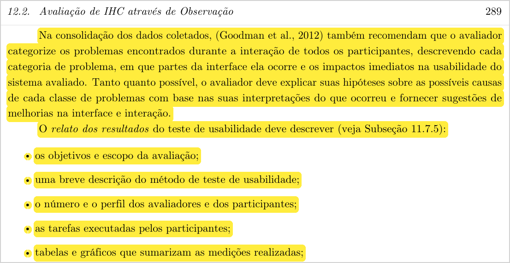
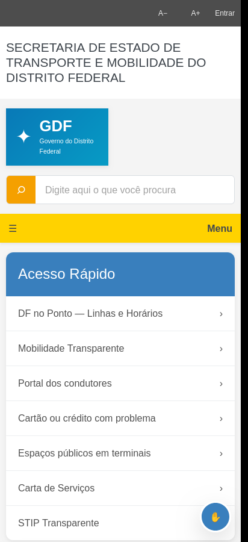
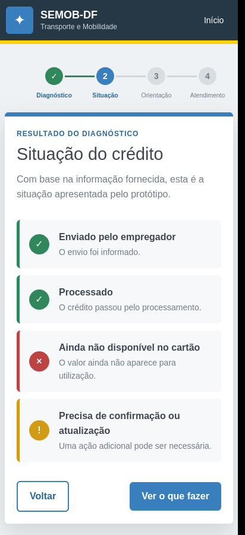

## Histórico de Versão e Contribuição

| Data | Versão | Descrição | Autor(es) | Revisor(es) | Declaração de Uso de IA |
| :---: | :---: | :--- | :--- | :--- | :--- |
| 14/11/2026 | `1.0` | Registro das três entrevistas e do achado na tela final. | [Arthur Mariani](https://github.com/arthur-mariani) |  | Google Gemini: apoio à organização do relato e à redação, com base nas informações fornecidas pelo autor. |
| 19/11/2026 | `1.1` | Padronização da estrutura (histórico no topo, conteúdo, fotos de referência e referências ao final); retirada das referências que não são o livro da disciplina nem material do professor; inclusão de fotos de referência grifadas. Inclusão das telas do protótipo avaliado, com links para o protótipo e para o artefato relacionado. Inclusão do bloco de artefatos relacionados (persona, cenário, análise de tarefas, storyboard, planejamentos, relatos e protótipos da funcionalidade). | [Gabriel Melo](https://github.com/gabriellcardone-06) | Pendente de revisão | Claude (Anthropic) — apoio na padronização da estrutura do artefato, na revisão das referências e na formatação em Markdown; apoio na inclusão das telas do protótipo.; apoio na inclusão dos links entre artefatos |

!!! warning "Observação para correção manual"
    Há versões sem revisor no histórico. Indicar o revisor de cada versão.

!!! warning "Observação para correção manual"
    As telas da seção "Telas do Protótipo Avaliado" foram capturadas do protótipo publicado (arthur-mariani.github.io/PAF-IHC) em 19/11/2026. O autor deve confirmar se correspondem à versão usada nas sessões de avaliação e trocar as capturas se o protótipo mudou depois.

---

# Relato dos Resultados da Avaliação do Protótipo de Alta Fidelidade (TAR-07)

## 1. Introdução e escopo

Este relato apresenta os resultados informados por Arthur Mariani sobre a avaliação do protótipo de alta fidelidade da [TAR-07: Resolver indisponibilidade de crédito de Vale-Transporte](../../../../analise-de-requisitos/analise-de-tarefas/tar-07-credito-vale-transporte.md). O fluxo se relaciona ao [Cenário 4](../../../../analise-de-requisitos/cenarios/cenario-4-credito-vale-transporte.md) e à persona [Maria Eduarda Santos](../../../../analise-de-requisitos/personas/maria-eduarda-santos.md). A organização dos resultados segue o [planejamento da avaliação](../../planejamentos-individuais/Arthur/arthur-planejamento-avaliacao-prototipo-alta-fidelidade.md) e o [planejamento deste relato](../../planejamentos-individuais/Arthur/arthur-planejamento-relato-prototipo-alta-fidelidade.md).

O objetivo foi observar se participantes do público-alvo encontravam a orientação para crédito indisponível, compreendiam a informação apresentada e identificavam como continuar buscando atendimento. Trata-se de uma avaliação formativa do fluxo simulado; ela não comprova a liberação de crédito nem a correção de procedimentos institucionais.

**Artefatos relacionados — fluxo da funcionalidade TAR-07 (Regularização de Crédito de Vale-Transporte):**

* **Persona:** [Maria Eduarda Santos](../../../../analise-de-requisitos/personas/maria-eduarda-santos.md)
* **Cenário:** [Cenário 4](../../../../analise-de-requisitos/cenarios/cenario-4-credito-vale-transporte.md)
* **Análise de tarefas:** [TAR-07](../../../../analise-de-requisitos/analise-de-tarefas/tar-07-credito-vale-transporte.md)
* **Storyboard:** [Storyboard 07](../../../nivel1/storyboards.md#37-storyboard-07-regularizacao-de-credito-de-vale-transporte)
* **Nível 1 — avaliação do storyboard e da análise de tarefas:** [Planejamento da avaliação](../../../nivel1/planejamentos-individuais/Arthur/arthur-planejamento-avaliacao.md) · [Planejamento do relato](../../../nivel1/planejamentos-individuais/Arthur/planejamento-relato-analise-tarefas.md) · Relato dos resultados (*não disponível — pendente de correção manual*)
* **Nível 2 — protótipo de papel (baixa fidelidade):** [Planejamento da avaliação](../../../nivel2/planejamentos-individuais/Arthur/arthur-planejamento-avaliacao-prototipo-papel.md) · [Planejamento do relato](../../../nivel2/planejamentos-individuais/Arthur/arthur-planejamento-relato-prototipo-papel.md) · [Relato dos resultados](../../../nivel2/relatos-individuais/arthur/relato-resultados-prototipo-papel.md)
* **Nível 3 — protótipo de alta fidelidade:** [Planejamento da avaliação](../../planejamentos-individuais/Arthur/arthur-planejamento-avaliacao-prototipo-alta-fidelidade.md) · [Planejamento do relato](../../planejamentos-individuais/Arthur/arthur-planejamento-relato-prototipo-alta-fidelidade.md) · Relato dos resultados (*esta página*)
* **Telas do protótipo de papel:** [telas no planejamento da avaliação](../../../nivel2/planejamentos-individuais/Arthur/arthur-planejamento-avaliacao-prototipo-papel.md#9-telas-do-prototipo-avaliado)
* **Protótipo de alta fidelidade navegável:** [acessar o protótipo](https://arthur-mariani.github.io/PAF-IHC/credito/)

## 2. Método e participantes

Foram realizadas **três entrevistas individuais** com uso do [protótipo de alta fidelidade](https://arthur-mariani.github.io/PAF-IHC). A quantidade de participantes corresponde ao [planejamento da avaliação](../../planejamentos-individuais/Arthur/arthur-planejamento-avaliacao-prototipo-alta-fidelidade.md), que justifica a escolha de três participantes com base em Barbosa et al. (2021, pp. 258–259). Os três participantes eram **maiores de 18 anos, trabalhavam e estudavam, utilizavam transporte público com frequência e tinham alta familiaridade com tecnologia**. Esse perfil é compatível com o público usuário considerado no planejamento. Os participantes são identificados apenas por P01, P02 e P03.

| Campo | Registro |
| :--- | :--- |
| Número de participantes | 3 |
| Tarefas previstas | T1: encontrar orientação; T2: interpretar a situação apresentada e indicar o próximo passo; T3: encontrar continuidade do atendimento. |
| Data, horário e local das sessões | 12/11/2026, das 8h às 10h, na Universidade de Brasília. |
| Protótipo avaliado | [Protótipo de alta fidelidade](https://arthur-mariani.github.io/PAF-IHC) |
| Dispositivo e condições de uso | Smartphone para testar e gravar |
| Condutor e observador | Arthur Mariani acumulou as duas funções em decorrência da falta de tempo. |
| Teste piloto | Realizado em conjunto com o grupo. Os dados do piloto não integram os resultados das três entrevistas. |

### 2.1 Links das três entrevistas

| Participante | Link da entrevista |
| :---: | :--- |
| P01 | [Assistir à entrevista 1](https://youtube.com/shorts/tysSW-D0fuU?feature=share) |
| P02 | [Assistir à entrevista 2](https://youtube.com/shorts/UMFZ9PTngXs?feature=share) |
| P03 | [Assistir à entrevista 3](https://youtube.com/shorts/e5aj-diS3Uk?feature=share) |

## 3. Dados coletados e execução das tarefas

Segundo o registro fornecido pelo autor, **as três tarefas foram executadas com sucesso nas três entrevistas e os entrevistados aprovaram o fluxo**. A orientação inicial foi encontrada sem dica pelo avaliador. Ao final, **os participantes tentaram interagir com o contêiner que apresenta os horários de atendimento**. Esse comportamento aponta uma expectativa de ação que a apresentação atual do componente não esclarece.

| Participante | T1: Encontrar orientação | T2: Interpretar e decidir | T3: Continuar atendimento | Observação ao final |
| :---: | :--- | :--- | :--- | :--- |
| P01 | Executada com sucesso, sem dica | Executada com sucesso | Executada com sucesso | Tentativa de interação com o contêiner de horários. |
| P02 | Executada com sucesso, sem dica | Executada com sucesso | Executada com sucesso | Tentativa de interação com o contêiner de horários. |
| P03 | Executada com sucesso, sem dica | Executada com sucesso | Executada com sucesso | Tentativa de interação com o contêiner de horários. |

Os resultados por tarefa acima foram informados pelo autor e sintetizam o desempenho observado nas três entrevistas.

## 4. Interpretação das perguntas de avaliação

| Pergunta do planejamento | Evidência disponível | Interpretação e situação |
| :---: | :--- | :--- |
| P01: Acesso à orientação | Os três participantes encontraram a orientação sem dica do avaliador, conforme informado pelo autor. | **Respondida:** a entrada para a orientação foi encontrada sem dica nas sessões relatadas. |
| P02: Compreensão das mensagens | O autor informou que as perguntas de avaliação tiveram resultado positivo e o fluxo foi compreendido. | **Respondida:** as mensagens foram compreendidas no caminho testado. |
| P03: Próximo passo | Os três participantes executaram com sucesso a tarefa de interpretar a situação e decidir o próximo passo. | **Respondida:** o próximo passo foi identificado nas sessões relatadas. |
| P04: Continuidade do atendimento | Os três participantes executaram com sucesso a tarefa de continuar buscando atendimento. | **Respondida:** encontraram a continuidade do atendimento; a tentativa de interação com o contêiner de horários indica um ajuste necessário na tela final. |
| P05: Erros e hesitações | O fluxo foi concluído, mas os participantes tentaram interagir com o contêiner de horários. | **Respondida:** o ponto de interação a melhorar está no contêiner da etapa final. |
| P06: Opinião após o uso | O autor informou que os entrevistados aprovaram o fluxo. | **Respondida:** avaliação positiva dos três participantes, sem falas literais atribuídas individualmente. |

## 5. Problema observado e ponto positivo

| ID | Tipo | Tela ou componente | Evidência | Efeito e hipótese | Recomendação |
| :---: | :--- | :--- | :--- | :--- | :--- |
| AF-01 | Problema de interação | Contêiner dos horários de atendimento, na etapa final | Os participantes tentaram interagir com o contêiner. | A aparência ou a posição do bloco pode sugerir que ele é acionável. A tentativa de interação não impediu a conclusão do fluxo. | Se o contêiner é apenas informativo, apresentá-lo visualmente como informação estática e separar dele as ações disponíveis. Se deve abrir detalhes ou permitir outra ação, implementar essa interação e indicar seu resultado. |
| AF-02 | Ponto positivo | Fluxo principal da TAR-07 | Os três participantes executaram as tarefas com sucesso e aprovaram o fluxo, conforme informado pelo autor. | Indício de que a sequência principal de orientação funciona para os participantes observados. | Preservar o caminho principal. |

O problema **AF-01** aparece uma vez na consolidação, pois diz respeito ao mesmo componente. A hipótese sobre a causa visual é uma interpretação a validar, não uma fala atribuída aos participantes.

## 6. Plano de reprojeto

| ID | Mudança proposta | Justificativa | Prioridade | Responsável | Estado |
| :---: | :--- | :--- | :---: | :--- | :--- |
| AF-01 | Definir se o contêiner de horários é informativo ou interativo; ajustar aparência e comportamento de acordo com essa função. | Tentativas de interação na etapa final, sem impedir a conclusão da tarefa. | Média | Equipe de prototipação | Proposta |

## 7. Limitações e conclusão

As três entrevistas oferecem evidência qualitativa sobre o fluxo testado e correspondem ao número previsto para esta rodada. A amostra pequena e as tarefas delimitadas não permitem generalizações para todos os usuários do Vale-Transporte. O autor confirmou a conclusão das tarefas, a execução de T1 sem dica e a aprovação do fluxo. As conclusões se referem ao caminho avaliado no protótipo.

O resultado informado é positivo para o fluxo geral da TAR-07: os três participantes concluíram as tarefas e aprovaram a experiência. O principal ajuste identificado está na tela final: o contêiner dos horários de atendimento gerou tentativas de interação. O reprojeto deve tornar clara a função desse componente.

## 8. Trechos do livro que fundamentam o relato

As imagens abaixo foram extraídas do livro de Barbosa et al. (2021). Os destaques identificam os trechos usados para organizar e interpretar os resultados deste relato.

<strong>Figura 1.</strong> Interpretação dos dados de cada participante (p. 262).

<em>Fonte: BARBOSA et al. (2021, p. 262). Recorte e grifo: <a href="https://github.com/gabriellcardone-06">Gabriel Melo</a> (2026).</em>

<strong>Figura 2.</strong> Consolidação dos resultados entre participantes (p. 263).

<em>Fonte: BARBOSA et al. (2021, p. 263). Recorte e grifo: <a href="https://github.com/gabriellcardone-06">Gabriel Melo</a> (2026).</em>

<strong>Figura 3.</strong> Conteúdo e limites do relato dos resultados (p. 263).

<em>Fonte: BARBOSA et al. (2021, p. 263). Recorte e grifo: <a href="https://github.com/gabriellcardone-06">Gabriel Melo</a> (2026).</em>

<strong>Figura 4.</strong> Dados coletados no teste de usabilidade (p. 289).

<em>Fonte: BARBOSA et al. (2021, p. 289). Recorte e grifo: <a href="https://github.com/gabriellcardone-06">Gabriel Melo</a> (2026).</em>

<strong>Figura 5.</strong> Descrição dos problemas e sugestões de solução (p. 289).

<em>Fonte: BARBOSA et al. (2021, p. 289). Recorte e grifo: <a href="https://github.com/gabriellcardone-06">Gabriel Melo</a> (2026).</em>

## 9. Telas do Protótipo Avaliado

As Figuras 6 a 10 mostram as telas do protótipo de alta fidelidade da [TAR-07](../../../../analise-de-requisitos/analise-de-tarefas/tar-07-credito-vale-transporte.md).

* **Protótipo navegável:** [Acessar o protótipo da TAR-07](https://arthur-mariani.github.io/PAF-IHC)

<strong>Figura 6</strong> — Página inicial do protótipo, com o Acesso Rápido e a opção "Cartão ou crédito com problema"

{ width="300" }

<em>Fonte: Elaborado por Arthur Mariani (2026). Captura de tela do protótipo publicado.</em>

<strong>Figura 7</strong> — Etapa 1 de 4 — Diagnóstico: "Vamos entender o que aconteceu"

{ width="300" }

<em>Fonte: Elaborado por Arthur Mariani (2026). Captura de tela do protótipo publicado.</em>

<strong>Figura 8</strong> — Etapa 2 de 4 — Situação do crédito

{ width="300" }

<em>Fonte: Elaborado por Arthur Mariani (2026). Captura de tela do protótipo publicado.</em>

<strong>Figura 9</strong> — Etapa 3 de 4 — Orientação: "O que fazer agora"

{ width="300" }

<em>Fonte: Elaborado por Arthur Mariani (2026). Captura de tela do protótipo publicado.</em>

<strong>Figura 10</strong> — Etapa 4 de 4 — Atendimento: "Locais de atendimento"

{ width="300" }

<em>Fonte: Elaborado por Arthur Mariani (2026). Captura de tela do protótipo publicado.</em>

---
---

## 10. Fotos de Referência
As Figuras 11 a 13 mostram os trechos que fundamentam este artefato, recortados e grifados em amarelo diretamente do livro da disciplina (BARBOSA et al., 2021).

<strong>Figura 11</strong> — Representação de interface em alta fidelidade

<em>Fonte: BARBOSA et al. (2021, p. 210). Recorte e grifo: [Gabriel Melo](https://github.com/gabriellcardone-06) (2026).</em>

<strong>Figura 12</strong> — 12.2.1 Teste de usabilidade: objetivo, atividades e medidas por tarefa

<em>Fonte: BARBOSA et al. (2021, pp. 288–289). Recorte e grifo: [Gabriel Melo](https://github.com/gabriellcardone-06) (2026).</em>

<strong>Figura 13</strong> — 11.7.5 Consolidação e relato dos resultados

<em>Fonte: BARBOSA et al. (2021, p. 263). Recorte e grifo: [Gabriel Melo](https://github.com/gabriellcardone-06) (2026).</em>

---

## 11. Referências Bibliográficas
* BARBOSA, Simone Diniz Junqueira; SILVA, Bruno Santana da; SILVEIRA, Milene Selbach; GASPARINI, Isabela; DARIN, Ticianne; BARBOSA, Gabriel Diniz Junqueira. **Interação Humano-Computador e Experiência do Usuário**. Rio de Janeiro: Autopublicação, 2021. ISBN 978-65-00-19677-1.
