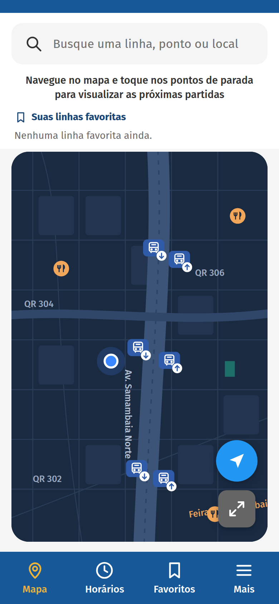
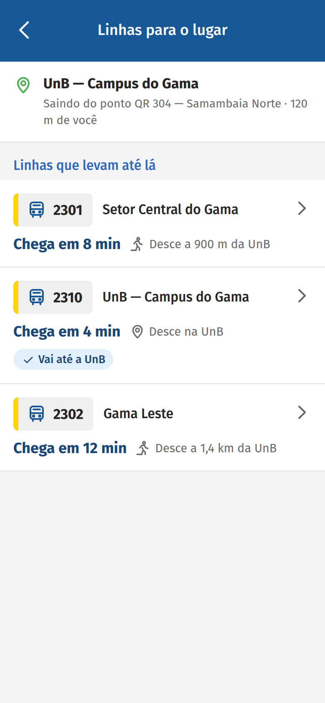
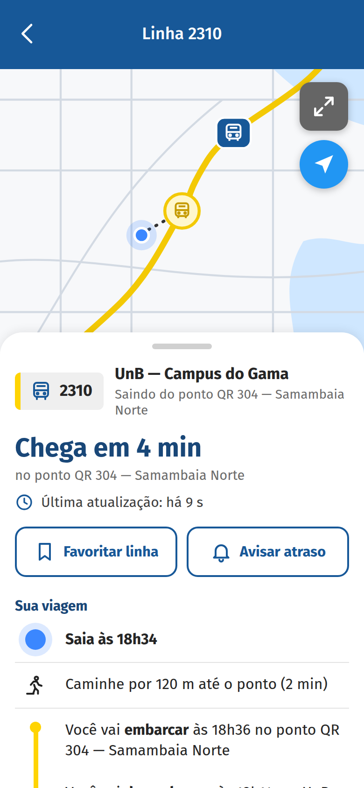
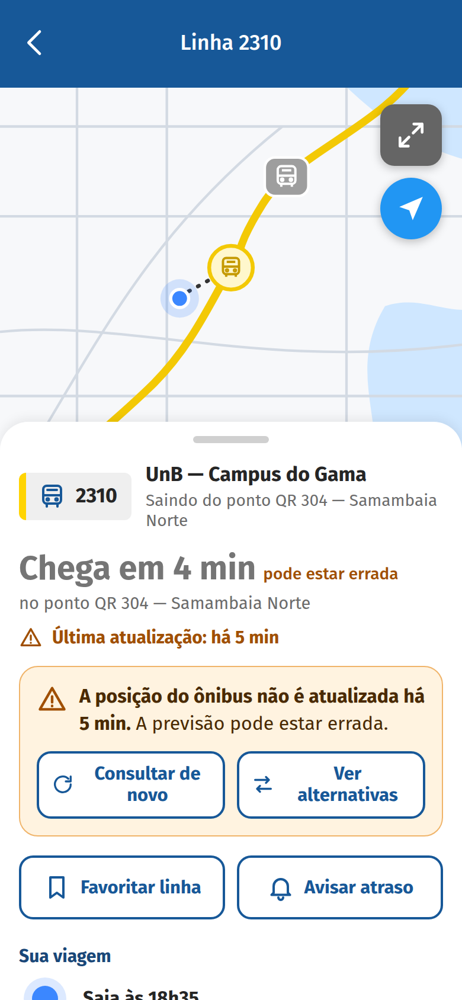
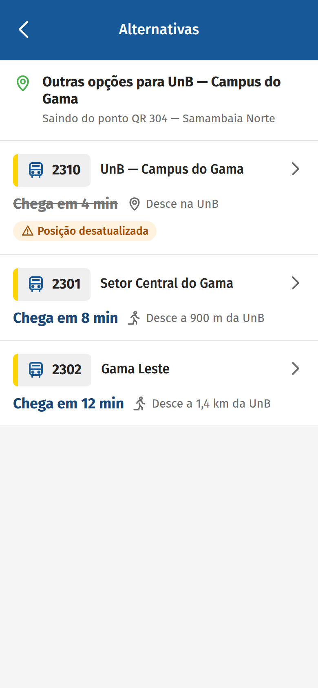
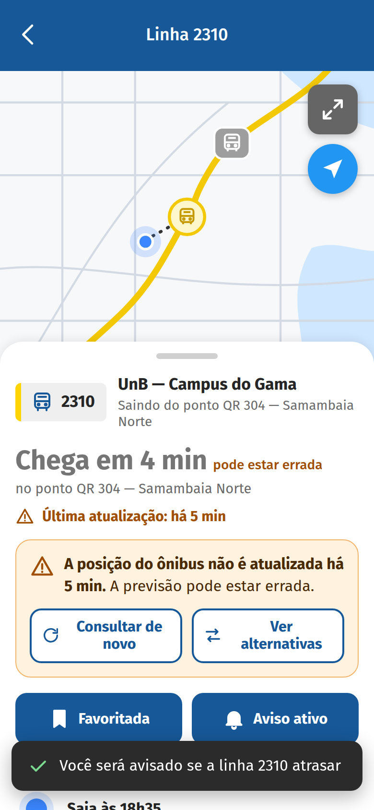
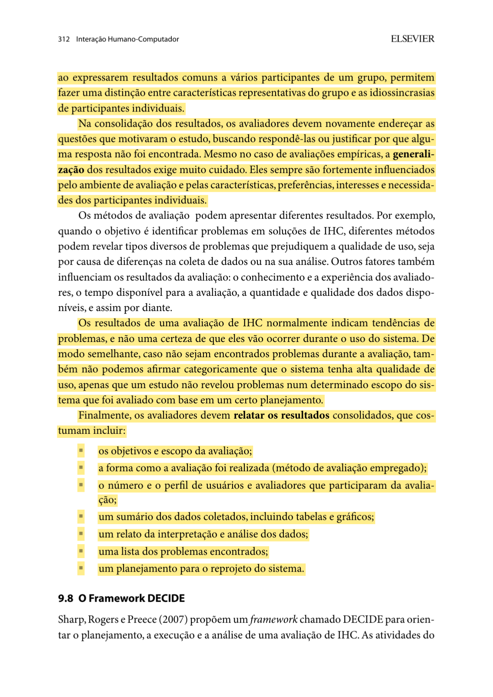
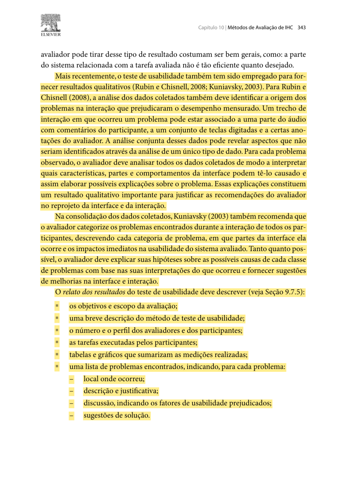

# Relato dos Resultados da Avaliação do Protótipo de Alta Fidelidade (TAR-06)

## Histórico de Versão

| Data | Versão | Descrição | Autor(es) | Revisor(es) | Declaração de uso de IA |
| :---: | :---: | :--- | :--- | :--- | :--- |
| 10/11/2026 | `0.1` | Esqueleto do relato: estrutura das seções, descrição do protótipo e tabelas a preencher depois das sessões. Nenhum resultado registrado. | [Carlos Costa](https://github.com/carloshfgit) | *a definir* | Claude Code (Anthropic) - montagem da estrutura e formatação em Markdown a partir do planejamento do relato do autor |

---

!!! warning "Relato em construção"
    Esta versão é apenas a **estrutura** do relato. As sessões de avaliação ainda não foram realizadas. Os campos marcados com *[a preencher]* serão completados **somente com os dados reais** das sessões.

Neste documento, apresenta-se o **Relato dos Resultados da Avaliação do Protótipo de Alta Fidelidade** referente à **[TAR-06 (Consulta de ônibus em tempo real no DF no Ponto)](../../../../analise-de-requisitos/analise-de-tarefas/tar-06-df-no-ponto.md)**. A avaliação seguiu o [Planejamento da Avaliação do Protótipo de Alta Fidelidade](../../planejamentos-individuais/carlos/carlos-planejamento-av-prot-alta-fidel.md), e este relato segue a estrutura definida no [Planejamento do Relato](../../planejamentos-individuais/carlos/carlos-planejamento-relato-prot-alta-fidel.md) (Tabela 1 daquele documento).

Primeiro, os dados de cada participante são interpretados. Depois, os resultados de todos são consolidados, voltando às perguntas iniciais (Barbosa e Silva, 2010, p. 310–312) ([Imagem 7](#imagem-7)). Os problemas são descritos conforme o teste de usabilidade (Barbosa e Silva, 2010, p. 342–343) ([Imagens 8 e 9](#imagem-8)).

---

## 1. Objetivos e Escopo

O escopo é a consulta da previsão de chegada de uma linha, desde a busca até a decisão de ir ao ponto, e os atalhos para as próximas consultas, no contexto do [Cenário 2](../../../../analise-de-requisitos/cenarios/cenario-2-viagem-matutina.md) e da persona [João Pedro Carvalho](../../../../analise-de-requisitos/personas/joao-pedro-carvalho.md). Outras funções do aplicativo não foram avaliadas.

A avaliação teve como objetivos:

1. Identificar problemas de usabilidade e navegação nas telas de busca, resultados, detalhe da linha e alternativas.
2. Verificar se os ajustes vindos do protótipo de papel funcionam com cores, tipografia e interação reais.
3. Avaliar a indicação de **última atualização** e o **aviso de posição desatualizada** (H4 e H5).
4. Avaliar os atalhos de **linhas favoritas** e do **aviso de atraso** (H2).
5. Verificar a busca por ponto de referência com um usuário novo (H6).
6. Verificar a conformidade com o [Guia de Estilo](../../../../analise-de-requisitos/guia-de-estilo/introducao.md) do Grupo 05.

### 1.1 Protótipo Avaliado

O protótipo é uma página em **HTML navegável**, executada no navegador do celular. A troca do Figma para o HTML está justificada na seção 5.1 do [Planejamento da Avaliação](../../planejamentos-individuais/carlos/carlos-planejamento-av-prot-alta-fidel.md). O protótipo é versionado em repositório próprio do autor e publicado no GitHub Pages.

<strong>Tabela 1</strong> — Identificação do protótipo avaliado

| Item | Detalhamento |
| :--- | :--- |
| **Link do protótipo** | [carloshfgit.github.io/prototipo-tar06-df-no-ponto](https://carloshfgit.github.io/prototipo-tar06-df-no-ponto/) |
| **Repositório** | [github.com/carloshfgit/prototipo-tar06-df-no-ponto](https://github.com/carloshfgit/prototipo-tar06-df-no-ponto) |
| **Versão testada** | *[a preencher: versão e commit usados nas sessões]* |
| **Telas** | A1 Início · A2 Busca · A3 Resultados por lugar ou ponto · A4 Linha · N1 Aviso de posição desatualizada · A5 Alternativas · N2 Confirmações · A6 Favoritos |
| **Dados** | Fictícios: ponto QR 304 (Samambaia Norte), destino UnB — Campus do Gama, linhas 2310, 2301, 2302 e 2130 |
| **Identidade visual** | Cores e componentes medidos em capturas do aplicativo DF no Ponto; vocabulário e regras de ação do Guia de Estilo do Grupo 05 |

<em>Fonte: Elaborado por Carlos Costa (2026).</em>

<strong>Imagens 1 a 6</strong> — Telas do protótipo de alta fidelidade da TAR-06

| { width="200" } | { width="200" } | { width="200" } |
| :---: | :---: | :---: |
| **Imagem 1** — A1 Início | **Imagem 2** — A3 Resultados por lugar | **Imagem 3** — A4 Linha |
| { width="200" } | { width="200" } | { width="200" } |
| **Imagem 4** — N1 Aviso de posição desatualizada | **Imagem 5** — A5 Alternativas | **Imagem 6** — N2 Confirmação do aviso de atraso |

<em>Fonte: Elaborado por Carlos Costa (2026).</em>

---

## 2. Método

O método foi o **teste de usabilidade** (Barbosa e Silva, 2010, p. 341–342), com a técnica de **pensar em voz alta** e uma entrevista breve ao final. O participante executou três tarefas no celular, e o observador registrou, para cada uma:

* conclusão;
* tempo;
* erros e retornos;
* pedidos de ajuda;
* falas.

O protótipo também registrou automaticamente os toques e as trocas de tela, com horário, para conferir os tempos.

<strong>Tabela 2</strong> — Tarefas da sessão

| ID | Enunciado entregue ao participante | Critério de conclusão | Perguntas |
| :---: | :--- | :--- | :---: |
| **AF1** | "Descubra em quanto tempo chega o próximo ônibus da sua linha para a UnB Gama." | Informa o tempo previsto da linha correta. | P01, P02, P03 |
| **AF2** | "O aplicativo mostrou um aviso sobre a posição do ônibus. Decida o que fazer." | Explica o aviso e escolhe consultar de novo ou ver alternativas, com justificativa. | P04, P05 |
| **AF3** | "Deixe essa linha pronta para as próximas manhãs e peça para ser avisado se ela atrasar." | Vê as confirmações de linha salva e de aviso de atraso ativado. | P06 |

<em>Fonte: Planejamento da Avaliação do Protótipo de Alta Fidelidade (Tabela 3), Carlos Costa (2026).</em>

O aviso de posição desatualizada (AF2) é um **estado simulado**: ele aparece *[a preencher: momento usado nas sessões]* depois de a linha 2310 ser aberta pela primeira vez. Não é uma falha real do rastreamento.

---

## 3. Participantes e Avaliadores

<strong>Tabela 3</strong> — Participantes e equipe da avaliação

| Item | Detalhamento |
| :--- | :--- |
| **P01** | *[a preencher: perfil agregado — frequência de uso de ônibus, uso de aplicativos, se já usou o DF no Ponto]* |
| **P02** | *[a preencher]* |
| **P03** | *[a preencher]* |
| **Condutor** | [Carlos Costa](https://github.com/carloshfgit) |
| **Observador** | *[a preencher]* |
| **Ética** | *[a preencher: TCLE assinado em duas vias, gravação e publicação autorizadas ou não]* |

<em>Fonte: Elaborado por Carlos Costa (2026).</em>

Nenhum participante integra o Grupo 05 ou participou das avaliações anteriores da TAR-06 (P04 e P05). Os participantes são identificados apenas por código; nome, linha de ônibus real e outros dados pessoais não foram registrados.

---

## 4. Execução

### 4.1 Teste Piloto

*[a preencher: data, horário, integrante do Grupo 05 que não construiu o protótipo, duração e ajustes feitos depois do piloto (protótipo, tarefas, ficha, roteiro), com a versão nova do protótipo.]*

Os dados do piloto **não entram nos resultados**; só os ajustes feitos depois dele são registrados (Barbosa e Silva, 2010, p. 307) ([Imagem 10](#imagem-10)).

### 4.2 Sessões

<strong>Tabela 4</strong> — Sessões realizadas

| Sessão | Participante | Data e horário | Duração | Local | Gravação |
| :---: | :---: | :---: | :---: | :--- | :---: |
| 1 | P01 | *[a preencher]* | *[a preencher]* | *[a preencher]* | *[a preencher]* |
| 2 | P02 | *[a preencher]* | *[a preencher]* | *[a preencher]* | *[a preencher]* |
| 3 | P03 | *[a preencher]* | *[a preencher]* | *[a preencher]* | *[a preencher]* |

<em>Fonte: Elaborado por Carlos Costa (2026).</em>

### 4.3 Desvios do Planejamento

O planejamento previa o piloto em 10/11/2026 e as sessões em 11/11 e 12/11/2026. O piloto não foi feito em 10/11/2026, porque o protótipo ficou pronto nesse mesmo dia.

*[a preencher: datas reais, outras mudanças de horário, local, observador ou roteiro, falhas técnicas e interrupções.]*

---

## 5. Desempenho por Tarefa

A coluna "Conclusão" usa os valores **sem ajuda**, **com ajuda** ou **não concluída**. O tempo vai do início da leitura da tarefa até o critério de conclusão.

<strong>Tabela 5</strong> — Desempenho dos participantes nas tarefas

| Participante | Tarefa | Conclusão | Tempo | Erros e retornos | Pedidos de ajuda | Comentários relevantes |
| :---: | :---: | :--- | :---: | :--- | :---: | :--- |
| P01 | AF1 | *[a preencher]* | *[a preencher]* | *[a preencher]* | *[a preencher]* | *[a preencher]* |
| P01 | AF2 | *[a preencher]* | *[a preencher]* | *[a preencher]* | *[a preencher]* | *[a preencher]* |
| P01 | AF3 | *[a preencher]* | *[a preencher]* | *[a preencher]* | *[a preencher]* | *[a preencher]* |
| P02 | AF1 | *[a preencher]* | *[a preencher]* | *[a preencher]* | *[a preencher]* | *[a preencher]* |
| P02 | AF2 | *[a preencher]* | *[a preencher]* | *[a preencher]* | *[a preencher]* | *[a preencher]* |
| P02 | AF3 | *[a preencher]* | *[a preencher]* | *[a preencher]* | *[a preencher]* | *[a preencher]* |
| P03 | AF1 | *[a preencher]* | *[a preencher]* | *[a preencher]* | *[a preencher]* | *[a preencher]* |
| P03 | AF2 | *[a preencher]* | *[a preencher]* | *[a preencher]* | *[a preencher]* | *[a preencher]* |
| P03 | AF3 | *[a preencher]* | *[a preencher]* | *[a preencher]* | *[a preencher]* | *[a preencher]* |

<em>Fonte: Elaborado por Carlos Costa (2026).</em>

---

## 6. Respostas às Perguntas da Avaliação

<strong>Tabela 6</strong> — Respostas às perguntas P01–P07

| Pergunta | Evidências (P01, P02, P03) | Síntese | Situação |
| :---: | :--- | :--- | :---: |
| **P01** — Busca | *[a preencher]* | *[a preencher]* | *[a preencher]* |
| **P02** — Seleção | *[a preencher]* | *[a preencher]* | *[a preencher]* |
| **P03** — Previsão | *[a preencher]* | *[a preencher]* | *[a preencher]* |
| **P04** — Confiabilidade | *[a preencher]* | *[a preencher]* | *[a preencher]* |
| **P05** — Informação defasada | *[a preencher]* | *[a preencher]* | *[a preencher]* |
| **P06** — Próximas consultas | *[a preencher]* | *[a preencher]* | *[a preencher]* |
| **P07** — Guia de Estilo e experiência | *[a preencher]* | *[a preencher]* | *[a preencher]* |

<em>Fonte: Elaborado por Carlos Costa (2026).</em>

Os valores da coluna "Situação" são **respondida**, **parcial** ou **inconclusiva**. Uma pergunta sem evidência suficiente é marcada como inconclusiva, com a justificativa (Barbosa e Silva, 2010, p. 311–312).

### 6.1 Entrevista Pós-Teste

<strong>Tabela 7</strong> — Respostas da entrevista pós-teste

| Pergunta | P01 | P02 | P03 |
| :--- | :--- | :--- | :--- |
| O que significava a informação "Última atualização: há X"? Ela mudou a sua confiança na previsão? | *[a preencher]* | *[a preencher]* | *[a preencher]* |
| O que você entendeu quando apareceu o aviso sobre a posição do ônibus? | *[a preencher]* | *[a preencher]* | *[a preencher]* |
| Teve algum botão, palavra ou cor que você não entendeu ou que te confundiu? | *[a preencher]* | *[a preencher]* | *[a preencher]* |
| Usando esse aplicativo no ponto, você se sentiria informado enquanto espera? Por quê? | *[a preencher]* | *[a preencher]* | *[a preencher]* |
| O que você mudaria nessas telas? | *[a preencher]* | *[a preencher]* | *[a preencher]* |

<em>Fonte: Elaborado por Carlos Costa (2026).</em>

---

## 7. Problemas Encontrados

Os problemas são classificados pela escala de severidade de Nielsen (1994), descrita na Tabela 2 do [Planejamento do Relato](../../planejamentos-individuais/carlos/carlos-planejamento-relato-prot-alta-fidel.md): 0 sem importância, 1 leve, 2 moderado, 3 grave e 4 catastrófico.

Um problema que aparece em mais de um participante é registrado uma vez, com os participantes afetados. A descrição separa o que foi observado da possível causa na interface (Barbosa e Silva, 2010, p. 343) ([Imagem 9](#imagem-9)).

<strong>Tabela 8</strong> — Problemas encontrados no protótipo de alta fidelidade, ordenados por severidade

| ID | Tela / componente | Descrição do problema | Evidência observada | Participantes afetados | Severidade (0–4) | Sugestão de solução no protótipo |
| :---: | :--- | :--- | :--- | :---: | :---: | :--- |
| **AF-01** | *[a preencher]* | *[a preencher]* | *[a preencher]* | *[a preencher]* | *[0 a 4]* | *[a preencher]* |

<em>Fonte: Elaborado por Carlos Costa (2026).</em>

---

## 8. Comparação com o Protótipo de Papel

A Tabela 9 retoma as pendências do [Relato do Protótipo de Papel](../../../nivel2/relatos-individuais/carlos/relato-resultados-prot-papel.md) (Tabela 6 daquele documento).

<strong>Tabela 9</strong> — Pendências do protótipo de papel × resultado na alta fidelidade

| Pendência do papel | Ajuste feito no protótipo | Resultado na alta fidelidade |
| :--- | :--- | :---: |
| **PE-01** — O aviso N1 ofereceu só "Ver alternativas"; "Consultar de novo" não foi testada. | O aviso N1 tem as duas opções, "Consultar de novo" e "Ver alternativas", com o mesmo peso visual. | *[a preencher]* |
| **PE-02** — A lista de resultados por lugar, com linhas de números parecidos, não foi exibida (H3). | A busca por "UnB Gama" leva à lista com as linhas 2301, 2310 e 2302, com destino e local de desembarque. | *[a preencher]* |
| **PE-03** — Os tempos de cada tarefa não foram medidos. | Cada tarefa foi cronometrada, e o protótipo registrou automaticamente os toques e as trocas de tela. | *[a preencher]* |

<em>Fonte: Elaborado por Carlos Costa (2026).</em>

Os valores da coluna "Resultado" são **resolvido**, **persiste** ou **não observado**.

---

## 9. Hipóteses da TAR-06

<strong>Tabela 10</strong> — Hipóteses da TAR-06 após a avaliação de alta fidelidade

| Hipótese | Descrição resumida | Pergunta | Evidência | Situação após a avaliação |
| :---: | :--- | :---: | :--- | :---: |
| **H2** | A busca exige lembrar a linha; um atalho para linhas usadas ajudaria. | P01, P06 | *[a preencher]* | *[a preencher]* |
| **H3** | Itens próximos na lista levam à seleção errada. | P02 | *[a preencher]* | *[a preencher]* |
| **H4** | A hora da última atualização ajuda a avaliar a confiabilidade. | P04 | *[a preencher]* | *[a preencher]* |
| **H5** | O usuário trata uma posição defasada como atual. | P05 | *[a preencher]* | *[a preencher]* |
| **H6** | O usuário novo não sabe que existe a busca por ponto de referência. | P01 | *[a preencher]* | *[a preencher]* |
| **H7** | Com a consulta em tempo real, o passageiro não se sente sem informação enquanto espera. | P07 | *[a preencher]* | *[a preencher]* |

<em>Fonte: Elaborado por Carlos Costa (2026), com base na Tabela 5 da TAR-06.</em>

Os valores possíveis são **confirmada**, **parcialmente confirmada**, **não confirmada** e **não avaliada**.

---

## 10. Reprojeto e Limitações

### 10.1 Reprojeto

Os problemas de severidade 3 e 4 são corrigidos primeiro no protótipo HTML; os de severidade 1 e 2 entram na lista de melhorias; os de severidade 0 são apenas registrados. Cada mudança indica o problema que a justifica, a tela alterada e o *commit* do protótipo que a contém.

<strong>Tabela 11</strong> — Mudanças propostas para o protótipo

| Prioridade | Problema | Tela | Mudança | *Commit* / versão |
| :---: | :---: | :--- | :--- | :---: |
| *[a preencher]* | *[a preencher]* | *[a preencher]* | *[a preencher]* | *[a preencher]* |

<em>Fonte: Elaborado por Carlos Costa (2026).</em>

### 10.2 Perguntas sem Resposta

*[a preencher]*

### 10.3 Limitações

* **Amostra:** *[a preencher: número e perfil reais dos participantes]*. Com três participantes, as conclusões valem só para o protótipo e as tarefas testadas (Barbosa e Silva, 2010, p. 312–313).
* **Estado simulado:** o aviso de posição desatualizada aparece em um momento definido, não por falha real do rastreamento.
* **Dados fictícios:** linhas, pontos e horários não correspondem ao serviço real. O aviso de atraso não envia notificações.
* *[a preencher: falhas técnicas e desvios do roteiro]*

---

## 11. Vídeos

*[a preencher: gravações das sessões incorporadas do YouTube (vídeos "não listados"), somente com a autorização dos participantes.]*

---

## 12. Fotos de Referência

Os trechos grifados em amarelo fundamentam a estrutura deste relato.

<strong>Imagem 7</strong> — Consolidação dos resultados e itens do relato (p. 312).

<em>Fonte: Barbosa e Silva (2010, p. 312).</em>

<strong>Imagem 8</strong> — Dados de conclusão, tempo, erros e uso de ajuda no teste de usabilidade (p. 342).

<em>Fonte: Barbosa e Silva (2010, p. 342).</em>

<strong>Imagem 9</strong> — Descrição dos problemas encontrados no teste de usabilidade (p. 343).

<em>Fonte: Barbosa e Silva (2010, p. 343).</em>

<strong>Imagem 10</strong> — Descarte dos dados do teste piloto (p. 307).

<em>Fonte: Barbosa e Silva (2010, p. 307).</em>

---

## 13. Declaração sobre o Uso de IA Generativa

Em cumprimento ao Plano de Ensino e ao Código de Conduta da SBC, declara-se que a ferramenta **Claude Code (Anthropic)** foi utilizada para montar a estrutura deste relato a partir do planejamento do autor e para formatar o texto em Markdown. A mesma ferramenta implementou o protótipo navegável a partir das decisões de design do autor. A condução das sessões, o registro das observações e das respostas, a classificação da severidade e as decisões de reprojeto são de Carlos Costa, que responde integralmente pelo conteúdo. Nenhum dado de sessão foi gerado pela ferramenta.

---

## 14. Referências Bibliográficas

* BARBOSA, Simone Diniz Junqueira; SILVA, Bruno Santana da. **Interação Humano-Computador**. Rio de Janeiro: Elsevier/Campus, 2010. Cap. 9, seções 9.7.2 e 9.7.4–9.8, p. 307 e 310–313; cap. 10, seção 10.2.1, p. 341–343.
* BRASIL. Conselho Nacional de Saúde. **Resolução nº 510, de 07 de abril de 2016**. Regulamenta as pesquisas em Ciências Humanas e Sociais. Brasília: Diário Oficial da União, 2016.
* NIELSEN, Jakob. **Usability Engineering**. San Francisco: Morgan Kaufmann, 1994.
* SALES, André Barros de. **Plano de Ensino: Interação Humano Computador**. Brasília: Universidade de Brasília, Faculdade UnB Gama (FCTE/UnB), 2026.

---
**Autor:** [Carlos Costa](https://github.com/carloshfgit)  
**Revisor:** *a definir*
