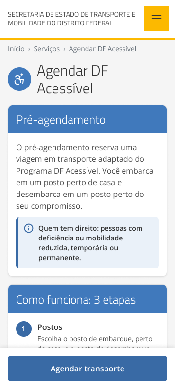
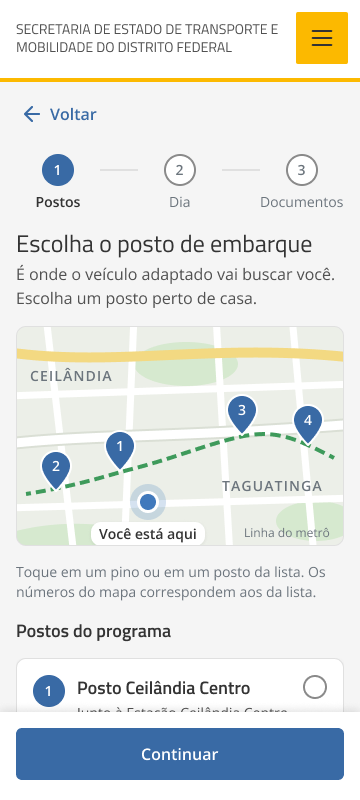
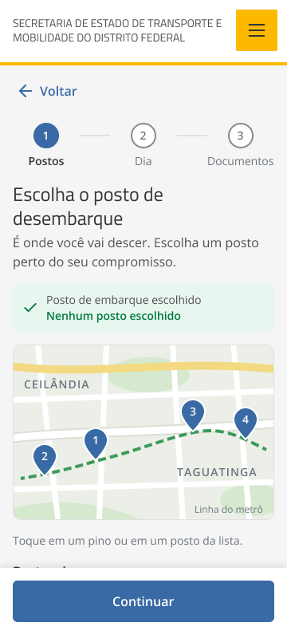
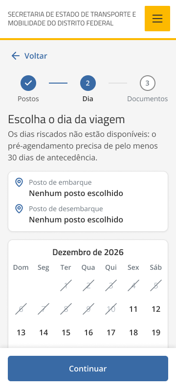
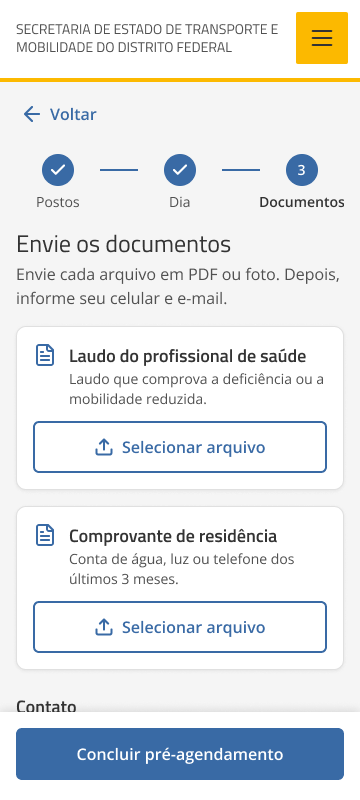
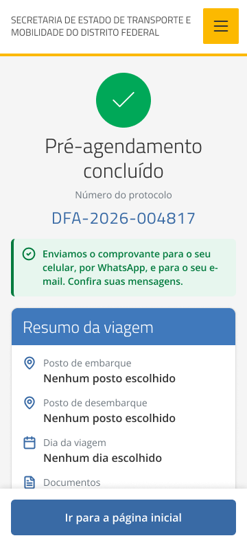
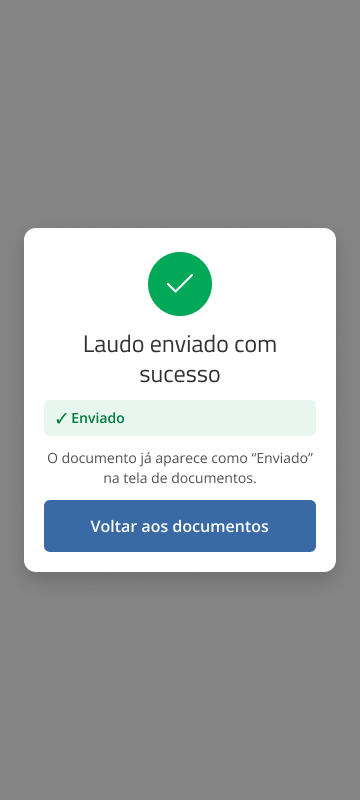
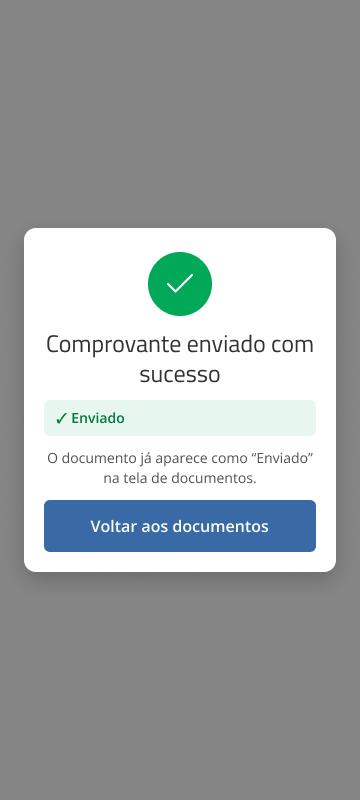

## Histórico de Versão e Contribuição

| Data | Versão | Descrição | Autor(es) | Revisor(es) | Declaração de Uso de IA |
| :---: | :---: | :--- | :--- | :--- | :--- |
| 15/11/2026 | `1.0` | Consolidação e relato dos resultados do teste de usabilidade do Protótipo de Alta Fidelidade (TAR-02) com 3 participantes. | [Gabriel Cardone](https://github.com/gabriellcardone-06) | [Arthur Mariani](https://github.com/arthur-mariani) | Claude (Anthropic) - usado para apoio na transcrição das gravações, na medição dos tempos a partir dos vídeos e na formatação markdown da página. |
| 20/11/2026 | `1.1` | Inclusão da seção com as telas do protótipo de alta fidelidade e do link para o protótipo no Figma, inclusão dos TCLEs assinados pelos participantes e renumeração das seções e figuras. | [Gabriel Cardone](https://github.com/gabriellcardone-06) | Pendente de revisão | Claude (Anthropic) - formatação markdown. |

---

# Relato dos Resultados da Avaliação do Protótipo de Alta Fidelidade (TAR-02)

Neste documento, apresenta-se o **Relato dos Resultados da Avaliação do Protótipo de Alta Fidelidade** referente à **[TAR-02 (Pré-agendamento no Programa DF Acessível)](../../../../analise-de-requisitos/analise-de-tarefas/tar-02-df-acessivel.md)**. A avaliação seguiu o [Planejamento da Avaliação do Protótipo de Alta Fidelidade](../../planejamentos-individuais/gabriel/planejamento-av-prot-alta-fidel.md), e a estrutura deste relato segue o [Planejamento do Relato](../../planejamentos-individuais/gabriel/planejamento-relato-prot-alta-fidel.md), mantendo o padrão do [Relato dos Resultados da Avaliação do Protótipo de Papel](../../../nivel2/relatos-individuais/gabriel/relato-resultado-prot-papel.md) para permitir a comparação entre os dois níveis.

**Artefatos relacionados — fluxo da funcionalidade TAR-02 (Pré-agendamento no Programa DF Acessível):**

* **Persona:** [Larissa Ferreira Lima](../../../../analise-de-requisitos/personas/larissa-ferreira-lima.md)
* **Cenário:** [Cenário 1](../../../../analise-de-requisitos/cenarios/cenario-1-pre-agendamento-df-acessivel.md)
* **Análise de tarefas:** [TAR-02](../../../../analise-de-requisitos/analise-de-tarefas/tar-02-df-acessivel.md)
* **Storyboard:** [Storyboard 02](../../../nivel1/storyboards.md#32-storyboard-02-pre-agendamento-no-programa-df-acessivel)
* **Nível 1: avaliação do storyboard e da análise de tarefas:** [Planejamento da avaliação](../../../nivel1/planejamentos-individuais/Gabriel/gabriel-planejamento-avaliacao.md) · [Planejamento do relato](../../../nivel1/planejamentos-individuais/Gabriel/gabriel-planejamento-relato-resultados-avaliacao.md) · [Relato dos resultados](../../../nivel1/relatos-individuais/gabriel/relato-resultados-storyboard-tarefas.md)
* **Nível 2: protótipo de papel (baixa fidelidade):** [Planejamento da avaliação](../../../nivel2/planejamentos-individuais/Gabriel/gabriel-planejamento-av-prototipo-papel.md) · [Planejamento do relato](../../../nivel2/planejamentos-individuais/Gabriel/gabriel-planejamento-relato-prot-papel.md) · [Relato dos resultados](../../../nivel2/relatos-individuais/gabriel/relato-resultado-prot-papel.md)
* **Nível 3: protótipo de alta fidelidade:** [Planejamento da avaliação](../../planejamentos-individuais/gabriel/planejamento-av-prot-alta-fidel.md) · [Planejamento do relato](../../planejamentos-individuais/gabriel/planejamento-relato-prot-alta-fidel.md) · Relato dos resultados (*esta página*)
* **Telas do protótipo de papel:** [telas no planejamento da avaliação](../../../nivel2/planejamentos-individuais/Gabriel/gabriel-planejamento-av-prototipo-papel.md#9-telas-do-prototipo-avaliado)
* **Protótipo de alta fidelidade navegável:** [acessar o protótipo](https://www.figma.com/proto/AIO6YnlBnPcriwQzsEdHpi/Prot%C3%B3tipo-Alta-Fidelidade-%E2%80%94-TAR-02-DF-Acess%C3%ADvel--SEMOB-DF-?node-id=6-67&starting-point-node-id=6%3A67&t=a6O7kf7iKozAdr05-1)

---

## 1. O Protótipo Avaliado

O objeto desta avaliação é o protótipo interativo de alta fidelidade da **[TAR-02 (Pré-agendamento no Programa DF Acessível)](../../../../analise-de-requisitos/analise-de-tarefas/tar-02-df-acessivel.md)**, desenvolvido no **Figma** na versão para celular e em conformidade com o [Guia de Estilo](../../../../analise-de-requisitos/guia-de-estilo/introducao.md) do Grupo 05:

* **Protótipo Interativo no Figma:** [Acessar o protótipo no Figma](https://www.figma.com/proto/AIO6YnlBnPcriwQzsEdHpi/Prot%C3%B3tipo-Alta-Fidelidade-%E2%80%94-TAR-02-DF-Acess%C3%ADvel--SEMOB-DF-?node-id=6-67&starting-point-node-id=6%3A67&t=a6O7kf7iKozAdr05-1)

As Figuras 1 a 10 mostram as telas do protótipo de alta fidelidade da [TAR-02](../../../../analise-de-requisitos/analise-de-tarefas/tar-02-df-acessivel.md), no estado em que aparecem ao serem abertas no celular. As Figuras 7 a 10 são as sobreposições abertas a partir da tela de documentos.

<strong>Figura 1</strong>: Apresentação do pré-agendamento, com a explicação do serviço, o público atendido, as 3 etapas e o botão "Agendar transporte" (tela 1 do protótipo)

{ width="320" }

<em>Fonte: Elaborado por Gabriel Cardone (2026). Tela exportada do [protótipo no Figma](https://www.figma.com/proto/AIO6YnlBnPcriwQzsEdHpi/Prot%C3%B3tipo-Alta-Fidelidade-%E2%80%94-TAR-02-DF-Acess%C3%ADvel--SEMOB-DF-?node-id=6-67&starting-point-node-id=6%3A67&t=a6O7kf7iKozAdr05-1).</em>

<strong>Figura 2</strong>: Escolha do posto de embarque, com o indicador de etapas, o mapa com os postos numerados e a lista "Postos do programa" (tela 2 do protótipo)

{ width="320" }

<em>Fonte: Elaborado por Gabriel Cardone (2026). Tela exportada do [protótipo no Figma](https://www.figma.com/proto/AIO6YnlBnPcriwQzsEdHpi/Prot%C3%B3tipo-Alta-Fidelidade-%E2%80%94-TAR-02-DF-Acess%C3%ADvel--SEMOB-DF-?node-id=6-67&starting-point-node-id=6%3A67&t=a6O7kf7iKozAdr05-1).</em>

<strong>Figura 3</strong>: Escolha do posto de desembarque, com a confirmação do posto de embarque escolhido no topo (tela 3 do protótipo)

{ width="320" }

<em>Fonte: Elaborado por Gabriel Cardone (2026). Tela exportada do [protótipo no Figma](https://www.figma.com/proto/AIO6YnlBnPcriwQzsEdHpi/Prot%C3%B3tipo-Alta-Fidelidade-%E2%80%94-TAR-02-DF-Acess%C3%ADvel--SEMOB-DF-?node-id=6-67&starting-point-node-id=6%3A67&t=a6O7kf7iKozAdr05-1).</em>

<strong>Figura 4</strong>: Escolha do dia da viagem, com o resumo dos postos e o calendário de dezembro de 2026 com os dias indisponíveis riscados (tela 4 do protótipo)

{ width="320" }

<em>Fonte: Elaborado por Gabriel Cardone (2026). Tela exportada do [protótipo no Figma](https://www.figma.com/proto/AIO6YnlBnPcriwQzsEdHpi/Prot%C3%B3tipo-Alta-Fidelidade-%E2%80%94-TAR-02-DF-Acess%C3%ADvel--SEMOB-DF-?node-id=6-67&starting-point-node-id=6%3A67&t=a6O7kf7iKozAdr05-1).</em>

<strong>Figura 5</strong>: Envio dos documentos (laudo e comprovante de residência) e dos dados de contato (tela 5 do protótipo)

{ width="320" }

<em>Fonte: Elaborado por Gabriel Cardone (2026). Tela exportada do [protótipo no Figma](https://www.figma.com/proto/AIO6YnlBnPcriwQzsEdHpi/Prot%C3%B3tipo-Alta-Fidelidade-%E2%80%94-TAR-02-DF-Acess%C3%ADvel--SEMOB-DF-?node-id=6-67&starting-point-node-id=6%3A67&t=a6O7kf7iKozAdr05-1).</em>

<strong>Figura 6</strong>: Conclusão do pré-agendamento, com o número de protocolo, o aviso de envio do comprovante e o resumo da viagem (tela 6 do protótipo)

{ width="320" }

<em>Fonte: Elaborado por Gabriel Cardone (2026). Tela exportada do [protótipo no Figma](https://www.figma.com/proto/AIO6YnlBnPcriwQzsEdHpi/Prot%C3%B3tipo-Alta-Fidelidade-%E2%80%94-TAR-02-DF-Acess%C3%ADvel--SEMOB-DF-?node-id=6-67&starting-point-node-id=6%3A67&t=a6O7kf7iKozAdr05-1).</em>

<strong>Figura 7</strong>: Seletor de arquivos aberto a partir do campo "Laudo do profissional de saúde" (sobreposição O1 do protótipo)

{ width="320" }

<em>Fonte: Elaborado por Gabriel Cardone (2026). Tela exportada do [protótipo no Figma](https://www.figma.com/proto/AIO6YnlBnPcriwQzsEdHpi/Prot%C3%B3tipo-Alta-Fidelidade-%E2%80%94-TAR-02-DF-Acess%C3%ADvel--SEMOB-DF-?node-id=6-67&starting-point-node-id=6%3A67&t=a6O7kf7iKozAdr05-1).</em>

<strong>Figura 8</strong>: Seletor de arquivos aberto a partir do campo "Comprovante de residência" (sobreposição O2 do protótipo)

{ width="320" }

<em>Fonte: Elaborado por Gabriel Cardone (2026). Tela exportada do [protótipo no Figma](https://www.figma.com/proto/AIO6YnlBnPcriwQzsEdHpi/Prot%C3%B3tipo-Alta-Fidelidade-%E2%80%94-TAR-02-DF-Acess%C3%ADvel--SEMOB-DF-?node-id=6-67&starting-point-node-id=6%3A67&t=a6O7kf7iKozAdr05-1).</em>

<strong>Figura 9</strong>: *Pop-up* "Laudo enviado com sucesso" (sobreposição O3 do protótipo)

{ width="320" }

<em>Fonte: Elaborado por Gabriel Cardone (2026). Tela exportada do [protótipo no Figma](https://www.figma.com/proto/AIO6YnlBnPcriwQzsEdHpi/Prot%C3%B3tipo-Alta-Fidelidade-%E2%80%94-TAR-02-DF-Acess%C3%ADvel--SEMOB-DF-?node-id=6-67&starting-point-node-id=6%3A67&t=a6O7kf7iKozAdr05-1).</em>

<strong>Figura 10</strong>: *Pop-up* "Comprovante enviado com sucesso" (sobreposição O4 do protótipo)

{ width="320" }

<em>Fonte: Elaborado por Gabriel Cardone (2026). Tela exportada do [protótipo no Figma](https://www.figma.com/proto/AIO6YnlBnPcriwQzsEdHpi/Prot%C3%B3tipo-Alta-Fidelidade-%E2%80%94-TAR-02-DF-Acess%C3%ADvel--SEMOB-DF-?node-id=6-67&starting-point-node-id=6%3A67&t=a6O7kf7iKozAdr05-1).</em>

---

## 2. Introdução e Objetivos da Avaliação

### 2.1 Escopo do Protótipo Avaliado

O protótipo avaliado foi construído no **Figma** e representa, na versão para celular do site da **SEMOB-DF**, a funcionalidade de pré-agendamento de viagens do Programa DF Acessível. Ele mantém o fluxo aprovado no protótipo de papel, agora com o acabamento visual do [Guia de Estilo](../../../../analise-de-requisitos/guia-de-estilo/introducao.md). As telas avaliadas foram:

1. **Apresentação ("Agendar DF Acessível"):** explicação do pré-agendamento, público atendido, resumo das 3 etapas (Postos, Dia, Documentos), aviso de 30 dias de antecedência e botão "Agendar transporte".
2. **Posto de embarque:** indicador de etapas, mapa com os postos numerados e a marcação "Você está aqui", lista "Postos do programa" com distância e recursos de acessibilidade de cada posto, e botão "Continuar".
3. **Posto de desembarque:** mesma estrutura, com a confirmação do posto de embarque já escolhido no topo.
4. **Dia:** resumo dos postos escolhidos, calendário de dezembro de 2026 com os dias indisponíveis riscados, confirmação do dia escolhido por extenso e botão "Continuar".
5. **Documentos:** campos "Laudo do profissional de saúde" e "Comprovante de residência" com o botão "Selecionar arquivo", seletor de arquivos simulado, *pop-up* de confirmação de envio, campos de telefone (WhatsApp) e e-mail e botão "Concluir pré-agendamento".
6. **Conclusão:** mensagem "Pré-agendamento concluído", número de protocolo, aviso de envio do comprovante por WhatsApp e e-mail, resumo da viagem e botão "Ir para a página inicial".

### 2.2 Objetivos e Metas

Os objetivos foram avaliar a eficácia e a eficiência das três etapas do fluxo, confirmar a compreensão dos rótulos com o acabamento final, verificar a conformidade com o Guia de Estilo, avaliar a legibilidade e as áreas de toque e subsidiar o refinamento final no Figma. As metas de usabilidade definidas no planejamento foram:

* **M01 (Eficácia):** pelo menos 2 dos 3 participantes concluem cada tarefa sem pedir ajuda.
* **M02 (Eficiência):** fluxo completo concluído em até 3 minutos por participante.
* **M03 (Erros):** no máximo 1 erro por tarefa, em média.
* **M04 (Satisfação):** nenhum participante classifica a experiência como difícil.

---

## 3. Metodologia Empregada

Foi aplicado o **Teste de Usabilidade** (Barbosa et al., 2021, Seção 12.2.1) com a técnica de **pensar em voz alta** (*think aloud*), seguido de uma **entrevista pós-teste** com as perguntas Q01 a Q05. Cada participante recebeu o [Cenário 1](../../../../analise-de-requisitos/cenarios/cenario-1-pre-agendamento-df-acessivel.md) (*"Você precisa de transporte adaptado para ir à fisioterapia, em Taguatinga, daqui a um mês. Você mora em Ceilândia [...] Faça o pré-agendamento da viagem."*) e executou as tarefas TAR-02.1 a TAR-02.3.

* **Dispositivo:** celular, com o protótipo aberto no navegador pelo modo de apresentação do Figma. O participante tocou diretamente na tela, como faria no site real.
* **Gravação:** câmera filmando o participante, com a gravação da tela do celular sobreposta no vídeo.
* **Duração real das sessões:** entre 2min12s e 2min17s cada (tarefas e entrevista), abaixo dos 5 minutos previstos.
* **Medição:** os tempos de cada tarefa foram medidos a partir das gravações, pela troca de tela no celular, com precisão aproximada de ±2 segundos.

### 3.1 Desvios em Relação ao Planejamento

* **Cronograma:** as sessões não seguiram os horários da Tabela 4 do planejamento. P1 e P2 foram realizadas em sequência, no mesmo ambiente, pela manhã; P3 foi realizada em outro ambiente, no fim da tarde.
* **Identificação na gravação:** o planejamento previa que os participantes fossem chamados apenas pelos códigos P1, P2 e P3 também na fala do avaliador, mas nas gravações eles foram chamados pelo primeiro nome. Neste relato, os participantes são identificados apenas pelos códigos.
* **Perfil dos participantes:** foi utilizado o perfil alternativo, e não o perfil prioritário (pessoas com mobilidade reduzida). Ver Seção 4.

---

## 4. Caracterização dos Participantes e Papéis da Equipe

* **Avaliador Condutor e Observador:** [Gabriel Cardone](https://github.com/gabriellcardone-06), que apresentou o cenário, cronometrou as tarefas, conduziu a entrevista pós-teste e não precisou intervir durante as tarefas.
* **Participantes:** 3 participantes (P1, P2 e P3), todos com o **perfil alternativo**: pessoas sem mobilidade reduzida que **já precisaram agendar transporte para parentes**, representando quem faz o agendamento em nome da persona [Larissa Ferreira Lima](../../../../analise-de-requisitos/personas/larissa-ferreira-lima.md). Nenhum deles participou da avaliação do protótipo de papel.
* **Aspectos éticos:** antes de cada sessão, o participante assinou o [Termo de Consentimento Livre e Esclarecido (TCLE)](../../../../assets/PDFs/TCLE_Pesquisa_Transporte.pdf). Os termos assinados por P1, P2 e P3 estão na Tabela 1, e o aceite aparece registrado no início das gravações de P1 e P3. Os vídeos foram publicados como "não listados" no YouTube.

### 4.1 Gravações das Sessões

<strong>Tabela 1</strong>: Gravações das Sessões de Teste e Termos de Consentimento Assinados

| Participante | Gravação | Duração | TCLE Assinado |
| :---: | :--- | :---: | :---: |
| **P1** | [Assistir à sessão do P1](https://youtu.be/32m5PDfR7CI) | 2min17s | [TCLE do P1](../../../../assets/PDFs/TCLE-Prototipo-Alta-Fidelidade-1-Gabriel.pdf) |
| **P2** | [Assistir à sessão do P2](https://youtu.be/WU4zI5DJAkc) | 2min12s | [TCLE do P2](../../../../assets/PDFs/TCLE-Prototipo-Alta-Fidelidade-2-Gabriel.pdf) |
| **P3** | [Assistir à sessão do P3](https://youtu.be/5XpT6cdrFQg) | 2min12s | [TCLE do P3](../../../../assets/PDFs/TCLE-Prototipo-Alta-Fidelidade-3-Gabriel.pdf) |

<em>Fonte: Elaborado por Gabriel Cardone (2026).</em>

  <iframe width="560" height="315" src="https://www.youtube-nocookie.com/embed/32m5PDfR7CI" title="Avaliação do Protótipo de Alta Fidelidade TAR-02 - Participante P1" frameborder="0" allow="accelerometer; autoplay; clipboard-write; encrypted-media; gyroscope; picture-in-picture" allowfullscreen></iframe>

  <iframe width="560" height="315" src="https://www.youtube-nocookie.com/embed/WU4zI5DJAkc" title="Avaliação do Protótipo de Alta Fidelidade TAR-02 - Participante P2" frameborder="0" allow="accelerometer; autoplay; clipboard-write; encrypted-media; gyroscope; picture-in-picture" allowfullscreen></iframe>

  <iframe width="560" height="315" src="https://www.youtube-nocookie.com/embed/5XpT6cdrFQg" title="Avaliação do Protótipo de Alta Fidelidade TAR-02 - Participante P3" frameborder="0" allow="accelerometer; autoplay; clipboard-write; encrypted-media; gyroscope; picture-in-picture" allowfullscreen></iframe>

---

## 5. Sumário dos Dados de Desempenho

### 5.1 Desempenho por Participante e Tarefa

Uma tarefa foi considerada **Satisfatória** quando concluída sem pedido de ajuda e com no máximo 1 erro, e **Com Falhas** quando houve pedido de ajuda, mais de 1 erro, desistência ou quando o resultado final não correspondeu ao que a tarefa pedia.

<strong>Tabela 2</strong>: Desempenho por Participante e Tarefa no Protótipo de Alta Fidelidade

| ID Tarefa | Participante | Sucesso sem Ajuda? | Tempo Gasto | Erros | Pedidos de Ajuda | Avaliação da Usabilidade |
| :---: | :---: | :---: | :---: | :---: | :---: | :---: |
| **TAR-02.1** | P1 | **Sim** | 00:16 | 0 | 0 | **Satisfatório** |
| **TAR-02.1** | P2 | **Parcial** ¹ | 00:16 | 1 | 0 | **Com Falhas** |
| **TAR-02.1** | P3 | **Sim** | 00:11 | 0 | 0 | **Satisfatório** |
| **TAR-02.2** | P1 | **Sim** | 00:09 | 0 | 0 | **Satisfatório** |
| **TAR-02.2** | P2 | **Sim** | 00:07 | 0 | 0 | **Satisfatório** |
| **TAR-02.2** | P3 | **Sim** | 00:06 | 0 | 0 | **Satisfatório** |
| **TAR-02.3** | P1 | **Sim** | 00:16 | 0 | 0 | **Satisfatório** |
| **TAR-02.3** | P2 | **Sim** | 00:16 | 0 | 0 | **Satisfatório** |
| **TAR-02.3** | P3 | **Sim** | 00:15 | 0 | 0 | **Satisfatório** |

<em>Fonte: Elaborado por Gabriel Cardone (2026), a partir das gravações das sessões.</em>

¹ P2 concluiu a etapa sem pedir ajuda, mas escolheu os postos invertidos em relação ao cenário: **Posto Taguatinga Centro** como embarque e **Posto Ceilândia Centro** como desembarque, quando o cenário pedia embarque perto de casa (Ceilândia) e desembarque perto da clínica (Taguatinga). A inversão não foi percebida nem no resumo da tela "Dia" nem no resumo da tela de conclusão, onde P2 comentou que estava "tudo certinho". Por isso, a escolha foi contada como 1 erro e a tarefa foi classificada como **Com Falhas** (ver PROB-AF01).

Além das três tarefas, os participantes leram a tela de apresentação antes de tocar em "Agendar transporte". O tempo total de cada participante, da abertura da tela de apresentação até a tela "Pré-agendamento concluído", foi:

<strong>Tabela 3</strong>: Tempo Total do Fluxo por Participante

| Participante | Leitura da Apresentação | TAR-02.1 a TAR-02.3 | Total |
| :---: | :---: | :---: | :---: |
| **P1** | 00:23 | 00:41 | **01:04** |
| **P2** | 00:16 | 00:39 | **00:55** |
| **P3** | 00:11 | 00:32 | **00:43** |
| **Média** | 00:17 | 00:37 | **00:54** |

<em>Fonte: Elaborado por Gabriel Cardone (2026), a partir das gravações das sessões.</em>

### 5.2 Verificação das Metas e Comparação com o Protótipo de Papel

<strong>Tabela 4</strong>: Metas de Usabilidade e Comparação entre os Níveis

| Meta | Critério | Resultado no Protótipo de Papel | Resultado na Alta Fidelidade | Meta Atingida? |
| :---: | :--- | :--- | :--- | :---: |
| **M01** | Pelo menos 2 de 3 participantes concluem cada tarefa sem ajuda. | 1 de 1 participante, nas 3 tarefas. | Nenhum pedido de ajuda. TAR-02.1: 2 de 3 com o resultado correto; TAR-02.2 e TAR-02.3: 3 de 3. | **Sim** |
| **M02** | Fluxo completo em até 3 minutos. | Cerca de 70 segundos. | Média de 54 segundos; maior tempo de 1min04s (P1). | **Sim** |
| **M03** | No máximo 1 erro por tarefa, em média. | Nenhum erro registrado. | TAR-02.1: 0,33 erro em média; TAR-02.2 e TAR-02.3: nenhum erro. | **Sim** |
| **M04** | Nenhum participante avalia a experiência como difícil. | Avaliação positiva. | P1 e P2 deram nota 10; P3 descreveu a funcionalidade como "muito prática". | **Sim** |

<em>Fonte: Elaborado por Gabriel Cardone (2026), com dados do relato do protótipo de papel (Seção 4).</em>

Na comparação por tarefa, a escolha dos postos caiu de 23 segundos no papel para 14 segundos em média, e o envio dos documentos caiu de 40 para 16 segundos em média. A escolha do dia manteve cerca de 7 segundos. Parte dessa diferença se explica pelo meio: no papel, o avaliador precisava trocar as telas e posicionar os elementos manualmente.

---

## 6. Consolidação da Entrevista Pós-teste

<strong>Tabela 5</strong>: Síntese das Respostas da Entrevista Pós-teste

| ID | Foco | Pergunta Aplicada | Síntese das Respostas de P1 a P3 | Atendeu ao Critério? |
| :---: | :--- | :--- | :--- | :---: |
| **Q01** | Envio de Documentos | *"Como você soube que os documentos tinham sido enviados? Enviar o laudo e o comprovante de residência foi fácil?"* | Os três reconheceram a confirmação de envio. P1 e P2 citaram o *pop-up*, e P1 notou que o documento "permanecia como enviado" depois de fechá-lo. P3 citou a confirmação no resumo final. Todos acharam o envio fácil: "foram só poucos cliques" (P1) e "as áreas [estão] bem identificadas" (P2). P3 percebeu o seletor simulado como os documentos do próprio celular. | **Sim** |
| **Q02** | Interpretação de Rótulos | *"Com suas palavras, qual a diferença entre o posto de embarque e o de desembarque?"* | Os três explicaram corretamente: o embarque é onde a pessoa acessa o transporte e o desembarque é onde ela desce, no destino final. Inclusive P2, que inverteu os postos durante a tarefa. | **Sim** |
| **Q03** | Guia de Estilo | *"Ficou claro o que era para escolher e o que era para avançar de tela?"* | Todos responderam que sim. P3 destacou que, nos postos, o mapa deixa claro o que selecionar e qual posto está mais perto da sua localização. | **Sim** |
| **Q04** | Acessibilidade | *"Teve dificuldade para ler algum texto ou acertar algum botão?"* | Nenhum participante relatou dificuldade, e não foram observados toques fora do alvo nas gravações. | **Sim** |
| **Q05** | Satisfação | *"Como você avalia a facilidade de uso? Usaria isso na vida real?"* | P1 e P2 deram nota 10 e disseram não ter observações. P3 disse que "qualquer pessoa com o mínimo de letramento digital" consegue usar. Os três disseram que usariam na vida real. | **Sim** |

<em>Fonte: Elaborado por Gabriel Cardone (2026), a partir das gravações das sessões.</em>

Há uma divergência entre a Q02 e o desempenho de P2 na TAR-02.1: o participante entende a diferença entre os postos, mas escolheu os postos trocados. Isso indica que o problema não está no rótulo, e sim na falta de apoio da interface para conferir se o posto escolhido corresponde à casa e ao destino do usuário (ver PROB-AF01).

---

## 7. Tabela de Problemas de IHC

<strong>Tabela 6</strong>: Registro e Priorização dos Problemas de Usabilidade

| ID Problema | Tela / Componente | Descrição e Justificativa | Participantes Afetados | Fatores de Usabilidade Prejudicados | Severidade (0 a 4) | Sugestão de Solução |
| :---: | :--- | :--- | :---: | :--- | :---: | :--- |
| **PROB-AF01** | Telas de posto de embarque e de desembarque / lista "Postos do programa" | P2 escolheu os postos invertidos e não percebeu a troca em nenhum dos dois resumos (tela "Dia" e tela de conclusão). A lista mostra a distância de cada posto até "você", mas não destaca qual é o mais próximo de casa, e o resumo não convida o usuário a conferir os postos. Em uso real, a inversão geraria uma viagem no sentido errado, descoberta só no dia. | P2 | Eficácia; Prevenção de erros | **2 — Pequeno** | Destacar o posto mais próximo com a etiqueta "Mais perto de você" e ordenar a lista por distância; na tela de desembarque, mostrar a distância a partir do posto de embarque; no resumo da tela "Dia", exibir os postos no formato "De [embarque] → Para [desembarque]" com a opção "Trocar". |
| **PROB-AF02** | Tela de conclusão / botão "Ir para a página inicial" | P1 tocou em "Ir para a página inicial" logo após a conclusão, sem ler o resumo nem o número de protocolo. O impacto é baixo, porque o comprovante também é enviado por WhatsApp e e-mail, mas o protocolo é a referência para falar com a SEMOB-DF sobre a viagem. | P1 | Memorabilidade | **1 — Cosmético** | Adicionar a ação "Copiar protocolo" ao lado do número e manter o botão "Ir para a página inicial" abaixo do resumo da viagem. |

<em>Fonte: Elaborado por Gabriel Cardone (2026).</em>

A severidade do PROB-AF01 foi classificada como **2** porque ocorreu com 1 dos 3 participantes, que não precisou de ajuda para concluir a etapa. Ainda assim, ele deve ser priorizado entre os ajustes, porque o erro não é percebido pelo usuário e tem consequência real.

---

## 8. Conformidade com o Guia de Estilo

<strong>Tabela 7</strong>: Verificação de Conformidade com o Guia de Estilo

| Diretriz do Guia de Estilo | Padrão Esperado | Evidência nos Testes | Status |
| :--- | :--- | :--- | :---: |
| **Rótulos das ações** ([Elementos de Ação, 4.1](../../../../analise-de-requisitos/guia-de-estilo/elementos-de-acao.md)) | Os rótulos informam o efeito da ação, sem termos genéricos como "Clique aqui". | Os participantes leram em voz alta e anteciparam o efeito de "Agendar transporte", "Selecionar arquivo" e "Concluir pré-agendamento" antes de tocar. | **Conforme** |
| **Distinção entre seleção e ação** ([Elementos de Ação, 4.2](../../../../analise-de-requisitos/guia-de-estilo/elementos-de-acao.md)) | Elementos de seleção são visualmente diferentes dos que avançam no fluxo. | Os cartões de posto (com marcação "Selecionado") e os dias do calendário foram usados para escolher, e o botão "Continuar" para avançar. Na Q03, todos disseram que a diferença ficou clara. | **Conforme** |
| **Feedback** ([Elementos de Ação, 4.3](../../../../analise-de-requisitos/guia-de-estilo/elementos-de-acao.md)) | Depois de cada ação, o sistema informa o que aconteceu. | O *pop-up* "Laudo enviado com sucesso", o status "Enviado" em cada documento e a tela "Pré-agendamento concluído" foram reconhecidos por todos (Q01). | **Conforme** |
| **Sequência de diálogo** ([Vocabulário e Padrões, 4.3](../../../../analise-de-requisitos/guia-de-estilo/vocabulario-e-padroes.md)) | Postos → dia → documentos → feedback de conclusão. | Nenhum participante tentou pular ou voltar etapas. | **Conforme** |
| **Legibilidade e áreas de toque** | Textos legíveis, contraste adequado e alvos de toque amplos. | Nenhum toque fora do alvo e nenhuma dificuldade de leitura relatada (Q04). Ressalva: nenhum participante tem mobilidade reduzida. | **Conforme** |

<em>Fonte: Elaborado por Gabriel Cardone (2026).</em>

---

## 9. Plano de Reprojeto no Figma

Conforme o planejamento, as correções foram priorizadas pela severidade e pela frequência:

1. **PROB-AF01 (severidade 2) — prioridade:** incluir a etiqueta "Mais perto de você", ordenar os postos por distância e mostrar o trajeto "De → Para" com a opção "Trocar" no resumo da tela "Dia". Mesmo com severidade 2, este ajuste é o primeiro da lista, porque o erro passa despercebido pelo usuário.
2. **PROB-AF02 (severidade 1) — se houver tempo:** incluir a ação "Copiar protocolo" na tela de conclusão.
3. **Guia de Estilo:** nenhuma diretriz se mostrou insuficiente. Fica a sugestão, para discussão com a equipe, de uma diretriz para que resumos de escolhas importantes sempre ofereçam a opção de corrigi-las.
4. **Modelos de tarefa:** o teste não revelou passos novos ou desnecessários, então o [HTA e o CTT da TAR-02](../../../../analise-de-requisitos/analise-de-tarefas/tar-02-df-acessivel.md) não precisam de revisão.

---

## 10. Conclusão e Limitações

O teste indicou que o protótipo de alta fidelidade da TAR-02 atinge as quatro metas de usabilidade: os três participantes concluíram o fluxo sem pedir ajuda, em menos de 1min05s, com no máximo 1 erro e avaliação positiva. Os rótulos, o feedback de envio dos documentos e a diferença entre elementos de seleção e de ação foram compreendidos. O principal achado foi a inversão dos postos por P2 (PROB-AF01), que aponta a necessidade de a interface ajudar o usuário a conferir as escolhas mais importantes, e não apenas mostrá-las.

### 10.1 Limitações do Estudo

* **Número reduzido de participantes:** foram 3 participantes, conforme o [planejamento da avaliação](../../planejamentos-individuais/gabriel/planejamento-av-prot-alta-fidel.md). O número é suficiente para revelar os problemas mais graves, mas não para generalizar as métricas.
* **Perfil alternativo:** os participantes já agendaram transporte para parentes, mas não têm mobilidade reduzida. Por isso, a conformidade de legibilidade e áreas de toque (Q04) deve ser confirmada com usuários do perfil prioritário.
* **Protótipo, e não o site real:** o seletor de arquivos e o envio dos documentos foram simulados no Figma, e os dias disponíveis eram fixos.
* **Avaliador único:** o mesmo avaliador conduziu e observou as sessões. Os tempos foram medidos depois, a partir das gravações, com precisão aproximada de ±2 segundos.
* **Ausência de problemas graves não comprova qualidade de uso:** segundo Barbosa et al. (2021, p. 263), o estudo indica apenas que não foram encontrados problemas graves dentro do escopo avaliado.

---

## 11. Fotos de Referência

As Figuras 11 a 13 mostram os trechos que fundamentam este artefato, recortados e grifados em amarelo diretamente do livro da disciplina (BARBOSA et al., 2021).

<strong>Figura 11</strong>: Representação de interface em alta fidelidade

<em>Fonte: BARBOSA et al. (2021, p. 210).</em>

<strong>Figura 12</strong>: 12.2.1 Teste de usabilidade: objetivo, atividades e medidas por tarefa

<em>Fonte: BARBOSA et al. (2021, pp. 288–289).</em>

<strong>Figura 13</strong>: 11.7.5 Consolidação e relato dos resultados

<em>Fonte: BARBOSA et al. (2021, p. 263).</em>

---

## 12. Referências Bibliográficas

* BARBOSA, Simone Diniz Junqueira; SILVA, Bruno Santana da; SILVEIRA, Milene Selbach; GASPARINI, Isabela; DARIN, Ticianne; BARBOSA, Gabriel Diniz Junqueira. **Interação Humano-Computador e Experiência do Usuário**. 1. ed. Rio de Janeiro: Autopublicação, 2021. ISBN 978-65-00-19677-1. Cap. 11, Seção 11.7.5, p. 263–264; Cap. 12, Seções 12.1.1 e 12.2.1, p. 267–290.
* SALES, André Barros de. **Plano de Ensino: Interação Humano Computador**. Brasília: Universidade de Brasília, FCTE/UnB, 2026.
