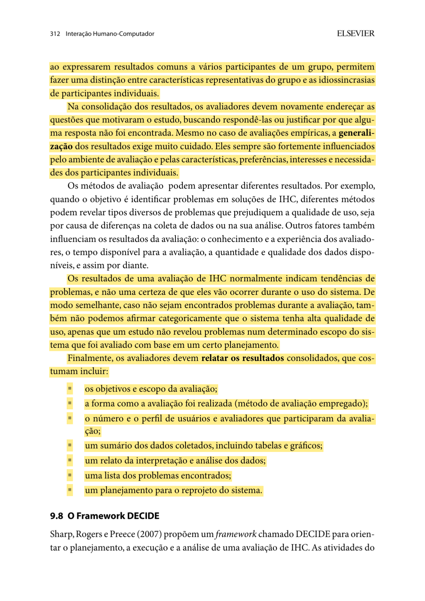
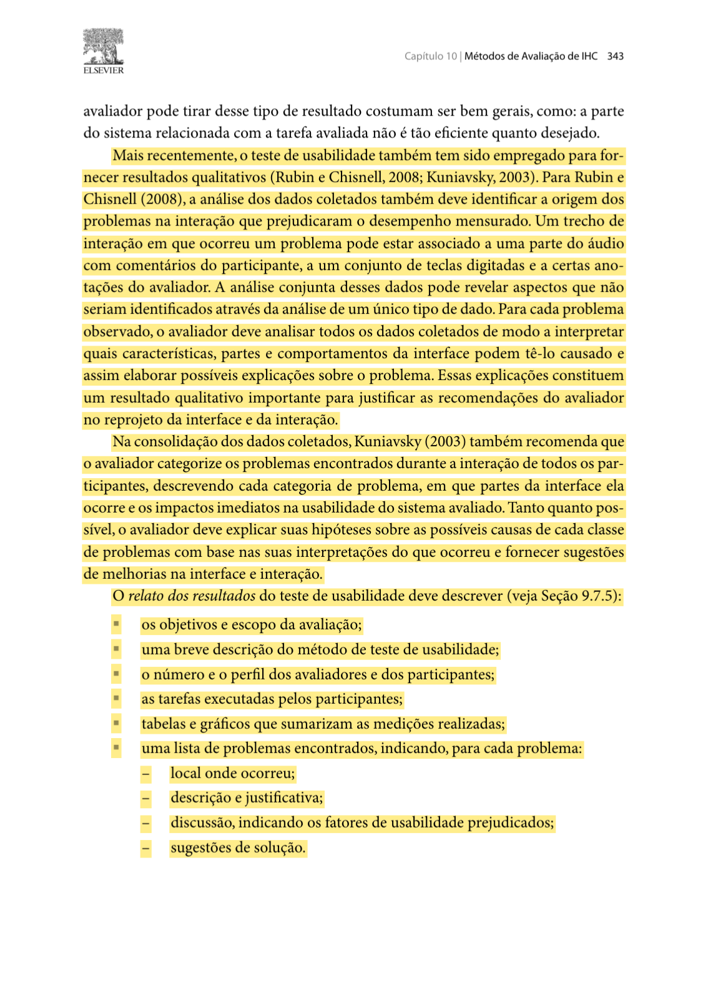

## Histórico de Versão

| Data | Versão | Descrição | Autor(es) | Revisor(es) | Declaração de uso de IA |
| :---: | :---: | :--- | :--- | :--- | :--- |
| 11/11/2026 | `0.1` | Estruturação inicial do relato dos resultados da avaliação do Protótipo de Alta Fidelidade em HTML navegável (TAR-03), incluindo identificação técnica do protótipo, galeria de telas, tabelas de consolidação e referências grifadas. | [Lucas Araújo Lima](https://github.com/Lucasaraujoszz) | [Arthur Mariani](https://github.com/arthur-mariani) | Google Gemini — utilizado apenas para formatação em Markdown |

---

# Relato dos Resultados da Avaliação do Protótipo de Alta Fidelidade (TAR-03)

!!! warning "Relato em construção"
    Esta versão apresenta a **estrutura metodológica completa** do relato, a documentação visual do protótipo em HTML navegável e as tabelas padronizadas. As sessões de avaliação com os 3 participantes encontram-se em fase de execução e gravação; os campos indicados com *[a preencher]* serão completados **exclusivamente com os dados empíricos reais** coletados nas sessões.

Neste documento, apresenta-se o **Relato dos Resultados da Avaliação do Protótipo de Alta Fidelidade** referente à **[TAR-03 — Planejamento de Rota Completa (Porta a Porta) por Destino com Indicação de Paradas e Previsão de Chegada](../../../../analise-de-requisitos/analise-de-tarefas/tar-03-planejamento-rota.md)**. A condução da avaliação obedece ao protocolo estabelecido no [Planejamento da Avaliação do Protótipo de Alta Fidelidade (TAR-03)](../../planejamentos-individuais/lucas/planejamento-av-prot-alta-fidel.md) e segue rigorosamente a estrutura definida no [Planejamento do Relato dos Resultados (TAR-03)](../../planejamentos-individuais/lucas/planejamento-relato-prot-alta-fidel.md).

Em conformidade com **Barbosa & Silva (2010, Cap. 9, Seção 9.7.5, p. 310–312; Cap. 10, Seção 10.2.1, p. 341–348)**, os dados coletados são inicialmente interpretados por participante e por sub-tarefa, e em seguida consolidados para responder às questões investigativas (`QF01` a `QF06`) do framework DECIDE ([Figura 7](#figura-7)), catalogando os problemas de usabilidade encontrados ([Figuras 8 e 9](#figura-8)).

---

## 1. Objetivos e Escopo da Avaliação

O escopo desta avaliação no Nível 3 compreende o fluxo completo de planejamento de viagem porta a porta no sistema **SEMOB-DF / DF no Ponto**, partindo da localização atual automática via GPS (*Samambaia Sul — QR 302*) até o destino profissional (*SIA Trecho 3*), no contexto da persona primária **[Marcos Paulo Vieira ("Marquinhos")](../../../../analise-de-requisitos/personas/marcos-paulo-vieira.md)**.

Os objetivos específicos da avaliação foram:

1. **Aferir a eficiência e a eficácia na execução das sub-tarefas (`TAR-03.1`, `TAR-03.2` e `TAR-03.3`):** Medir a taxa de conclusão sem auxílio, o número de cliques incorretos (*misclicks*) e o tempo despendido pelos 3 participantes, comparando o desempenho empírico à predição analítica de `9,70 s` obtida via GOMS/KLM.
2. **Validar as correções oriundas do Protótipo de Papel:** Verificar se a ampliação dos rótulos de caminhada até a parada (*Parada QR 302 Conj. 4*) e a hierarquia dos cartões de rota eliminam hesitações quando renderizadas com tipografia, cores e interação reais no navegador.
3. **Avaliar a compreensibilidade dos estados de contingência em tempo real:** Testar a reação dos usuários diante do banner de retenção severa na EPTG (`+14 min`, com troca em 1 toque para a linha `0.380`) e do estado de perda de sinal GPS (mudança cromática para cinza e consulta à grade horária *offline*).
4. **Verificar a aderência ao [Guia de Estilo](../../../../analise-de-requisitos/guia-de-estilo/introducao.md) do Grupo 05:** Confirmar se os padrões de contraste (WCAG AA), áreas de toque mínimas de `48×48 px` e botões no formato `[Verbo + Objeto]` sustentam uma interação fluida.

---

### 1.1 Protótipo de Alta Fidelidade Avaliado

O protótipo avaliado consiste em uma aplicação web interativa construída em **HTML5 semântico, CSS3 e JavaScript puro (Vanilla JS)**, projetada em *Mobile Viewport* (`390 px` a `412 px`) para execução direta no navegador do smartphone. A justificativa metodológica da substituição do Figma pelo código HTML navegável encontra-se documentada na Seção 7 do [Planejamento da Avaliação](../../planejamentos-individuais/lucas/planejamento-av-prot-alta-fidel.md).

<strong>Tabela 1</strong> — Identificação Técnica do Protótipo de Alta Fidelidade Avaliado (TAR-03)

| Item | Detalhamento |
| :--- | :--- |
| **Link do protótipo navegável** | [interacao-humano-computador.github.io/2026.2-Grupo05/prototipos/tar-03/](../../../../prototipos/tar-03/index.html) |
| **Caminho no repositório** | [`docs/prototipos/tar-03/`](../../../../prototipos/tar-03/index.html) (`index.html`, `styles.css`, `app.js`) |
| **Versão / *Commit* avaliado** | Commit `36971c5` (*feat(prototipo): adiciona prototipo navegavel de alta fidelidade da TAR-03 em HTML/CSS/JS*) |
| **Telas e Estados Interativos** | **T1** Home com GPS ativo · **T2** Busca preditiva (*Autocompletar*) · **T3** Comparador de rotas porta a porta · **T4** Mapa ao vivo e passo a passo · **T5** Alerta de retenção na EPTG · **T6** Falha de GPS e grade horária *offline* |
| **Massa de Dados** | Origem: *Samambaia Sul - QR 302* · Destino: *SIA Trecho 3* · Linhas: `092.1 (Semiexpresso)`, `0.092 (Via EPTG)` e `0.380 (Alternativa)` · Tarifa: `R$ 5,50` |
| **Identidade Visual** | Paleta institucional SEMOB-DF (`#004a8f`, `#15803d`, `#b45309`), tipografia *System UI / Outfit*, alto contraste acessível e padrões do Guia de Estilo do Grupo 05 |

<em>Fonte: Elaborado por Lucas Araújo Lima (2026).</em>

<strong>Figuras 1 a 6</strong> — Telas e Estados Interativos do Protótipo de Alta Fidelidade em HTML da TAR-03

  <figure style="margin:0;width:220px">
    
    <figcaption><strong>Figura 1</strong> — T1 Home e Origem GPS</figcaption>
  </figure>
  <figure style="margin:0;width:220px">
    
    <figcaption><strong>Figura 2</strong> — T2 Busca Preditiva ("SIA")</figcaption>
  </figure>
  <figure style="margin:0;width:220px">
    
    <figcaption><strong>Figura 3</strong> — T3 Comparador de Rotas</figcaption>
  </figure>
  <figure style="margin:0;width:220px">
    
    <figcaption><strong>Figura 4</strong> — T4 Mapa Ao Vivo (Linha 092.1)</figcaption>
  </figure>
  <figure style="margin:0;width:220px">
    
    <figcaption><strong>Figura 5</strong> — T5 Alerta de Retenção (+14 min)</figcaption>
  </figure>
  <figure style="margin:0;width:220px">
    
    <figcaption><strong>Figura 6</strong> — T6 Grade Horária Offline</figcaption>
  </figure>

<em>Fonte: Capturas diretas do protótipo em HTML5/CSS3/JS desenvolvido por Lucas Araújo Lima (2026).</em>

---

## 2. Método de Avaliação e Protocolo Executado

A avaliação seguiu o método de **Teste de Usabilidade (Observação de Uso em Ambiente Controlado)** (Barbosa & Silva, 2010, Seção 10.2.1, p. 341–348; Rubin & Chisnell, 2008), combinando:

1. **Execução de Tarefas Guiadas por Cenário:** Cada participante recebeu o cenário de deslocamento matutino até o SIA Trecho 3 e executou sequencialmente as sub-tarefas `TAR-03.1`, `TAR-03.2` e `TAR-03.3` no navegador móvel.
2. **Protocolo *Think Aloud* (Pensar em Voz Alta):** Os participantes foram instruídos a verbalizar continuamente o que estavam procurando, lendo e decidindo na interface antes de cada toque.
3. **Entrevista Pós-Teste Semiestruturada:** Após concluir a interação no protótipo, cada participante respondeu às perguntas investigativas `QF01` a `QF06` definidas no planejamento DECIDE.

### 2.1 Teste Piloto e Declaração de Descarte dos Dados

Em estrita observância a Barbosa & Silva (2010, Seção 9.7.2, p. 299 e p. 307) ([Figura 10](#figura-10)) e ao Plano de Ensino da disciplina:

* **Realização do Teste Piloto:** *[a preencher: data, horário e avaliador que participou da calibração]*.
* **Verificações efetuadas:** Conferência da abertura do link no navegador móvel, funcionamento do campo de autocompletar, responsividade dos botões de simulação de contingência e nitidez da captura de áudio/tela.
* **Declaração de Isenção:** Todos os dados, tempos e gravações produzidos durante o Teste Piloto destinaram-se exclusivamente à calibração técnica do instrumento e foram **integralmente descartados**, não integrando nenhuma métrica ou tabela deste relato.

---

## 3. Número e Perfil dos Avaliadores e dos Participantes

O dimensionamento da amostra fundamenta-se na teoria de testes de usabilidade iterativos de **Steve Krug (2000, 2006)** e **Barbosa & Silva (2010, p. 305)**, segundo a qual **3 participantes** por rodada permitem identificar de 80% a 85% dos problemas críticos de usabilidade com agilidade para correção imediata no código.

<strong>Tabela 2</strong> — Papéis dos Avaliadores na Condução das Sessões

| Integrante | Papel na Sessão | Atribuições Executadas |
| :--- | :--- | :--- |
| **[Lucas Araújo Lima](https://github.com/Lucasaraujoszz)** | **Avaliador Facilitador / Condutor** | Recepção dos participantes, apresentação do TCLE, leitura do cenário, condução neutra da sessão e aplicação da entrevista pós-teste. |
| **[Arthur Mariani](https://github.com/arthur-mariani)** | **Avaliador Observador / Revisor** | Cronometragem por sub-tarefa, registro de cliques incorretos (*misclicks*) e revisão metodológica dos resultados. |

<em>Fonte: Elaborado por Lucas Araújo Lima (2026).</em>

<strong>Tabela 3</strong> — Perfil Demográfico e Comportamental dos 3 Participantes Avaliados

| ID | Identificação / Iniciais | Faixa Etária | Ocupação | Frequência de Uso do STPC/DF | Dispositivo / Sistema | Assinatura do TCLE |
| :---: | :--- | :---: | :--- | :--- | :---: | :---: |
| **P01** | *[a preencher]* | *[a preencher]* | *[a preencher]* | *[a preencher]* | *[Android / iOS]* | *[Sim — Consentimento gravado/assinado]* |
| **P02** | *[a preencher]* | *[a preencher]* | *[a preencher]* | *[a preencher]* | *[Android / iOS]* | *[Sim — Consentimento gravado/assinado]* |
| **P03** | *[a preencher]* | *[a preencher]* | *[a preencher]* | *[a preencher]* | *[Android / iOS]* | *[Sim — Consentimento gravado/assinado]* |

<em>Fonte: Dados primários coletados nas sessões de avaliação (2026).</em>

* **Conformidade Ética:** Todos os participantes foram informados previamente de que o objeto avaliado é exclusivamente o protótipo em HTML (e jamais suas habilidades pessoais), concordaram voluntariamente com o [Termo de Consentimento Livre e Esclarecido (TCLE)](../../../../assets/PDFs/TCLE_Pesquisa_Transporte.pdf) e autorizaram a gravação de tela e voz para fins acadêmicos (Resolução CNS nº 510/2016).

---

## 4. Sumário Quantitativo de Desempenho por Sub-tarefa

A Tabela 4 resume, por sub-tarefa e por participante, os indicadores quantitativos exigidos por Barbosa & Silva (2010, p. 342) ([Figura 8](#figura-8)): conclusão sem ajuda, tempo gasto (em comparação à meta preditiva GOMS/KLM), quantidade de erros/cliques incorretos e solicitações de auxílio.

<strong>Tabela 4</strong> — Sumário Quantitativo de Desempenho nas Sub-tarefas da TAR-03 no Protótipo HTML

| Sub-tarefa Avaliada | Participante | Concluiu sem Ajuda? | Tempo Gasto (s) | Referência KLM / Meta | Cliques Incorretos (*Misclicks*) | Uso de Ajuda | Avaliação de Eficiência |
| :--- | :---: | :---: | :---: | :---: | :---: | :---: | :---: |
| **TAR-03.1:** Identificar origem GPS ativa e buscar destino *"SIA Trecho 3"* no autocompletar. | **P01** **P02** **P03** | *[a preencher]* *[a preencher]* *[a preencher]* | *[s]* *[s]* *[s]* | $\le 6,0\text{ s}$ | *[qtd]* *[qtd]* *[qtd]* | *[0]* *[0]* *[0]* | *[a preencher]* |
| **TAR-03.2:** Comparar cartões de rota, identificar parada de embarque e iniciar rota `092.1`. | **P01** **P02** **P03** | *[a preencher]* *[a preencher]* *[a preencher]* | *[s]* *[s]* *[s]* | $\le 10,0\text{ s}$ | *[qtd]* *[qtd]* *[qtd]* | *[0]* *[0]* *[0]* | *[a preencher]* |
| **TAR-03.3:** Acompanhar ônibus ao vivo no mapa e acionar contingência (`0.380` e horários *offline*). | **P01** **P02** **P03** | *[a preencher]* *[a preencher]* *[a preencher]* | *[s]* *[s]* *[s]* | $\le 12,0\text{ s}$ | *[qtd]* *[qtd]* *[qtd]* | *[0]* *[0]* *[0]* | *[a preencher]* |

<em>Fonte: Elaborado por Lucas Araújo Lima (2026).</em>

---

## 5. Interpretação Individual e Consolidação das Perguntas da Avaliação

Seguindo o método de interpretação e consolidação de Barbosa & Silva (2010, p. 310–312) ([Figura 7](#figura-7)), analisa-se primeiramente o percurso de cada participante para, em seguida, reunir os resultados frente às seis questões investigativas (`QF01` a `QF06`).

### 5.1 Interpretação dos Dados por Participante

* **Participante P01:** *[a preencher após a sessão: análise do comportamento de P01 nas telas T1 a T6, verbalizações do Think Aloud e facilidade/dificuldade observada].*
* **Participante P02:** *[a preencher após a sessão: análise do comportamento de P02 nas telas T1 a T6, verbalizações do Think Aloud e facilidade/dificuldade observada].*
* **Participante P03:** *[a preencher após a sessão: análise do comportamento de P03 nas telas T1 a T6, verbalizações do Think Aloud e facilidade/dificuldade observada].*

### 5.2 Consolidação das Respostas às Perguntas Investigativas (`QF01` a `QF06`)

<strong>Tabela 5</strong> — Matriz de Consolidação das Perguntas Investigativas do Framework DECIDE (TAR-03)

| ID | Foco Investigado | Pergunta da Avaliação | Síntese Empírica Consolidada (`P01`, `P02`, `P03`) | Status da Pergunta |
| :---: | :--- | :--- | :--- | :---: |
| **QF01** | **Home e Origem Automática GPS** | Na tela inicial, o participante reconhece imediatamente o card de localização via GPS e aciona a barra *"Para onde você quer ir?"* sem hesitação? | *[a preencher]* | *[Respondida / Parcial / Sem resposta]* |
| **QF02** | **Comparação de Rotas e Parada Ideal** | A hierarquia dos cartões (selo *"Mais Rápida"*, caminhada de `4 min / 280m` e chegada às `07h52`) permite escolher a linha `092.1` com clareza? | *[a preencher]* | *[Respondida / Parcial / Sem resposta]* |
| **QF03** | **Mapa Ao Vivo e Trajeto a Pé** | No mapa interativo, o participante distingue com clareza o caminho tracejado até a *Parada QR 302 Conj. 4* e a posição ao vivo do ônibus? | *[a preencher]* | *[Respondida / Parcial / Sem resposta]* |
| **QF04** | **Alerta de Retenção e Troca em 1 Toque** | Diante do alerta de congestionamento na EPTG (`+14 min`), o participante compreende o atraso e aciona `[Trocar para Linha 0.380 Agora]`? | *[a preencher]* | *[Respondida / Parcial / Sem resposta]* |
| **QF05** | **Contingência de Falha de GPS** | Ao ocorrer a perda de sinal GPS, o participante percebe o status cinza (*"Sem sinal GPS"*) e consulta a grade de horários programados *offline*? | *[a preencher]* | *[Respondida / Parcial / Sem resposta]* |
| **QF06** | **Satisfação Visual e Qualidade de Uso** | Como o participante avalia a legibilidade, o contraste e a fluidez do protótipo em HTML frente aos aplicativos de transporte atuais? | *[a preencher]* | *[Respondida / Parcial / Sem resposta]* |

<em>Fonte: Elaborado por Lucas Araújo Lima (2026).</em>

---

## 6. Problemas de Usabilidade Identificados (Escala de Nielsen)

Cada obstáculo, dúvida ou erro observado durante as sessões é catalogado na Tabela 6 com sua localização exata no protótipo, o fator de qualidade de uso afetado, a severidade segundo a escala de **Nielsen (1994)** (de `0 — Sem importância` a `4 — Catastrófico`) e a sugestão concreta de correção ([Figura 9](#figura-9)).

<strong>Tabela 6</strong> — Registro e Priorização de Problemas de Usabilidade no Protótipo de Alta Fidelidade (TAR-03)

| ID | Tela / Localização | Fator de Qualidade Afetado | Descrição do Problema e Evidência Observada (`P01`–`P03`) | Severidade (0 a 4) | Sugestão de Solução / Reprojeto no Código |
| :---: | :--- | :--- | :--- | :---: | :--- |
| **PR-01** | *[a preencher]* | *[Eficiência / Comunicabilidade / Segurança]* | *[a preencher]* | *[0–4]* | *[a preencher]* |
| **PR-02** | *[a preencher]* | *[Eficiência / Comunicabilidade / Segurança]* | *[a preencher]* | *[0–4]* | *[a preencher]* |
| **PR-03** | *[a preencher]* | *[Eficiência / Comunicabilidade / Segurança]* | *[a preencher]* | *[0–4]* | *[a preencher]* |

<em>Fonte: Elaborado por Lucas Araújo Lima (2026), com base em Nielsen (1994) e Barbosa & Silva (2010, p. 343).</em>

---

## 7. Verificação de Conformidade com o Guia de Estilo do Grupo 05

<strong>Tabela 7</strong> — Aferição de Conformidade do Protótipo da TAR-03 com o Guia de Estilo

| Diretriz do Guia de Estilo | Especificação Aplicada no Protótipo HTML (TAR-03) | Resultado na Avaliação com Usuários |
| :--- | :--- | :---: |
| **Paleta Semântica e Contraste (WCAG AA)** | Azul institucional (`#004a8f`), verde para telemetria ativa (`#15803d`), âmbar para alerta de retenção (`#b45309`) e modo de Alto Contraste dedicado. | *[a preencher]* |
| **Hierarquia Tipográfica e Legibilidade** | Fonte sem serifa (*System UI / Outfit*), tamanhos escalonados para código da linha (`18 px bold`), tempos e metadados de parada. | *[a preencher]* |
| **Padronização de Elementos de Ação** | Rótulos acionáveis claros no formato `[Verbo + Objeto]`: *"Iniciar Rota"*, *"Trocar para Linha 0.380 Agora"*, *"Ver Horários Programados"*. | *[a preencher]* |
| **Áreas de Toque Mínimas (*Touch Targets*)** | Botões e itens de lista de autocompletar dimensionados com altura mínima de `48 px` em CSS para prevenção de erros motores no celular. | *[a preencher]* |
| **Prevenção de Erros e Automação (GPS)** | Preenchimento automático da origem via GPS na Home e botão de limpeza rápida (`×`) na barra de destino. | *[a preencher]* |

<em>Fonte: Elaborado por Lucas Araújo Lima (2026).</em>

---

## 8. Plano de Reprojeto e Limitações dos Resultados

### 8.1 Plano de Reprojeto no Código (HTML5 / CSS3 / JS)

Os problemas classificados com severidade `3` ou `4` têm correção imediata obrigatória no código-fonte (`docs/prototipos/tar-03/`); os de severidade `1` e `2` são incorporados como refinamentos visuais de CSS/JS.

<strong>Tabela 8</strong> — Plano de Reprojeto e Refinamentos Aplicados ao Protótipo da TAR-03

| Prioridade | Problema Relacionado | Tela / Arquivo Afetado | Alteração Técnica de Reprojeto | Status / *Commit* |
| :---: | :---: | :--- | :--- | :---: |
| *[Alta / Média / Baixa]* | *[PR-01]* | *[`index.html` / `styles.css` / `app.js`]* | *[a preencher]* | *[a preencher]* |

<em>Fonte: Elaborado por Lucas Araújo Lima (2026).</em>

### 8.2 Perguntas sem Resposta

*[a preencher após a consolidação das 3 sessões: indicar explicitamente se todas as perguntas `QF01` a `QF06` foram respondidas com sucesso ou se alguma questão restou inconclusiva/sem resposta, conforme exigido por Barbosa & Silva (2010, p. 312)].*

### 8.3 Limitações dos Resultados

* **Dimensão da Amostra (3 Participantes):** Conforme fundamentado em Steve Krug (2000, 2006) e Barbosa & Silva (2010, p. 305, 312–313), a amostra de 3 usuários é altamente eficaz para detecção qualitativa de barreiras de usabilidade, mas não se destina a generalizações estatísticas populacionais.
* **Ambiente Controlado e Simulação de Telemetria:** Embora o protótipo opere em navegador móvel real, os eventos de congestionamento na EPTG (`+14 min`) e queda do sinal de satélite GPS são engatilhados por estado simulado em JavaScript, e não por consumo de API governamental em trânsito real na rua.
* **Escopo Recortado de Rotas:** A base de dados preditiva do protótipo foi delimitada ao corredor Samambaia Sul $\leftrightarrow$ SIA Trecho 3 para garantir controle experimental entre os 3 participantes.

---

## 9. Gravações das Sessões de Avaliação

Os registros audiovisuais das 3 sessões de teste de usabilidade (publicados como vídeos "não listados" no YouTube, mediante autorização expressa no TCLE) serão incorporados a seguir após a realização das entrevistas:

* **Sessão 01 (Participante P01):** *[a preencher: link do YouTube e vídeo incorporado]*
* **Sessão 02 (Participante P02):** *[a preencher: link do YouTube e vídeo incorporado]*
* **Sessão 03 (Participante P03):** *[a preencher: link do YouTube e vídeo incorporado]*

---

## 10. Fundamentação Teórica (Páginas Grifadas da Literatura)

Os trechos destacados em amarelo nas páginas originais de **Barbosa & Silva (2010)** fundamentam a estrutura metodológica deste relato:

<strong>Figura 7</strong> — Consolidação dos resultados, perguntas sem resposta e itens obrigatórios do relato (p. 312)

<em>Fonte: BARBOSA & SILVA (2010, Capítulo 9, Seção 9.7.5, p. 312).</em>

<strong>Figura 8</strong> — Métricas de conclusão, tempo, erros e uso de ajuda no Teste de Usabilidade (p. 342)

<em>Fonte: BARBOSA & SILVA (2010, Capítulo 10, Seção 10.2.1, p. 342).</em>

<strong>Figura 9</strong> — Descrição estruturada dos problemas de usabilidade: local, impacto e solução (p. 343)

<em>Fonte: BARBOSA & SILVA (2010, Capítulo 10, Seção 10.2.1, p. 343).</em>

<strong>Figura 10</strong> — Regra metodológica de descarte dos dados gerados no Teste Piloto (p. 307)

<em>Fonte: BARBOSA & SILVA (2010, Capítulo 9, Seção 9.7.2, p. 307).</em>

---

## 11. Declaração sobre o Uso de IA Generativa

Em conformidade com o Plano de Ensino da disciplina (SALES, 2026) e o Código de Conduta da SBC, declara-se que a ferramenta Google Gemini foi utilizada exclusivamente como auxílio para formatação em Markdown. Todo o desenvolvimento do protótipo, condução das sessões, coleta de evidências empíricas, análise de severidade e decisões de reprojeto são de autoria e responsabilidade de Lucas Araújo Lima.

---

## 12. Referências Bibliográficas

* BARBOSA, Simone Diniz Junqueira; SILVA, Bruno Santana da. **Interação Humano-Computador**. Rio de Janeiro: Elsevier / Campus, 2010. ISBN 978-85-352-1120-7. (Capítulo 9, Seções 9.7.2 e 9.7.4–9.8, p. 299, 307 e 310–313; Capítulo 10, Seção 10.2.1, p. 341–348).
* BARBOSA, Simone Diniz Junqueira et al. **Interação Humano-Computador e Experiência do Usuário**. Rio de Janeiro: Autopublicação, 2021. ISBN 978-65-00-19677-1.
* BRASIL. Conselho Nacional de Saúde. **Resolução nº 510, de 07 de abril de 2016**. Regulamenta as pesquisas em Ciências Humanas e Sociais. Brasília: Diário Oficial da União, 2016.
* KRUG, Steve. **Don't Make Me Think: A Common Sense Approach to Web Usability**. Berkeley: New Riders, 2000.
* KRUG, Steve. **Rocket Surgery Made Easy: The Do-It-Yourself Guide to Finding and Fixing Usability Problems**. Berkeley: New Riders, 2006.
* NIELSEN, Jakob. **Usability Engineering**. San Diego: Academic Press, 1994.
* RUBIN, Jeffrey; CHISNELL, Dana. **Handbook of Usability Testing: How to Plan, Design, and Conduct Effective Tests**. 2nd ed. Indianapolis: Wiley, 2008.
* SALES, André Barros de. **Plano de Ensino: Interação Humano Computador**. Brasília: Universidade de Brasília, Faculdade UnB Gama (FCTE/UnB), 2026.

---
**Autor:** [Lucas Araújo Lima](https://github.com/Lucasaraujoszz)  
**Revisor:** [Arthur Mariani](https://github.com/arthur-mariani)

