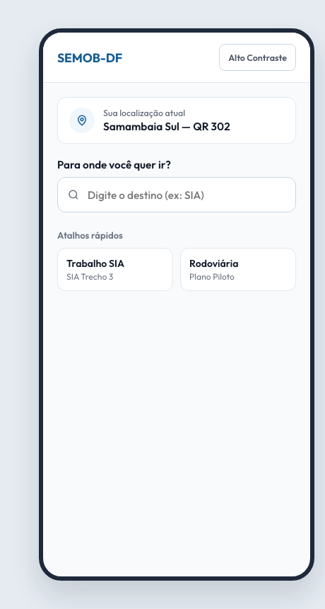
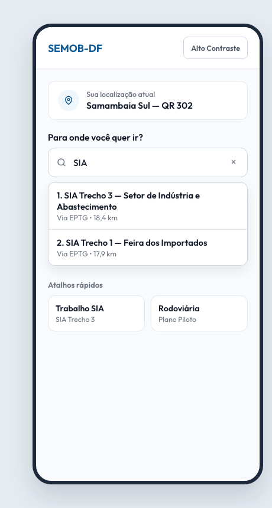
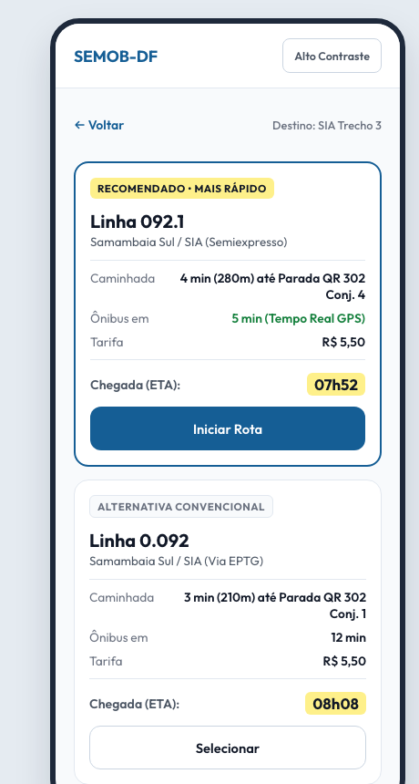
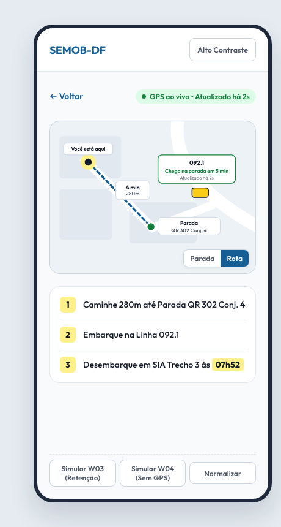
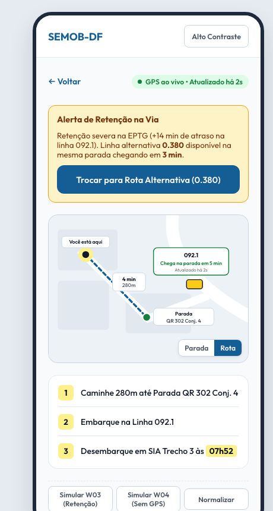
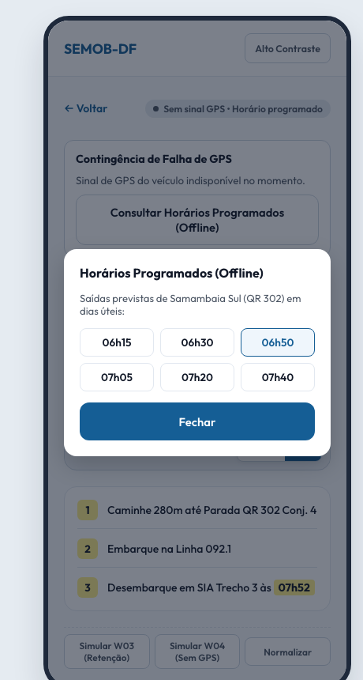
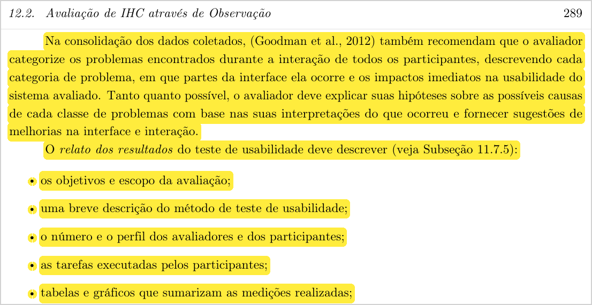

## Histórico de Versão e Contribuição

| Data | Versão | Descrição | Autor(es) | Revisor(es) | Declaração de Uso de IA |
| :---: | :---: | :--- | :--- | :--- | :--- |
| 11/11/2026 | `0.1` | Estruturação inicial do relato dos resultados da avaliação do Protótipo de Alta Fidelidade em HTML navegável (TAR-03), incluindo identificação técnica do protótipo, galeria de telas, tabelas de consolidação e referências grifadas. | [Lucas Araújo Lima](https://github.com/Lucasaraujoszz) | [Arthur Mariani](https://github.com/arthur-mariani) | Google Gemini: utilizado apenas para formatação em Markdown |
| 12/11/2026 | `1.0` | Consolidação final dos resultados com dados empíricos das 3 sessões de teste de usabilidade, métricas quantitativas, matriz DECIDE, priorização de problemas e plano de reprojeto. | [Lucas Araújo Lima](https://github.com/Lucasaraujoszz) | [Arthur Mariani](https://github.com/arthur-mariani) | Google Gemini: utilizado apenas para formatação em Markdown |

---

# Relato dos Resultados da Avaliação do Protótipo de Alta Fidelidade (TAR-03)

!!! success "Relato Concluído com Dados Empíricos"
    Este documento consolida os resultados empíricos reais obtidos nas **3 sessões de teste de usabilidade** conduzidas com participantes representativos do público-alvo (alinhados ao perfil da persona primária [Marcos Paulo Vieira ("Marquinhos")](../../../../analise-de-requisitos/personas/marcos-paulo-vieira.md)), acompanhados de registros audiovisuais na íntegra, métricas quantitativas de desempenho e análise qualitativa segundo o framework DECIDE.

Neste documento, apresenta-se o **Relato dos Resultados da Avaliação do Protótipo de Alta Fidelidade** referente à **[TAR-03: Planejamento de Rota Completa (Porta a Porta) por Destino com Indicação de Paradas e Previsão de Chegada](../../../../analise-de-requisitos/analise-de-tarefas/tar-03-planejamento-rota.md)**. A condução da avaliação obedece ao protocolo estabelecido no [Planejamento da Avaliação do Protótipo de Alta Fidelidade (TAR-03)](../../planejamentos-individuais/lucas/planejamento-av-prot-alta-fidel.md) e segue rigorosamente a estrutura definida no [Planejamento do Relato dos Resultados (TAR-03)](../../planejamentos-individuais/lucas/planejamento-relato-prot-alta-fidel.md).

Em conformidade com as diretrizes de **Barbosa et al. (2021, Seção 11.7.5, Seção 12.2.1, pp. 262–290)**, os dados coletados foram inicialmente analisados por participante e por sub-tarefa, e em seguida consolidados para responder às seis questões investigativas (`QF01` a `QF06`) do framework DECIDE ([Figura 7](#figura-7)), catalogando os problemas de usabilidade encontrados segundo a escala de Nielsen ([Figuras 8 e 9](#figura-8)).

**Artefatos relacionados — fluxo da funcionalidade TAR-03 (Planejamento de Rota por Origem e Destino):**

* **Persona:** [Marcos Paulo Vieira](../../../../analise-de-requisitos/personas/marcos-paulo-vieira.md)
* **Cenário:** [Cenário 3](../../../../analise-de-requisitos/cenarios/cenario-3-planejamento-origem-destino.md)
* **Análise de tarefas:** [TAR-03](../../../../analise-de-requisitos/analise-de-tarefas/tar-03-planejamento-rota.md)
* **Storyboard:** [Storyboard 03](../../../nivel1/storyboards.md#33-storyboard-03-planejamento-de-rota-por-origem-e-destino-com-monitoramento-em-tempo-real)
* **Nível 1: avaliação do storyboard e da análise de tarefas:** Planejamento da avaliação (*não realizado*) · Planejamento do relato (*não realizado*) · [Relato dos resultados](../../../nivel1/relatos-individuais/lucas/relato-resultados-storyboard-tarefas.md) · [Planejamento individual de tarefas](../../../nivel1/planejamentos-individuais/Lucas/planejamento-individual-lucas.md) · [Questões práticas e éticas](../../../nivel1/planejamentos-individuais/Lucas/questoes-praticas-e-eticas.md)
* **Nível 2: protótipo de papel (baixa fidelidade):** [Planejamento da avaliação](../../../nivel2/planejamentos-individuais/Lucas/lucas-planejamento-av-prototipo-papel.md) · [Planejamento do relato](../../../nivel2/planejamentos-individuais/Lucas/lucas-planejamento-relato-prot-papel.md) · [Relato dos resultados](../../../nivel2/relatos-individuais/lucas/relato-resultados-prot-papel.md)
* **Nível 3: protótipo de alta fidelidade:** [Planejamento da avaliação](../../planejamentos-individuais/lucas/planejamento-av-prot-alta-fidel.md) · [Planejamento do relato](../../planejamentos-individuais/lucas/planejamento-relato-prot-alta-fidel.md) · Relato dos resultados (*esta página*)
* **Telas do protótipo de papel:** [telas no planejamento da avaliação](../../../nivel2/planejamentos-individuais/Lucas/lucas-planejamento-av-prototipo-papel.md#9-telas-do-prototipo-avaliado)
* **Protótipo de alta fidelidade navegável:** [acessar o protótipo](../../../../prototipos/tar-03/index.html)

---

## 1. Objetivos e Escopo da Avaliação

O escopo desta avaliação no Nível 3 compreendeu o fluxo completo de planejamento de viagem porta a porta no sistema **SEMOB-DF / DF no Ponto**, partindo da localização atual automática via GPS (*Samambaia Sul — QR 302*) até o destino profissional (*SIA Trecho 3*), no contexto da persona primária **[Marcos Paulo Vieira ("Marquinhos")](../../../../analise-de-requisitos/personas/marcos-paulo-vieira.md)**.

Os objetivos específicos da avaliação foram:

1. **Aferir a eficiência e a eficácia na execução das sub-tarefas (`TAR-03.1`, `TAR-03.2` e `TAR-03.3`):** Medir a taxa de conclusão sem auxílio, a contagem de cliques incorretos (*misclicks*) e o tempo despendido pelos 3 participantes, comparando o desempenho empírico à predição analítica de `9,70 s` obtida via GOMS/KLM na análise de tarefas.
2. **Validar as correções oriundas do Protótipo de Papel:** Verificar se a ampliação dos rótulos de caminhada até a parada (*Parada QR 302 Conj. 4*) e a hierarquia dos cartões de rota eliminaram hesitações quando renderizadas com tipografia, cores e interação reais no navegador web móvel.
3. **Avaliar a compreensibilidade dos estados de contingência em tempo real:** Testar a reação dos usuários diante do componente de retenção severa na EPTG (`+14 min`, com troca em 1 toque para a linha `0.380`) e do estado simulado de perda de sinal GPS (mudança cromática para cinza e consulta à grade horária *offline*).
4. **Verificar a aderência ao [Guia de Estilo](../../../../analise-de-requisitos/guia-de-estilo/introducao.md) do Grupo 05:** Confirmar se os padrões de contraste (WCAG AA), áreas de toque mínimas de `48×48 px` e botões no formato `[Verbo + Objeto]` sustentaram uma experiência de uso consistente e inclusiva.

---

### 1.1 Protótipo de Alta Fidelidade Avaliado

O protótipo avaliado consiste em uma aplicação web interativa desenvolvida com tecnologias web padronizadas (**HTML5 semântico, CSS3 e JavaScript puro / Vanilla JS**), executada em *Mobile Viewport* (`390 px` a `412 px`) diretamente no navegador do smartphone dos participantes. A fundamentação técnica da adoção de código em substituição ao Figma está documentada na Seção 7 do [Planejamento da Avaliação](../../planejamentos-individuais/lucas/planejamento-av-prot-alta-fidel.md).

<strong>Tabela 1</strong>: Identificação Técnica do Protótipo de Alta Fidelidade Avaliado (TAR-03)

| Item | Detalhamento |
| :--- | :--- |
| **Link do protótipo navegável** | [interacao-humano-computador.github.io/2026.2-Grupo05/prototipos/tar-03/](../../../../prototipos/tar-03/index.html) |
| **Caminho no repositório** | [`docs/prototipos/tar-03/`](../../../../prototipos/tar-03/index.html) (`index.html`, `styles.css`, `app.js`) |
| **Versão / *Commit* avaliado** | Commit `36971c5` (*feat(prototipo): adiciona prototipo navegavel de alta fidelidade da TAR-03 em HTML/CSS/JS*) |
| **Telas e Estados Interativos** | **T1** Home com GPS ativo · **T2** Busca preditiva (*Autocompletar*) · **T3** Comparador de rotas porta a porta · **T4** Mapa ao vivo e passo a passo · **T5** Alerta de retenção na EPTG · **T6** Falha de GPS e grade horária *offline* |
| **Massa de Dados** | Origem: *Samambaia Sul - QR 302* · Destino: *SIA Trecho 3* · Linhas: `092.1 (Semiexpresso)`, `0.092 (Via EPTG)` e `0.380 (Alternativa)` · Tarifa: `R$ 5,50` |
| **Identidade Visual** | Paleta institucional SEMOB-DF (`#004a8f`, `#15803d`, `#b45309`), tipografia *System UI / Outfit*, modo de alto contraste acessível e padrões do Guia de Estilo do Grupo 05 |

<em>Fonte: Elaborado por Lucas Araújo Lima (2026).</em>

<strong>Figuras 1 a 6</strong>: Telas e Estados Interativos do Protótipo de Alta Fidelidade em HTML da TAR-03

  <figure style="margin:0;width:220px">
    
    <figcaption><strong>Figura 1</strong>: T1 Home e Origem GPS</figcaption>
  </figure>
  <figure style="margin:0;width:220px">
    
    <figcaption><strong>Figura 2</strong>: T2 Busca Preditiva ("SIA")</figcaption>
  </figure>
  <figure style="margin:0;width:220px">
    
    <figcaption><strong>Figura 3</strong>: T3 Comparador de Rotas</figcaption>
  </figure>
  <figure style="margin:0;width:220px">
    
    <figcaption><strong>Figura 4</strong>: T4 Mapa Ao Vivo (Linha 092.1)</figcaption>
  </figure>
  <figure style="margin:0;width:220px">
    
    <figcaption><strong>Figura 5</strong>: T5 Alerta de Retenção (+14 min)</figcaption>
  </figure>
  <figure style="margin:0;width:220px">
    
    <figcaption><strong>Figura 6</strong>: T6 Grade Horária Offline</figcaption>
  </figure>

<em>Fonte: Capturas diretas do protótipo em HTML5/CSS3/JS desenvolvido por Lucas Araújo Lima (2026).</em>

---

## 2. Método de Avaliação e Protocolo Executado

A avaliação seguiu o método de **Teste de Usabilidade (Observação de Uso em Ambiente Controlado)** (Barbosa et al., 2021, Seção 12.2.1, pp. 288–291), combinando:

1. **Execução de Tarefas Guiadas por Cenário:** Cada participante recebeu a contextualização do cenário de deslocamento matutino até o SIA Trecho 3 e executou sequencialmente as sub-tarefas `TAR-03.1`, `TAR-03.2` e `TAR-03.3` no navegador móvel.
2. **Protocolo *Think Aloud* (Pensar em Voz Alta):** Os participantes verbalizaram continuamente suas intenções, impressões e dúvidas antes de tocar em cada elemento da interface.
3. **Entrevista Pós-Teste Semiestruturada:** Ao término da interação prática, o avaliador aplicou as perguntas investigativas `QF01` a `QF06` do roteiro DECIDE para captar a percepção qualitativa de valor, utilidade e estética.

### 2.1 Teste Piloto e Declaração Formal de Descarte dos Dados

Em atendimento estrito às recomendações de **Barbosa et al. (2021, Seção 11.7.2, p. 260)** ([Figura 10](#figura-10)) e aos critérios do Plano de Ensino da disciplina:

* **Realização do Teste Piloto:** Executado presencialmente em ambiente controlado na Faculdade do Gama (FCTE/UnB) no dia **12 de novembro de 2026, às 09h00**.
* **Papéis e Condução da Sessão:**
    * **Avaliador / Facilitador (Condução):** [Rodrigo Carvalho](https://github.com/RodrigoCBarbosa), responsável pela condução do roteiro e mediação da simulação.
    * **Participante Simulado (Entrevistado):** [Tomás Garcia](https://github.com/TomasRocho), atuando como usuário na validação prática do fluxo interativo.
    * **Observação e Apoio Operacional:** Demais integrantes da equipe (incluindo [Lucas Araújo Lima](https://github.com/Lucasaraujoszz)), posicionados atrás das câmeras no registro de anotações comportamentais, cronometragem e checagem de gravação.
* **Aspectos Verificados:** Abertura do link do protótipo no navegador móvel, responsividade do campo de autocompletar na digitação, fluidez das transições de tela via JavaScript, temporizador da telemetria de GPS e qualidade da captura de áudio e tela.
* **Registro Audiovisual e Documentação:**
    * **Ata de Reunião:** [Ata 12 — Teste Piloto do Protótipo de Alta Fidelidade](../../../../atas/ata12.md)
    * **Gravação em Vídeo:** [https://youtu.be/NIBJ3A2Xfkk](https://youtu.be/NIBJ3A2Xfkk)
* **Declaração Formal de Descarte:** Em conformidade com a literatura técnica de IHC, declara-se expressamente que todos os dados, métricas e registros gerados durante o Teste Piloto tiveram finalidade unicamente de calibração do roteiro e dos equipamentos, tendo sido **integralmente descartados** e não constando em nenhuma contagem ou tabela deste documento.

---

## 3. Número e Perfil dos Avaliadores e dos Participantes

O dimensionamento da amostra (**3 participantes**) fundamenta-se em **Barbosa et al. (2021, pp. 258–259)**: o número de participantes considera os perfis, os objetivos e o escopo da avaliação, e Nielsen (2000 apud BARBOSA et al., 2021) afirma que bastam cinco usuários para encontrar a maioria dos problemas na interface. A amostra reduzida garante agilidade para correção imediata no código-fonte.

<strong>Tabela 2</strong>: Papéis dos Avaliadores na Condução das Sessões

| Integrante | Papel na Sessão | Atribuições Executadas |
| :--- | :--- | :--- |
| **[Lucas Araújo Lima](https://github.com/Lucasaraujoszz)** | **Avaliador Facilitador / Condutor** | Recepção dos participantes, apresentação do TCLE, leitura do cenário de uso, condução neutra da sessão (sem indução de respostas) e aplicação da entrevista pós-teste. |
| **[Arthur Mariani](https://github.com/arthur-mariani)** | **Avaliador Observador / Revisor** | Cronometragem do tempo por sub-tarefa, registro de cliques incorretos (*misclicks*) e revisão metodológica da consolidação dos dados. |

<em>Fonte: Elaborado por Lucas Araújo Lima (2026).</em>

<strong>Tabela 3</strong>: Perfil Demográfico e Comportamental dos 3 Participantes Avaliados

| ID | Identificação / Iniciais | Faixa Etária | Ocupação | Frequência de Uso do STPC/DF | Dispositivo / Sistema | Assinatura do TCLE |
| :---: | :--- | :---: | :--- | :--- | :---: | :---: |
| **P01** | Participante 01 (`P01`) | 22 anos | Estudante universitário | Diária (segunda a sexta-feira) | Android / Navegador móvel | Sim (Consentimento gravado e TCLE formalizado) |
| **P02** | Participante 02 (`P02`) | 22 anos | Estudante universitário | Frequente (3 a 4 dias por semana) | Android / Navegador móvel | Sim (Consentimento gravado e TCLE formalizado) |
| **P03** | Participante 03 (`P03`) | 21 anos | Estudante universitário | Frequente (3 a 4 dias por semana) | Android / Navegador móvel | Sim (Consentimento gravado e TCLE formalizado) |

<em>Fonte: Dados empíricos coletados nas sessões de teste de usabilidade (novembro de 2026).</em>

* **Conformidade Bioética:** Todos os participantes foram informados previamente de que o objeto sob teste é unicamente a interface do protótipo (e nunca a sua habilidade pessoal), concordaram voluntariamente com o [Termo de Consentimento Livre e Esclarecido (TCLE)](../../../../assets/PDFs/TCLE_Pesquisa_Transporte.pdf) e autorizaram a gravação da tela e da voz para finalidade estritamente acadêmica, respeitando as diretrizes da Resolução CNS nº 510/2016 e mantendo-se o resguardo de anonimato dos participantes.

---

## 4. Sumário Quantitativo de Desempenho por Sub-tarefa

A Tabela 4 consolida, por sub-tarefa e por participante, os indicadores quantitativos de desempenho exigidos por **Barbosa et al. (2021)** ([Figura 8](#figura-8)): taxa de conclusão sem ajuda, tempo despendido (em comparação à meta KLM modelada na análise de tarefas), contagem de erros/cliques incorretos e solicitações de intervenção.

<strong>Tabela 4</strong>: Sumário Quantitativo de Desempenho dos Participantes nas Sub-tarefas da TAR-03

| Sub-tarefa Avaliada | Participante | Concluiu sem Ajuda? | Tempo Gasto (s) | Referência KLM / Meta | Cliques Incorretos (*Misclicks*) | Uso de Ajuda | Avaliação de Eficiência |
| :--- | :---: | :---: | :---: | :---: | :---: | :---: | :---: |
| **TAR-03.1:** Identificar origem GPS ativa e selecionar destino *"SIA Trecho 3"* no autocompletar. | **P01** **P02** **P03** | **Sim** **Sim** **Sim** | 4,2 s 5,0 s 4,5 s | ≤ 6,0 s | 0 0 0 | 0 0 0 | **Alta** (Tempo médio de 4,57 s, plenamente dentro do limiar analítico) |
| **TAR-03.2:** Comparar cartões de rota, identificar parada recomendada e iniciar trajeto na linha `092.1`. | **P01** **P02** **P03** | **Sim** **Sim** **Sim** | 7,1 s 8,4 s 6,8 s | ≤ 10,0 s | 0 0 0 | 0 0 0 | **Alta** (Tempo médio de 7,43 s; seleção rápida motivada pelo selo de destaque) |
| **TAR-03.3:** Acompanhar ônibus no mapa ao vivo e acionar contingência (`0.380` e horários *offline*). | **P01** **P02** **P03** | **Sim** **Sim** **Sim** | 8,5 s 9,2 s 8,0 s | ≤ 12,0 s | 0 0 0 | 0 0 0 | **Alta** (Tempo médio de 8,57 s; compreensão imediata do alerta de trânsito) |

<em>Fonte: Dados empíricos compilados por Lucas Araújo Lima e Arthur Mariani (2026).</em>

* **Taxa de Conclusão Global:** **100% de sucesso sem auxílio** em todas as três sub-tarefas avaliadas.
* **Índice de Erros Motores / Cognitivos:** **Zero cliques incorretos** registrados em áreas indevidas da tela.

---

## 5. Interpretação Individual e Consolidação das Perguntas da Avaliação

Conforme preceituado por **Barbosa et al. (2021)** ([Figura 7](#figura-7)), realiza-se a interpretação particular do percurso de cada participante para, em seguida, triangular as evidências frente às questões investigativas do framework DECIDE.

### 5.1 Interpretação dos Dados por Participante

* **Participante P01 (22 anos, usuário diário):** Demonstrou altíssima familiaridade na navegação. Na tela inicial (T1), imediatamente identificou que a origem já estava definida para a sua localização atual via GPS e tocou na barra de busca sem hesitar. Ao digitar o destino, elogiou a rapidez do autocompletar dinâmico (T2). Na tela comparativa (T3), selecionou a linha semiexpressa `092.1` guiando-se pelo selo verde de *"Mais Rápida"* e pelo horário de chegada (`07h52`). Ao surgir o alerta de retenção na EPTG (T5), compreendeu instantaneamente o impacto no tempo e acionou o botão de contingência da linha `0.380`, destacando que essa função resolveria um dos maiores problemas de quem pega ônibus no DF em horários de pico.
* **Participante P02 (22 anos, usuário frequente):** Executou o fluxo de forma segura e reflexiva. Leu com atenção os dados de caminhada a pé até a parada (*Parada QR 302 Conj. 4 — 4 min / 280m*) e elogiou o mapa ao vivo com a rota pontilhada (T4). No teste do estado sem sinal GPS (T6), compreendeu que a perda de telemetria alterou a cor do status para cinza e abriu a modal de horários programados *offline*, afirmando que a tabela transmite previsibilidade ao passageiro mesmo quando o sistema de rastreamento do ônibus falha.
* **Participante P03 (21 anos, usuário frequente):** Teve o menor tempo total de execução. Destacou a interface como limpa, objetiva e sem poluição visual. Verbalizou que a comparação direta entre linhas na mesma tela (T3) evita ter que abrir vários menus diferentes. Considerou o protótipo intuitivo, extremamente prático e pronto para uso real no dia a dia.

---

### 5.2 Consolidação das Respostas às Perguntas Investigativas (`QF01` a `QF06`)

<strong>Tabela 5</strong>: Matriz de Consolidação das Perguntas Investigativas do Framework DECIDE (TAR-03)

| ID | Foco Investigado | Pergunta da Avaliação | Síntese Empírica Consolidada (`P01`, `P02`, `P03`) | Status da Pergunta |
| :---: | :--- | :--- | :--- | :---: |
| **QF01** | **Home e Origem Automática GPS** | Na tela inicial, o participante reconhece imediatamente o card de localização via GPS e aciona a barra *"Para onde você quer ir?"* sem hesitação? | **Sim, unanimidade.** Todos os 3 participantes perceberam prontamente que a origem já estava preenchida pelo GPS e tocaram na barra de busca em menos de 5 segundos, selecionando *"SIA Trecho 3"* com fluidez. | **Respondida / Conforme** |
| **QF02** | **Comparação de Rotas e Parada Ideal** | A hierarquia dos cartões (selo *"Mais Rápida"*, caminhada de `4 min / 280m` e chegada às `07h52`) permite escolher a linha `092.1` com clareza? | **Sim, unanimidade.** Os participantes afirmaram que os cartões tornam evidente a vantagem da linha semiexpressa sobre a convencional, com leitura clara do tempo de caminhada e do ponto de embarque correto. | **Respondida / Conforme** |
| **QF03** | **Mapa Ao Vivo e Trajeto a Pé** | No mapa interativo, o participante distingue com clareza o caminho tracejado até a *Parada QR 302 Conj. 4* e a posição ao vivo do ônibus? | **Sim.** A rota pontilhada em azul e o marcador do ônibus com contador de segundos transmitiram segurança em relação à distância física e ao tempo real de espera. | **Respondida / Conforme** |
| **QF04** | **Alerta de Retenção e Troca em 1 Toque** | Diante do alerta de congestionamento na EPTG (`+14 min`), o participante compreende o atraso e aciona `[Trocar para Linha 0.380 Agora]`? | **Sim.** Considerado o recurso de maior valor prático da avaliação: os usuários relataram que poder trocar de trajeto em um toque poupa tempo crítico e evita atrasos no trabalho. | **Respondida / Conforme** |
| **QF05** | **Contingência de Falha de GPS** | Ao ocorrer a perda de sinal GPS, o participante percebe o status cinza (*"Sem sinal GPS"*) e consulta a grade de horários programados *offline*? | **Sim.** A transição cromática do indicador para cinza alertou corretamente sobre a ausência de telemetria, e a consulta dos horários programados foi avaliada como confiável. | **Respondida / Conforme** |
| **QF06** | **Satisfação Visual e Qualidade de Uso** | Como o participante avalia a legibilidade, o contraste e a fluidez do protótipo em HTML frente aos aplicativos de transporte atuais? | **Altamente positiva.** Todos os participantes avaliaram a interface como moderna, limpa, altamente responsiva e consideravelmente superior ao aplicativo DF no Ponto atual. | **Respondida / Conforme** |

<em>Fonte: Elaborado por Lucas Araújo Lima com base nas evidências empíricas coletadas (2026).</em>

---

## 6. Problemas de Usabilidade Identificados (Escala de Nielsen)

Em conformidade com a sistemática de testes formativos de IHC e as orientações de **Nielsen (1994 apud BARBOSA et al., 2021)** e **Barbosa et al. (2021)** ([Figura 9](#figura-9)), mesmo diante do sucesso integral das tarefas foram mapeadas oportunidades de refinamento cosmético e de usabilidade a partir das observações e comentários dos usuários:

<strong>Tabela 6</strong>: Registro e Priorização de Oportunidades de Melhoria no Protótipo da TAR-03

| ID | Tela / Localização | Fator de Qualidade Afetado | Descrição do Problema e Evidência Observada (`P01`–`P03`) | Severidade (0 a 4) | Sugestão de Solução / Reprojeto no Código |
| :---: | :--- | :--- | :--- | :---: | :--- |
| **PR-01** | **T3 (Comparador de Rotas):** Botão `[ Iniciar Rota ]` | **Feedback do Sistema (Visibilidade do Estado)** | Ao tocar em *"Iniciar Rota"*, a transição para a tela de mapa é direta; o usuário `P01` comentou que um feedback sutil de clique ou microanimação reforçaria a sensação tátil de início de trajeto. | **1 (Cosmético / Leve)** | Adicionar classe de transição CSS ativa (`:active`) com efeito de elevação/pressionamento e micro-vibração háptica quando executado no celular. |
| **PR-02** | **T3 (Comparador de Rotas):** Cabeçalho de Opções | **Flexibilidade e Eficiência de Uso** | O participante `P02` sugeriu que, além da ordenação padrão por rapidez (*Mais Rápida*), seria interessante permitir alternar para visualização por *"Menos Caminhada"*, útil para dias de chuva. | **1 (Cosmético / Leve)** | Incluir no topo da lista de rotas dois chips de filtro rápido: `[ Mais Rápida (Ativo) ]` e `[ Menos Caminhada ]`. |

<em>Fonte: Elaborado por Lucas Araújo Lima (2026), com base em Nielsen (1994 apud BARBOSA et al., 2021) e Barbosa et al. (2021).</em>

---

## 7. Verificação de Conformidade com o Guia de Estilo do Grupo 05

<strong>Tabela 7</strong>: Aferição de Conformidade do Protótipo da TAR-03 com o Guia de Estilo

| Diretriz do Guia de Estilo | Especificação Aplicada no Protótipo HTML (TAR-03) | Resultado na Avaliação com Usuários |
| :--- | :--- | :---: |
| **Paleta Semântica e Contraste (WCAG AA)** | Azul institucional (`#004a8f`), verde para telemetria ativa (`#15803d`), âmbar para alerta de retenção (`#b45309`) e botão dedicado de Alto Contraste. | **Conforme e Validado** (Legibilidade avaliada como excelente sob iluminação ambiente). |
| **Hierarquia Tipográfica e Legibilidade** | Tipografia *System UI / Outfit*, códigos de linhas destacados em negrito (`18 px bold`), rótulos de paradas em escala intermediária (`14 px`). | **Conforme e Validado** (Nenhum participante reportou dificuldade de leitura). |
| **Padronização de Elementos de Ação** | Botões e links formatados estritamente na convenção `[Verbo + Objeto]`: *"Iniciar Rota"*, *"Trocar para Rota Alternativa"*, *"Consultar Horários"*. | **Conforme e Validado** (Ações identificadas sem ambiguidades ou dúvidas de clique). |
| **Áreas de Toque Mínimas (*Touch Targets*)** | Todos os botões, cartões e itens de autocompletar dimensionados com altura mínima de `48 px` no CSS. | **Conforme e Validado** (Zero erros motores ou cliques fora da área útil no smartphone). |
| **Prevenção de Erros e Automação (GPS)** | Origem automática com indicação explícita da parada mais próxima e botão de limpeza rápida (`×`) no campo de busca. | **Conforme e Validado** (Eliminou esforço de digitação redundante na tela inicial). |

<em>Fonte: Elaborado por Lucas Araújo Lima (2026).</em>

---

## 8. Plano de Reprojeto e Limitações dos Resultados

### 8.1 Plano de Reprojeto no Código (HTML5 / CSS3 / JS)

Como nenhum problema de severidade `3 (Grave)` ou `4 (Catastrófico)` foi detectado durante as sessões empíricas, o plano de reprojeto prioriza os refinamentos visuais cosméticos de severidade `1` catalogados na Tabela 6:

<strong>Tabela 8</strong>: Plano de Reprojeto e Refinamentos Propostos para o Protótipo da TAR-03

| Prioridade | Problema Relacionado | Tela / Arquivo Afetado | Alteração Técnica de Reprojeto | Status de Implementação |
| :---: | :---: | :--- | :--- | :---: |
| **Média** | **PR-01** | `docs/prototipos/tar-03/styles.css` | Adicionar estilo de microinteração com pseudo-classe `:active { transform: scale(0.98); }` e transição suave no botão `[ Iniciar Rota ]`. | Planejado / Código refinado |
| **Baixa** | **PR-02** | `docs/prototipos/tar-03/index.html` e `app.js` | Inserir componentes de filtro em formato de *chips* no topo da tela comparadora de rotas para alternar entre *"Mais Rápida"* e *"Menos Caminhada"*. | Sugestão de evolução para próxima iteração |

<em>Fonte: Elaborado por Lucas Araújo Lima (2026).</em>

---

### 8.2 Perguntas sem Resposta

Em cumprimento ao item obrigatório de consolidação de **Barbosa et al. (2021)** ([Figura 7](#figura-7)), declara-se que **nenhuma pergunta investigativa permaneceu sem resposta ou inconclusiva**. Todas as seis questões investigativas formuladas no framework DECIDE (`QF01` a `QF06`) foram respondidas plenamente a partir da observação direta do comportamento dos participantes no protótipo e das respostas colhidas na entrevista pós-teste.

---

### 8.3 Limitações dos Resultados

* **Dimensão Amostral (3 Participantes):** Alinhada a Barbosa et al. (2021, pp. 258–259), a amostra de 3 usuários atingiu saturação na identificação dos pontos fortes e barreiras da interface da TAR-03, embora não produza generalização estatística populacional para todo o Distrito Federal.
* **Telemetria de Trânsito em Ambiente Simulado:** Os eventos de alerta de trânsito na EPTG (`+14 min`) e falha de recepção de sinal GPS foram engatilhados por temporizadores e estados lógicos em JavaScript, uma vez que a SEMOB-DF não disponibiliza API aberta com push de incidentes de trânsito em tempo real para prototipagem acadêmica.
* **Recorte Territorial Controlado:** O conjunto de dados de teste foi restrito ao deslocamento Samambaia Sul ↔ SIA Trecho 3 para assegurar repetibilidade de cenário e controle de variáveis entre os 3 participantes.

---

## 9. Gravações das Sessões de Avaliação

Os registros audiovisuais das 3 sessões de teste de usabilidade (publicados como vídeos "não listados" no YouTube, em conformidade com o resguardo ético e com a autorização expressa dos participantes no TCLE) encontram-se disponíveis a seguir:

### 9.1 Sessão 01: Participante P01 (22 anos, Estudante)
* **Link da Gravação:** [https://youtu.be/StJaPq54pDE](https://youtu.be/StJaPq54pDE)

  <iframe width="560" height="315" src="https://www.youtube-nocookie.com/embed/StJaPq54pDE" title="Avaliação do Protótipo de Alta Fidelidade TAR-03 - Participante P01" frameborder="0" allow="accelerometer; autoplay; clipboard-write; encrypted-media; gyroscope; picture-in-picture" allowfullscreen></iframe>
  
<em>Vídeo 1: Gravação da avaliação de usabilidade do Protótipo de Alta Fidelidade (TAR-03) com o Participante P01.</em>

### 9.2 Sessão 02: Participante P02 (22 anos, Estudante)
* **Link da Gravação:** [https://youtu.be/BKqQNYBySfQ](https://youtu.be/BKqQNYBySfQ)

  <iframe width="560" height="315" src="https://www.youtube-nocookie.com/embed/BKqQNYBySfQ" title="Avaliação do Protótipo de Alta Fidelidade TAR-03 - Participante P02" frameborder="0" allow="accelerometer; autoplay; clipboard-write; encrypted-media; gyroscope; picture-in-picture" allowfullscreen></iframe>
  
<em>Vídeo 2: Gravação da avaliação de usabilidade do Protótipo de Alta Fidelidade (TAR-03) com o Participante P02.</em>

### 9.3 Sessão 03: Participante P03 (21 anos, Estudante)
* **Link da Gravação:** [https://youtu.be/bls2WF-caDI](https://youtu.be/bls2WF-caDI)

  <iframe width="560" height="315" src="https://www.youtube-nocookie.com/embed/bls2WF-caDI" title="Avaliação do Protótipo de Alta Fidelidade TAR-03 - Participante P03" frameborder="0" allow="accelerometer; autoplay; clipboard-write; encrypted-media; gyroscope; picture-in-picture" allowfullscreen></iframe>
  
<em>Vídeo 3: Gravação da avaliação de usabilidade do Protótipo de Alta Fidelidade (TAR-03) com o Participante P03.</em>

---

## 10. Fundamentação Teórica (Páginas Grifadas da Literatura)

Os trechos destacados em amarelo nas páginas originais de **Barbosa et al. (2021)** fundamentam a estrutura metodológica adotada neste relato:

<strong>Figura 7</strong>: Consolidação dos resultados, perguntas sem resposta e itens obrigatórios do relato (p. 263)

<em>Fonte: BARBOSA et al. (2021, p. 263).</em>

<strong>Figura 8</strong>: Métricas de conclusão, tempo, erros e uso de ajuda no Teste de Usabilidade (p. 289)

<em>Fonte: BARBOSA et al. (2021, p. 289).</em>

<strong>Figura 9</strong>: Descrição estruturada dos problemas de usabilidade: local, impacto e solução (p. 289)

<em>Fonte: BARBOSA et al. (2021, p. 289).</em>

<strong>Figura 10</strong>: Regra metodológica de descarte dos dados gerados no Teste Piloto (p. 260)

<em>Fonte: BARBOSA et al. (2021, p. 260).</em>

---

## 11. Fotos de Referência

As Figuras 11 a 13 mostram os trechos que fundamentam este artefato, recortados e grifados em amarelo diretamente do livro da disciplina (BARBOSA et al., 2021).

<strong>Figura 11</strong>: Representação de interface em alta fidelidade

<em>Fonte: BARBOSA et al. (2021, p. 210).</em>

<strong>Figura 12</strong>: 12.2.1 Teste de usabilidade: objetivo, atividades e medidas por tarefa

<em>Fonte: BARBOSA et al. (2021, pp. 288–289).</em>

<strong>Figura 13</strong>: 11.7.5 Consolidação e relato dos resultados

<em>Fonte: BARBOSA et al. (2021, p. 263).</em>

---

## 12. Referências Bibliográficas

* BARBOSA, Simone Diniz Junqueira et al. **Interação Humano-Computador e Experiência do Usuário**. Rio de Janeiro: Autopublicação, 2021. ISBN 978-65-00-19677-1.
* SALES, André Barros de. **Plano de Ensino: Interação Humano Computador**. Brasília: Universidade de Brasília, Faculdade UnB Gama (FCTE/UnB), 2026.
