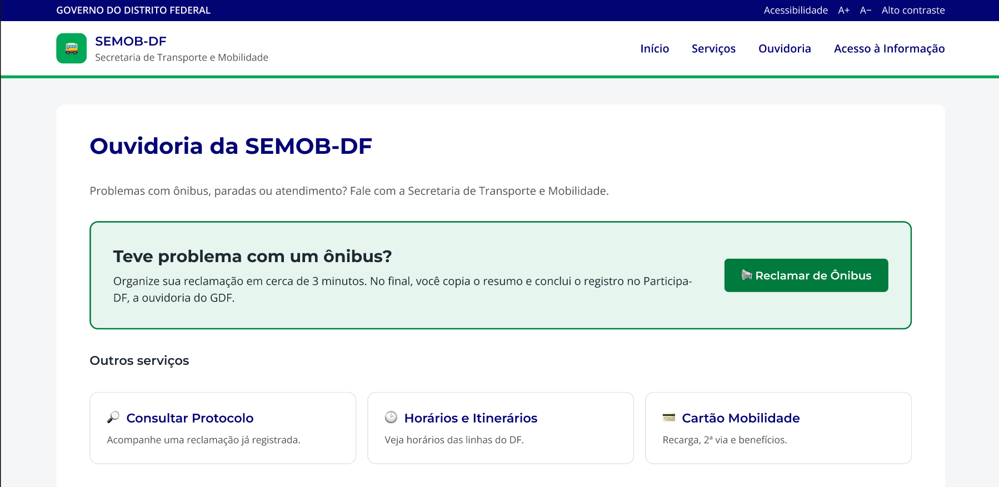
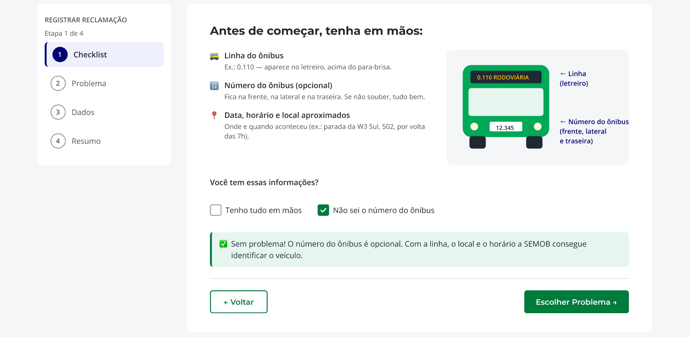
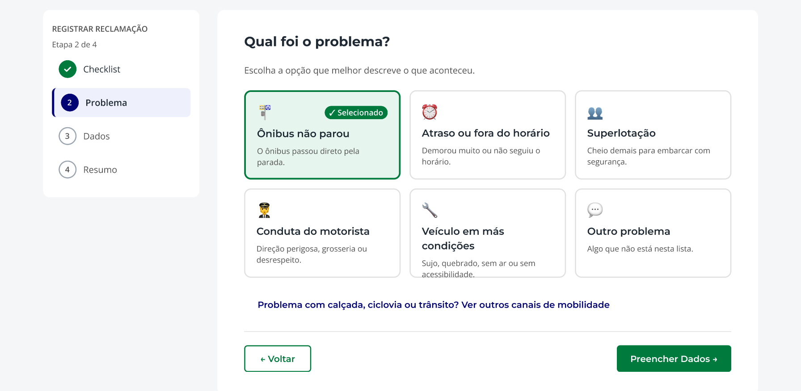
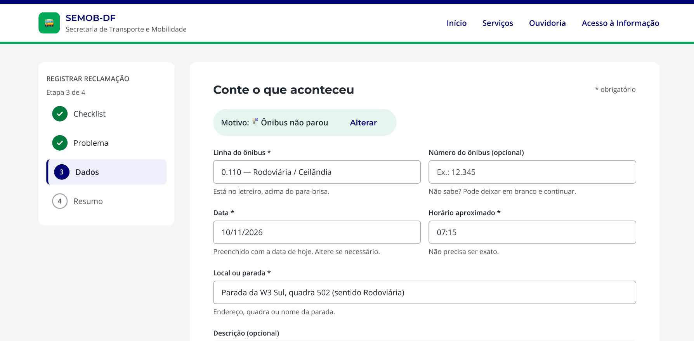
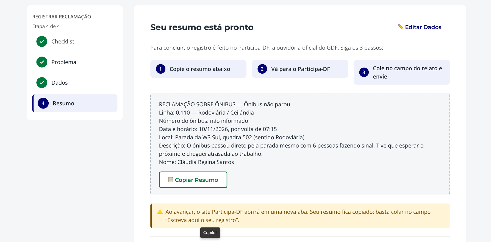
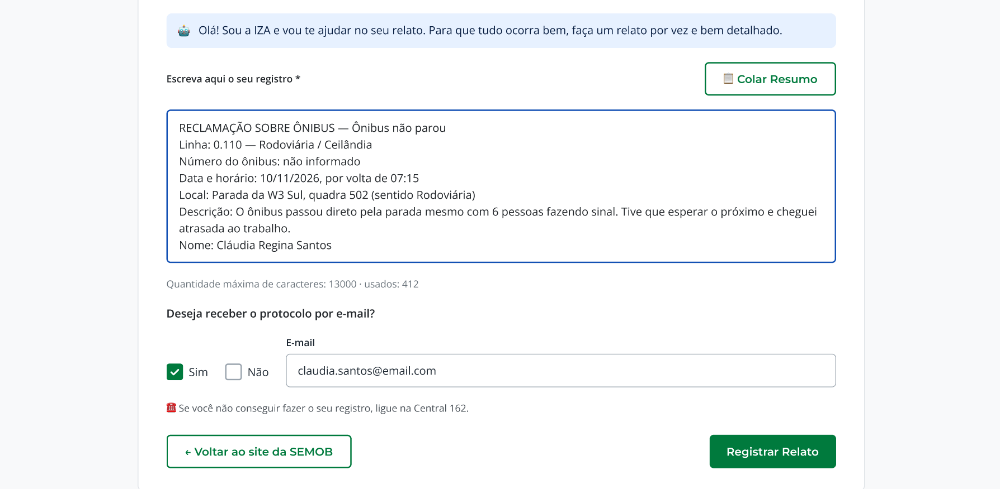
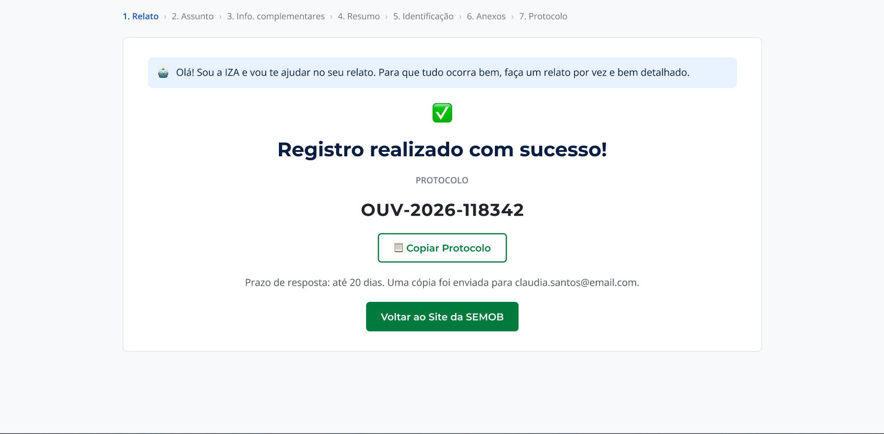

## Histórico de Versão e Contribuição

| Data | Versão | Descrição | Autor(es) | Revisor(es) | Declaração de Uso de IA |
| :---: | :---: | :--- | :--- | :--- | :--- |
| 15/11/2026 | `1.0` | Consolidação e relato dos resultados da avaliação de usabilidade do Protótipo de Alta Fidelidade (TAR-08) com 3 participantes. | [Rodrigo Barbosa](https://github.com/RodrigoCBarbosa) | [Carlos Costa](https://github.com/carloshfgit) | Google Gemini - Utilizada para apoio na estruturação das tabelas em Markdown e transcrição/revisão sintática dos dados empíricos. |

---

# Relato dos Resultados da Avaliação do Protótipo de Alta Fidelidade (TAR-08)

Neste documento, apresenta-se o **Relato dos Resultados da Avaliação do Protótipo de Alta Fidelidade** referente à **[TAR-08 (Registro de Reclamação sobre Ônibus a partir do Site da Semob)](../../../../analise-de-requisitos/analise-de-tarefas/tar-08-reclamacao-onibus.md)** da **SEMOB-DF**. O relatório consolida as evidências empíricas coletadas a partir dos testes de usabilidade e entrevistas pós-teste conduzidos com **três participantes** no protótipo interativo desenvolvido no **Figma**.

A condução e a interpretação dos resultados seguem o [Planejamento da Avaliação](../../planejamentos-individuais/rodrigo/rodrigo-planejamento-av-prot-alta-fidel.md) e o [Planejamento do Relato](../../planejamentos-individuais/rodrigo/rodrigo-planejamento-relato-prot-alta-fidel.md), fundamentando-se nas diretrizes metodológicas de Interação Humano-Computador (Barbosa et al., 2021, Cap. 11 e 12).

**Artefatos relacionados — fluxo da funcionalidade TAR-08 (Reclamação sobre Ônibus):**

* **Persona:** [Cláudia Regina Santos](../../../../analise-de-requisitos/personas/claudia-regina-santos.md)
* **Cenário:** [Cenário 11](../../../../analise-de-requisitos/cenarios/cenario-11-reclamacao-onibus.md)
* **Análise de tarefas:** [TAR-08](../../../../analise-de-requisitos/analise-de-tarefas/tar-08-reclamacao-onibus.md)
* **Storyboard:** [Storyboard 06](../../../nivel1/storyboards.md#36-storyboard-06-reclamacao-sobre-onibus-a-partir-do-site-da-semob)
* **Nível 1: avaliação do storyboard e da análise de tarefas:** [Planejamento da avaliação](../../../nivel1/planejamentos-individuais/Rodrigo/rodrigo-planejamento-avaliacao.md) · [Planejamento do relato](../../../nivel1/planejamentos-individuais/Rodrigo/rodrigo-planejamento-relato-resultados-avaliacao.md) · [Relato dos resultados](../../../nivel1/relatos-individuais/rodrigo/relato-resultados-storyboard-tarefas.md)
* **Nível 2: protótipo de papel (baixa fidelidade):** [Planejamento da avaliação](../../../nivel2/planejamentos-individuais/Rodrigo/rodrigo-planejamento-av-prototipo-papel.md) · [Planejamento do relato](../../../nivel2/planejamentos-individuais/Rodrigo/rodrigo-planejamento-relato-prot-papel.md) · [Relato dos resultados](../../../nivel2/relatos-individuais/rodrigo/relato-resultado-prot-papel.md)
* **Nível 3: protótipo de alta fidelidade:** [Planejamento da avaliação](../../planejamentos-individuais/rodrigo/rodrigo-planejamento-av-prot-alta-fidel.md) · [Planejamento do relato](../../planejamentos-individuais/rodrigo/rodrigo-planejamento-relato-prot-alta-fidel.md) · Relato dos resultados (*esta página*)
* **Telas do protótipo de papel:** [telas no planejamento da avaliação](../../../nivel2/planejamentos-individuais/Rodrigo/rodrigo-planejamento-av-prototipo-papel.md#8-telas-do-prototipo-avaliado)
* **Protótipo de alta fidelidade navegável:** *não disponível*

---

## 1. O Protótipo Avaliado

O objeto desta avaliação é o protótipo interativo de alta fidelidade da **TAR-08**, desenvolvido no **Figma** como uma versão aprimorada do site da SEMOB-DF e em conformidade com o [Guia de Estilo](../../../../analise-de-requisitos/guia-de-estilo/introducao.md) do Grupo 05. O protótipo consolida o ciclo evolutivo iniciado no [Storyboard 06](../../../nivel1/storyboards.md#36-storyboard-06-reclamacao-sobre-onibus-a-partir-do-site-da-semob) e refinado no protótipo de papel do Nível 2, mantendo as duas soluções validadas anteriormente: a eliminação do redirecionamento para login externo antes do preenchimento (`PROB-01`) e o número de ordem do ônibus como campo opcional (`PROB-02`).

O fluxo implementado no Figma é conduzido por um assistente em **4 etapas** (Checklist, Problema, Dados e Resumo), com indicador de progresso lateral, seguido do registro no Participa-DF:

1. **Tela inicial da Ouvidoria da SEMOB-DF**, com o card *"Teve problema com um ônibus?"* e o botão `[ Reclamar de Ônibus ]` em destaque;
2. **Etapa 1 — Checklist "Antes de começar, tenha em mãos"**, com ilustração indicando onde ficam a linha (letreiro) e o número do ônibus, o item *Número do ônibus (opcional)* e a opção *"Não sei o número do ônibus"*;
3. **Etapa 2 — Seleção do motivo** em cards descritivos (*Ônibus não parou*, *Atraso ou fora do horário*, *Superlotação*, *Conduta do motorista*, *Veículo em más condições* e *Outro problema*);
4. **Etapa 3 — Preenchimento dos dados** (linha, número opcional, data, horário aproximado, local/parada e descrição opcional);
5. **Etapa 4 — Resumo pronto**, com instruções em 3 passos (copiar o resumo, ir ao Participa-DF e colar no campo do relato) e o botão `[ Copiar Resumo ]`;
6. **Participa-DF**, com o botão `[ Colar Resumo ]`, opção de receber o protocolo por e-mail e o botão `[ Registrar Relato ]`;
7. **Tela de sucesso** (*"Registro realizado com sucesso!"*), com o número de protocolo em destaque (ex.: `OUV-2026-118342`), o botão `[ Copiar Protocolo ]`, o prazo de resposta de até 20 dias, a confirmação do envio de cópia por e-mail e o botão `[ Voltar ao Site da SEMOB ]`.

* **Telas do Protótipo:** as telas do fluxo completo, exportadas do Figma, são apresentadas na Seção 1.1.

### 1.1 Telas do Protótipo

<strong>Figura 1</strong>: Tela inicial da Ouvidoria da SEMOB-DF

<em>Fonte: Elaborado por Rodrigo Barbosa (2026).</em>

<strong>Figura 2</strong>: Etapa 1 — Checklist “Antes de começar, tenha em mãos”

<em>Fonte: Elaborado por Rodrigo Barbosa (2026).</em>

<strong>Figura 3</strong>: Etapa 2 — Seleção do motivo da reclamação

<em>Fonte: Elaborado por Rodrigo Barbosa (2026).</em>

<strong>Figura 4</strong>: Etapa 3 — Preenchimento dos dados da ocorrência

<em>Fonte: Elaborado por Rodrigo Barbosa (2026).</em>

<strong>Figura 5</strong>: Etapa 4 — Resumo pronto para cópia

<em>Fonte: Elaborado por Rodrigo Barbosa (2026).</em>

<strong>Figura 6</strong>: Registro do relato no Participa-DF

<em>Fonte: Elaborado por Rodrigo Barbosa (2026).</em>

<strong>Figura 7</strong>: Tela de sucesso com o protocolo gerado

<em>Fonte: Elaborado por Rodrigo Barbosa (2026).</em>

**Limitações do protótipo:** por se tratar de um protótipo no Figma, não era possível digitar; os campos eram preenchidos automaticamente por clique, com os dados da persona [Cláudia Regina Santos](../../../../analise-de-requisitos/personas/claudia-regina-santos.md). Além disso, somente o motivo *Ônibus não parou* estava interativo, o que foi informado previamente aos participantes.

---

## 2. Introdução e Objetivos da Avaliação

### 2.1 Escopo Avaliado

A avaliação concentrou-se no fluxo completo da **TAR-08**, que permite ao passageiro do transporte público do Distrito Federal registrar uma reclamação sobre um ônibus a partir do site da SEMOB-DF. Foi apresentado aos participantes o seguinte cenário: *"O ônibus passou direto por você na parada, você não conseguiu ver o número do veículo e deseja registrar uma reclamação."*

Os participantes atuaram no papel da persona [Cláudia Regina Santos](../../../../analise-de-requisitos/personas/claudia-regina-santos.md), passageira que já vivenciou irregularidades no transporte e valoriza canais rápidos e objetivos de manifestação.

### 2.2 Objetivos da Avaliação

Conforme definido na etapa **D — Determinar os Objetivos** do [Planejamento da Avaliação](../../planejamentos-individuais/rodrigo/rodrigo-planejamento-av-prot-alta-fidel.md), a avaliação teve como objetivos:

* **Verificar a conformidade com o Guia de Estilo do Grupo 05:** paleta de cores, tipografia, alvos de toque *mobile-first*, botões no padrão `[Verbo + Ação]` e disposição dos cards.
* **Avaliar a usabilidade da funcionalidade TAR-08:** identificar hesitações, desvios de fluxo ou cliques fora da área interativa durante a navegação pelo assistente de reclamação.
* **Validar a eficácia do formulário com identificação flexível:** verificar se o participante compreende que o número do ônibus é opcional e conclui a reclamação sem ele.
* **Avaliar a comunicabilidade e o feedback do sistema:** verificar se o resumo, o encaminhamento ao Participa DF e a entrega do protocolo transmitem clareza e segurança.
* **Subsidiar o produto final:** coletar dados quantitativos e qualitativos para os ajustes finais no Figma.

### 2.3 Perguntas da Avaliação (Framework DECIDE)

<strong>Quadro 1</strong>: Perguntas Investigativas da Avaliação

| ID | Foco | Pergunta Investigativa |
| :---: | :--- | :--- |
| **Q01** | Conformidade com o Guia de Estilo | Os botões, cards e rótulos são legíveis, claros e fáceis de identificar? |
| **Q02** | Acesso ao Canal de Reclamação | O ponto de entrada para o assistente de reclamação é facilmente localizado? |
| **Q03** | Seleção Guiada do Motivo | A escolha da categoria do problema em cards é simples e direta? |
| **Q04** | Facultatividade do Veículo | Como o participante avalia o número do ônibus não ser obrigatório? |
| **Q05** | Feedback e Código de Protocolo | O resumo, o protocolo e a opção de copiar deixam a manifestação clara? |
| **Q06** | Satisfação Geral | Como o participante avalia a facilidade de uso e a rapidez do assistente? |

<em>Fonte: Elaborado por Rodrigo Barbosa (2026).</em>

---

## 3. Gravações das Entrevistas e Termos de Consentimento

Em conformidade com os princípios éticos em pesquisas envolvendo seres humanos (Resoluções CNS nº 466/2012 e nº 510/2016; Barbosa et al., 2021, Seção 7.4), todos os participantes foram relembrados, no início da sessão, do Termo de Consentimento Livre e Esclarecido (TCLE) assinado, que autoriza o uso de imagem e voz e contém o contato do avaliador para eventuais dúvidas posteriores.

### 3.1 Entrevistado 1
* **Gravação da Sessão:** [Link para o YouTube - Sessão do Participante 1](https://youtu.be/uoa5EMy9byM)
* **Termo de Consentimento Livre e Esclarecido (TCLE):** [Visualizar TCLE aplicado](../../../../assets/PDFs/TCLE_Pesquisa_Transporte.pdf)

### 3.2 Entrevistado 2
* **Gravação da Sessão:** [Link para o YouTube - Sessão do Participante 2](https://youtu.be/z784FeWRAeE)
* **Termo de Consentimento Livre e Esclarecido (TCLE):** [Visualizar TCLE aplicado](../../../../assets/PDFs/TCLE_Pesquisa_Transporte.pdf)

### 3.3 Entrevistado 3
* **Gravação da Sessão:** [Link para o YouTube - Sessão do Participante 3](https://youtu.be/l6sHuiO9aBc)
* **Termo de Consentimento Livre e Esclarecido (TCLE):** [Visualizar TCLE aplicado](../../../../assets/PDFs/TCLE_Pesquisa_Transporte.pdf)

---

## 4. Metodologia e Caracterização dos Participantes

A avaliação adotou o método de **Teste de Usabilidade (Observação de Uso em Ambiente Controlado)** apoiado pela técnica de **Pensar em Voz Alta (*Think Aloud*)** e finalizado com uma entrevista semiestruturada pós-teste com as perguntas Q01 a Q06. O facilitador apresentou o cenário, relembrou o TCLE e explicou as limitações do protótipo; em seguida, o participante executou a tarefa verbalizando seu raciocínio.

A amostragem foi dimensionada em **três participantes**, conforme o planejamento da avaliação, com base nas orientações de Barbosa et al. (2021, pp. 258–259) sobre o perfil e o número de participantes e na referência de Nielsen (2000 apud BARBOSA et al., 2021), segundo a qual poucos usuários bastam para encontrar a maioria dos problemas na interface.

<strong>Tabela 1</strong>: Caracterização dos Participantes Recrutados

| Participante | Perfil Demográfico / Ocupação | Relação com o Transporte Público no DF | Duração da Sessão | Data da Sessão |
| :---: | :--- | :--- | :---: | :---: |
| **Entrevistado 1** | Estudante universitário (UnB Gama) | Usuário esporádico de ônibus; relatou alternar com carro e Uber. | 4min31s | 12/11/2026 |
| **Entrevistado 2** | Estudante universitário (UnB Gama) | Usuário frequente de ônibus no Gama (citou a linha 3204). | 3min09s | 12/11/2026 |
| **Entrevistado 3** | Estudante universitário (UnB Gama) | Usuário frequente de transporte público no DF. | 4min01s | 12/11/2026 |

<em>Fonte: Elaborado por Rodrigo Barbosa (2026).</em>

---

## 5. Sumário dos Dados Coletados

### 5.1 Desempenho Quantitativo nas Tarefas Interativas

Os três participantes concluíram o fluxo completo da reclamação, do card inicial até a tela de sucesso com o protocolo, sem desistências. Os tempos foram medidos a partir das gravações, do primeiro clique no protótipo até a tela de registro realizado com sucesso.

<strong>Tabela 2</strong>: Desempenho Quantitativo nas Tarefas da TAR-08 no Figma

| ID Tarefa | Descrição da Tarefa no Figma | Sucesso sem Ajuda (P1, P2, P3) | Taxa de Conclusão sem Ajuda | Intervenções do Facilitador |
| :---: | :--- | :---: | :---: | :---: |
| **TAR-08.1** | Localizar e acionar `[ Reclamar de Ônibus ]` na tela inicial. | Sim, Sim, Sim | **100%** | 0 |
| **TAR-08.2** | Indicar que não sabe o número do ônibus e prosseguir. | Sim, Sim, Não | **67%** | 1 (P3) |
| **TAR-08.3** | Selecionar o motivo *Ônibus não parou*. | Sim, Sim, Sim | **100%** | 0 |
| **TAR-08.4** | Preencher os dados da ocorrência e revisar o resumo. | Sim, Sim, Não | **67%** | 1 (P3) |
| **TAR-08.5** | Copiar o resumo, colá-lo no Participa DF, registrar o relato e obter o protocolo. | Sim, Sim, Sim | **100%** | 0 |

<em>Fonte: Elaborado por Rodrigo Barbosa (2026).</em>

<strong>Tabela 3</strong>: Tempo Total de Execução da Tarefa

| Participante | Início da Tarefa (gravação) | Tela de Sucesso (gravação) | Tempo Total Aproximado |
| :---: | :---: | :---: | :---: |
| **Entrevistado 1** | 00:58 | 02:03 | **≈ 1min05s** |
| **Entrevistado 2** | 00:40 | 01:45 | **≈ 1min05s** |
| **Entrevistado 3** | 00:57 | 02:50 | **≈ 1min53s** |
| **Média** | — | — | **≈ 1min21s** |

<em>Fonte: Elaborado por Rodrigo Barbosa (2026) a partir das gravações das sessões.</em>

**Observações das intervenções (Entrevistado 3):**

* **TAR-08.2:** diante do checklist "O que ter em mãos", o participante afirmou *"tenho tudo em mãos, né?"*, e o facilitador precisou relembrar o cenário de que ele não sabia o número do ônibus. Em seguida, o participante leu o aviso de que *"com a linha consegue identificar o veículo"* e prosseguiu.
* **TAR-08.4:** na etapa de Dados, ao tentar avançar para o resumo, o participante não identificou de imediato a área clicável (*"E eu posso clicar aqui?"*), e o facilitador indicou onde clicar (*"é só clicar em cima aí"*).

---

### 5.2 Consolidação Qualitativa das Respostas da Entrevista Pós-Teste (DECIDE)

<strong>Tabela 4</strong>: Síntese das Respostas da Entrevista Pós-Teste por Participante

| ID | Pergunta Aplicada | Entrevistado 1 | Entrevistado 2 | Entrevistado 3 | Avaliação da Interface |
| :---: | :--- | :--- | :--- | :--- | :---: |
| **Q01** | *Os botões e rótulos pareceram legíveis, claros e fáceis de identificar?* | "Com certeza. Foi bem nítido", percebeu de imediato. | Tudo fácil de acessar; ao olhar, já sabia o que cada elemento era. | Sim; botões intuitivos e uso tranquilo. | **Conforme** |
| **Q02** | *A opção de registrar a reclamação foi encontrada com facilidade?* | "Foi bem fácil." | Sim. | Sim. | **Conforme** |
| **Q03** | *A escolha da categoria do problema foi simples e direta?* | Encontrou várias categorias e conseguiu se identificar com a correta. | Sim; destacou que os cards "até explicavam um pouquinho". | Sim. | **Conforme** |
| **Q04** | *Como avalia o número do ônibus não ser obrigatório?* | Positivo: na correria do dia a dia é difícil anotar, sobretudo para quem não acompanha a rotina de ônibus. | Negativo: argumentou que o problema costuma não ser de um único veículo (citou a linha 3204 no Gama). | Negativo: acha que deveria ser obrigatório, pois passam muitos ônibus e fica difícil filtrar qual foi. | **Ajustar** |
| **Q05** | *O comprovante com o protocolo e a opção de copiar deixaram a manifestação clara?* | "Tava bem certo"; gostou muito do tratamento. | Sim; tudo claro e objetivo. | Sim; descrição clara. | **Conforme** |
| **Q06** | *Como avalia a facilidade de uso geral e a rapidez do assistente?* | Tranquilo; ressaltou que o preenchimento automático foi limitação do protótipo e que a digitação dos dados é importante. | "Muito fácil, muito rápido [...] é um ótimo protótipo." | "Bem bom"; teve alguns problemas no começo, mas depois entendeu o funcionamento. | **Positivo** |

<em>Fonte: Elaborado por Rodrigo Barbosa (2026).</em>

Ao serem perguntados, no início da entrevista, se haviam notado algum problema, os três participantes responderam que não: *"foi de boa o processo"* (P1), *"achei tudo muito fácil e entendível"* (P2) e *"ficou bem intuitivo"* (P3).

---

## 6. Tabela de Registro e Priorização de Problemas de IHC

A análise das interações e dos comentários dos entrevistados permitiu identificar três pontos de refinamento, classificados segundo a escala de severidade de Nielsen (1994 apud BARBOSA et al., 2021) e Barbosa et al. (2021):

<strong>Tabela 5</strong>: Registro, Classificação e Priorização de Problemas de Usabilidade

| ID Problema | Descrição do Problema Observado | Tela / Componente Afetado | Severidade (0 a 4) | Fatores de Usabilidade Prejudicados | Recomendação de Reprojeto no Figma |
| :---: | :--- | :--- | :---: | :--- | :--- |
| **PROB-F01** | Dois de três participantes (P2 e P3) questionaram a opcionalidade do número do ônibus, receando que reclamações sem o veículo identificado fiquem difíceis de filtrar e apurar, mesmo com o aviso *"Com a linha, o local e o horário a SEMOB consegue identificar o veículo"*. | Etapa 1 (Checklist) e Etapa 3 (Dados) / Campo Número do Ônibus | **2 (Moderado)** | Confiança no sistema / Comunicabilidade | Manter o campo opcional (decisão validada no Nível 2), mas reforçar a rastreabilidade: incluir o campo *sentido da linha* e destacar no resumo que horário, parada e sentido serão usados para identificar o veículo, além de incentivar o preenchimento do número quando o usuário souber. |
| **PROB-F02** | O participante não identificou a área clicável para avançar da etapa de Dados para o Resumo, precisando de indicação do facilitador. | Etapa 3 (Dados) / Campos preenchidos por clique e botão de avanço | **2 (Moderado)** | Visibilidade / Affordance | No Figma, ampliar os *hotspots* dos campos e do botão de avanço e mantê-lo visível sem rolagem (ex.: barra de ações fixa no rodapé com `[ ← Voltar ]` e `[ Revisar Resumo → ]`). Na versão final, os campos serão editáveis, eliminando o preenchimento por clique. |
| **PROB-F03** | O participante afirmou *"tenho tudo em mãos"*, reproduzindo o rótulo da primeira opção do checklist, sem associar de imediato o cenário à opção *"Não sei o número do ônibus"*. Além disso, as duas opções são *checkboxes*, o que permite marcar ambas ao mesmo tempo. | Etapa 1 (Checklist) / Opções "Tenho tudo em mãos" e "Não sei o número do ônibus" | **1 (Leve)** | Clareza de rótulo / Prevenção de erros | Substituir as duas *checkboxes* por uma pergunta direta com opções mutuamente exclusivas (*radio buttons*): *"Você sabe o número do ônibus?"* → `( ) Sim, vou informar` / `( ) Não sei o número`. |

<em>Fonte: Elaborado por Rodrigo Barbosa (2026) com base no feedback empírico.</em>

---

## 7. Avaliação de Conformidade com o Guia de Estilo do Grupo 05

<strong>Tabela 6</strong>: Conformidade das Telas do Figma com o Guia de Estilo

| Diretriz do Guia de Estilo | Padrão Esperado no Figma | Resultado nos Testes com os 3 Usuários | Situação |
| :--- | :--- | :--- | :---: |
| **Padrão de Rótulos** | Botões de ação no padrão `[Verbo + Ação]` (ex.: `[ Reclamar de Ônibus ]`). | Os três acionaram o card de reclamação de imediato e sem dúvidas de vocabulário. | **Conforme** |
| **Alvos de Toque** | Botões e cards clicáveis amplos (mínimo de 44x44 dp). | Botões e cards de motivo amplos e acionados sem erro; porém, um participante não identificou a área clicável na etapa de Dados (PROB-F02). | **Ajustar** |
| **Formulário Otimizado** | Campo opcional claramente sinalizado para dados não memorizáveis (número do ônibus). | Todos prosseguiram sem o número, mas dois questionaram a opcionalidade e um precisou de lembrete do cenário (PROB-F01 e PROB-F03). | **Ajustar** |
| **Contraste e Cores** | Paleta institucional com contraste WCAG AA. | Nenhuma queixa de legibilidade; P1 descreveu os elementos como "bem nítidos". | **Conforme** |

<em>Fonte: Elaborado por Rodrigo Barbosa (2026).</em>

---

## 8. Plano de Reprojeto e Ciclo de Iteração no Figma

Com base nos resultados, não foram encontrados problemas de severidade 3 ou 4. Os ajustes priorizados para o Figma são:

1. **Comunicação da opcionalidade do veículo (PROB-F01 e PROB-F03):** substituir as *checkboxes* do checklist por uma pergunta com opções exclusivas (*"Você sabe o número do ônibus?"*), incluir o campo *sentido da linha* na etapa de Dados e reforçar no resumo como a SEMOB identificará o veículo sem o número.
2. **Avanço visível na etapa de Dados (PROB-F02):** ampliar os *hotspots* no Figma e fixar a barra de ações (`[ ← Voltar ]` / `[ Revisar Resumo → ]`) no rodapé, para que o botão de avanço fique visível sem rolagem.
3. **Campos editáveis na versão final:** conforme apontado pelo Entrevistado 1, o preenchimento automático foi uma limitação do Figma; na implementação, os campos devem ser editáveis e manter os rótulos e máscaras definidos no protótipo.

---

## 9. Conclusão

A avaliação do protótipo de alta fidelidade da TAR-08 confirmou a viabilidade do assistente de reclamação: os três participantes concluíram o registro e obtiveram o protocolo, com tempo médio aproximado de 1min21s, e duas das cinco sub-tarefas tiveram uma intervenção pontual do facilitador com o Entrevistado 3. O acesso ao canal, a seleção do motivo em cards e a tela de protocolo foram compreendidos de imediato, e a satisfação geral foi positiva.

O principal achado foi a divergência sobre a opcionalidade do número do ônibus: enquanto P1 valorizou não precisar dessa informação, P2 e P3 manifestaram receio quanto à apuração de reclamações sem o veículo identificado. Como lição aprendida, destaca-se que flexibilizar um campo não basta: é preciso comunicar ao usuário como sua manifestação continuará rastreável. Com os refinamentos da Seção 8, o protótipo está validado para a versão final da TAR-08.

---

## 10. Fotos de Referência

As Figuras 8 a 10 mostram os trechos que fundamentam este artefato, recortados e grifados em amarelo diretamente do livro da disciplina (BARBOSA et al., 2021).

<strong>Figura 8</strong>: Representação de interface em alta fidelidade

<em>Fonte: BARBOSA et al. (2021, p. 210).</em>

<strong>Figura 9</strong>: 12.2.1 Teste de usabilidade: objetivo, atividades e medidas por tarefa

<em>Fonte: BARBOSA et al. (2021, pp. 288–289).</em>

<strong>Figura 10</strong>: 11.7.5 Consolidação e relato dos resultados

<em>Fonte: BARBOSA et al. (2021, p. 263).</em>

---

## 11. Referências Bibliográficas

* BARBOSA, Simone Diniz Junqueira; SILVA, Bruno Santana da; SILVEIRA, Milene Selbach; GASPARINI, Isabela; DARIN, Ticianne; BARBOSA, Gabriel Diniz Junqueira. **Interação Humano-Computador e Experiência do Usuário**. Rio de Janeiro: Autopublicação, 2021. ISBN 978-65-00-19677-1. (Capítulo 11, p. 245–266; Capítulo 12, p. 288–291).
* SALES, André Barros de. **Plano de Ensino: Interação Humano Computador**. Brasília: Universidade de Brasília, Faculdade UnB Gama (FCTE/UnB), 2026.
