## Histórico de Versão e Contribuição

| Data | Versão | Descrição | Autor(es) | Revisor(es) | Declaração de Uso de IA |
| :---: | :---: | :--- | :--- | :--- | :--- |
| 15/11/2026 | `1.0` | Relato dos resultados da avaliação do protótipo de alta fidelidade da TAR-09 (Pedido de aumento do limite diário do Vale-Transporte), com dois participantes. | [Tomás Rocho](https://github.com/TomasRocho) | [Rodrigo Carvalho](https://github.com/RodrigoCBarbosa) | Claude (Anthropic) - usado para estruturação do texto e formatação Markdown da página, a partir das informações da sessão fornecidas pelo autor |
| 19/11/2026 | `1.1` | Padronização da estrutura (histórico no topo, conteúdo, fotos de referência e referências ao final); declaração de IA levada para o histórico; autor e revisor retirados do rodapé; retirada das referências que não são o livro da disciplina nem material do professor; inclusão de fotos de referência grifadas. Inclusão das telas do protótipo avaliado, com links para o protótipo e para o artefato relacionado. Inclusão do bloco de artefatos relacionados (persona, cenário, análise de tarefas, storyboard, planejamentos, relatos e protótipos da funcionalidade). Correção das páginas e seções citadas do livro da disciplina (edição de 2021). | [Gabriel Melo](https://github.com/gabriellcardone-06) | Pendente de revisão | Claude (Anthropic) — apoio na padronização da estrutura do artefato, na revisão das referências e na formatação em Markdown; apoio na inclusão das telas do protótipo.; apoio na inclusão dos links entre artefatos |

!!! warning "Observação para correção manual"
    As telas da seção "Telas do Protótipo Avaliado" foram capturadas do protótipo navegável do repositório (docs/prototipos/tar-09) em 19/11/2026. O autor deve confirmar se correspondem à versão usada nas sessões de avaliação.

---

# Relato dos Resultados da Avaliação do Protótipo de Alta Fidelidade (TAR-09)

Neste documento, apresentam-se os resultados da avaliação do protótipo de alta fidelidade da **[TAR-09 (Solicitar Aumento do Limite Diário de Uso do Vale-Transporte)](../../../../analise-de-requisitos/analise-de-tarefas/tar-09-limite-vale-transporte.md)**. A avaliação seguiu o [Planejamento da Avaliação do Protótipo de Alta Fidelidade](../../planejamentos-individuais/tomas/tomas-planejamento-av-prot-alta-fidel.md), e este relato segue a estrutura do [Planejamento do Relato dos Resultados](../../planejamentos-individuais/tomas/tomas-planejamento-relato-prot-alta-fidel.md).

Os dados de cada participante foram interpretados primeiro e, depois, consolidados para responder às perguntas da avaliação (Barbosa et al., 2021, pp. 262–263). Os problemas seriam descritos com o que foi observado, a possível causa e a recomendação (Barbosa et al., 2021, p. 289). Como nenhum problema foi observado, a seção 7 registra apenas essa conclusão.

**Artefatos relacionados — fluxo da funcionalidade TAR-09 (Pedido de Aumento do Limite Diário do Vale-Transporte):**

* **Persona:** [Heitor Santos Júnior](../../../../analise-de-requisitos/personas/heitor-santos-junior.md)
* **Cenário:** [Cenário 9](../../../../analise-de-requisitos/cenarios/cenario-9-limite-vale-transporte.md)
* **Análise de tarefas:** [TAR-09](../../../../analise-de-requisitos/analise-de-tarefas/tar-09-limite-vale-transporte.md)
* **Storyboard:** [Storyboard 05](../../../nivel1/storyboards.md#35-storyboard-05-pedido-de-aumento-do-limite-diario-do-vale-transporte)
* **Nível 1 — avaliação do storyboard e da análise de tarefas:** [Planejamento da avaliação](../../../nivel1/planejamentos-individuais/Tomas/tomas-planejamento-avaliacao.md) · [Planejamento do relato](../../../nivel1/planejamentos-individuais/Tomas/tomas-planejamento-relato-resultados-avaliacao.md) · Relato dos resultados (*não disponível — pendente de correção manual*)
* **Nível 2 — protótipo de papel (baixa fidelidade):** [Planejamento da avaliação](../../../nivel2/planejamentos-individuais/Tomas/tomas-planejamento-av-prototipo-papel.md) · [Planejamento do relato](../../../nivel2/planejamentos-individuais/Tomas/tomas-planejamento-relato-prot-papel.md) · [Relato dos resultados](../../../nivel2/relatos-individuais/tomas/relato-resultados-prot-papel.md)
* **Nível 3 — protótipo de alta fidelidade:** [Planejamento da avaliação](../../planejamentos-individuais/tomas/tomas-planejamento-av-prot-alta-fidel.md) · [Planejamento do relato](../../planejamentos-individuais/tomas/tomas-planejamento-relato-prot-alta-fidel.md) · Relato dos resultados (*esta página*)
* **Telas do protótipo de papel:** [telas no planejamento da avaliação](../../../nivel2/planejamentos-individuais/Tomas/tomas-planejamento-av-prototipo-papel.md)
* **Protótipo de alta fidelidade navegável:** [acessar o protótipo](../../../../prototipos/tar-09/index.html)

---

## 1. Introdução, Objetivos e Escopo

O protótipo avaliado representa o fluxo **"Meu Vale-Transporte foi recusado"** no site da SEMOB-DF: o passageiro descobre por que o cartão foi recusado na catraca, pede mais passagens por dia pelo celular, recebe um protocolo e acompanha o pedido. É um **protótipo vertical** (Barbosa et al., 2021): só o fluxo da TAR-09 funciona; os outros serviços da página inicial existem para não induzir a escolha.

Os objetivos da avaliação eram:

1. verificar se o atalho "Meu Vale-Transporte foi recusado" é encontrado na página inicial;
2. verificar se a explicação da recusa ("Você usou 8 de 8 passagens hoje") é entendida como limite diário, e não como falta de saldo;
3. avaliar o pedido em três passos (rotina, fotos dos documentos e declaração do RH);
4. avaliar a prevenção e a recuperação de erros (foto ilegível e declaração faltando);
5. avaliar o *feedback* final, o protocolo e o acompanhamento do pedido;
6. cobrir as pendências PE-01 a PE-04 deixadas pelo [Relato do Protótipo de Papel](../../../nivel2/relatos-individuais/tomas/relato-resultados-prot-papel.md).

**Fora do escopo:** a câmera, o aviso do WhatsApp e a análise da SEMOB foram **simulados** dentro do protótipo. A avaliação não verificou se o serviço pode ser implantado pela SEMOB-DF e pelo BRB Mobilidade.

### 1.1 Protótipo avaliado

<strong>Tabela 1</strong> — Identificação do Protótipo Avaliado

| Item | Detalhamento |
| :--- | :--- |
| **Link do protótipo** | [prototipos/tar-09](../../../../prototipos/tar-09/index.html) (publicado no GitHub Pages junto com a Wiki) |
| **Caminho no repositório** | `docs/prototipos/tar-09/` (`index.html`, `styles.css`, `app.js`) |
| **Versão testada** | *Commit* `a09b751` (14/11/2026) |
| **Tecnologia** | HTML, CSS e JavaScript, sem servidor; abre no navegador do celular |
| **Telas** | T1 Página inicial · T2 Informar o cartão · T3 Explicação da recusa · W5 Postos · T4–T6 Pedido em três passos · E1 Foto ilegível · E2 Declaração faltando · T7 Revisão · T8 Confirmação · T9 Acompanhar pedido · N1 Aviso do WhatsApp |
| **Dados** | Fictícios: cartão 0042 1873 5560, protocolo 2026-0451 e fotos de documentos marcadas como "EXEMPLO" |
| **Identidade visual** | Visual do portal da SEMOB-DF (barra do GDF, título da Secretaria em letras finas, faixa de busca, cartões brancos com botão cinza-escuro e trilha de navegação com ">" verde), seguindo o [Guia de Estilo](../../../../analise-de-requisitos/guia-de-estilo/introducao.md) do Grupo 05 |

<em>Fonte: Elaborado por Tomás Rocho (2026).</em>

O protótipo pode ser usado abaixo:

  <iframe src="../../../../../prototipos/tar-09/index.html" title="Protótipo de alta fidelidade da TAR-09" width="400" height="720" style="border:1px solid #ccc;border-radius:12px;max-width:100%"></iframe>

---

## 2. Método

* **Método:** teste de usabilidade com observação de uso (Barbosa et al., 2021, p. 288), com a técnica de **pensar em voz alta** (*think aloud*) e entrevista curta ao final.
* **Tarefas:** lidas uma de cada vez, a partir do [Cenário 9](../../../../analise-de-requisitos/cenarios/cenario-9-limite-vale-transporte.md): *"Você trabalha com manutenção e passou o dia indo de prédio em prédio de ônibus. Na volta para casa, o cartão do Vale-Transporte não passou na catraca. Use o site da SEMOB no celular para resolver."*

<strong>Tabela 2</strong> — Tarefas Avaliadas

| ID Tarefa | Enunciado | Critério de Conclusão |
| :---: | :--- | :--- |
| **TAR-09.1** | "Descubra por que o seu cartão foi recusado." | Chega à T3 e explica a recusa como limite do dia. |
| **TAR-09.2** | "Peça para poder usar mais passagens por dia. Os documentos que você precisa estão no celular." | Chega à T8 com o protocolo na tela. |
| **TAR-09.3** | "Passaram alguns dias. Veja se o seu pedido foi aprovado." | Mostra a situação do pedido na T9 ou lê o aviso N1. |

<em>Fonte: Elaborado por Tomás Rocho (2026), a partir do planejamento da avaliação.</em>

* **Teste piloto:** foi feito um teste piloto antes das sessões, para conferir o protótipo, as tarefas e a gravação. Como prevê o planejamento, os dados do piloto não entram nos resultados (Barbosa et al., 2021, pp. 259–260).

### 2.1 Mudanças em relação ao planejamento

<strong>Tabela 3</strong> — Diferenças entre o Planejado e o Realizado

| Item | Planejado | Realizado | Efeito nos resultados |
| :--- | :--- | :--- | :--- |
| **Protótipo** | Figma (versão 1.0 do planejamento) | HTML, CSS e JavaScript (versão 1.1 do planejamento) | Nenhum efeito negativo: o protótipo ficou mais interativo (campos com digitação real e dados preservados ao voltar). |
| **Participantes** | 3 participantes | 2 participantes (P01 e P02) | Menos chance de encontrar problemas menos frequentes (seção 9). |
| **Observador** | Rodrigo Carvalho, separado do condutor | Tomás Rocho conduziu e observou sozinho | As anotações foram feitas por quem conduzia; as gravações servem de apoio para a revisão. |
| **Datas** | Piloto em 08/11 e sessões em 10, 12 e 14/11 | Gravações das sessões publicadas em 15/11/2026 | Nenhum efeito sobre os dados. |
| **Medição do tempo** | Cronometragem por tarefa e por participante | Tempo aproximado de cada tarefa, estimado pelo avaliador | Os tempos servem só para dar uma ideia da duração (seção 4). |

<em>Fonte: Elaborado por Tomás Rocho (2026).</em>

---

## 3. Participantes e Avaliadores

<strong>Tabela 4</strong> — Participantes, Avaliador e Gravações

| Código | Perfil (sem dados pessoais) | Proximidade com a persona Heitor | Gravação |
| :---: | :--- | :---: | :--- |
| **P01** | Usuário do Vale-Transporte recrutado pelo perfil do planejamento (trabalhador que usa o transporte público do DF e o celular no dia a dia). | Alta | [Sessão P01](https://youtu.be/vr4LIyB6S8w) (5 min 05 s) |
| **P02** | Usuário do Vale-Transporte recrutado pelo perfil do planejamento (trabalhador que usa o transporte público do DF e o celular no dia a dia). | Alta | [Sessão P02](https://youtu.be/E0sX1v0LoNM) (6 min 01 s) |

<em>Fonte: Elaborado por Tomás Rocho (2026). Avaliador: Tomás Rocho (condutor e observador).</em>

**Ética:** antes de cada sessão, o participante foi informado do objetivo acadêmico, de que o avaliado era o protótipo e não ele, de que o protótipo não envia pedido nenhum à SEMOB-DF e de que podia parar a qualquer momento. Ele leu e assinou o [TCLE](../../../../assets/PDFs/TCLE_Pesquisa_Transporte.pdf) e autorizou a gravação. Só foram usados dados fictícios, e os participantes aparecem apenas pelos códigos P01 e P02 (Barbosa et al., 2021, pp. 127–128).

As gravações das duas sessões estão abaixo:

  
<strong>Sessão P01</strong>

  <iframe width="560" height="315" src="https://www.youtube-nocookie.com/embed/vr4LIyB6S8w" title="Sessão do protótipo de alta fidelidade (TAR-09) com o participante P01" frameborder="0" allow="accelerometer; autoplay; clipboard-write; encrypted-media; gyroscope; picture-in-picture; web-share" allowfullscreen></iframe>

  
<strong>Sessão P02</strong>

  <iframe width="560" height="315" src="https://www.youtube-nocookie.com/embed/E0sX1v0LoNM" title="Sessão do protótipo de alta fidelidade (TAR-09) com o participante P02" frameborder="0" allow="accelerometer; autoplay; clipboard-write; encrypted-media; gyroscope; picture-in-picture; web-share" allowfullscreen></iframe>

---

## 4. Desempenho por Tarefa

<strong>Tabela 5</strong> — Desempenho de Cada Participante nas Tarefas

| Participante | Tarefa | Conclusão | Erros | Pedidos de Ajuda | Dificuldades Observadas |
| :---: | :---: | :---: | :---: | :---: | :--- |
| **P01** | **TAR-09.1** | **Sem ajuda** | 0 | 0 | Nenhuma. |
| **P01** | **TAR-09.2** | **Sem ajuda** | 0 | 0 | Nenhuma. |
| **P01** | **TAR-09.3** | **Sem ajuda** | 0 | 0 | Nenhuma. |
| **P02** | **TAR-09.1** | **Sem ajuda** | 0 | 0 | Nenhuma. |
| **P02** | **TAR-09.2** | **Sem ajuda** | 0 | 0 | Nenhuma. |
| **P02** | **TAR-09.3** | **Sem ajuda** | 0 | 0 | Nenhuma. |

<em>Fonte: Elaborado por Tomás Rocho (2026).</em>

<strong>Tabela 6</strong> — Resumo das Duas Sessões por Tarefa

| Tarefa | Concluíram sem ajuda | Concluíram com ajuda | Não concluíram | Tempo aproximado | Total de erros | Total de pedidos de ajuda |
| :---: | :---: | :---: | :---: | :---: | :---: | :---: |
| **TAR-09.1** | 2 de 2 | 0 de 2 | 0 de 2 | cerca de 10 s | 0 | 0 |
| **TAR-09.2** | 2 de 2 | 0 de 2 | 0 de 2 | cerca de 1 min 30 s | 0 | 0 |
| **TAR-09.3** | 2 de 2 | 0 de 2 | 0 de 2 | cerca de 20 s | 0 | 0 |

<em>Fonte: Elaborado por Tomás Rocho (2026). Os tempos foram estimados pelo avaliador para as duas sessões e não foram cronometrados por participante; servem só como referência, sem meta numérica.</em>

A TAR-09.2 foi a mais longa, como era esperado: ela tem a descrição da rotina, três fotos (uma delas recusada de propósito pelo erro E1) e a revisão do pedido. Mesmo assim, os dois participantes passaram por ela sem pedir ajuda.

---

## 5. Interpretação por Participante

* **P01:** encontrou o atalho "Meu Vale-Transporte foi recusado" na página inicial sem entrar em outro serviço e entendeu, na T3, que o cartão foi recusado pelo limite de passagens do dia. No pedido, descreveu a rotina, enviou os documentos, tirou outra foto quando o comprovante foi recusado (E1), enviou a declaração do RH e chegou ao protocolo. Na última tarefa, conferiu que o pedido tinha sido aprovado. Não teve desvios, erros nem pedidos de ajuda.
* **P02:** seguiu o mesmo caminho de P01, também sem desvios, erros ou pedidos de ajuda, e concluiu as três tarefas.

Nos dois casos, o fluxo foi seguido na ordem prevista na [TAR-09](../../../../analise-de-requisitos/analise-de-tarefas/tar-09-limite-vale-transporte.md) (entender a recusa → montar o pedido → acompanhar), sem que o avaliador precisasse intervir.

---

## 6. Respostas às Perguntas da Avaliação

<strong>Tabela 7</strong> — Resultado das Perguntas da Avaliação

| ID | Pergunta (resumo) | Critério de Aceitação | P01 | P02 | Resultado Geral |
| :---: | :--- | :--- | :---: | :---: | :--- |
| **Q01** | Encontra o atalho na página inicial? | Toca no atalho certo sem entrar antes em outro serviço. | S | S | Atingido nos dois. |
| **Q02** | Entende por que o cartão foi recusado? | Explica que passou do limite, e não que está sem saldo. | S | S | Atingido nos dois. |
| **Q03** | Entende que as integrações contam? | Diz que cada ônibus conta, mesmo com integração. | S | S | Atingido nos dois; nenhum participante mostrou dúvida sobre o aviso. |
| **Q04** | Preenche a rotina e envia os documentos sem ajuda? | Conclui os passos 1 a 3 sem perguntar o que colocar. | S | S | Atingido nos dois. |
| **Q05** | Recupera-se do erro de foto ilegível (E1)? | Toca em "Tirar outra foto" sem ajuda. | S | S | Atingido nos dois. |
| **Q06** | Entende o aviso de declaração faltando (E2)? | Volta ao passo 3 sem perder os dados. | Não testada | Não testada | Nenhum participante tentou revisar o pedido sem a declaração, então o aviso E2 não apareceu. |
| **Q07** | Sabe que o pedido foi recebido e como acompanhar? | Cita o protocolo, o aviso e a consulta. | S | S | Atingido nos dois. |
| **Q08** | Sabe onde está dentro do pedido? | Diz o passo em que está e como voltar. | S | S | Atingido nos dois; nenhum participante se perdeu nos três passos. |
| **Q09** | O que achou claro, confuso ou faltando? | Opinião aberta. | Sem pontos confusos | Sem pontos confusos | Os dois avaliaram bem o protótipo e não apontaram nada confuso ou faltando. |

<em>Fonte: Elaborado por Tomás Rocho (2026). Legenda: S = sim.</em>

**Pergunta sem resposta:** apenas a **Q06** ficou sem resposta, porque o aviso E2 só aparece se o participante tentar revisar o pedido sem a declaração do RH, e nenhum dos dois fez isso.

---

## 7. Problemas de Usabilidade Encontrados

<strong>Tabela 8</strong> — Problemas de Usabilidade Encontrados

| ID | O que foi observado | Tela ou Estado | Participantes | Severidade (0–4) | Recomendação |
| :---: | :--- | :--- | :---: | :---: | :--- |
| — | Nenhum problema de usabilidade foi observado. Os dois participantes concluíram as três tarefas sem ajuda, sem desvios e sem erros, e não sugeriram mudanças. | — | 0 de 2 | — | Manter o fluxo, os textos e o visual do protótipo. |

<em>Fonte: Elaborado por Tomás Rocho (2026).</em>

---

## 8. Comparação com o Protótipo de Papel

O [Relato do Protótipo de Papel](../../../nivel2/relatos-individuais/tomas/relato-resultados-prot-papel.md) também não encontrou problemas de usabilidade, mas deixou quatro pendências. A Tabela 9 mostra o que foi coberto agora.

<strong>Tabela 9</strong> — Pendências do Protótipo de Papel Verificadas no Protótipo Navegável

| Pendência do Nível 2 | O que foi feito no Nível 3 | Situação | Evidência |
| :---: | :--- | :---: | :--- |
| **PE-01** — tempo das tarefas não medido | Tempo aproximado de cada tarefa estimado pelo avaliador | **Parcial** | Tabela 6. Os tempos não foram cronometrados por participante. |
| **PE-02** — estados de documento faltando e "entregar no posto" não usados | Estados E2 e W5 mantidos no protótipo | **Não testada** | Nenhum participante tentou revisar sem a declaração (Q06). |
| **PE-03** — sem teste piloto | Piloto feito antes das sessões | **Coberta** | Seção 2. |
| **PE-04** — apenas um participante | Dois participantes | **Parcial** | Tabela 4. Planejados três. |

<em>Fonte: Elaborado por Tomás Rocho (2026).</em>

O resultado se manteve nos dois níveis: o fluxo foi concluído sem ajuda no papel (1 participante) e no protótipo navegável (2 participantes). No papel, o "uso" é conduzido pelo avaliador, que troca as telas (Barbosa et al., 2021). Agora os participantes conduziram o uso sozinhos, com campos reais, a foto recusada e a navegação definitiva, e mesmo assim não tiveram dificuldade. Isso reforça que o fluxo proposto na TAR-09 e no [Storyboard 05](../../../nivel1/storyboards.md) é compreensível para o perfil avaliado.

---

## 9. Limitações dos Resultados

* **Dois participantes:** abaixo dos três planejados e da referência de cinco citada por Barbosa et al. (2021, p. 258). Problemas que só aparecem com menos frequência podem não ter sido encontrados.
* **Avaliador único:** a mesma pessoa conduziu e observou. Hesitações curtas podem não ter sido anotadas na hora; as gravações permitem revisá-las.
* **Tempos aproximados:** os tempos da Tabela 6 são estimativas e não permitem comparar os participantes entre si.
* **Estados não testados:** o aviso de declaração faltando (E2) não apareceu em nenhuma sessão, e o caminho "Prefiro entregar no posto" (W5) não fez parte do caminho dos participantes até a conclusão das tarefas.
* **Simulações:** a câmera, a espera de alguns dias e o aviso do WhatsApp foram simulados. Com a câmera real ou com a espera real, o comportamento pode ser diferente.
* **Ambiente:** a sessão não aconteceu na catraca do ônibus, à noite e com pressa, como no Cenário 9.
* **Protótipo vertical:** os resultados valem só para o fluxo da TAR-09, e não para os outros serviços do site.

---

## 10. Plano de Reprojeto

Como nenhum problema foi encontrado, **não há correção obrigatória** no protótipo, na TAR-09, no Storyboard 05 nem no Guia de Estilo.

<strong>Tabela 10</strong> — Plano de Reprojeto

| Item | Ação | Artefato | Prioridade | Responsável |
| :---: | :--- | :--- | :---: | :--- |
| **R-01** | Manter o fluxo, os textos e o visual do protótipo como estão. | Protótipo da TAR-09 | — | Tomás Rocho |
| **R-02** | Numa próxima avaliação, pedir explicitamente que um participante tente enviar o pedido sem a declaração do RH e que outro escolha "Prefiro entregar no posto", para testar E2 e W5. | Planejamento de uma nova rodada | Média | Tomás Rocho |
| **R-03** | Numa próxima avaliação, usar o painel do avaliador (`?avaliador=1`) para cronometrar cada tarefa por participante e ter um observador separado do condutor. | Planejamento de uma nova rodada | Média | Tomás Rocho |
| **R-04** | Propor ao Guia de Estilo a mensagem de erro de foto (problema + como corrigir + "Tirar outra foto"), que funcionou com os dois participantes, como padrão para o envio de documentos pelo celular. | [Guia de Estilo — Elementos de ação](../../../../analise-de-requisitos/guia-de-estilo/elementos-de-acao.md) | Baixa | Tomás Rocho |

<em>Fonte: Elaborado por Tomás Rocho (2026).</em>

---

## 11. Conclusão

O protótipo de alta fidelidade da TAR-09 foi avaliado com dois usuários do Vale-Transporte. Os dois concluíram as três tarefas sem ajuda, sem desvios e sem erros: encontraram o serviço na página inicial, entenderam que o cartão foi recusado pelo limite diário e não por falta de saldo, montaram o pedido com a rotina, os documentos e a declaração do RH, recuperaram-se do erro de foto e acompanharam o pedido até a aprovação. Oito das nove perguntas da avaliação tiveram o critério atingido; apenas a Q06 não pôde ser testada.

Somado ao resultado do protótipo de papel, isso indica que a solução proposta na TAR-09 (atalho direto, explicação clara da recusa, pedido pelo celular com protocolo e aviso pelo WhatsApp) atende à tarefa para o perfil avaliado. As limitações da seção 9, principalmente o número de participantes e os estados não testados, devem ser consideradas antes de generalizar o resultado.

---

## 12. Evidências do Livro

As figuras abaixo mostram os trechos grifados de Barbosa et al. (2021) usados para interpretar, consolidar e relatar os resultados.

<strong>Figura 1</strong> — Interpretação dos dados de cada participante (p. 262).

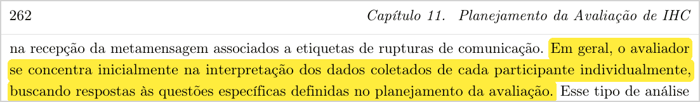

<em>Fonte: BARBOSA et al. (2021, p. 262). Recorte e grifo: <a href="https://github.com/gabriellcardone-06">Gabriel Melo</a> (2026).</em>

<strong>Figura 2</strong> — Consolidação entre participantes (p. 263).

<em>Fonte: BARBOSA et al. (2021, p. 263). Recorte e grifo: <a href="https://github.com/gabriellcardone-06">Gabriel Melo</a> (2026).</em>

<strong>Figura 3</strong> — Cautela na generalização e itens do relato (p. 263).

<em>Fonte: BARBOSA et al. (2021, p. 263). Recorte e grifo: <a href="https://github.com/gabriellcardone-06">Gabriel Melo</a> (2026).</em>

<strong>Figura 4</strong> — Dados coletados no teste de usabilidade (p. 289).

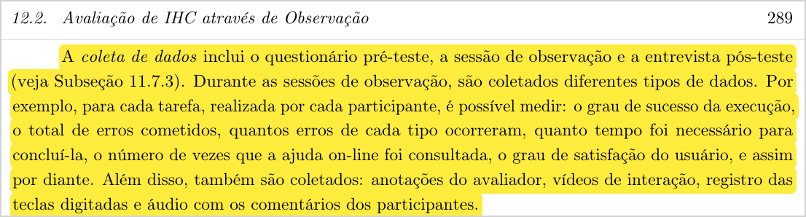

<em>Fonte: BARBOSA et al. (2021, p. 289). Recorte e grifo: <a href="https://github.com/gabriellcardone-06">Gabriel Melo</a> (2026).</em>

## 13. Telas do Protótipo Avaliado

As Figuras 5 a 14 mostram as telas do protótipo de alta fidelidade da [TAR-09](../../../../analise-de-requisitos/analise-de-tarefas/tar-09-limite-vale-transporte.md).

* **Protótipo navegável:** [Acessar o protótipo da TAR-09](../../../../prototipos/tar-09/index.html)

<strong>Figura 5</strong> — Página inicial com o Acesso Rápido e o botão "Meu Vale-Transporte foi recusado"

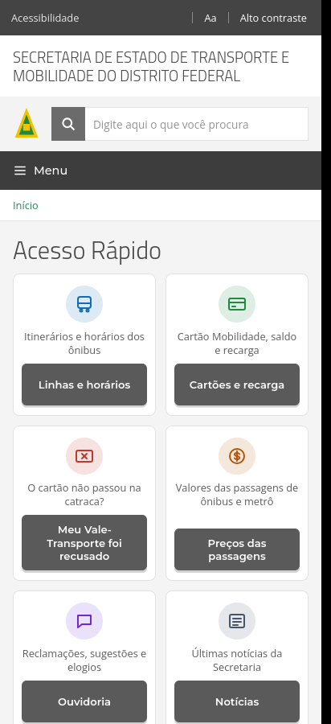{ width="300" }

<em>Fonte: Elaborado por Tomás Rocho (2026). Captura de tela do protótipo navegável.</em>

<strong>Figura 6</strong> — Consulta do cartão pelo número ("Meu Vale-Transporte foi recusado")

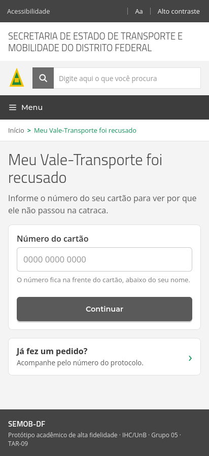{ width="300" }

<em>Fonte: Elaborado por Tomás Rocho (2026). Captura de tela do protótipo navegável.</em>

<strong>Figura 7</strong> — Motivo da recusa: limite de 8 passagens por dia

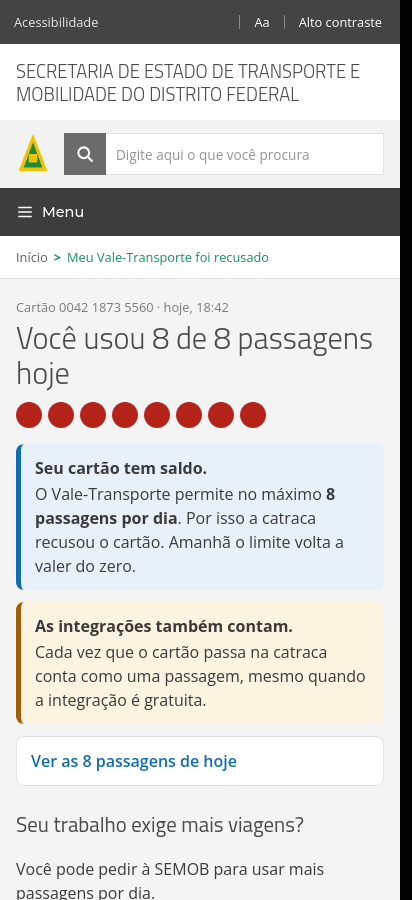{ width="300" }

<em>Fonte: Elaborado por Tomás Rocho (2026). Captura de tela do protótipo navegável.</em>

<strong>Figura 8</strong> — Entregar no posto: locais de atendimento e documentos

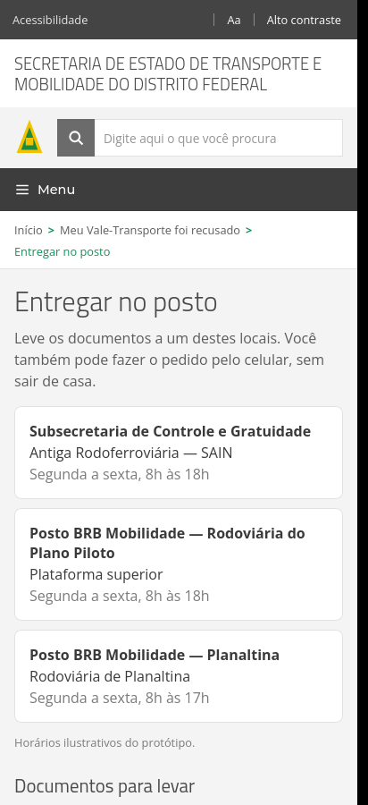{ width="300" }

<em>Fonte: Elaborado por Tomás Rocho (2026). Captura de tela do protótipo navegável.</em>

<strong>Figura 9</strong> — Pedir mais passagens — Passo 1 de 3: Sua rotina

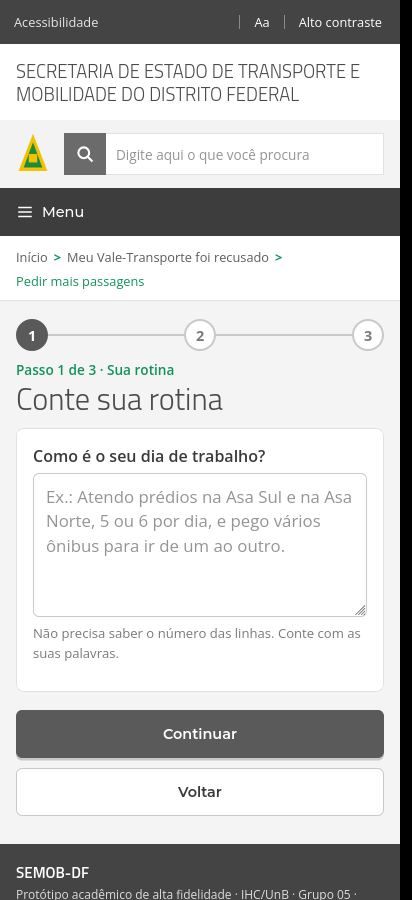{ width="300" }

<em>Fonte: Elaborado por Tomás Rocho (2026). Captura de tela do protótipo navegável.</em>

<strong>Figura 10</strong> — Pedir mais passagens — Passo 2 de 3: Fotos dos documentos

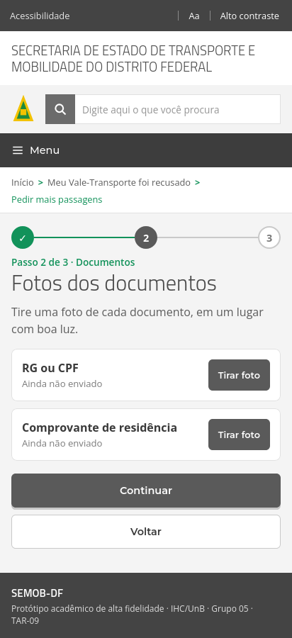{ width="300" }

<em>Fonte: Elaborado por Tomás Rocho (2026). Captura de tela do protótipo navegável.</em>

<strong>Figura 11</strong> — Pedir mais passagens — Passo 3 de 3: Declaração do RH

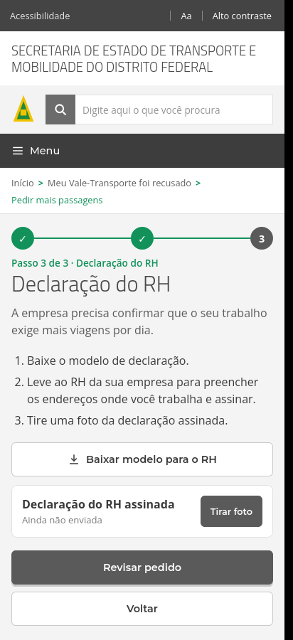{ width="300" }

<em>Fonte: Elaborado por Tomás Rocho (2026). Captura de tela do protótipo navegável.</em>

<strong>Figura 12</strong> — Confira seu pedido

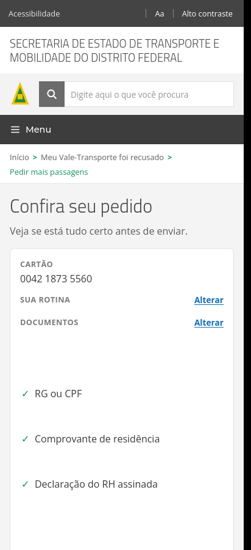{ width="300" }

<em>Fonte: Elaborado por Tomás Rocho (2026). Captura de tela do protótipo navegável.</em>

<strong>Figura 13</strong> — Pedido enviado, com o número do protocolo

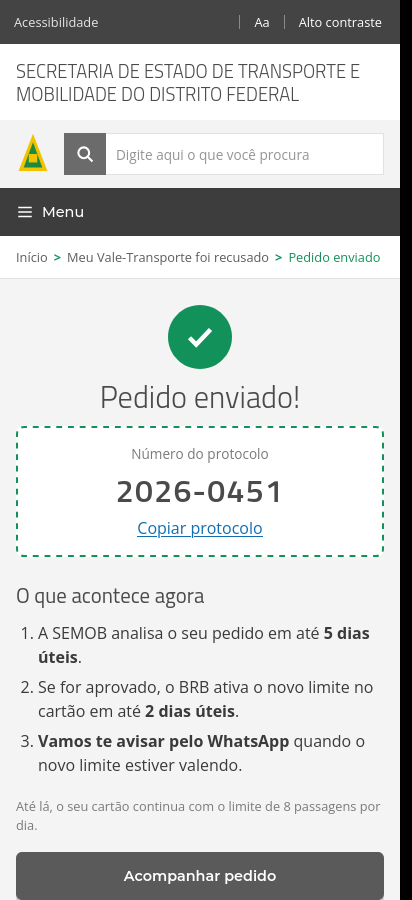{ width="300" }

<em>Fonte: Elaborado por Tomás Rocho (2026). Captura de tela do protótipo navegável.</em>

<strong>Figura 14</strong> — Acompanhar pedido

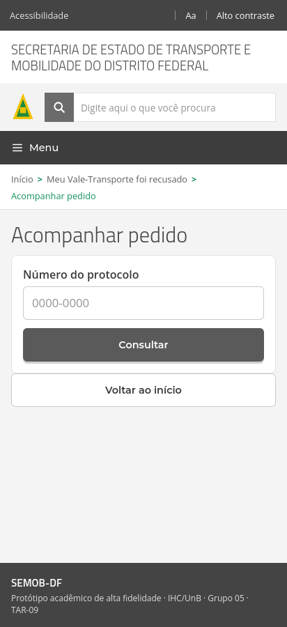{ width="300" }

<em>Fonte: Elaborado por Tomás Rocho (2026). Captura de tela do protótipo navegável.</em>

---
---

## 14. Fotos de Referência
As Figuras 15 a 17 mostram os trechos que fundamentam este artefato, recortados e grifados em amarelo diretamente do livro da disciplina (BARBOSA et al., 2021).

<strong>Figura 15</strong> — Representação de interface em alta fidelidade

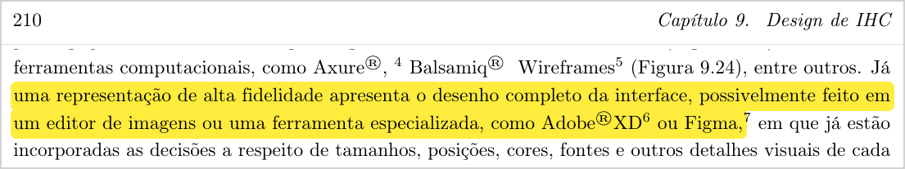

<em>Fonte: BARBOSA et al. (2021, p. 210). Recorte e grifo: [Gabriel Melo](https://github.com/gabriellcardone-06) (2026).</em>

<strong>Figura 16</strong> — 12.2.1 Teste de usabilidade: objetivo, atividades e medidas por tarefa

<em>Fonte: BARBOSA et al. (2021, pp. 288–289). Recorte e grifo: [Gabriel Melo](https://github.com/gabriellcardone-06) (2026).</em>

<strong>Figura 17</strong> — 11.7.5 Consolidação e relato dos resultados

<em>Fonte: BARBOSA et al. (2021, p. 263). Recorte e grifo: [Gabriel Melo](https://github.com/gabriellcardone-06) (2026).</em>

---

## 15. Referências Bibliográficas
* BARBOSA, Simone Diniz Junqueira; SILVA, Bruno Santana da; SILVEIRA, Milene Selbach; GASPARINI, Isabela; DARIN, Ticianne; BARBOSA, Gabriel Diniz Junqueira. **Interação Humano-Computador e Experiência do Usuário**. Rio de Janeiro: Autopublicação, 2021. ISBN 978-65-00-19677-1.
* SALES, André Barros de. **Plano de Ensino: Interação Humano Computador**. Brasília: Universidade de Brasília, FCTE/UnB, 2026.
