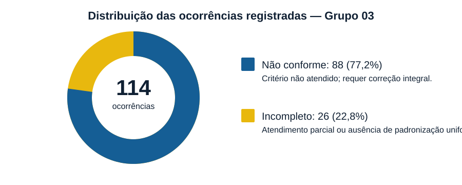
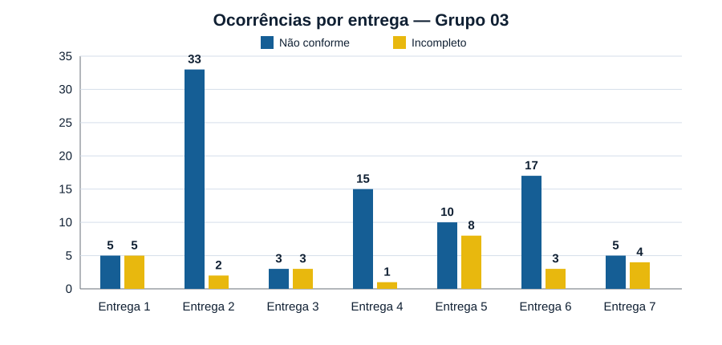

## Histórico de Versão e Contribuição

| Data | Versão | Descrição | Autor(es) | Revisor(es) | Declaração de Uso de IA |
| :---: | :---: | :--- | :--- | :--- | :--- |
| 23/11/2026 | `1.0` | Consolidação dos itens não conformes e incompletos encontrados na inspeção geral dos artefatos do Grupo 03, com tabelas, gráficos e encaminhamentos. | [Lucas Araújo Lima](https://github.com/Lucasaraujoszz) | [Arthur Mariani](https://github.com/arthur-mariani); [Igor Dantas](https://github.com/IgorDARAUJO) | Google Gemini: apoio na estruturação, redação, consolidação quantitativa e geração dos gráficos. |

---

# Relato da Inspeção Geral do Grupo 03

## 1. Introdução

Este documento consolida os resultados da inspeção geral dos artefatos das Entregas 1 a 7 do **Grupo 03**, conduzida pela equipe do Grupo 05 em **23/11/2026, às 22h**. A avaliação utilizou as [listas de verificação versão 2.0](../verificacao/index.md), que organizam os critérios de desenvolvimento do projeto (D), os itens de Planejamento Geral (PG) e de conteúdo definidos no Plano de Ensino (C) e os itens elaborados pelo grupo (G).

Foram incluídos neste relato somente os critérios classificados como **Não conforme** ou **Incompleto**. A classificação **Conforme** também foi adotada durante a avaliação: todos os critérios avaliados das listas de verificação que não constam nas tabelas de achados como **Não conforme** ou **Incompleto** foram atendidos integralmente e, portanto, estão **Conformes**. Já os itens marcados como removidos ou não aplicáveis ao escopo analisado não foram avaliados e não integram as tabelas de achados nem a contagem quantitativa.

## 2. Método e limitações

A inspeção geral foi conduzida por entrega, comparando os artefatos publicados pelo Grupo 03 com os critérios aplicáveis das listas de verificação. A classificação adotada na avaliação compreendeu **Conforme**, **Não conforme** e **Incompleto**, conforme descrito na **Tabela 1**. Os itens avaliados que não foram registrados neste documento como **Não conforme** ou **Incompleto** encontram-se **Conformes** e, por não demandarem retrabalho, não são repetidos nas tabelas de achados.

<strong>Tabela 1</strong>: Classificação adotada na inspeção geral do Grupo 03

| Classificação | Significado nesta inspeção | Encaminhamento |
| :--- | :--- | :--- |
| **Conforme** | O critério foi integralmente atendido pelo(s) artefato(s) avaliado(s). | Não requer correção; por isso, não aparece nas tabelas de achados. |
| **Não conforme** | O critério não foi atendido. | Corrigir o artefato e submetê-lo a nova verificação. |
| **Incompleto** | O critério foi atendido apenas em parte ou não foi atendido de maneira uniforme pelos artefatos da entrega. | Completar ou padronizar os artefatos antes da nova verificação. |

<em>Fonte: Elaborado por Inteligência Artificial.</em>

A inspeção contou com a participação dos três integrantes designados para a atividade, conforme detalhado na **Tabela 2**.

<strong>Tabela 2</strong>: Participantes e registro da sessão de inspeção do Grupo 03

| Participante | Papel exercido | Data e horário |
| :--- | :--- | :---: |
| [Lucas Araújo Lima](https://github.com/Lucasaraujoszz) | Inspetor e autor da consolidação | 23/11/2026, às 22h |
| [Arthur Mariani](https://github.com/arthur-mariani) | Inspetor e revisor | 23/11/2026, às 22h |
| [Igor Dantas](https://github.com/IgorDARAUJO) | Inspetor e revisor | 23/11/2026, às 22h |

<em>Fonte: Elaborado por Inteligência Artificial.</em>

Como critério de consolidação, nas fases com múltiplos artefatos correlatos, quando parte dos documentos atende ao critério e ao menos um apresenta lacuna, o resultado foi registrado como **Incompleto**. Para facilitar a leitura, faixas contíguas de critérios com a mesma classificação e a mesma causa (como `G1–G15` e `G21–G30` na Entrega 2, ou `G8–G14` e `G15–G21` na Entrega 6) aparecem agrupadas nas tabelas de achados com a indicação da quantidade de itens entre parênteses, sendo cada critério contabilizado individualmente nos totais quantitativos.

### 2.1 Gravação da inspeção geral

O registro audiovisual da inspeção geral do Grupo 03 está disponível em [YouTube: Inspeção Geral do Grupo 03](https://youtu.be/MaPLSHG7r8k) e incorporado no **Vídeo 1**.

  <iframe width="560" height="315" src="https://www.youtube-nocookie.com/embed/MaPLSHG7r8k" title="Inspeção Geral do Grupo 03" frameborder="0" allow="accelerometer; autoplay; clipboard-write; encrypted-media; gyroscope; picture-in-picture; web-share" allowfullscreen></iframe>

<strong>Vídeo 1</strong>: Gravação da inspeção geral dos artefatos do Grupo 03.

<em>Fonte: Elaborado por Inteligência Artificial.</em>

## 3. Visão geral dos resultados

Foram registradas **114 ocorrências**: **88 não conformidades (77,2%)** e **26 itens incompletos (22,8%)**. A proporção geral entre as duas classificações é apresentada no **Gráfico 1**.

<strong>Gráfico 1</strong>: Distribuição das ocorrências classificadas na inspeção geral do Grupo 03.

<em>Fonte: Elaborado por Inteligência Artificial.</em>

A distribuição das ocorrências ao longo das sete entregas pode ser visualizada no **Gráfico 2** e detalhada numericamente na **Tabela 3**.

<strong>Gráfico 2</strong>: Quantidade de ocorrências não conformes e incompletas por entrega do Grupo 03.

<em>Fonte: Elaborado por Inteligência Artificial.</em>

<strong>Tabela 3</strong>: Síntese das ocorrências por entrega do Grupo 03

| Entrega | Não conforme | Incompleto | Total |
| :---: | :---: | :---: | :---: |
| 1 | 5 | 5 | 10 |
| 2 | 33 | 2 | 35 |
| 3 | 3 | 3 | 6 |
| 4 | 15 | 1 | 16 |
| 5 | 10 | 8 | 18 |
| 6 | 17 | 3 | 20 |
| 7 | 5 | 4 | 9 |
| **Total** | **88** | **26** | **114** |

<em>Fonte: Elaborado por Inteligência Artificial.</em>

## 4. Achados por entrega

### 4.1 Entrega 1

Os achados identificados na inspeção dos artefatos da Entrega 1 estão consolidados na **Tabela 4**.

<strong>Tabela 4</strong>: Achados da Entrega 1 — Grupo 03

| Critério | Classificação | Achado consolidado | Encaminhamento |
| :---: | :---: | :--- | :--- |
| [D4](../verificacao/v2/verif1.md) | Incompleto | No artefato de visão geral, há fonte incorreta ("elaborada por autores") e tabelas que não são chamadas no texto. | Corrigir a atribuição de fonte e referenciar todas as tabelas e imagens no corpo do texto. |
| [D6](../verificacao/v2/verif1.md) | Incompleto | O cronograma executado não apresenta as datas reais de início e fim da realização das atividades. | Registrar as datas reais de início e fim para cada atividade executada. |
| [D7](../verificacao/v2/verif1.md) | Não conforme | Não há registro de ata de reunião referente à Entrega 1. | Publicar a ata da reunião com data, horários, participantes, objetivos e atividades definidas. |
| [D8](../verificacao/v2/verif1.md) | Não conforme | Não há gravação da reunião do grupo referente à entrega. | Disponibilizar o registro em vídeo da reunião do grupo. |
| [PG3](../verificacao/v2/verif1.md) | Não conforme | O cronograma planejado não apresenta o período de gravação da apresentação das etapas. | Incluir os períodos de gravação da apresentação no cronograma planejado. |
| [PG4](../verificacao/v2/verif1.md) | Incompleto | O cronograma planejado das Entregas 5 e 6 não prevê período de revisão/ajustes nos artefatos. | Adicionar o período de revisão e ajustes também para as Entregas 5 e 6 no cronograma planejado. |
| [C1](../verificacao/v2/verif1.md) | Incompleto | A justificativa da escolha do Processo de Design está incompleta quanto aos elementos exigidos (referência, foto do texto e autor). | Completar a justificativa do Processo de Design com referência bibliográfica, recorte do texto e autoria. |
| [G2](../verificacao/v2/verif1.md) | Incompleto | A comparação dos sites avaliados não contempla integralmente todos os sites pelos mesmos critérios com pontos fortes e fracos. | Completar a tabela comparativa aplicando os mesmos critérios a todos os sites avaliados. |
| [G5](../verificacao/v2/verif1.md) | Não conforme | O Processo de Design não relaciona as entregas do projeto aos três níveis de design de Mayhew. | Explicitar o vínculo entre as entregas e os três níveis de design previstos no processo adotado. |
| [G6](../verificacao/v2/verif1.md) | Não conforme | O Processo de Design não prevê ciclos de avaliação e reprojeto até o alcance das metas de usabilidade. | Documentar os ciclos iterativos de avaliação e reprojeto com registro das decisões de design. |

<em>Fonte: Elaborado por Inteligência Artificial.</em>

### 4.2 Entrega 2

Os achados identificados na inspeção dos artefatos da Entrega 2 estão consolidados na **Tabela 5**.

<strong>Tabela 5</strong>: Achados da Entrega 2 — Grupo 03

| Critério | Classificação | Achado consolidado | Encaminhamento |
| :---: | :---: | :--- | :--- |
| [D4](../verificacao/v2/verif2.md) | Incompleto | Os artefatos da Entrega 2 apresentam tabelas e/ou imagens sem legenda, fonte ou chamada correspondente no texto. | Padronizar legendas, fontes e chamadas textuais em todos os artefatos da entrega. |
| [D9](../verificacao/v2/verif2.md) | Não conforme | Não há vídeo de apresentação na categoria "não listado" no YouTube. | Publicar e vincular o vídeo de apresentação da entrega no modo não listado. |
| [C1](../verificacao/v2/verif2.md) | Não conforme | O perfil do usuário não é definido por mais de uma técnica de elicitação e/ou ferramenta. | Utilizar e documentar mais de uma técnica para definição do perfil de usuário. |
| [C2](../verificacao/v2/verif2.md) | Não conforme | O perfil do usuário não apresenta os atributos esperados com referência bibliográfica e foto do texto. | Completar os atributos do perfil com referência e recorte da fonte utilizada. |
| [C3](../verificacao/v2/verif2.md) | Incompleto | Os grupos de atributos do capítulo 8 (idade, experiência, atitudes e tarefas primárias) estão atendidos apenas parcialmente. | Completar o perfil de usuário cobrindo todos os grupos de atributos requeridos. |
| [C7](../verificacao/v2/verif2.md) | Não conforme | Não é apresentado o Termo de Consentimento Livre e Esclarecido (TCLE) dos participantes. | Elaborar e disponibilizar o TCLE referente às atividades com participantes. |
| [C11](../verificacao/v2/verif2.md) | Não conforme | Não há uma atividade por integrante modelada em ao menos duas técnicas de especificação de tarefas. | Modelar uma atividade para cada integrante utilizando pelo menos duas técnicas (HTA, GOMS ou CTT). |
| [C12](../verificacao/v2/verif2.md) | Não conforme | Não foi evidenciada a utilização de técnica para especificar as tarefas. | Aplicar e documentar as técnicas escolhidas para especificação das tarefas. |
| [G1–G15](../verificacao/v2/verif2.md) *(15 critérios)* | Não conforme | Os dados de perfil do usuário (demográficos, experiência, organização, educação, tecnologia, tarefas e jargões) não foram coletados, pois as entrevistas não foram realizadas. | Executar a coleta de dados prevista junto ao público-alvo e registrar os resultados no perfil de usuário. |
| [G16](../verificacao/v2/verif2.md) | Não conforme | Os dados coletados não identificam os tipos de usuário (primário, secundário e demais stakeholders). | Classificar explicitamente os públicos identificados entre primário, secundário e stakeholders. |
| [G17](../verificacao/v2/verif2.md) | Não conforme | Não foram identificados todos os stakeholders afetados pelo sistema além dos usuários finais. | Mapear e documentar todos os stakeholders impactados pelo sistema. |
| [G21–G25](../verificacao/v2/verif2.md) *(5 critérios)* | Não conforme | Os aspectos éticos de pesquisa envolvendo pessoas (assinatura do TCLE, anonimato, autonomia, prevenção de viés e beneficência) não foram efetivados, pois as entrevistas não foram realizadas. | Aplicar o TCLE e garantir a execução dos procedimentos éticos durante a realização das entrevistas. |
| [G26–G30](../verificacao/v2/verif2.md) *(5 critérios)* | Não conforme | A técnica de entrevista (roteiro, perguntas abertas/fechadas, estruturação, aplicação individual e treinamento do entrevistador) não foi aplicada, pois as entrevistas não foram realizadas. | Planejar, preparar o roteiro e conduzir as entrevistas conforme os critérios metodológicos definidos. |

<em>Fonte: Elaborado por Inteligência Artificial.</em>

### 4.3 Entrega 3

Os achados identificados na inspeção dos artefatos da Entrega 3 estão consolidados na **Tabela 6**.

<strong>Tabela 6</strong>: Achados da Entrega 3 — Grupo 03

| Critério | Classificação | Achado consolidado | Encaminhamento |
| :---: | :---: | :--- | :--- |
| [D4](../verificacao/v2/verif3.md) | Incompleto | Há tabelas e/ou imagens sem atendimento completo de legenda, fonte e chamada no texto. | Padronizar todos os elementos visuais e suas referências textuais. |
| [D8](../verificacao/v2/verif3.md) | Não conforme | Não há gravação da reunião do grupo referente à entrega. | Disponibilizar a gravação da reunião do grupo. |
| [D9](../verificacao/v2/verif3.md) | Não conforme | Não há vídeo de apresentação na categoria "não listado" no YouTube. | Publicar e vincular o vídeo de apresentação da entrega no modo não listado. |
| [C13](../verificacao/v2/verif3.md) | Incompleto | As metas de usabilidade ou objetivos de avaliação estão apresentados de forma parcial quanto à referência e foto do texto. | Completar a definição das metas de usabilidade com referência bibliográfica e recorte da fonte. |
| [C14](../verificacao/v2/verif3.md) | Não conforme | Não é apresentada a razão da seleção das metas de usabilidade definidas para o projeto. | Justificar a escolha de cada meta de usabilidade com base no contexto e nos usuários do projeto. |
| [C15](../verificacao/v2/verif3.md) | Incompleto | O Guia de Estilo está incompleto quanto à documentação, referência bibliográfica e foto da fonte. | Completar a estrutura do Guia de Estilo e incluir referência e recorte da fonte. |

<em>Fonte: Elaborado por Inteligência Artificial.</em>

### 4.4 Entrega 4

Os achados identificados na inspeção dos artefatos da Entrega 4 estão consolidados na **Tabela 7**.

<strong>Tabela 7</strong>: Achados da Entrega 4 — Grupo 03

| Critério | Classificação | Achado consolidado | Encaminhamento |
| :---: | :---: | :--- | :--- |
| [D4](../verificacao/v2/verif4.md) | Incompleto | Há tabelas e/ou imagens que não atendem integralmente à exigência de legenda, fonte e chamada no texto. | Padronizar a identificação e a chamada textual de todos os elementos visuais. |
| [D9](../verificacao/v2/verif4.md) | Não conforme | Não há vídeo de apresentação na categoria "não listado" no YouTube. | Publicar e vincular o vídeo não listado da entrega. |
| [C3](../verificacao/v2/verif4.md) | Não conforme | O planejamento não descreve os objetivos da avaliação conforme o esperado. | Explicitar os objetivos da avaliação no planejamento. |
| [C5](../verificacao/v2/verif4.md) | Não conforme | Não são detalhadas as questões práticas da avaliação (recrutamento, quantidade de usuários, equipamentos, prazos, orçamento e mão de obra). | Documentar integralmente as questões práticas da avaliação. |
| [C7](../verificacao/v2/verif4.md) | Não conforme | O planejamento não define a estrutura do relatório de resultados da avaliação. | Incluir a estrutura prevista para o relato dos resultados. |
| [C8](../verificacao/v2/verif4.md) | Não conforme | Não há cronograma (data e horário) e local definidos para a avaliação do Storyboard e da Análise de Tarefas. | Registrar datas, horários e locais previstos para as sessões de avaliação. |
| [C9](../verificacao/v2/verif4.md) | Não conforme | Os desenhos do Storyboard não estão relacionados às especificações do artefato de Análise de Tarefas. | Vincular explicitamente cada storyboard à respectiva análise de tarefas. |
| [C10](../verificacao/v2/verif4.md) | Não conforme | A quantidade de storyboards não corresponde à quantidade de integrantes do grupo. | Garantir a produção e publicação de um storyboard por integrante. |
| [C11](../verificacao/v2/verif4.md) | Não conforme | Não há definição do teste-piloto nem data para sua realização antes da avaliação, com referência e foto. | Definir o teste-piloto, agendar sua data prévia e incluir referência com recorte da fonte. |
| [C12](../verificacao/v2/verif4.md) | Não conforme | O planejamento não deixa claro que o resultado do teste-piloto não será apresentado no resultado da avaliação. | Registrar explicitamente a separação entre os dados do teste-piloto e os resultados finais. |
| [C13](../verificacao/v2/verif4.md) | Não conforme | Não estão especificados os itens que o avaliador deve realizar ou anotar durante a avaliação. | Definir o roteiro de observação e registro de problemas pelo avaliador. |
| [G1](../verificacao/v2/verif4.md) | Não conforme | O planejamento não seleciona ao menos um objetivo formal de avaliação. | Definir pelo menos um objetivo claro de avaliação segundo o referencial adotado. |
| [G7](../verificacao/v2/verif4.md) | Não conforme | O planejamento não define o cronograma completo das atividades de avaliação (recrutamento, piloto, coleta, análise e entrega). | Estruturar o cronograma completo de todas as etapas da avaliação. |
| [G22](../verificacao/v2/verif4.md) | Não conforme | O planejamento da avaliação da Análise de Tarefas não prevê a comparação entre os caminhos dos modelos e a execução real dos participantes. | Incluir a comparação entre os caminhos previstos nos modelos e o desempenho observado. |
| [G23](../verificacao/v2/verif4.md) | Não conforme | O planejamento não define o perfil e a quantidade de participantes com justificativa. | Definir perfil, quantidade de participantes e justificativa metodológica. |
| [G25](../verificacao/v2/verif4.md) | Não conforme | O planejamento não especifica os limites de duração previstos para as tarefas e para a sessão completa. | Estabelecer o tempo estimado por tarefa e a duração total da sessão. |

<em>Fonte: Elaborado por Inteligência Artificial.</em>

### 4.5 Entrega 5

Os achados identificados na inspeção dos artefatos da Entrega 5 estão consolidados na **Tabela 8**.

<strong>Tabela 8</strong>: Achados da Entrega 5 — Grupo 03

| Critério | Classificação | Achado consolidado | Encaminhamento |
| :---: | :---: | :--- | :--- |
| [D4](../verificacao/v2/verif5.md) | Incompleto | Há tabelas e/ou imagens sem legenda, fonte ou chamada no texto. | Padronizar todos os elementos visuais e suas referências textuais. |
| [D7](../verificacao/v2/verif5.md) | Não conforme | Não há ata(s) de reunião referente(s) à entrega. | Publicar as atas de reunião com todos os campos obrigatórios. |
| [D8](../verificacao/v2/verif5.md) | Não conforme | Não há gravação da reunião do grupo referente à entrega. | Disponibilizar o registro em vídeo da reunião. |
| [D9](../verificacao/v2/verif5.md) | Não conforme | Não há vídeo de apresentação na categoria "não listado" no YouTube. | Publicar e vincular o vídeo não listado da entrega. |
| [G1](../verificacao/v2/verif5.md) | Incompleto | O planejamento não informa de forma completa qual protótipo de papel será avaliado e qual tarefa representa. | Identificar explicitamente o protótipo de papel e as tarefas associadas em todos os planejamentos. |
| [G2](../verificacao/v2/verif5.md) | Incompleto | Os objetivos da avaliação do protótipo de papel estão definidos apenas parcialmente. | Detalhar o que se deseja descobrir com o uso do protótipo de papel. |
| [G4](../verificacao/v2/verif5.md) | Não conforme | O planejamento não utiliza as seis etapas do framework DECIDE. | Estruturar o planejamento cobrindo todas as seis etapas do DECIDE. |
| [G6](../verificacao/v2/verif5.md) | Incompleto | O perfil dos participantes está definido apenas parcialmente em relação ao público-alvo da tarefa. | Alinhar e completar o perfil dos participantes conforme a tarefa avaliada. |
| [G7](../verificacao/v2/verif5.md) | Incompleto | A definição de quem atuará como "computador" e quem observará e registrará a sessão está incompleta. | Definir claramente os papéis de "computador" e observador/registrador nas sessões. |
| [G10](../verificacao/v2/verif5.md) | Não conforme | Não são informadas as condições práticas da sessão (local, duração, materiais, equipamentos e forma de registro). | Documentar todas as condições práticas e logísticas da avaliação. |
| [G11](../verificacao/v2/verif5.md) | Não conforme | O planejamento não contempla consentimento informado, participação voluntária, anonimato e autorização para gravação. | Incorporar integralmente os termos e garantias éticas ao planejamento. |
| [G12](../verificacao/v2/verif5.md) | Não conforme | O planejamento do relato não define como registrar conclusão, dificuldades, evidências e interpretação por tarefa. | Especificar o modelo de registro de resultados por tarefa no planejamento do relato. |
| [G13](../verificacao/v2/verif5.md) | Não conforme | O planejamento do relato não prevê tabela de problemas de usabilidade com tela/peça, impacto, prioridade e recomendação. | Incluir a estrutura tabular para registro e priorização dos problemas de usabilidade. |
| [G14](../verificacao/v2/verif5.md) | Não conforme | O planejamento do relato não distingue alterações simples feitas no protótipo de papel de correções planejadas para versões futuras. | Estabelecer a distinção entre ajustes imediatos e correções para próximas versões. |
| [G15](../verificacao/v2/verif5.md) | Incompleto | O relato do Storyboard e da Análise de Tarefas informa parcialmente os objetivos e o escopo da avaliação. | Completar a seção de objetivos e escopo nos relatos de nível 1. |
| [G16](../verificacao/v2/verif5.md) | Incompleto | A descrição breve do método empregado no relato está incompleta. | Descrever de forma clara e completa o método utilizado para obtenção dos resultados. |
| [G18](../verificacao/v2/verif5.md) | Incompleto | O sumário dos dados coletados no relato está incompleto quanto ao uso de tabelas ou gráficos. | Consolidar o sumário quantitativo e qualitativo dos dados com tabelas ou gráficos. |
| [G23](../verificacao/v2/verif5.md) | Não conforme | O relato não compara o desempenho e as falas dos participantes com os caminhos previstos nos modelos de tarefa. | Comparar os resultados observados com os caminhos modelados (HTA, CTT ou GOMS). |

<em>Fonte: Elaborado por Inteligência Artificial.</em>

### 4.6 Entrega 6

Os achados identificados na inspeção dos artefatos da Entrega 6 estão consolidados na **Tabela 9**.

<strong>Tabela 9</strong>: Achados da Entrega 6 — Grupo 03

| Critério | Classificação | Achado consolidado | Encaminhamento |
| :---: | :---: | :--- | :--- |
| [D4](../verificacao/v2/verif6.md) | Incompleto | Há tabelas e/ou imagens sem legenda, fonte ou chamada no texto. | Padronizar todos os elementos visuais e suas referências textuais. |
| [D7](../verificacao/v2/verif6.md) | Não conforme | Não há ata(s) de reunião referente(s) à entrega. | Publicar as atas de reunião com todos os campos obrigatórios. |
| [D8](../verificacao/v2/verif6.md) | Não conforme | Não há gravação da reunião do grupo referente à entrega. | Disponibilizar a gravação da reunião do grupo. |
| [G2](../verificacao/v2/verif6.md) | Não conforme | O planejamento da avaliação de alta fidelidade não apresenta perguntas específicas a serem respondidas. | Definir perguntas de avaliação específicas alinhadas aos objetivos. |
| [G3](../verificacao/v2/verif6.md) | Incompleto | A adequação do método às perguntas e aos recursos disponíveis está justificada apenas parcialmente. | Completar a justificativa de escolha e adequação do método de avaliação. |
| [G7](../verificacao/v2/verif6.md) | Incompleto | O planejamento não comprova integralmente consentimento, anonimato, participação voluntária e autorização para gravações. | Tornar explícitos os quatro elementos éticos exigidos no planejamento. |
| [G8–G14](../verificacao/v2/verif6.md) *(7 critérios)* | Não conforme | O planejamento do relato da avaliação do protótipo de alta fidelidade não contempla os itens requeridos (objetivos/escopo/método, participantes/avaliadores, resumo por tarefa, interpretação, consolidação, lista de problemas e limitações/reprojeto). | Elaborar e publicar integralmente o planejamento do relato da avaliação do protótipo de alta fidelidade. |
| [G15–G21](../verificacao/v2/verif6.md) *(7 critérios)* | Não conforme | O relato dos resultados da avaliação do protótipo de papel não atende aos itens verificados (objetivos/método, avaliadores/participantes, tarefas, problemas corrigidos, problemas não corrigidos com prioridade, sugestões e anotações de observação). | Publicar ou completar integralmente o relato dos resultados da avaliação do protótipo de papel. |

<em>Fonte: Elaborado por Inteligência Artificial.</em>

### 4.7 Entrega 7

Os achados identificados na inspeção dos artefatos da Entrega 7 estão consolidados na **Tabela 10**.

<strong>Tabela 10</strong>: Achados da Entrega 7 — Grupo 03

| Critério | Classificação | Achado consolidado | Encaminhamento |
| :---: | :---: | :--- | :--- |
| [D4](../verificacao/v2/verif7.md) | Incompleto | Há tabelas e/ou imagens sem legenda, fonte ou chamada no texto. | Padronizar todos os elementos visuais e suas referências textuais. |
| [D7](../verificacao/v2/verif7.md) | Não conforme | Não há ata(s) de reunião referente(s) à entrega. | Publicar as atas de reunião com todos os campos obrigatórios. |
| [D8](../verificacao/v2/verif7.md) | Não conforme | Não há gravação da reunião do grupo referente à entrega. | Disponibilizar a gravação da reunião do grupo. |
| [G5](../verificacao/v2/verif7.md) | Incompleto | O relato informa parcialmente objetivo, escopo, método usado e versão do protótipo avaliado. | Completar a identificação metodológica e a versão do protótipo no relato. |
| [G6](../verificacao/v2/verif7.md) | Incompleto | O relato informa apenas parcialmente quantidade e perfil dos participantes e quem atuou como avaliador. | Completar a caracterização dos participantes e dos avaliadores. |
| [G8](../verificacao/v2/verif7.md) | Incompleto | O relato apresenta parcialmente, por tarefa, conclusão, erros, pedidos de ajuda e tempo. | Completar os indicadores de desempenho por tarefa para todos os testes realizados. |
| [G10](../verificacao/v2/verif7.md) | Não conforme | Os problemas de usabilidade não são descritos com tela, impacto, severidade e recomendação de correção (ou não há declaração de ausência de problemas). | Registrar detalhadamente os problemas encontrados e suas recomendações ou declarar expressamente a ausência deles. |
| [G11](../verificacao/v2/verif7.md) | Não conforme | O relato não compara os resultados da alta fidelidade com os obtidos na avaliação do protótipo de papel. | Incluir comparação explícita entre os problemas resolvidos e pendentes desde o protótipo de papel. |
| [G15](../verificacao/v2/verif7.md) | Não conforme | O relato não verifica o atingimento das metas de usabilidade definidas na Entrega 3 frente às faixas inaceitável, aceitável e ideal. | Comparar os indicadores medidos na avaliação com as faixas definidas nas metas de usabilidade. |

<em>Fonte: Elaborado por Inteligência Artificial.</em>

## 5. Prioridades de correção

Os achados evidenciam cinco frentes principais de correção para o Grupo 03, priorizadas conforme a recorrência transversal e o impacto metodológico entre as entregas, conforme sintetizado na **Tabela 11**.

<strong>Tabela 11</strong>: Ordem sugerida para correção dos achados — Grupo 03

| Prioridade | Frente | Critérios envolvidos | Motivo |
| :---: | :--- | :--- | :--- |
| 1 | Padronização editorial e registros de gestão | D4 (E1–E7); D6 (E1); D7 (E1, E5–E7); D8 (E1, E3, E5–E7); D9 (E2–E5) | Corrige lacunas transversais de rastreabilidade, atas, gravações e identificação de elementos visuais. |
| 2 | Coleta de dados, entrevistas e ética | E2 C1–C3, C7, C11–C12, G1–G17, G21–G30 | Concentra o maior volume de não conformidades (35 ocorrências na Entrega 2) e sustenta as decisões posteriores. |
| 3 | Planejamentos e relatos de avaliação | E4 C3, C5, C7–C13, G1, G7, G22–G23, G25; E5 G1–G2, G4, G6–G7, G10–G16, G18, G23; E6 G2–G3, G7–G21 | Garante consistência metodológica do framework DECIDE, teste-piloto, storyboards e relatos dos níveis 1 e 2. |
| 4 | Relato de alta fidelidade e metas de usabilidade | E7 G5–G6, G8, G10–G11, G15 | Fecha o ciclo avaliativo comparando o protótipo de alta fidelidade ao de papel e às metas da Entrega 3. |
| 5 | Planejamento, Processo de Design e Guia de Estilo | E1 PG3–PG4, C1, G2, G5–G6; E3 C13–C15 | Consolida a base conceitual do projeto, o cronograma planejado e as diretrizes do Guia de Estilo. |

<em>Fonte: Elaborado por Inteligência Artificial.</em>

## 6. Encaminhamentos para nova verificação

Após a execução das correções pelo Grupo 03, recomenda-se reaplicar os critérios registrados neste relato, atualizando a situação de cada item para **Conforme**, **Não conforme** ou **Incompleto**. A nova verificação deve registrar a versão dos artefatos revisados, a data, os avaliadores responsáveis e as evidências consultadas no modelo de registro das listas de verificação.

---

## Referências Bibliográficas

* BARBOSA, Simone Diniz Junqueira; SILVA, Bruno Santana da; SILVEIRA, Milene Selbach; GASPARINI, Isabela; DARIN, Ticianne; BARBOSA, Gabriel Diniz Junqueira. **Interação Humano-Computador e Experiência do Usuário**. Rio de Janeiro: Autopublicação, 2021. ISBN 978-65-00-19677-1. Versão de 03/05/2021.
* SALES, André Barros de. **Plano de Ensino: Interação Humano Computador: Turma 01**. Brasília: Universidade de Brasília, Faculdade UnB Gama, 2026. Disponível em: [Plano de Ensino (PDF)](../assets/inspecoes/plano-de-ensino-ihc-2026-2-turma01-v1.pdf).
