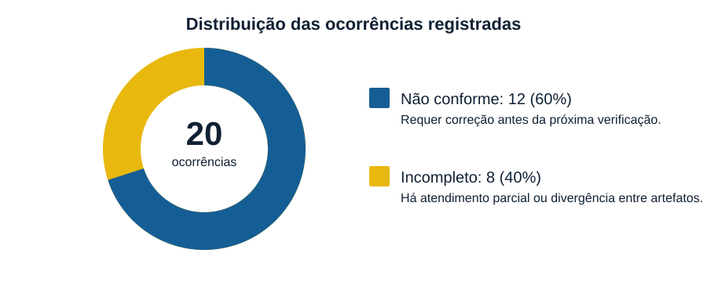
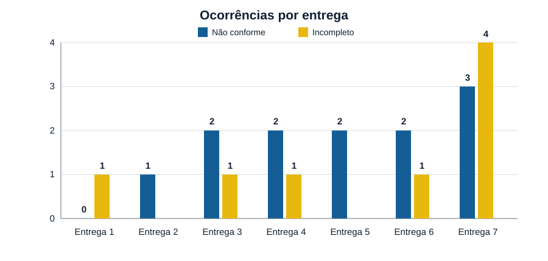

## Histórico de Versão e Contribuição

| Data | Versão | Descrição | Autor(es) | Revisor(es) | Declaração de Uso de IA |
| :---: | :---: | :--- | :--- | :--- | :--- |
| 22/11/2026 | `1.0` | Consolidação dos itens não conformes e incompletos encontrados na inspeção geral do projeto, com tabelas, gráficos e encaminhamentos. | [Arthur Mariani](https://github.com/arthur-mariani); [Carlos Henrique](https://github.com/carloshfgit); [Gabriel Melo](https://github.com/gabriellcardone-06); [Igor Dantas](https://github.com/IgorDARAUJO); [Lucas Araújo](https://github.com/Lucasaraujoszz); [Rodrigo Carvalho](https://github.com/RodrigoCBarbosa); [Tomás Garcia](https://github.com/TomasRocho) | [Arthur Mariani](https://github.com/arthur-mariani); [Carlos Henrique](https://github.com/carloshfgit); [Gabriel Melo](https://github.com/gabriellcardone-06); [Igor Dantas](https://github.com/IgorDARAUJO); [Lucas Araújo](https://github.com/Lucasaraujoszz); [Rodrigo Carvalho](https://github.com/RodrigoCBarbosa); [Tomás Garcia](https://github.com/TomasRocho) | Google Gemini: apoio na estruturação, redação, consolidação quantitativa e geração dos gráficos. |

---

# Relato da Inspeção Geral do Projeto

## 1. Introdução

Este documento consolida os resultados da inspeção geral dos artefatos das Entregas 1 a 7 do Grupo 05. A inspeção foi realizada com base nos princípios do método de Fagan, que estrutura a revisão de artefatos por critérios explícitos, papéis definidos, registro de defeitos, retrabalho e acompanhamento das correções (FAGAN, 1976). A avaliação utilizou as [listas de verificação versão 2.0](../verificacao/index.md), que organizam os critérios de desenvolvimento do projeto (D), os itens definidos no Plano de Ensino (C) e os itens elaborados pelo grupo (G).

Foram incluídos neste relato somente os critérios classificados como **Não conforme** ou **Incompleto**. Os demais critérios foram considerados conformes durante a inspeção e, por isso, não aparecem nas tabelas de achados.

## 2. Método e limitações

A inspeção geral foi conduzida por entrega, comparando os artefatos publicados com os critérios aplicáveis de suas listas de verificação. A classificação adotada foi:

| Classificação | Significado nesta inspeção | Encaminhamento |
| :--- | :--- | :--- |
| **Não conforme** | O critério não foi atendido. | Corrigir o artefato e submetê-lo a nova verificação. |
| **Incompleto** | O critério foi atendido apenas em parte ou não foi atendido de maneira uniforme pelos artefatos da entrega. | Completar ou padronizar os artefatos antes da nova verificação. |

<em>Fonte: elaborado pelo Grupo 05 (2026).</em>

Como o grupo possui sete integrantes, algumas fases contêm sete artefatos correlatos. Nesses casos, quando parte dos artefatos atende ao critério e pelo menos um não atende, o resultado consolidado foi registrado como **Incompleto**. Esta decisão evita transformar a conformidade de seis artefatos em uma afirmação indevida de conformidade da entrega inteira.

### 2.1 Organização baseada em Fagan

Fagan (1976) organiza a inspeção em planejamento, visão geral, preparação, reunião de inspeção, retrabalho e acompanhamento. Nesta inspeção, o método foi adaptado ao contexto dos artefatos de IHC: as listas forneceram os critérios de exame, a reunião registrada consolidou as classificações e este relato registra os achados e orienta o retrabalho.

<strong>Tabela 2</strong>: Papéis na inspeção geral conforme o método de Fagan

| Papel | Participante(s) | Responsabilidade exercida |
| :--- | :--- | :--- |
| Moderador | [Carlos Henrique](https://github.com/carloshfgit) | Planejar e conduzir a inspeção, manter o foco nos critérios e acompanhar os encaminhamentos. |
| Autor | [Arthur Mariani](https://github.com/arthur-mariani); [Carlos Henrique](https://github.com/carloshfgit); [Gabriel Melo](https://github.com/gabriellcardone-06); [Igor Dantas](https://github.com/IgorDARAUJO); [Lucas Araújo](https://github.com/Lucasaraujoszz); [Rodrigo Carvalho](https://github.com/RodrigoCBarbosa); [Tomás Garcia](https://github.com/TomasRocho) | Autores dos artefatos inspecionados. |
| Leitor | [Carlos Henrique](https://github.com/carloshfgit) | Percorrer os critérios das listas e os artefatos de forma estruturada durante a inspeção. |
| Relator | [Rodrigo Carvalho](https://github.com/RodrigoCBarbosa) | Registrar os achados, suas classificações, evidências e encaminhamentos. |
| Inspetores | [Gabriel Melo](https://github.com/gabriellcardone-06); [Igor Dantas](https://github.com/IgorDARAUJO); [Lucas Araújo](https://github.com/Lucasaraujoszz); [Tomás Garcia](https://github.com/TomasRocho) | Examinar os artefatos, identificar desvios dos critérios e participar da consolidação dos resultados. |

<em>Fonte: elaborado pelo Grupo 05 (2026), a partir da distribuição de funções declarada pelos participantes.</em>

<strong>Quadro 1</strong>: Comparação entre a inspeção de Fagan e a aplicação no Grupo 05

| Etapa de Fagan | Previsão teórica | Aplicação na inspeção geral |
| :--- | :--- | :--- |
| Planejamento | Definir escopo, participantes, papéis e critérios de entrada. | O escopo abrangeu todos os artefatos produzidos no projeto, das Entregas 1 a 7. As listas v2.0 e os papéis de Fagan delimitaram a inspeção. |
| Visão geral e preparação | Apresentar o artefato e permitir que os inspetores compreendam os critérios antes do exame. | As listas e suas referências foram consultadas antes da checagem dos artefatos. |
| Reunião de inspeção | Identificar e registrar defeitos, sem deslocar o foco para a solução durante o exame. | A gravação registra a conferência dos critérios e as classificações Conforme, Não conforme ou Incompleto. |
| Retrabalho | O autor corrige os defeitos registrados. | As tabelas de achados e de prioridades indicam os encaminhamentos de correção, organizados no cronograma de retrabalho. |
| Acompanhamento | Verificar se as correções foram implementadas corretamente. | A reaplicação dos critérios registrados na seção 6 foi definida como próxima verificação. |

<em>Fonte: adaptado de Fagan (1976).</em>

### 2.2 Gravação da inspeção geral

O registro audiovisual da inspeção geral está disponível em [YouTube: Inspeção Geral do Grupo 05](https://www.youtube.com/watch?v=X6P0Tk3qObE).

  <iframe width="560" height="315" src="https://www.youtube-nocookie.com/embed/X6P0Tk3qObE" title="Inspeção Geral do Grupo 05" frameborder="0" allow="accelerometer; autoplay; clipboard-write; encrypted-media; gyroscope; picture-in-picture; web-share" allowfullscreen></iframe>

<strong>Vídeo 1</strong>: Gravação da inspeção geral dos artefatos do Grupo 05.

<em>Fonte: Grupo 05 (2026).</em>

Não foi produzida rastreabilidade por artefato individual neste relato. Para isso, seria necessário rever as gravações e conferir cada artefato um a um, o que não integra o conjunto de evidências desta consolidação. Portanto, os resultados devem ser lidos como uma visão agregada por entrega e critério, e não como atribuição de problema a uma pessoa ou documento específico.

## 3. Visão geral dos resultados

Foram registradas **20 ocorrências**: 12 não conformidades (60%) e 8 itens incompletos (40%). A consolidação e a análise da frequência dos tipos de achado seguem a orientação de Fagan (1976) de usar os resultados da inspeção para orientar a melhoria do processo.

<strong>Gráfico 1</strong>: Distribuição das ocorrências classificadas na inspeção geral.

<em>Fonte: elaborado pelo Grupo 05 (2026), a partir dos resultados consolidados da inspeção.</em>

<strong>Gráfico 2</strong>: Quantidade de ocorrências não conformes e incompletas por entrega.

<em>Fonte: elaborado pelo Grupo 05 (2026), a partir dos resultados consolidados da inspeção.</em>

<strong>Tabela 3</strong>: Síntese das ocorrências por entrega

| Entrega | Não conforme | Incompleto | Total |
| :---: | :---: | :---: | :---: |
| 1 | 0 | 1 | 1 |
| 2 | 1 | 0 | 1 |
| 3 | 2 | 1 | 3 |
| 4 | 2 | 1 | 3 |
| 5 | 2 | 0 | 2 |
| 6 | 2 | 1 | 3 |
| 7 | 3 | 4 | 7 |
| **Total** | **12** | **8** | **20** |

<em>Fonte: elaborado pelo Grupo 05 (2026), a partir dos resultados consolidados da inspeção.</em>

## 4. Achados por entrega

### 4.1 Entrega 1

<strong>Tabela 4</strong>: Achados da Entrega 1

| Critério | Classificação | Achado consolidado | Encaminhamento |
| :---: | :---: | :--- | :--- |
| [G3](../verificacao/v2/verif1.md) | Incompleto | A comparação dos sites não considera integralmente a experiência do usuário: estilo da interface, estrutura das tarefas, terminologia e qualidade de uso. | Completar a comparação com evidências para todos os aspectos de experiência do usuário previstos no critério. |

<em>Fonte: elaborado pelo Grupo 05 (2026), com base na Lista de Verificação da Entrega 1.</em>

### 4.2 Entrega 2

<strong>Tabela 5</strong>: Achados da Entrega 2

| Critério | Classificação | Achado consolidado | Encaminhamento |
| :---: | :---: | :--- | :--- |
| [D4](../verificacao/v2/verif2.md) | Não conforme | Há tabelas e/ou imagens sem legenda, fonte ou chamada correspondente no texto. | Revisar os artefatos e garantir legenda, fonte e referência textual para cada tabela e imagem. |

<em>Fonte: elaborado pelo Grupo 05 (2026), com base na Lista de Verificação da Entrega 2.</em>

### 4.3 Entrega 3

<strong>Tabela 6</strong>: Achados da Entrega 3

| Critério | Classificação | Achado consolidado | Encaminhamento |
| :---: | :---: | :--- | :--- |
| [D5](../verificacao/v2/verif3.md) | Não conforme | Um ou mais artefatos não apresentam texto introdutório. | Acrescentar uma introdução que contextualize objetivo, escopo e organização do artefato. |
| [C17](../verificacao/v2/verif3.md) | Incompleto | O Guia de Estilo não demonstra integralmente correspondência com o site avaliado; o conteúdo e a evidência precisam de ajuste. | Corrigir o conteúdo e inserir evidências que conectem as diretrizes ao site da SEMOB-DF. |
| [G1](../verificacao/v2/verif3.md) | Não conforme | O critério de simplificação da estrutura das tarefas não foi atendido. | Revisar o artefato e evidenciar como as tarefas são simplificadas, apoiadas ou tornam informações relevantes visíveis. |

<em>Fonte: elaborado pelo Grupo 05 (2026), com base na Lista de Verificação da Entrega 3.</em>

### 4.4 Entrega 4

<strong>Tabela 7</strong>: Achados da Entrega 4

| Critério | Classificação | Achado consolidado | Encaminhamento |
| :---: | :---: | :--- | :--- |
| [D4](../verificacao/v2/verif4.md) | Incompleto | Há tabelas e/ou imagens que não atendem integralmente à exigência de legenda, fonte e chamada no texto. | Padronizar a identificação e a chamada de todos os elementos visuais. |
| [D9](../verificacao/v2/verif4.md) | Não conforme | Não há vídeo de apresentação não listado no YouTube conforme exigido pelo critério. | Publicar ou vincular o vídeo não listado da entrega. |
| [G7](../verificacao/v2/verif4.md) | Não conforme | O planejamento não define integralmente o cronograma das atividades de avaliação. | Registrar recrutamento, teste-piloto, coleta, análise de dados e entrega do relato, com datas ou períodos. |

**Observação:** o item G6 foi considerado conforme, embora sua redação necessite correção. Como não constitui não conformidade do artefato, essa revisão textual não integra a contagem de ocorrências.

<em>Fonte: elaborado pelo Grupo 05 (2026), com base na Lista de Verificação da Entrega 4.</em>

### 4.5 Entrega 5

<strong>Tabela 8</strong>: Achados da Entrega 5

| Critério | Classificação | Achado consolidado | Encaminhamento |
| :---: | :---: | :--- | :--- |
| [D4](../verificacao/v2/verif5.md) | Não conforme | Há tabelas e/ou imagens sem legenda, fonte ou chamada no texto. | Padronizar todos os elementos visuais e suas referências textuais. |
| [D6](../verificacao/v2/verif5.md) | Não conforme | O cronograma executado não registra integralmente responsáveis e datas de início e fim das atividades. | Atualizar o cronograma executado com responsáveis e datas de realização. |

<em>Fonte: elaborado pelo Grupo 05 (2026), com base na Lista de Verificação da Entrega 5.</em>

### 4.6 Entrega 6

<strong>Tabela 9</strong>: Achados da Entrega 6

| Critério | Classificação | Achado consolidado | Encaminhamento |
| :---: | :---: | :--- | :--- |
| [D4](../verificacao/v2/verif6.md) | Não conforme | Há tabelas e/ou imagens sem legenda, fonte ou chamada no texto. | Padronizar todos os elementos visuais e suas referências textuais. |
| [D6](../verificacao/v2/verif6.md) | Não conforme | O cronograma executado não registra integralmente responsáveis e datas de início e fim das atividades. | Atualizar o cronograma executado com responsáveis e datas de realização. |
| [G7](../verificacao/v2/verif6.md) | Incompleto | O planejamento não comprova integralmente consentimento, anonimato, participação voluntária e autorização para gravações. | Completar a documentação ética e tornar explícitos os quatro elementos exigidos. |

<em>Fonte: elaborado pelo Grupo 05 (2026), com base na Lista de Verificação da Entrega 6.</em>

### 4.7 Entrega 7

<strong>Tabela 10</strong>: Achados da Entrega 7

| Critério | Classificação | Achado consolidado | Encaminhamento |
| :---: | :---: | :--- | :--- |
| [D4](../verificacao/v2/verif7.md) | Não conforme | Há tabelas e/ou imagens sem legenda, fonte ou chamada no texto. | Padronizar todos os elementos visuais e suas referências textuais. |
| [D6](../verificacao/v2/verif7.md) | Não conforme | O cronograma executado não registra integralmente responsáveis e datas de início e fim das atividades. | Atualizar o cronograma executado com responsáveis e datas de realização. |
| [G1](../verificacao/v2/verif7.md) | Incompleto | O protótipo não pode ser aberto e utilizado de forma autônoma por todos os participantes. | Garantir um link funcional e navegação independente, sem troca manual de telas pelo avaliador. |
| [G3](../verificacao/v2/verif7.md) | Incompleto | O protótipo não segue integralmente o Guia de Estilo do Grupo 05. | Ajustar rótulos, mensagens de erro e alvos de toque conforme o guia. |
| [G5](../verificacao/v2/verif7.md) | Incompleto | O relato não informa integralmente objetivo, escopo, método e versão do protótipo avaliado. | Completar a identificação metodológica do relato. |
| [G6](../verificacao/v2/verif7.md) | Incompleto | O relato não informa integralmente quantidade, perfil dos participantes e quem atuou como avaliador. | Completar a caracterização dos participantes e os papéis na avaliação. |
| [G7](../verificacao/v2/verif7.md) | Não conforme | O relato não registra as mudanças em relação ao planejamento e seus efeitos. | Documentar alterações de datas, participantes, papéis ou medições e seus impactos nos resultados. |

<em>Fonte: elaborado pelo Grupo 05 (2026), com base na Lista de Verificação da Entrega 7.</em>

## 5. Prioridades de correção

As ocorrências mostram três frentes de correção. A primeira é transversal: D4 ocorre em cinco entregas e D6 em três, portanto a padronização editorial e do cronograma executado deve ser realizada de forma coordenada. A segunda é de completude metodológica: os relatos e planejamentos das Entregas 4, 6 e 7 precisam tornar explícitos cronograma, ética, método e resultados. A terceira é de qualidade da solução: a Entrega 3 precisa reforçar a ligação do Guia de Estilo ao domínio avaliado, enquanto a Entrega 7 requer ajustes no protótipo e no relato de alta fidelidade.

<strong>Tabela 11</strong>: Ordem sugerida para o retrabalho

| Prioridade | Frente | Critérios envolvidos | Motivo |
| :---: | :--- | :--- | :--- |
| 1 | Padronização transversal | D4 e D6 | Corrige problemas repetidos em várias entregas. |
| 2 | Relatos e planejamento de avaliação | E4 G7; E6 G7; E7 G5–G7 | Completa informação necessária para interpretar e verificar as avaliações. |
| 3 | Guia de Estilo e princípios | E3 C17 e G1 | Melhora a ligação entre análise, diretrizes e o redesign. |
| 4 | Protótipo de alta fidelidade | E7 G1 e G3 | Permite avaliação autônoma e aderente ao Guia de Estilo. |
| 5 | Comparação de sites | E1 G3 | Completa a justificativa de experiência do usuário na escolha do site. |

<em>Fonte: elaborado pelo Grupo 05 (2026), a partir da recorrência e do impacto dos critérios inspecionados.</em>

### 5.1 Cronograma de retrabalho

O cronograma abaixo operacionaliza o retrabalho previsto na inspeção de Fagan. Os autores dos artefatos executam as correções; o moderador, o relator e os inspetores apoiam a verificação e o registro do resultado.

<strong>Tabela 12</strong>: Cronograma de retrabalho e acompanhamento

| Data | Atividade | Critérios ou entregas envolvidos | Responsáveis | Resultado esperado |
| :---: | :--- | :--- | :--- | :--- |
| 23/11 | Revisar a padronização editorial e o cronograma executado. | D4 e D6 das Entregas 2, 4, 5, 6 e 7. | Autores dos artefatos inspecionados. | Tabelas, imagens, fontes, chamadas e cronogramas atualizados. |
| 24/11 | Corrigir os achados da Entrega 1 e do Guia de Estilo. | E1 G3; E3 C17 e G1. | Autores dos artefatos inspecionados. | Comparação de sites e diretrizes de design completadas com evidências. |
| 25/11 | Completar o planejamento da avaliação e os registros éticos. | E4 D9 e G7; E6 G7. | Autores dos artefatos inspecionados. | Vídeo, cronograma de avaliação e documentação ética regularizados. |
| 26/11 | Ajustar o protótipo e o relato de alta fidelidade. | E7 G1, G3, G5, G6 e G7. | Autores dos artefatos inspecionados. | Protótipo autônomo, aderente ao Guia de Estilo, e relato completo. |
| 27/11 | Revisar os artefatos corrigidos e consolidar as evidências. | Todos os critérios registrados neste relato. | Moderador, relator e inspetores. | Registro atualizado das correções e das evidências consultadas. |
| 28/11 | Realizar o acompanhamento da inspeção de Fagan. | Todos os critérios registrados neste relato. | Moderador, relator, inspetores e autores dos artefatos. | Reaplicação dos critérios e encerramento ou abertura de pendências remanescentes. |

<em>Fonte: elaborado pelo Grupo 05 (2026), a partir dos achados e do método de Fagan.</em>

## 6. Próxima verificação

Após o retrabalho, recomenda-se reaplicar apenas os critérios registrados neste relato, atualizando a situação de cada um para **Conforme**, **Não conforme** ou **Incompleto**. Essa confirmação corresponde ao acompanhamento previsto por Fagan (1976). A nova aplicação deve registrar a versão dos artefatos verificados, a data, os avaliadores e as evidências consultadas, seguindo o modelo de registro presente nas listas de verificação.

---

## Referências Bibliográficas

* BARBOSA, Simone Diniz Junqueira; SILVA, Bruno Santana da; SILVEIRA, Milene Selbach; GASPARINI, Isabela; DARIN, Ticianne; BARBOSA, Gabriel Diniz Junqueira. **Interação Humano-Computador e Experiência do Usuário**. Rio de Janeiro: Autopublicação, 2021. ISBN 978-65-00-19677-1. Versão de 03/05/2021.
* FAGAN, Michael E. **Design and code inspections to reduce errors in program development**. *IBM Systems Journal*, v. 15, n. 3, p. 182–211, 1976. DOI: [10.1147/sj.153.0182](https://doi.org/10.1147/sj.153.0182).
* SALES, André Barros de. **Plano de Ensino: Interação Humano Computador: Turma 01**. Brasília: Universidade de Brasília, Faculdade UnB Gama, 2026. Disponível em: [Plano de Ensino (PDF)](../assets/inspecoes/plano-de-ensino-ihc-2026-2-turma01-v1.pdf).
