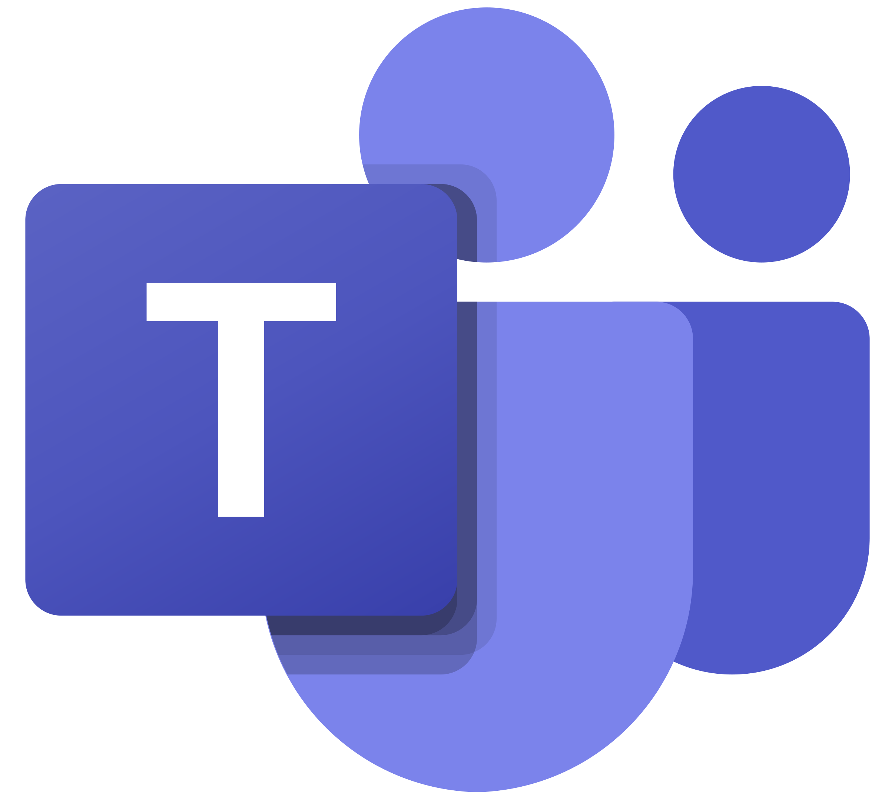
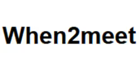
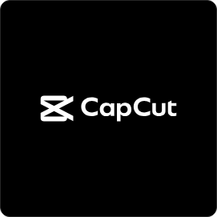
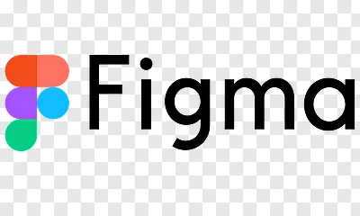
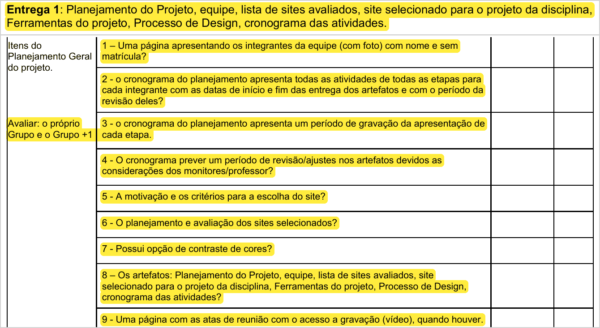

## Histórico de Versão e Contribuição

| Data | Versão | Descrição | Autor(es) | Revisor(es) | Declaração de Uso de IA |
| :---: | :---: | :--- | :--- | :--- | :--- |
| 05/09/2026 | `1.0` | Tabela de ferramentas utilizadas no projeto. | [Gabriel Melo](https://github.com/gabriellcardone-06) | [Tomas Garcia](https://github.com/TomasRocho) | Google Gemini — auxílio na estruturação textual, refinamento de clareza formal e formatação Markdown do presente documento |
| 19/09/2026 | `2.0` | Acrescimo de novas ferramentas que serão utilizadas durante o desenvolvimento do projeto | [Gabriel Melo](https://github.com/gabriellcardone-06) | [Igor Dantas](https://github.com/IgorDARAUJO) | Google Gemini — auxílio na estruturação textual, refinamento de clareza formal e formatação Markdown do presente documento |
| 20/09/2026 | `2.1` | Acrescimo de etapas onde serão utilizadas as ferramentas | [Gabriel Melo](https://github.com/gabriellcardone-06) | [Arthur Mariani](https://github.com/arthur-mariani) | Google Gemini — auxílio na estruturação textual, refinamento de clareza formal e formatação Markdown do presente documento |
| 10/11/2026 | `2.2` | Inclusão do Claude Code (Anthropic) e ajuste da descrição do Figma, porque o protótipo de alta fidelidade da TAR-06 passou a ser feito em HTML navegável. | [Carlos Costa](https://github.com/carloshfgit) | [Arthur Mariani](https://github.com/arthur-mariani) | Google Gemini — auxílio na estruturação textual, refinamento de clareza formal e formatação Markdown do presente documento |
| 19/11/2026 | `2.3` | Padronização da estrutura (histórico no topo, conteúdo, fotos de referência e referências ao final); declaração de IA levada para o histórico; retirada das referências que não são o livro da disciplina nem material do professor; inclusão de fotos de referência grifadas. Inclusão da logo do Claude na Tabela 1. | [Gabriel Melo](https://github.com/gabriellcardone-06) | Pendente de revisão | Claude (Anthropic) — apoio na padronização da estrutura do artefato, na revisão das referências e na formatação em Markdown. |

---

# Ferramentas do Projeto

## 1. Introdução

Para o desenvolvimento estruturado e eficiente do projeto da disciplina de Interação Humano-Computador (IHC), selecionamos um conjunto de ferramentas focadas em otimizar a comunicação, o gerenciamento de tarefas, a colaboração em equipe e a documentação dos artefatos produzidos. 

A escolha dessas plataformas levou em consideração a acessibilidade, a eficiência e a integração necessária para que todas as etapas do processo de design (análise, síntese e avaliação) sejam conduzidas, registradas e compartilhadas de forma organizada e produtiva. A **Tabela 1** abaixo detalha as ferramentas adotadas e a motivação por trás de cada escolha para o ciclo de vida do projeto.

**Tabela 1** - Ferramentas utilizadas no projeto

| Ferramenta | Logo | Motivação da Escolha | Etapa(s) Utilizada |
| :--- | :---: | :--- | :--- |
| **Microsoft Teams** | { width="45" } | Utilizado para a comunicação formal, realização das reuniões de alinhamento da equipe e gravação de encontros importantes ou sessões de avaliação que exigem registro em vídeo e áudio. | Etapas de 1 a 8. |
| **LaTeX / Overleaf** | { width="45" } | Adotado para a criação e formatação do documento final e relatórios acadêmicos do projeto. Garante uma padronização rigorosa, versionamento de texto e alta qualidade tipográfica de forma colaborativa na nuvem. | Etapas de 1 a 8. |
| **GitHub** | { width="45" } | Plataforma essencial para o versionamento, hospedagem dos artefatos do projeto (Wiki) e controle colaborativo do repositório. Permite rastrear as entregas, gerenciar *issues* e integrar a documentação. | Etapas de 1 a 8. |
| **Google Docs** | { width="45" } | Utilizado para a edição rápida, simultânea e colaborativa de rascunhos, roteiros e textos preliminares antes da revisão final e transferência para a documentação oficial ou repositório. | Etapas de 1 a 8. |
| **MkDocs** | { width="52" } | Escolhido para a geração da página de documentação estática do projeto. Ele transforma nossos arquivos Markdown em um site estruturado, limpo e de fácil navegação, integrando-se perfeitamente ao GitHub Pages. | Etapas de 1 a 8. |
| **YouTube** | { width="45" } | Plataforma de hospedagem utilizada para o upload e compartilhamento dos vídeos produzidos ao longo do projeto, como registros de testes de usabilidade, simulações ou apresentações das entregas. | Etapas de 1 a 8. |
| **WhatsApp** | { width="45" } | Ferramenta de comunicação diária. É fundamental para a troca rápida de mensagens, avisos cotidianos, lembretes de prazos e resolução de impedimentos urgentes entre os membros do grupo. | Etapas de 1 a 8. |
| **When2meet** | { width="90" } | Utilizado para cruzar e mapear a disponibilidade de horários de todos os integrantes da equipe e geração do *heatmap* (mapa de calor) visual para facilitar a identificação rápida dos melhores momentos para o agendamento de reuniões. | Etapa 1. |
| **Google Gemini** | { width="45" } | Empregado como assistente de inteligência artificial para apoio na revisão sintática e textual, padronização da formatação em Markdown e auxílio na estruturação e estilização de código front-end para o MkDocs. Além disso, será utilizado para geração de imagens de personas. | Etapas de 1 a 8. |
| **123APPS** |  | Plataforma utilizada para a gravação de tela e áudio durante as apresentações assíncronas dos artefatos produzidos pela equipe, garantindo o registro em vídeo exigido pela disciplina. | Etapas de 1 a 8. |
| **CapCut** |  | Escolhido para a edição rápida e eficiente dos vídeos gravados. Permite realizar cortes, ajustes de áudio e a renderização final do material audiovisual antes do upload na plataforma de hospedagem. | Etapas de 1 a 8. |
| **VS Code** |  | Ambiente de Desenvolvimento Integrado (IDE) principal adotado pela equipe. Escolhido por sua leveza, integração nativa com o Git e vasta gama de extensões, facilitando a edição dos arquivos Markdown, a manutenção da estrutura do MkDocs e o gerenciamento do repositório. | Etapas de 1 a 8. |
| **Figma** |  | Ambiente de prototipação adotado pela equipe para planejamento de correções de defeitos encontrados nos sites e para os protótipos de alta fidelidade dos integrantes que optaram por ele. | Etapas 6 e 7. |
| **Claude Code (Anthropic)** | { width="45" } | Agente de código com IA usado para implementar o protótipo de alta fidelidade da TAR-06 em HTML navegável, a partir das telas, das tarefas e do Guia de Estilo definidos pelo autor, e para apoiar a revisão e a formatação dos textos em Markdown. O protótipo fica versionado no repositório e publicado no GitHub Pages. | Etapas 5, 6 e 7. |

*Fonte: Gabriel Melo. Logomarcas de propriedade de suas respectivas empresas institucionais.*

---

## 2. Fotos de Referência

As Figuras 1 a 2 mostram os trechos que fundamentam este artefato, recortados e grifados em amarelo diretamente do Plano de Ensino do professor (SALES, 2026).

<strong>Figura 1</strong> — Itens do Planejamento Geral do projeto (Entrega 1)

<em>Fonte: SALES (2026, Plano de Ensino, p. 8). Recorte e grifo: [Gabriel Melo](https://github.com/gabriellcardone-06) (2026).</em>

<strong>Figura 2</strong> — Itens do Desenvolvimento do projeto (1 a 11) da lista de verificação sugerida pelo professor

<em>Fonte: SALES (2026, Plano de Ensino, pp. 8–9). Recorte e grifo: [Gabriel Melo](https://github.com/gabriellcardone-06) (2026).</em>

---

## 3. Referências Bibliográficas

* BARBOSA, Simone Diniz Junqueira; SILVA, Bruno Santana da; SILVEIRA, Milene Selbach; GASPARINI, Isabela; DARIN, Ticianne; BARBOSA, Gabriel Diniz Junqueira. **Interação Humano-Computador e Experiência do Usuário**. Rio de Janeiro: Autopublicação, 2021. ISBN 978-65-00-19677-1.
* SALES, André Barros de. *Plano de Ensino: Interação Humano Computador*. Universidade de Brasília, Faculdade UnB Gama, 2026.
