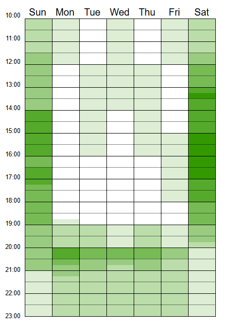
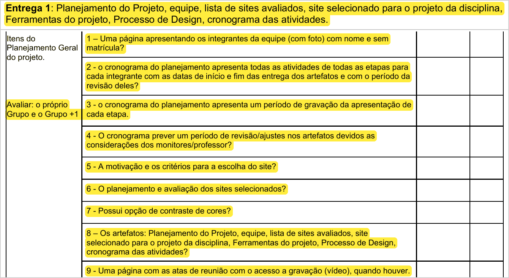
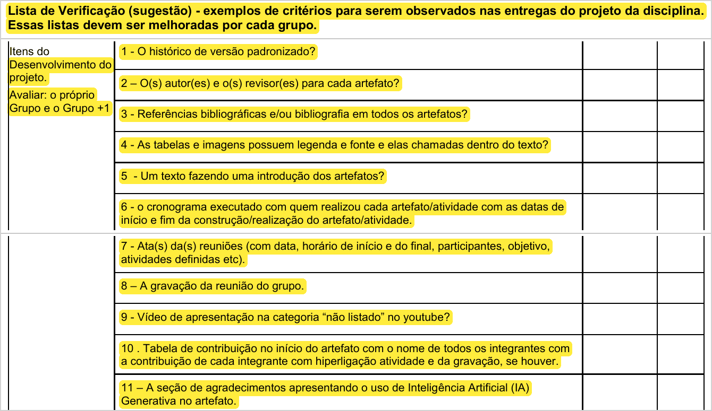

## Histórico de Versão e Contribuição

| Data | Versão | Descrição | Autor(es) | Revisor(es) | Declaração de Uso de IA |
| :---: | :---: | :--- | :--- | :--- | :--- |
| 05/09/2026 | `1.0` | Documentação do mapa de disponibilidade dos integrantes. | [Gabriel Melo](https://github.com/gabriellcardone-06) | [Tomas Garcia](https://github.com/TomasRocho) | Google Gemini — auxílio na estruturação textual, refinamento de clareza formal e formatação Markdown do presente documento |
| 19/11/2026 | `1.1` | Padronização da estrutura (histórico no topo, conteúdo, fotos de referência e referências ao final); declaração de IA levada para o histórico; inclusão de fotos de referência grifadas. | [Gabriel Melo](https://github.com/gabriellcardone-06) | Pendente de revisão | Claude (Anthropic) — apoio na padronização da estrutura do artefato, na revisão das referências e na formatação em Markdown. |

---

# Disponibilidade dos Integrantes

## 1. Introdução

O desenvolvimento de um projeto de Interação Humano-Computador exige sincronia e trabalho colaborativo constante entre os membros da equipe. Para viabilizar a organização dos encontros e gravações da disciplina, foi realizado um mapeamento cruzado dos horários de todos os integrantes.

A **Figura 1** apresenta o *heatmap* (mapa de calor) gerado, indicando os períodos de maior e menor disponibilidade do grupo para o agendamento de reuniões síncronas. Quanto mais escura a tonalidade da cor verde, maior é o número de integrantes disponíveis simultaneamente naquele determinado bloco de tempo.

**Figura 1** - Mapa de calor (Heatmap) da disponibilidade da equipe

*Fonte: Gráfico gerado por meio da ferramenta When2meet.*

---

## 2. Fotos de Referência

As Figuras 2 a 3 mostram os trechos que fundamentam este artefato, recortados e grifados em amarelo diretamente do Plano de Ensino do professor (SALES, 2026).

<strong>Figura 2</strong> — Itens do Planejamento Geral do projeto (Entrega 1)

<em>Fonte: SALES (2026, Plano de Ensino, p. 8). Recorte e grifo: [Gabriel Melo](https://github.com/gabriellcardone-06) (2026).</em>

<strong>Figura 3</strong> — Itens do Desenvolvimento do projeto (1 a 11) da lista de verificação sugerida pelo professor

<em>Fonte: SALES (2026, Plano de Ensino, pp. 8–9). Recorte e grifo: [Gabriel Melo](https://github.com/gabriellcardone-06) (2026).</em>

---

## 3. Referências Bibliográficas

* BARBOSA, Simone Diniz Junqueira; SILVA, Bruno Santana da; SILVEIRA, Milene Selbach; GASPARINI, Isabela; DARIN, Ticianne; BARBOSA, Gabriel Diniz Junqueira. **Interação Humano-Computador e Experiência do Usuário**. Rio de Janeiro: Autopublicação, 2021. ISBN 978-65-00-19677-1.
* SALES, André Barros de. *Plano de Ensino: Interação Humano Computador*. Universidade de Brasília, Faculdade UnB Gama, 2026.
