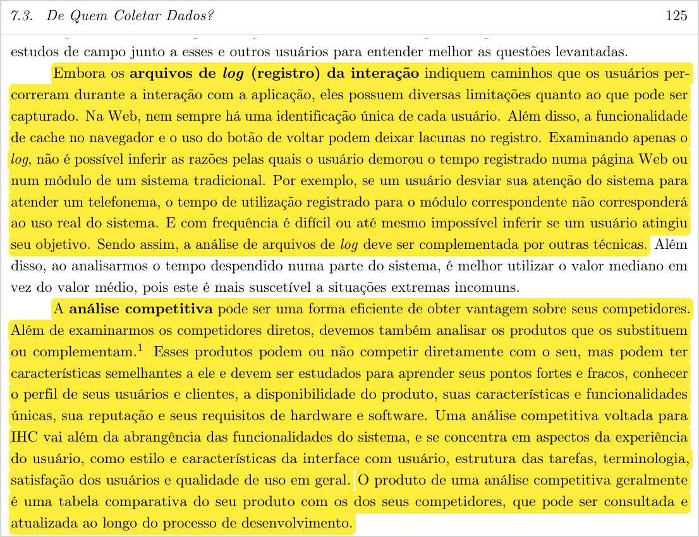
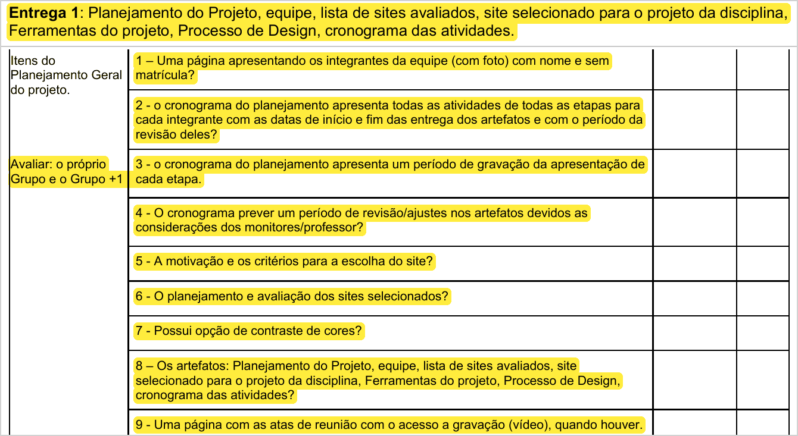

## Histórico de Versão e Contribuição

| Data | Versão | Descrição | Autor(es) | Revisor(es) | Declaração de Uso de IA |
| :---: | :---: | :--- | :--- | :--- | :--- |
| 05/09/2026 | `1.0` | Seleção do sistema para avaliação. | [Rodrigo Carvalho](https://github.com/RodrigoCBarbosa) | [Carlos Henrique](https://github.com/carloshfgit) | Google Gemini — auxílio na estruturação textual, refinamento de clareza formal e formatação Markdown do presente documento |
| 24/09/2026 | `1.1` | Revisão e organização do artefato pós feedback. | [Rodrigo Carvalho](https://github.com/RodrigoCBarbosa) | [Arthur Mariani](https://github.com/arthur-mariani) | Google Gemini — auxílio na estruturação textual, refinamento de clareza formal e formatação Markdown do presente documento |
| 19/11/2026 | `1.2` | Padronização da estrutura (histórico no topo, conteúdo, fotos de referência e referências ao final); declaração de IA levada para o histórico; inclusão de fotos de referência grifadas. | [Gabriel Melo](https://github.com/gabriellcardone-06) | Pendente de revisão | Claude (Anthropic) — apoio na padronização da estrutura do artefato, na revisão das referências e na formatação em Markdown. |

---

# Seleção do Sistema para Avaliação de IHC

## 1. Introdução

Para dar início à etapa de definição do escopo do projeto, a equipe realizou um levantamento preliminar e individual, no qual cada membro ficou responsável por inspecionar a interface de um portal governamental. A Tabela 1 apresenta a relação dos integrantes e os respectivos sites avaliados.

**Tabela 1 – Relação de integrantes e sites avaliados**

| Integrante | Site Avaliado | Link da avaliação |
| :--- | :--- | :--- |
| Arthur | Prefeitura de Angical Bahia | [Acessar avaliação](https://drive.google.com/file/d/1Q8NzRfhBQEKxviJP-siXsMfAFa-nr0tg/view?usp=sharing) |
| Carlos | SEMOB-DF | [Acessar avaliação](https://drive.google.com/file/d/1Q6WfvwByV6bU7NOs1YOPrESTYKDEU2fU/view?usp=sharing) |
| Gabriel | INSS | [Acessar avaliação](https://drive.google.com/file/d/1QlRK9tjW1Q9tNaUcOlHpUOcq0X3EJuN7/view?usp=sharing) |
| Igor | Plataforma Lattes | [Acessar avaliação](https://drive.google.com/file/d/1Ut57WMn6_axKPHMMZeVEr76Z8lPbaft1/view?usp=sharing) |
| Lucas | INSS | — |
| Rodrigo | DETRAN-DF | [Acessar avaliação](https://drive.google.com/file/d/1YG6ldLw2E6B_lF-nGIggoGN5ECo1q3Jl/view?usp=sharing) |
| Tomas | Portal da Prefeitura de São Paulo | [Acessar avaliação](https://drive.google.com/file/d/1QuMdRt0pVmz5fkSOoiT7PnKzfvHFfUtU/view?usp=sharing) |

*Fonte: Elaborada por Rodrigo Barbosa (2026).*

## 2. Seleção por eliminação

A partir do diagnóstico individual, o grupo deliberou sobre qual dos sistemas seria selecionado para o aprofundamento das análises de Interação Humano-Computador (IHC). Para garantir uma escolha estratégica que atendesse às demandas pedagógicas e práticas do projeto, foram definidos cinco critérios objetivos, descritos na legenda a seguir:

**Legenda dos Critérios de Seleção:**  
- **C1:** Volume de Oportunidades de Intervenção e Desvios dos Padrões de IHC (Material Suficiente para a Equipe).  
- **C2:** Acesso Estratégico e Direto ao Público-Alvo.  
- **C3:** Acesso Público, Irrestrito e de Domínio Aberto.  
- **C4:** Centralidade e Complexidade dos Fluxos de Tarefas.  
- **C5:** Viabilidade Técnica e Metodológica.  

A Tabela 2 sumariza a avaliação comparativa de cada portal inspecionado a partir dos critérios estabelecidos.

**Tabela 2 – Matriz de seleção do sistema baseada nos critérios de avaliação**

| Site Avaliado        | C1: Volume de Material                     | C2: Acesso ao Público-Alvo                         | C3: Acesso Aberto                            | C4: Complexidade de Fluxos                   | C5: Viabilidade Técnica/Metodológica         | Conclusão / Veredito         |
| :------------------- | :----------------------------------------- | :------------------------------------------------- | :------------------------------------------- | :------------------------------------------- | :------------------------------------------- | :--------------------------- |
| **SEMOB-DF**         | Alto (Várias quebras ergonômicas e fluxos) | Alto (Estudantes do DF/Passe Livre)                | Alto (Totalmente público)                    | Alto (Rotas, gratuidades)                    | Alto (Viável para cronograma)                | **SELECIONADO**              |
| **DETRAN-DF**        | Médio (6 problemas mapeados)               | Alto (Cidadãos e motoristas do DF)                 | Médio (Serviços vitais bloqueados por login) | Alto (Infrações, CNH)                        | Alto (Próximo da realidade do grupo)         | Descartado (C3 limitado)     |
| **Lattes (CNPq)**    | Baixo (Erros focados em tags de código)    | Alto (Comunidade universitária da UnB)             | Alto (Busca pública)                         | Baixo (Formulário longo, baixa complexidade) | Médio (Pouco material visual para 7 pessoas) | Descartado (C1/C4 baixos)    |
| **Meu INSS**         | Baixo (4 erros simples, sobreposição)      | Baixo (Dificuldade de recrutar idosos para testes) | Baixo (Alta barreira de autenticação gov.br) | Alto (Aposentadorias, perícias)              | Baixo (Barreiras de login/dados)             | Descartado (C2/C3 baixos)    |
| **IPTU São Paulo**   | Baixo (4 erros pontuais, texto)            | Inviável (Contribuintes/proprietários em SP)       | Médio (Exige "Senha Web")                    | Médio (Emissão de guias)                     | Baixo (Longe da realidade do grupo)          | Descartado (C2 inviável)     |
| **Pref. Angical-BA** | Baixo (Apenas 2 problemas estéticos)       | Inviável (Cidadãos no interior da Bahia)           | Alto (Totalmente aberto)                     | Baixo (Busca simples)                        | Baixo (Longe da realidade, falta material)   | Descartado (C1/C2 inviáveis) |

*Fonte: Elaborada por Rodrigo Barbosa (2026).*

## 3. Conclusão

Em síntese, se concluiu que o portal da SEMOB-DF foi selecionado por ser o único a atender a todos os critérios estratégicos e metodológicos de forma satisfatória. Os demais sistemas avaliados foram descartados por esbarrarem em limitações específicas: o DETRAN-DF apresentou restrições no acesso aberto e irrestrito (C3); a Plataforma Lattes não ofereceu volume de material e complexidade de fluxos suficientes para a equipe (C1 e C4); e o Meu INSS demonstrou barreiras impeditivas tanto no acesso ao público-alvo quanto na exigência de autenticação (C2 e C3). Por fim, o portal do IPTU de São Paulo e o da Prefeitura de Angical-BA foram invalidados sumariamente pela inviabilidade logística de contato com seus respectivos usuários finais (C2) e pela insuficiência estrutural de fluxos para análise (C1).

---

## 4. Fotos de Referência

As Figuras 1 a 2 mostram os trechos que fundamentam este artefato, recortados e grifados em amarelo diretamente do livro da disciplina (BARBOSA et al., 2021) e do Plano de Ensino do professor (SALES, 2026).

<strong>Figura 1</strong> — Limitações dos arquivos de log e análise competitiva

<em>Fonte: BARBOSA et al. (2021, p. 125). Recorte e grifo: [Gabriel Melo](https://github.com/gabriellcardone-06) (2026).</em>

<strong>Figura 2</strong> — Itens do Planejamento Geral do projeto (Entrega 1)

<em>Fonte: SALES (2026, Plano de Ensino, p. 8). Recorte e grifo: [Gabriel Melo](https://github.com/gabriellcardone-06) (2026).</em>

---

## 5. Referências Bibliográficas

* BARBOSA, Simone Diniz Junqueira; SILVA, Bruno Santana da; SILVEIRA, Milene Selbach; GASPARINI, Isabela; DARIN, Ticianne; BARBOSA, Gabriel Diniz Junqueira. **Interação Humano-Computador e Experiência do Usuário**. Rio de Janeiro: Autopublicação, 2021. ISBN 978-65-00-19677-1.
* SALES, André Barros de. *Plano de Ensino: Interação Humano Computador*. Universidade de Brasília, Faculdade UnB Gama, 2026.
