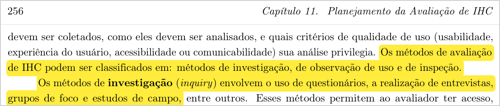

## Histórico de Versão e Contribuição

| Data | Versão | Descrição | Autor(es) | Revisor(es) | Declaração de Uso de IA |
| :---: | :---: | :--- | :--- | :--- | :--- |
| 19/11/2026 | `1.0` | Consolidação das versões anteriores das listas de verificação e das diferenças entre as versões 1.0 e 2.0. | [Gabriel Melo](https://github.com/gabriellcardone-06) | [Arthur Mariani](https://github.com/arthur-mariani) | Claude (Anthropic): apoio na consolidação da rastreabilidade já registrada nas listas 2.0 e na formatação em Markdown. |
| 22/11/2026 | `1.1` | Inclusão da seção sobre a redução dos itens do grupo para um item por integrante (versão 2.1 das listas). | [Gabriel Melo](https://github.com/gabriellcardone-06) | — | Claude (Anthropic): apoio na seleção dos itens mantidos e na redação da seção. |

---

# Alterações das Listas de Verificação

## 1. Objetivo

Este documento preserva o acesso às versões anteriores das listas de verificação e consolida as diferenças entre elas e as versões atuais. As perguntas originais não foram apagadas nem reescritas nos arquivos históricos. As correções foram aplicadas somente às listas 2.0, com base no livro da disciplina e no Plano de Ensino.

As versões atuais devem ser usadas nas novas inspeções. As versões 1.0 permanecem disponíveis apenas para rastreabilidade da evolução dos instrumentos.

## 2. Versões anteriores preservadas

<strong>Tabela 1</strong>: Documentos históricos das listas de verificação

| Entrega | Versão anterior | Data | Situação na versão atual |
| :---: | :--- | :---: | :--- |
| 1 | [Lista da Entrega 1, versão 1.0](verif1.md) | 26/09/2026 | Seus itens avaliavam planejamento e métodos de avaliação; foram transferidos e corrigidos na [Entrega 4, versão 2.0](v2/verif4.md). A [Entrega 1 atual](v2/verif1.md) passou a verificar o planejamento geral do projeto. |
| 2 | [Lista da Entrega 2, versão 1.0](verif2.md) | 26/09/2026 | Os 79 itens foram preservados como G1–G79, com correções e referências; foram acrescentados itens do professor e itens G80–G87. |
| 3 | [Lista da Entrega 3, versão 1.0](verif3.md) | 06/10/2026 | Os 39 itens foram preservados como G1–G39; foram acrescentados G40–G41, os itens do professor e referências visuais para todos os critérios. |
| 4 | Não havia lista 1.0 própria | — | A [versão 2.0](v2/verif4.md) recebeu os itens de avaliação que estavam incorretamente na Entrega 1, além dos itens do professor e dos critérios complementares G21–G28. |
| 5 | [Lista da Entrega 5, versão 1.0](verif5.md) | 25/10/2026 | Os itens 1–14 foram preservados como G1–G14; G15–G24 passaram a verificar o relato do Storyboard e da Análise de Tarefas. |
| 6 | [Lista da Entrega 6, versão 1.0](verif6.md) | 02/11/2026 | Os itens 1–14 foram preservados como G1–G14; G15–G21 passaram a verificar o relato do protótipo de papel. |
| 7 | [Lista da Entrega 7, versão 1.0](verif7.md) | 16/11/2026 | Os itens 1–14 foram preservados como G1–G14; G15 passou a relacionar os resultados às metas de usabilidade. |

<em>Fonte: elaborado pelo Grupo 05 (2026), a partir dos históricos e das seções de rastreabilidade das listas.</em>

## 3. Alterações estruturais comuns

As versões 2.0 adotaram a mesma organização para evitar diferenças de interpretação entre as entregas:

1. inclusão dos onze Itens do Desenvolvimento do Projeto, identificados por D1–D11, conforme o Plano de Ensino;
2. separação entre perguntas do professor, identificadas por C, e perguntas elaboradas pelo grupo, identificadas por G;
3. identificação do autor responsável pelo conteúdo verificado, sem mudar a autoria das perguntas do professor;
4. substituição das opções “Conforme”, “Não conforme” e “Não se aplica” por “Sim”, “Não” e “Incompleto”, seguindo as listas do Plano de Ensino;
5. inclusão de referência e fotografia do trecho utilizado para fundamentar os critérios;
6. inclusão de tabela de contribuição, registro da avaliação e rastreabilidade entre versões;
7. manutenção das perguntas antigas nos documentos 1.0, sem alteração retroativa.

## 4. Diferenças e correções por entrega

<strong>Tabela 2</strong>: Síntese das diferenças entre as listas antigas e atuais

| Entrega | Problema da versão anterior | Correção na versão 2.0 | Fundamentação |
| :---: | :--- | :--- | :--- |
| 1 | Os vinte itens verificavam o planejamento e os métodos de avaliação, conteúdo pertencente à Entrega 4. | Os itens foram transferidos para G1–G20 da Entrega 4. A nova lista da Entrega 1 verifica equipe, site, ferramentas, processo de design, cronograma e planejamento do projeto. | Plano de Ensino; planejamento da avaliação e métodos de avaliação no livro da disciplina. |
| 2 | Havia imprecisões sobre entrevistas, grupo de foco, TCLE, CTT, HTA e personas; cenários e GOMS não eram verificados. | Entrevistas passaram a ser estruturadas, não estruturadas ou semiestruturadas; grupo de foco foi separado; o TCLE passou a prever duas vias; as notações CTT e HTA foram explicitadas; a terminologia de personas foi corrigida; foram acrescentados cenários, GOMS e rastreabilidade. | BARBOSA et al. (2021, caps. 7 e 8), conforme referências e recortes presentes na lista 2.0. |
| 3 | Somente os cinco primeiros itens possuíam evidência visual, e duas perguntas usavam expressões diferentes das adotadas pelo livro. | Todos os itens receberam referência. “Diálogos burocráticos” foi substituído por “diálogos extensos”, e “diálogos bloqueantes” por “excesso de diálogos de confirmação”. | BARBOSA et al. (2021, pp. 223–225), conforme os recortes da lista 2.0. |
| 4 | Não havia lista própria; os critérios estavam na lista da Entrega 1. Alguns itens repetiam objetivos ou classificavam métodos em categorias inadequadas. | Foi criada a lista da Entrega 4. Os métodos foram organizados em investigação, observação de uso e inspeção; estudo de campo foi tratado como investigação; foram acrescentados escopo, justificativa do método, severidade, relato, participantes, material, duração e teste-piloto. | BARBOSA et al. (2021, pp. 253, 256–258, 263–264, 270–271 e 288). |
| 5 | A lista verificava somente os planejamentos do protótipo de papel e do relato, deixando de fora o relato da avaliação do Storyboard e da Análise de Tarefas. | G15–G24 passaram a verificar objetivos, método, participantes, resultados, problemas, limitações e recomendações desse relato. | BARBOSA et al. (2021, pp. 258–264 e 303–306). |
| 6 | A lista verificava os planejamentos da alta fidelidade, mas não o relato dos resultados do protótipo de papel. | G15–G21 passaram a verificar método, participante, tarefas, problemas, alterações realizadas, limitações e encaminhamento para a alta fidelidade. | BARBOSA et al. (2021, pp. 127–128, 258–264, 288–289 e 305–306). |
| 7 | O relato da alta fidelidade não era relacionado às metas de usabilidade, e a fundamentação do protótipo não estava integralmente ligada ao livro da disciplina. | As referências foram substituídas ou complementadas pelo livro, e G15 passou a verificar se os resultados respondem às metas de usabilidade definidas anteriormente. | BARBOSA et al. (2021, pp. 105, 107 e 210, além do capítulo sobre metas de usabilidade). |

<em>Fonte: elaborado pelo Grupo 05 (2026), com base nas tabelas de rastreabilidade das listas 2.0.</em>

## 5. Redução para um item por integrante (versão 2.1) { #5-reducao-para-um-item-por-integrante-versao-21 }

Na versão 2.1, os itens de conteúdo elaborados pelo grupo foram reduzidos a um item por integrante em todas as listas. O Plano de Ensino pede que cada integrante elabore ao menos um item de conteúdo da disciplina, com referência e foto do texto da referência (SALES, 2026, pp. 11–13). Os Itens do Desenvolvimento do Projeto (D1–D11) e as perguntas do professor não foram alterados. Para cada integrante, ficou o item que verifica o artefato produzido por ele e que não repete uma pergunta do professor; os itens mantidos foram renumerados de G1 a G7, e as figuras que só fundamentavam itens retirados saíram das páginas. A Tabela 3 resume a mudança.

<strong>Tabela 3</strong>: Itens das listas antes e depois da versão 2.1

| Entrega | Itens do grupo na v2.0 | Itens do grupo na v2.1 | Itens mantidos sem alteração | Correspondência item a item |
| :---: | :---: | :---: | :--- | :--- |
| 1 | 11 | 7 | D1–D11, PG1–PG9 e C1 | [Entrega 1](v2/verif1.md#reducao-v21) |
| 2 | 87 | 7 | D1–D11 e C1–C12 | [Entrega 2](v2/verif2.md#reducao-v21) |
| 3 | 41 | 7 | D1–D11 e C10–C17 | [Entrega 3](v2/verif3.md#reducao-v21) |
| 4 | 28 | 7 | D1–D11 e C2–C13 | [Entrega 4](v2/verif4.md#reducao-v21) |
| 5 | 24 | 7 | D1–D11 | [Entrega 5](v2/verif5.md#reducao-v21) |
| 6 | 21 | 7 | D1–D11 | [Entrega 6](v2/verif6.md#reducao-v21) |
| 7 | 15 | 7 | D1–D11 | [Entrega 7](v2/verif7.md#reducao-v21) |

<em>Fonte: elaborado pelo Grupo 05 (2026), a partir das listas 2.1.</em>

## 6. Rastreabilidade detalhada

As correspondências item a item permanecem nas próprias listas atuais:

- [Entrega 1, versão 2.0](v2/verif1.md#rastreabilidade-v10--v20);
- [Entrega 2, versão 2.0](v2/verif2.md#rastreabilidade-v10--v20);
- [Entrega 3, versão 2.0](v2/verif3.md#rastreabilidade-v10--v20);
- [Entrega 4, versão 2.0](v2/verif4.md#rastreabilidade-v10--v20);
- [Entrega 5, versão 2.0](v2/verif5.md#rastreabilidade-v10--v20);
- [Entrega 6, versão 2.0](v2/verif6.md#rastreabilidade-v10--v20);
- [Entrega 7, versão 2.0](v2/verif7.md#rastreabilidade-v10--v20).

---

## 7. Fotos de Referência

<strong>Figura 1</strong>: Classificação dos tipos de método de avaliação de IHC

<em>Fonte: BARBOSA et al. (2021), trecho utilizado na correção da lista da Entrega 4.</em>

<strong>Figura 2</strong>: Itens do Desenvolvimento do Projeto

<em>Fonte: SALES (2026, Plano de Ensino, pp. 8–9).</em>

---

## 8. Referências Bibliográficas

* BARBOSA, Simone Diniz Junqueira; SILVA, Bruno Santana da; SILVEIRA, Milene Selbach; GASPARINI, Isabela; DARIN, Ticianne; BARBOSA, Gabriel Diniz Junqueira. **Interação Humano-Computador e Experiência do Usuário**. Rio de Janeiro: Autopublicação, 2021. ISBN 978-65-00-19677-1. Versão de 03/05/2021.
* SALES, André Barros de. **Plano de Ensino: Interação Humano Computador: Turma 01**. Brasília: Universidade de Brasília, Faculdade UnB Gama, 2026. Disponível em: [plano de ensino (PDF)](../assets/inspecoes/plano-de-ensino-ihc-2026-2-turma01-v1.pdf).
