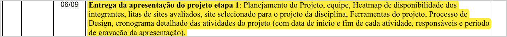
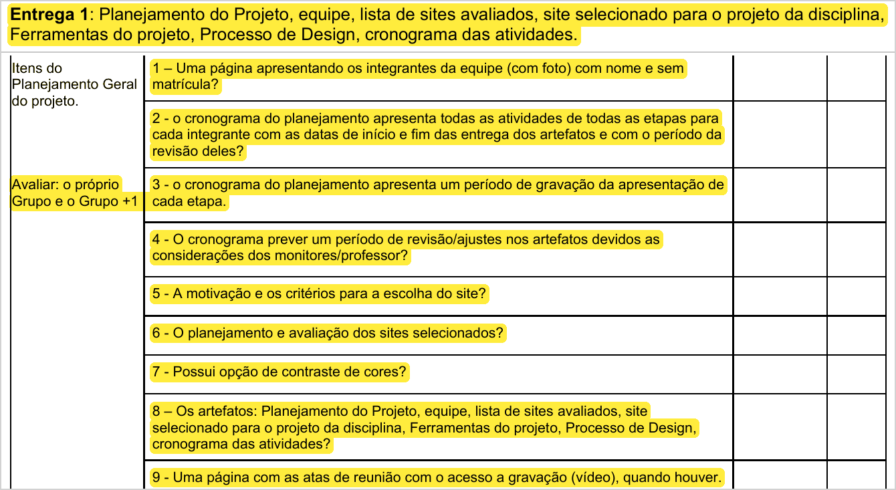
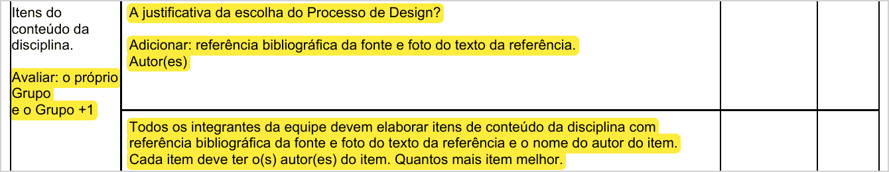
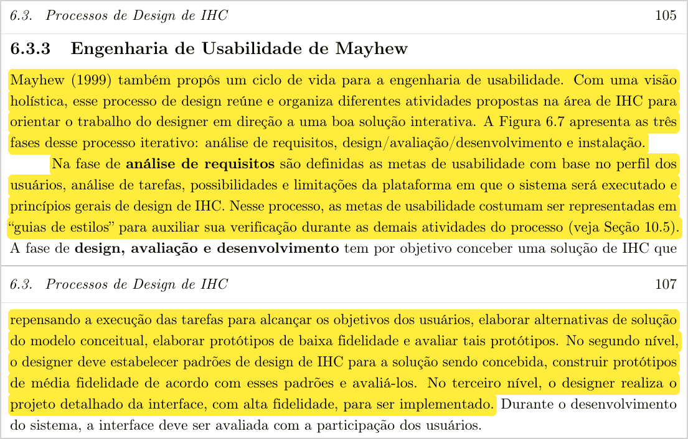
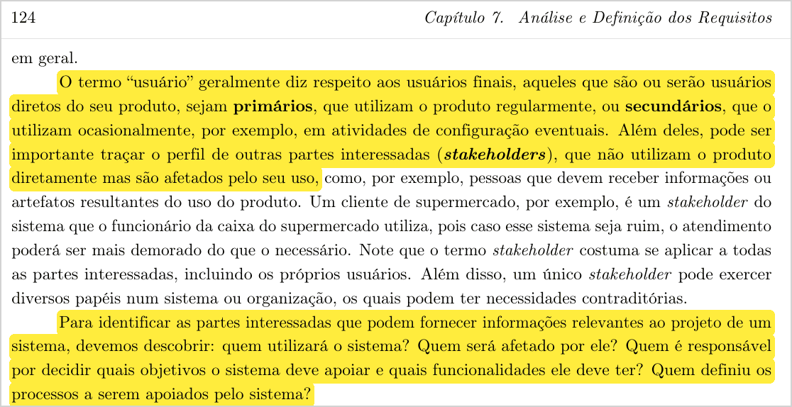
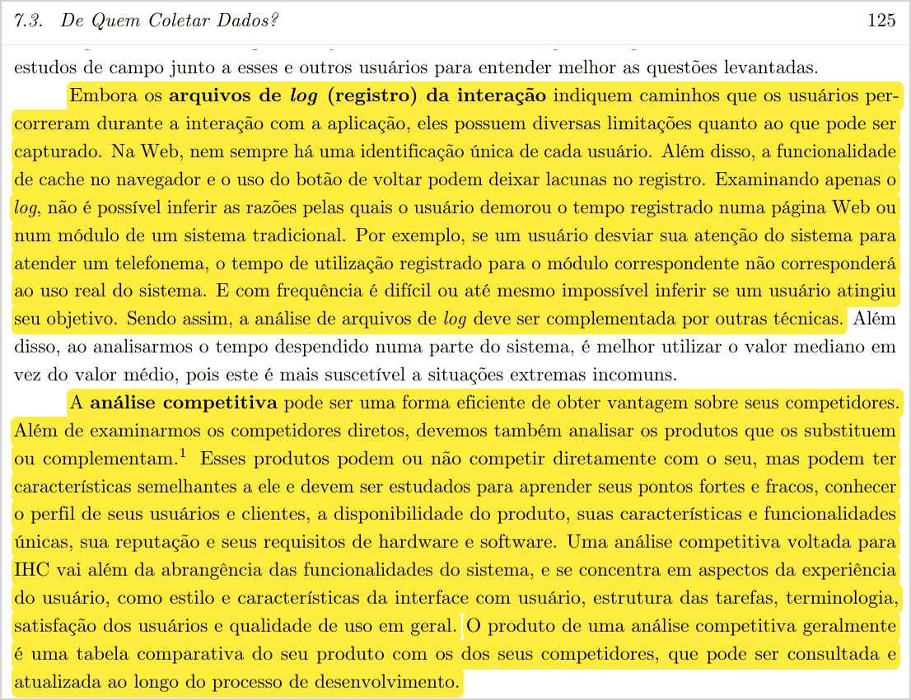
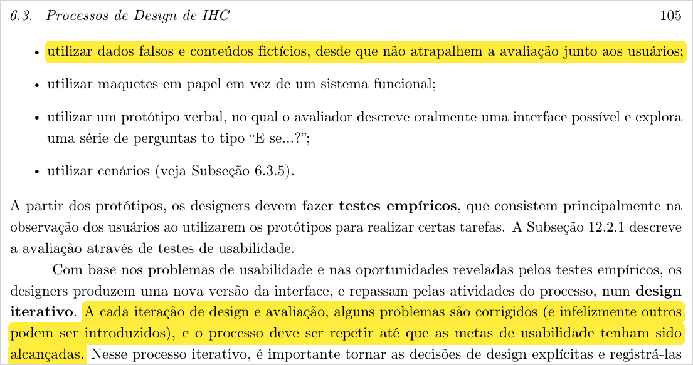

# Lista de Verificação — Entrega 1 (versão 2.0)

!!! info "Versão 2.0 — rastreabilidade"
    Esta é a **versão 2.0** da lista. A versão 1.0 continua disponível, sem alterações de conteúdo, em [verif1.md](../verif1.md). O [índice das listas de verificação](../index.md) mostra onde está cada versão.

## Histórico de versão

| Data | Versão | Descrição | Autor(es) | Revisor(es) |
| :---: | :---: | :--- | :--- | :--- |
| 26/09/2026 | 1.0 | Lista de verificação referente à entrega 1 (publicada em [verif1.md](../verif1.md)). | [Arthur Mariani](https://github.com/arthur-mariani) | [Carlos Costa](https://github.com/carloshfgit) |
| 19/11/2026 | 2.0 | Reestruturação da lista: inclusão dos Itens do Desenvolvimento do Projeto, dos itens do Planejamento Geral e de conteúdo do Plano de Ensino, de itens do grupo sobre os artefatos da Entrega 1, da autoria por item e dos prints das referências. Os itens da v1.0 sobre planejamento da avaliação foram transferidos para a lista da Entrega 4. | [Gabriel Melo](https://github.com/gabriellcardone-06) | Pendente de revisão |

## Introdução

Esta lista verifica os artefatos da **Entrega 1: Planejamento do Projeto, equipe, Heatmap de disponibilidade, lista de sites avaliados, site selecionado, Ferramentas do projeto, Processo de Design e cronograma**. O conteúdo da entrega está descrito no cronograma do Plano de Ensino (SALES, 2026, p. 4; [Figura 1](#figura-1)). A versão 1.0 desta lista tinha apenas perguntas sobre planejamento da avaliação de IHC (DECIDE) e métodos de avaliação, que são conteúdo da Entrega 4. Na versão 2.0, esses 20 itens foram transferidos para a [lista da Entrega 4](verif4.md), e esta lista passou a verificar o que a Entrega 1 de fato pede.

Para cada item, quem avalia marca **Sim**, **Não** ou **Incompleto**, como no Plano de Ensino (SALES, 2026). Quando um item não se aplica ao artefato avaliado, escreva *N/A* na linha e explique em *Observações* no registro da avaliação. A coluna *Autor(es) do item* indica quem escreveu a pergunta e quem é responsável pelo conteúdo verificado. Nos itens do professor, a pergunta é de André Barros de Sales e o integrante indicado é quem produziu o conteúdo e a evidência. A coluna *Referência* leva ao print grifado da fonte, no fim da página. As páginas do livro são as páginas impressas do *IHC.pdf* (BARBOSA et al., 2021, versão de 03/05/2021).

Os itens estão organizados assim: primeiro os **Itens do Desenvolvimento do Projeto (D1–D11)**, que se repetem em todas as listas; depois os itens de conteúdo do professor (quando a entrega tem lista no Plano de Ensino); por fim, os itens de conteúdo elaborados pelo grupo (código G).

## 1. Itens do Desenvolvimento do Projeto

O Plano de Ensino define onze itens de desenvolvimento que valem para todos os artefatos (SALES, 2026, pp. 8–9). Eles aparecem primeiro em todas as listas do grupo, da Entrega 1 à Entrega 7 (veja a Tabela 1). Nas Entregas 3 e 4, o Plano fala em “Todos os 10 itens”, mas a lista do professor tem 11; por isso os 11 foram mantidos.

<strong>Tabela 1</strong> — Itens do Desenvolvimento do Projeto (Avaliar: o próprio grupo e o grupo +1)

| Código | Pergunta de verificação | Autor(es) do item | Referência | Sim | Não | Incompleto |
| :---: | :--- | :--- | :---: | :---: | :---: | :---: |
| D1 | O histórico de versão padronizado? | **Pergunta:** André Barros de Sales (Plano de Ensino) **Inclusão na lista:** [Gabriel Melo](https://github.com/gabriellcardone-06) | [Fig. 2](#figura-2) | ☐ | ☐ | ☐ |
| D2 | O(s) autor(es) e o(s) revisor(es) para cada artefato? | **Pergunta:** André Barros de Sales (Plano de Ensino) **Inclusão na lista:** [Gabriel Melo](https://github.com/gabriellcardone-06) | [Fig. 2](#figura-2) | ☐ | ☐ | ☐ |
| D3 | Referências bibliográficas e/ou bibliografia em todos os artefatos? | **Pergunta:** André Barros de Sales (Plano de Ensino) **Inclusão na lista:** [Gabriel Melo](https://github.com/gabriellcardone-06) | [Fig. 2](#figura-2) | ☐ | ☐ | ☐ |
| D4 | As tabelas e imagens possuem legenda e fonte e são chamadas dentro do texto? | **Pergunta:** André Barros de Sales (Plano de Ensino) **Inclusão na lista:** [Gabriel Melo](https://github.com/gabriellcardone-06) | [Fig. 2](#figura-2) | ☐ | ☐ | ☐ |
| D5 | Um texto fazendo uma introdução dos artefatos? | **Pergunta:** André Barros de Sales (Plano de Ensino) **Inclusão na lista:** [Gabriel Melo](https://github.com/gabriellcardone-06) | [Fig. 2](#figura-2) | ☐ | ☐ | ☐ |
| D6 | O cronograma executado com quem realizou cada artefato/atividade, com as datas de início e fim da construção/realização do artefato/atividade? | **Pergunta:** André Barros de Sales (Plano de Ensino) **Inclusão na lista:** [Gabriel Melo](https://github.com/gabriellcardone-06) | [Fig. 2](#figura-2) | ☐ | ☐ | ☐ |
| D7 | Ata(s) da(s) reunião(ões) (com data, horário de início e do final, participantes, objetivo, atividades definidas etc.)? | **Pergunta:** André Barros de Sales (Plano de Ensino) **Inclusão na lista:** [Gabriel Melo](https://github.com/gabriellcardone-06) | [Fig. 2](#figura-2) | ☐ | ☐ | ☐ |
| D8 | A gravação da reunião do grupo? | **Pergunta:** André Barros de Sales (Plano de Ensino) **Inclusão na lista:** [Gabriel Melo](https://github.com/gabriellcardone-06) | [Fig. 2](#figura-2) | ☐ | ☐ | ☐ |
| D9 | Vídeo de apresentação na categoria “não listado” no YouTube? | **Pergunta:** André Barros de Sales (Plano de Ensino) **Inclusão na lista:** [Gabriel Melo](https://github.com/gabriellcardone-06) | [Fig. 2](#figura-2) | ☐ | ☐ | ☐ |
| D10 | Tabela de contribuição no início do artefato com o nome de todos os integrantes, com a contribuição de cada integrante e hiperligação para a atividade e para a gravação, se houver? | **Pergunta:** André Barros de Sales (Plano de Ensino) **Inclusão na lista:** [Gabriel Melo](https://github.com/gabriellcardone-06) | [Fig. 2](#figura-2) | ☐ | ☐ | ☐ |
| D11 | A seção de agradecimentos apresentando o uso de Inteligência Artificial (IA) Generativa no artefato? | **Pergunta:** André Barros de Sales (Plano de Ensino) **Inclusão na lista:** [Gabriel Melo](https://github.com/gabriellcardone-06) | [Fig. 2](#figura-2) | ☐ | ☐ | ☐ |

<em>Fonte: SALES (2026, Plano de Ensino, pp. 8–9), lista de verificação sugerida — Itens do Desenvolvimento do projeto.</em>

## 2. Itens do Planejamento Geral do Projeto (Plano de Ensino)

A Tabela 2 reproduz os nove itens do Planejamento Geral da lista do professor.

<strong>Tabela 2</strong> — Itens do Planejamento Geral do projeto — “O GitHub Pages possui:” (Avaliar: o próprio grupo e o grupo +1)

| Código | Pergunta de verificação | Autor(es) do item | Referência | Sim | Não | Incompleto |
| :---: | :--- | :--- | :---: | :---: | :---: | :---: |
| PG1 | Uma página apresentando os integrantes da equipe (com foto), com nome e sem matrícula? | **Pergunta:** André Barros de Sales (Plano de Ensino) **Conteúdo e evidência:** [Arthur Mariani](https://github.com/arthur-mariani) e [Carlos Costa](https://github.com/carloshfgit) | [Fig. 3](#figura-3) | ☐ | ☐ | ☐ |
| PG2 | O cronograma do planejamento apresenta todas as atividades de todas as etapas para cada integrante, com as datas de início e fim da entrega dos artefatos e com o período da revisão deles? | **Pergunta:** André Barros de Sales (Plano de Ensino) **Conteúdo e evidência:** [Igor Dantas](https://github.com/IgorDARAUJO) e [Carlos Costa](https://github.com/carloshfgit) | [Fig. 3](#figura-3) | ☐ | ☐ | ☐ |
| PG3 | O cronograma do planejamento apresenta um período de gravação da apresentação de cada etapa? | **Pergunta:** André Barros de Sales (Plano de Ensino) **Conteúdo e evidência:** [Igor Dantas](https://github.com/IgorDARAUJO) e [Carlos Costa](https://github.com/carloshfgit) | [Fig. 3](#figura-3) | ☐ | ☐ | ☐ |
| PG4 | O cronograma prevê um período de revisão/ajustes nos artefatos devido às considerações dos monitores/professor? | **Pergunta:** André Barros de Sales (Plano de Ensino) **Conteúdo e evidência:** [Igor Dantas](https://github.com/IgorDARAUJO) e [Carlos Costa](https://github.com/carloshfgit) | [Fig. 3](#figura-3) | ☐ | ☐ | ☐ |
| PG5 | A motivação e os critérios para a escolha do site? | **Pergunta:** André Barros de Sales (Plano de Ensino) **Conteúdo e evidência:** [Carlos Costa](https://github.com/carloshfgit) | [Fig. 3](#figura-3) | ☐ | ☐ | ☐ |
| PG6 | O planejamento e a avaliação dos sites selecionados? | **Pergunta:** André Barros de Sales (Plano de Ensino) **Conteúdo e evidência:** [Rodrigo Carvalho](https://github.com/RodrigoCBarbosa) | [Fig. 3](#figura-3) | ☐ | ☐ | ☐ |
| PG7 | Possui opção de contraste de cores? | **Pergunta:** André Barros de Sales (Plano de Ensino) **Conteúdo e evidência:** [Arthur Mariani](https://github.com/arthur-mariani) | [Fig. 3](#figura-3) | ☐ | ☐ | ☐ |
| PG8 | Os artefatos: Planejamento do Projeto, equipe, lista de sites avaliados, site selecionado para o projeto da disciplina, Ferramentas do projeto, Processo de Design, cronograma das atividades? | **Pergunta:** André Barros de Sales (Plano de Ensino) **Conteúdo e evidência:** [Arthur Mariani](https://github.com/arthur-mariani), [Carlos Costa](https://github.com/carloshfgit), [Gabriel Melo](https://github.com/gabriellcardone-06), [Igor Dantas](https://github.com/IgorDARAUJO), [Rodrigo Carvalho](https://github.com/RodrigoCBarbosa) e [Tomás Rocho](https://github.com/TomasRocho) | [Fig. 3](#figura-3) | ☐ | ☐ | ☐ |
| PG9 | Uma página com as atas de reunião com o acesso à gravação (vídeo), quando houver? | **Pergunta:** André Barros de Sales (Plano de Ensino) **Conteúdo e evidência:** [Lucas Araújo](https://github.com/Lucasaraujoszz) | [Fig. 3](#figura-3) | ☐ | ☐ | ☐ |

<em>Fonte: SALES (2026, Plano de Ensino, p. 8), com indicação dos responsáveis pelo conteúdo feita pelo Grupo 05 (2026).</em>

## 3. Itens de conteúdo da disciplina (Plano de Ensino)

O professor pede a justificativa do Processo de Design e que todos os integrantes elaborem itens de conteúdo com referência, foto do texto e autor (SALES, 2026, p. 9). O item está na Tabela 3.

<strong>Tabela 3</strong> — Item de conteúdo da Entrega 1 definido pelo professor

| Código | Pergunta de verificação | Autor(es) do item | Referência | Sim | Não | Incompleto |
| :---: | :--- | :--- | :---: | :---: | :---: | :---: |
| C1 | A justificativa da escolha do Processo de Design? (com referência bibliográfica, foto do texto da referência e autor) | **Pergunta:** André Barros de Sales (Plano de Ensino) **Conteúdo e evidência:** [Tomás Rocho](https://github.com/TomasRocho) | [Fig. 4](#figura-4) [Fig. 5](#figura-5) | ☐ | ☐ | ☐ |

<em>Fonte: SALES (2026, Plano de Ensino, p. 9); referência do conteúdo em BARBOSA et al. (2021, pp. 105–107).</em>

## 4. Itens de conteúdo elaborados pelo grupo

Cada integrante elaborou itens sobre o artefato da Entrega 1 que produziu (veja a Tabela 4). Os itens G2 e G3 aplicam a análise competitiva (BARBOSA et al., 2021, p. 125) à comparação dos sites, e os itens G4 a G6 verificam a justificativa do processo de Mayhew (BARBOSA et al., 2021, pp. 105–107).

<strong>Tabela 4</strong> — Itens de conteúdo do Grupo 05 para os artefatos da Entrega 1

| Código | Pergunta de verificação | Autor(es) do item | Referência | Sim | Não | Incompleto |
| :---: | :--- | :--- | :---: | :---: | :---: | :---: |
| G1 | O artefato de escolha do site justifica a decisão pelos critérios definidos e pelos públicos atendidos pelo site da SEMOB-DF (passageiros, motoristas e demais partes interessadas)? | [Carlos Costa](https://github.com/carloshfgit) | [Fig. 3](#figura-3) [Fig. 6](#figura-6) | ☐ | ☐ | ☐ |
| G2 | Todos os sites avaliados foram comparados pelos mesmos critérios, em uma tabela comparativa que registra os pontos fortes e fracos de cada um? | [Rodrigo Carvalho](https://github.com/RodrigoCBarbosa) | [Fig. 7](#figura-7) | ☐ | ☐ | ☐ |
| G3 | A comparação dos sites considera a experiência do usuário (estilo da interface, estrutura das tarefas, terminologia e qualidade de uso), e não só a quantidade de funcionalidades? | [Rodrigo Carvalho](https://github.com/RodrigoCBarbosa) | [Fig. 7](#figura-7) | ☐ | ☐ | ☐ |
| G4 | O artefato de Processo de Design descreve as três fases do ciclo de vida da engenharia de usabilidade de Mayhew: análise de requisitos; design, avaliação e desenvolvimento; e instalação? | [Tomás Rocho](https://github.com/TomasRocho) | [Fig. 5](#figura-5) | ☐ | ☐ | ☐ |
| G5 | O processo relaciona as entregas do projeto aos três níveis de design de Mayhew (nível 1: modelo conceitual e protótipos de baixa fidelidade; nível 2: padrões de design de tela e média fidelidade; nível 3: projeto detalhado em alta fidelidade)? | [Tomás Rocho](https://github.com/TomasRocho) | [Fig. 5](#figura-5) | ☐ | ☐ | ☐ |
| G6 | O processo prevê ciclos de avaliação e reprojeto até que as metas de usabilidade sejam alcançadas, com registro das decisões de design tomadas? | [Tomás Rocho](https://github.com/TomasRocho) | [Fig. 8](#figura-8) | ☐ | ☐ | ☐ |
| G7 | O artefato de Ferramentas do projeto informa, para cada ferramenta, a sua finalidade no projeto (documentação, prototipação, comunicação, gravação) e como a equipe a usa? | [Gabriel Melo](https://github.com/gabriellcardone-06) | [Fig. 1](#figura-1) | ☐ | ☐ | ☐ |
| G8 | O mapa de disponibilidade (heatmap) mostra a disponibilidade de todos os integrantes e os horários de reunião escolhidos a partir dele? | [Gabriel Melo](https://github.com/gabriellcardone-06) | [Fig. 1](#figura-1) | ☐ | ☐ | ☐ |
| G9 | O cronograma detalhado indica, para cada atividade, o responsável, o revisor e as datas de início e fim, cobrindo todas as entregas até a entrega final? | [Igor Dantas](https://github.com/IgorDARAUJO) | [Fig. 1](#figura-1) | ☐ | ☐ | ☐ |
| G10 | Cada ata registra data, horário de início e de fim, participantes, objetivo, decisões e responsáveis, com link para a gravação quando houver? | [Lucas Araújo](https://github.com/Lucasaraujoszz) | [Fig. 2](#figura-2) | ☐ | ☐ | ☐ |
| G11 | A alternância entre tema claro e escuro funciona em todas as páginas e mantém legíveis os textos, as tabelas e as imagens? | [Arthur Mariani](https://github.com/arthur-mariani) | [Fig. 3](#figura-3) | ☐ | ☐ | ☐ |

<em>Fonte: elaborado pelo Grupo 05 (2026), com base em SALES (2026) e BARBOSA et al. (2021).</em>

## Tabela de contribuição

A Tabela 5 mostra o que cada integrante fez nesta lista. A autoria dos itens segue o conteúdo que cada integrante produziu no projeto: quem fez o artefato é autor dos itens que o verificam. Os links levam ao artefato correspondente. As gravações das reuniões estão na página de [atas](../../atas/ata1.md) e de [gravações](../../apresentacoes/index.md).

<strong>Tabela 5</strong> — Contribuição de cada integrante nesta lista

| Integrante | Contribuição nesta lista | Artefato(s) relacionado(s) |
| :--- | :--- | :--- |
| [Arthur Mariani](https://github.com/arthur-mariani) | Autor da versão 1.0 (itens hoje na Entrega 4). Conteúdo dos itens PG1, PG7 e G11 (página inicial, equipe e opção de contraste). | [Página inicial](../../index.md) |
| [Carlos Costa](https://github.com/carloshfgit) | Revisor da versão 1.0. Conteúdo dos itens PG1–PG5 e G1 (equipe, cronograma e escolha do site). | [Site escolhido](../../planejamento/escolha-semob.md), [Cronograma](../../planejamento/cronograma.md) |
| [Gabriel Melo](https://github.com/gabriellcardone-06) | Autor da versão 2.0 (reestruturação, inclusão de D1–D11, PG1–PG9 e C1, rastreabilidade e prints). Itens G7 e G8. | [Ferramentas](../../planejamento/Ferramentas_do_Projeto.md), [Mapa de disponibilidade](../../planejamento/HeatMap_do_Grupo.md) |
| [Igor Dantas](https://github.com/IgorDARAUJO) | Conteúdo dos itens PG2–PG4 e item G9 (cronograma). | [Cronograma](../../planejamento/cronograma.md) |
| [Lucas Araújo](https://github.com/Lucasaraujoszz) | Conteúdo do item PG9 e item G10 (atas e gravações). | [Atas](../../atas/ata1.md) |
| [Rodrigo Carvalho](https://github.com/RodrigoCBarbosa) | Conteúdo do item PG6 e itens G2 e G3 (sites avaliados). | [Sites avaliados](../../planejamento/selecao_v2.md) |
| [Tomás Rocho](https://github.com/TomasRocho) | Conteúdo do item C1 e itens G4–G6 (Processo de Design). | [Processo de design](../../planejamento/ProcessoDesign.md) |
| André Barros de Sales (professor) | Autor das perguntas dos Itens do Desenvolvimento do Projeto (D1–D11) e dos itens PG1–PG9 e C1, retiradas da lista de verificação sugerida no Plano de Ensino. | [Plano de Ensino (PDF)](../../assets/inspecoes/plano-de-ensino-ihc-2026-2-turma01-v1.pdf) |

<em>Fonte: elaborado pelo Grupo 05 (2026).</em>

## Rastreabilidade v1.0 → v2.0

A versão 1.0 continua publicada em [verif1.md](../verif1.md) e não foi apagada. A Tabela 6 indica onde cada item da versão 1.0 está nesta versão e o que mudou.

<strong>Tabela 6</strong> — Rastreabilidade entre a versão 1.0 e a versão 2.0

| Item na v1.0 | Item na v2.0 | Alteração |
| :---: | :---: | :--- |
| Tabela 1, item 1 | [Entrega 4, G1](verif4.md) | Transferido: trata do planejamento da avaliação (DECIDE), conteúdo da Entrega 4. |
| Tabela 1, item 2 | [Entrega 4, G2](verif4.md) | Transferido: trata do planejamento da avaliação (DECIDE), conteúdo da Entrega 4. |
| Tabela 1, item 3 | [Entrega 4, G3](verif4.md) | Transferido: trata do planejamento da avaliação (DECIDE), conteúdo da Entrega 4. |
| Tabela 1, item 4 | [Entrega 4, G4](verif4.md) | Transferido: trata do planejamento da avaliação (DECIDE), conteúdo da Entrega 4. |
| Tabela 1, item 5 | [Entrega 4, G5](verif4.md) | Transferido: trata do planejamento da avaliação (DECIDE), conteúdo da Entrega 4. |
| Tabela 1, item 6 | [Entrega 4, G6](verif4.md) | Transferido: trata do planejamento da avaliação (DECIDE), conteúdo da Entrega 4. |
| Tabela 1, item 7 | [Entrega 4, G7](verif4.md) | Transferido: trata do planejamento da avaliação (DECIDE), conteúdo da Entrega 4. |
| Tabela 1, item 8 | [Entrega 4, G8](verif4.md) | Transferido: trata do planejamento da avaliação (DECIDE), conteúdo da Entrega 4. |
| Tabela 1, item 9 | [Entrega 4, G9](verif4.md) | Transferido: trata do planejamento da avaliação (DECIDE), conteúdo da Entrega 4. |
| Tabela 1, item 10 | [Entrega 4, G10](verif4.md) | Transferido: trata do planejamento da avaliação (DECIDE), conteúdo da Entrega 4. |
| Tabela 2, item 1 | [Entrega 4, G11](verif4.md) | Transferido: trata de métodos de avaliação, conteúdo da Entrega 4. |
| Tabela 2, item 2 | [Entrega 4, G12](verif4.md) | Transferido: trata de métodos de avaliação, conteúdo da Entrega 4. |
| Tabela 2, item 3 | [Entrega 4, G13](verif4.md) | Transferido: trata de métodos de avaliação, conteúdo da Entrega 4. |
| Tabela 2, item 4 | [Entrega 4, G14](verif4.md) | Transferido: trata de métodos de avaliação, conteúdo da Entrega 4. |
| Tabela 2, item 5 | [Entrega 4, G15](verif4.md) | Transferido: trata de métodos de avaliação, conteúdo da Entrega 4. |
| Tabela 2, item 6 | [Entrega 4, G16](verif4.md) | Transferido: trata de métodos de avaliação, conteúdo da Entrega 4. |
| Tabela 2, item 7 | [Entrega 4, G17](verif4.md) | Transferido: trata de métodos de avaliação, conteúdo da Entrega 4. |
| Tabela 2, item 8 | [Entrega 4, G18](verif4.md) | Transferido: trata de métodos de avaliação, conteúdo da Entrega 4. |
| Tabela 2, item 9 | [Entrega 4, G19](verif4.md) | Transferido: trata de métodos de avaliação, conteúdo da Entrega 4. |
| Tabela 2, item 10 | [Entrega 4, G20](verif4.md) | Transferido: trata de métodos de avaliação, conteúdo da Entrega 4. |
| Seções “1. Orientações” e “1. Perguntas…” | Introdução | Correção da numeração duplicada das seções (“1.” repetido). |
| Bibliografia (Barbosa e Silva, 2010, cap. 11) | Referências | Atualizada para o livro-texto da disciplina (BARBOSA et al., 2021) e o Plano de Ensino (SALES, 2026), com prints. |

<em>Fonte: elaborado pelo Grupo 05 (2026).</em>

## Registro da avaliação

O Plano de Ensino pede a resposta (Sim / Não / Incompleto) e a versão, a data e a hora da avaliação. Cada aplicação desta lista deve ser registrada na Tabela 7.

<strong>Tabela 7</strong> — Registro das avaliações feitas com esta lista

| Artefato e versão avaliada | Data e hora | Avaliador(es) | Grupo avaliador (próprio ou +1) | Observações |
| :--- | :---: | :--- | :---: | :--- |
| | | | | |

<em>Fonte: elaborado pelo Grupo 05 (2026), a partir de SALES (2026).</em>

## Agradecimentos e uso de IA generativa

Agradecemos ao professor André Barros de Sales pela lista de verificação sugerida no Plano de Ensino, que serve de base para os itens D1–D11 e para os itens de conteúdo marcados como do professor.

Na versão 2.0, o assistente de IA generativa *Claude* (Anthropic) foi usado para: comparar os itens da versão 1.0 com o livro-texto e com o Plano de Ensino; sugerir correções e novos itens; localizar no livro as páginas citadas; e gerar os recortes grifados das referências. A atribuição de autoria por conteúdo, o texto final dos itens e a revisão são responsabilidade dos integrantes do grupo. 

## Prints das referências

As figuras a seguir são recortes das fontes citadas nos itens desta lista, com o trecho que fundamenta cada item grifado em amarelo. Os recortes do livro foram retirados do arquivo *IHC.pdf* (BARBOSA et al., 2021, versão de 03/05/2021) e a numeração indicada é a numeração impressa nas páginas. Os recortes do Plano de Ensino foram retirados da versão disponibilizada pelo professor na turma 01 (SALES, 2026), com o número da página do PDF.

---

<strong>Figura 1</strong> — Descrição da Entrega 1 no cronograma do Plano de Ensino

<em>Fonte: SALES (2026, Plano de Ensino, p. 4). Recorte e grifo: [Gabriel Melo](https://github.com/gabriellcardone-06) (2026). Itens que usam esta figura: Introdução, G7, G8, G9.</em>

---

<strong>Figura 2</strong> — Itens do Desenvolvimento do projeto (1 a 11) da lista de verificação sugerida pelo professor

<em>Fonte: SALES (2026, Plano de Ensino, pp. 8–9). Recorte e grifo: [Gabriel Melo](https://github.com/gabriellcardone-06) (2026). Itens que usam esta figura: D1, D2, D3, D4, D5, D6, D7, D8, D9, D10, D11, G10.</em>

---

<strong>Figura 3</strong> — Itens do Planejamento Geral do projeto (Entrega 1)

<em>Fonte: SALES (2026, Plano de Ensino, p. 8). Recorte e grifo: [Gabriel Melo](https://github.com/gabriellcardone-06) (2026). Itens que usam esta figura: PG1, PG2, PG3, PG4, PG5, PG6, PG7, PG8, PG9, G1, G11.</em>

---

<strong>Figura 4</strong> — Itens de conteúdo da disciplina (Entrega 1)

<em>Fonte: SALES (2026, Plano de Ensino, p. 9). Recorte e grifo: [Gabriel Melo](https://github.com/gabriellcardone-06) (2026). Itens que usam esta figura: C1.</em>

---

<strong>Figura 5</strong> — Ciclo de vida da engenharia de usabilidade de Mayhew: fases e três níveis de design

<em>Fonte: BARBOSA et al. (2021, pp. 105, 107). Recorte e grifo: [Gabriel Melo](https://github.com/gabriellcardone-06) (2026). Itens que usam esta figura: C1, G4, G5.</em>

---

<strong>Figura 6</strong> — Usuários primários, secundários e stakeholders

<em>Fonte: BARBOSA et al. (2021, p. 124). Recorte e grifo: [Gabriel Melo](https://github.com/gabriellcardone-06) (2026). Itens que usam esta figura: G1.</em>

---

<strong>Figura 7</strong> — Limitações dos arquivos de log e análise competitiva

<em>Fonte: BARBOSA et al. (2021, p. 125). Recorte e grifo: [Gabriel Melo](https://github.com/gabriellcardone-06) (2026). Itens que usam esta figura: G2, G3.</em>

---

<strong>Figura 8</strong> — Simplificações aceitáveis em protótipos e design iterativo

<em>Fonte: BARBOSA et al. (2021, p. 105). Recorte e grifo: [Gabriel Melo](https://github.com/gabriellcardone-06) (2026). Itens que usam esta figura: G6.</em>

## Referências bibliográficas

- BARBOSA, Simone Diniz Junqueira; SILVA, Bruno Santana da; SILVEIRA, Milene Selbach; GASPARINI, Isabela; DARIN, Ticianne; BARBOSA, Gabriel Diniz Junqueira. **Interação Humano-Computador e Experiência do Usuário**. Rio de Janeiro: Autopublicação, 2021. ISBN 978-65-00-19677-1. Versão de 03/05/2021.
- SALES, André Barros de. **Plano de Ensino: Interação Humano Computador — Turma 01**. Brasília: Universidade de Brasília, Faculdade UnB Gama, 2026. Disponível em: [plano de ensino (PDF)](../../assets/inspecoes/plano-de-ensino-ihc-2026-2-turma01-v1.pdf).
