## Histórico de Versão e Contribuição

| Data | Versão | Descrição | Autor(es) | Revisor(es) | Declaração de Uso de IA |
| :---: | :---: | :--- | :--- | :--- | :--- |
| 26/09/2026 | `1.0` | Lista de verificação referente à entrega 2 (publicada em [verif2.md](../verif2.md)). | [Arthur Mariani](https://github.com/arthur-mariani) | [Carlos Costa](https://github.com/carloshfgit) | Claude (Anthropic): uso declarado pelo autor (sem detalhamento da finalidade) |
| 19/11/2026 | `2.0` | Inclusão dos Itens do Desenvolvimento do Projeto e dos 12 itens de conteúdo do Plano de Ensino; autoria por item de acordo com o conteúdo; correção de itens; novos itens de cenários, GOMS e perfil; prints das referências. | [Gabriel Melo](https://github.com/gabriellcardone-06) | [Arthur Mariani](https://github.com/arthur-mariani) | Claude (Anthropic): uso declarado pelo autor (sem detalhamento da finalidade) |
| 22/11/2026 | `2.1` | Redução dos itens do grupo para um item por integrante (G1–G7, renumerados); Itens do Desenvolvimento do Projeto (D1–D11) e itens do Plano de Ensino (C1–C12) mantidos sem alteração; remoção das figuras que só fundamentavam itens retirados; atualização da tabela de contribuição e da rastreabilidade. | [Gabriel Melo](https://github.com/gabriellcardone-06) | — | Claude (Anthropic): apoio na seleção dos itens mantidos, na renumeração e na atualização das referências cruzadas. |

---

# Lista de Verificação: Entrega 2 (versão 2.0)

!!! info "Versão 2.0 — rastreabilidade"
    Esta é a **versão 2.0** da lista. A versão 1.0 continua disponível, sem alterações de conteúdo, em [verif2.md](../verif2.md). O [índice das listas de verificação](../index.md) mostra onde está cada versão.

## Introdução

Esta lista verifica os artefatos da **Entrega 2: Perfil do usuário, Aspectos Éticos de Pesquisas Envolvendo Pessoas e Análise de Tarefas (com personas e cenários)**. A versão 1.0 tinha 79 itens, numerados de 1 a 79, sobre coleta de dados, ética, entrevistas, questionários, brainstorming, CTT, personas e HTA. Na versão 2.0 eles mantêm o mesmo número com o prefixo G (o item 23 da v1.0 é o G23), e os itens novos começam no G80. Os itens G1–G79 foram redigidos por Arthur Mariani na v1.0; agora cada um indica também o integrante responsável pelo conteúdo verificado. Na versão 2.1, os itens do grupo foram reduzidos a um por integrante (G1–G7); a correspondência com a versão 2.0 está na [Tabela 6](#reducao-v21).

Para cada item, quem avalia marca **Sim**, **Não** ou **Incompleto**, como no Plano de Ensino (SALES, 2026). Quando um item não se aplica ao artefato avaliado, escreva *N/A* na linha e explique em *Observações* no registro da avaliação. A coluna *Autor(es) do item* indica quem escreveu a pergunta e quem é responsável pelo conteúdo verificado. Nos itens do professor, a pergunta é de André Barros de Sales e o integrante indicado é quem produziu o conteúdo e a evidência. A coluna *Referência* leva ao print grifado da fonte, no fim da página. As páginas do livro são as páginas impressas do *IHC.pdf* (BARBOSA et al., 2021, versão de 03/05/2021).

Os itens estão organizados assim: primeiro os **Itens do Desenvolvimento do Projeto (D1–D11)**, que se repetem em todas as listas; depois os itens de conteúdo do professor (quando a entrega tem lista no Plano de Ensino); por fim, os itens de conteúdo elaborados pelo grupo (código G).

## 1. Itens do Desenvolvimento do Projeto

O Plano de Ensino define onze itens de desenvolvimento que valem para todos os artefatos (SALES, 2026, pp. 8–9). Eles aparecem primeiro em todas as listas do grupo, da Entrega 1 à Entrega 7 (veja a Tabela 1). Nas Entregas 3 e 4, o Plano fala em “Todos os 10 itens”, mas a lista do professor tem 11; por isso os 11 foram mantidos.

<strong>Tabela 1</strong>: Itens do Desenvolvimento do Projeto (Avaliar: o próprio grupo e o grupo +1)

| Código | Pergunta de verificação | Autor(es) do item | Referência | Sim | Não | Incompleto |
| :---: | :--- | :--- | :---: | :---: | :---: | :---: |
| D1 | O histórico de versão padronizado? | **Pergunta:** André Barros de Sales (Plano de Ensino) **Inclusão na lista:** [Gabriel Melo](https://github.com/gabriellcardone-06) | [Fig. 1](#figura-1) | ☐ | ☐ | ☐ |
| D2 | O(s) autor(es) e o(s) revisor(es) para cada artefato? | **Pergunta:** André Barros de Sales (Plano de Ensino) **Inclusão na lista:** [Gabriel Melo](https://github.com/gabriellcardone-06) | [Fig. 1](#figura-1) | ☐ | ☐ | ☐ |
| D3 | Referências bibliográficas e/ou bibliografia em todos os artefatos? | **Pergunta:** André Barros de Sales (Plano de Ensino) **Inclusão na lista:** [Gabriel Melo](https://github.com/gabriellcardone-06) | [Fig. 1](#figura-1) | ☐ | ☐ | ☐ |
| D4 | As tabelas e imagens possuem legenda e fonte e são chamadas dentro do texto? | **Pergunta:** André Barros de Sales (Plano de Ensino) **Inclusão na lista:** [Gabriel Melo](https://github.com/gabriellcardone-06) | [Fig. 1](#figura-1) | ☐ | ☐ | ☐ |
| D5 | Um texto fazendo uma introdução dos artefatos? | **Pergunta:** André Barros de Sales (Plano de Ensino) **Inclusão na lista:** [Gabriel Melo](https://github.com/gabriellcardone-06) | [Fig. 1](#figura-1) | ☐ | ☐ | ☐ |
| D6 | O cronograma executado com quem realizou cada artefato/atividade, com as datas de início e fim da construção/realização do artefato/atividade? | **Pergunta:** André Barros de Sales (Plano de Ensino) **Inclusão na lista:** [Gabriel Melo](https://github.com/gabriellcardone-06) | [Fig. 1](#figura-1) | ☐ | ☐ | ☐ |
| D7 | Ata(s) da(s) reunião(ões) (com data, horário de início e do final, participantes, objetivo, atividades definidas etc.)? | **Pergunta:** André Barros de Sales (Plano de Ensino) **Inclusão na lista:** [Gabriel Melo](https://github.com/gabriellcardone-06) | [Fig. 1](#figura-1) | ☐ | ☐ | ☐ |
| D8 | A gravação da reunião do grupo? | **Pergunta:** André Barros de Sales (Plano de Ensino) **Inclusão na lista:** [Gabriel Melo](https://github.com/gabriellcardone-06) | [Fig. 1](#figura-1) | ☐ | ☐ | ☐ |
| D9 | Vídeo de apresentação na categoria “não listado” no YouTube? | **Pergunta:** André Barros de Sales (Plano de Ensino) **Inclusão na lista:** [Gabriel Melo](https://github.com/gabriellcardone-06) | [Fig. 1](#figura-1) | ☐ | ☐ | ☐ |
| D10 | Tabela de contribuição no início do artefato com o nome de todos os integrantes, com a contribuição de cada integrante e hiperligação para a atividade e para a gravação, se houver? | **Pergunta:** André Barros de Sales (Plano de Ensino) **Inclusão na lista:** [Gabriel Melo](https://github.com/gabriellcardone-06) | [Fig. 1](#figura-1) | ☐ | ☐ | ☐ |
| D11 | A seção de agradecimentos apresentando o uso de Inteligência Artificial (IA) Generativa no artefato? | **Pergunta:** André Barros de Sales (Plano de Ensino) **Inclusão na lista:** [Gabriel Melo](https://github.com/gabriellcardone-06) | [Fig. 1](#figura-1) | ☐ | ☐ | ☐ |

<em>Fonte: SALES (2026, Plano de Ensino, pp. 8–9), lista de verificação sugerida — Itens do Desenvolvimento do projeto.</em>

## 2. Itens de conteúdo da disciplina (Plano de Ensino)

A Tabela 2 traz os 12 itens de conteúdo da Entrega 2 do Plano de Ensino. A versão 1.0 não tinha esses itens.

<strong>Tabela 2</strong>: Itens de conteúdo da Entrega 2 definidos pelo professor

| Código | Pergunta de verificação | Autor(es) do item | Referência | Sim | Não | Incompleto |
| :---: | :--- | :--- | :---: | :---: | :---: | :---: |
| C1 | O perfil do usuário é definido por mais de uma forma (técnica de elicitação e/ou ferramenta)? | **Pergunta:** André Barros de Sales (Plano de Ensino) **Conteúdo e evidência:** [Gabriel Melo](https://github.com/gabriellcardone-06) e [Rodrigo Carvalho](https://github.com/RodrigoCBarbosa) | [Fig. 2](#figura-2) [Fig. 3](#figura-3) | ☐ | ☐ | ☐ |
| C2 | O perfil do usuário possui os atributos de um perfil (dados demográficos; experiência no cargo; informações sobre a empresa; educação etc.), com referência e foto do texto da referência (Barbosa et al., 2021)? | **Pergunta:** André Barros de Sales (Plano de Ensino) **Conteúdo e evidência:** [Gabriel Melo](https://github.com/gabriellcardone-06) | [Fig. 2](#figura-2) [Fig. 4](#figura-4) | ☐ | ☐ | ☐ |
| C3 | O perfil do usuário define os grupos de atributos do capítulo 8 — Organização do Espaço de Problema: idade; experiência; atitudes; tarefas primárias? | **Pergunta:** André Barros de Sales (Plano de Ensino) **Conteúdo e evidência:** [Carlos Costa](https://github.com/carloshfgit) | [Fig. 2](#figura-2) [Fig. 5](#figura-5) | ☐ | ☐ | ☐ |
| C4 | Considera os aspectos éticos de pesquisas envolvendo pessoas? | **Pergunta:** André Barros de Sales (Plano de Ensino) **Conteúdo e evidência:** [Igor Dantas](https://github.com/IgorDARAUJO) | [Fig. 6](#figura-6) [Fig. 7](#figura-7) | ☐ | ☐ | ☐ |
| C5 | Apresenta os 4 princípios (da autonomia, da beneficência, da não maleficência e da justiça e equidade)? | **Pergunta:** André Barros de Sales (Plano de Ensino) **Conteúdo e evidência:** [Igor Dantas](https://github.com/IgorDARAUJO) | [Fig. 6](#figura-6) [Fig. 8](#figura-8) | ☐ | ☐ | ☐ |
| C6 | Informa que solicitará a permissão para gravar a voz ou a imagem de qualquer pessoa antes de começar a gravação? | **Pergunta:** André Barros de Sales (Plano de Ensino) **Conteúdo e evidência:** [Arthur Mariani](https://github.com/arthur-mariani) | [Fig. 6](#figura-6) [Fig. 9](#figura-9) | ☐ | ☐ | ☐ |
| C7 | Apresenta o termo de consentimento livre e esclarecido (TCLE) dos participantes? | **Pergunta:** André Barros de Sales (Plano de Ensino) **Conteúdo e evidência:** [Arthur Mariani](https://github.com/arthur-mariani) e [Igor Dantas](https://github.com/IgorDARAUJO) | [Fig. 6](#figura-6) [Fig. 9](#figura-9) | ☐ | ☐ | ☐ |
| C8 | Foram utilizadas no mínimo duas técnicas para coletar dados e levantar os requisitos dos usuários (entrevistas, grupos de foco, questionários, brainstorming, card sorting, estudos de campo, investigação contextual)? | **Pergunta:** André Barros de Sales (Plano de Ensino) **Conteúdo e evidência:** [Carlos Costa](https://github.com/carloshfgit) e [Lucas Araújo](https://github.com/Lucasaraujoszz) | [Fig. 6](#figura-6) [Fig. 3](#figura-3) | ☐ | ☐ | ☐ |
| C9 | Os cenários? | **Pergunta:** André Barros de Sales (Plano de Ensino) **Conteúdo e evidência:** [Igor Dantas](https://github.com/IgorDARAUJO) | [Fig. 10](#figura-10) [Fig. 11](#figura-11) | ☐ | ☐ | ☐ |
| C10 | A análise de tarefas? | **Pergunta:** André Barros de Sales (Plano de Ensino) **Conteúdo e evidência:** [Gabriel Melo](https://github.com/gabriellcardone-06) | [Fig. 10](#figura-10) [Fig. 12](#figura-12) | ☐ | ☐ | ☐ |
| C11 | Uma atividade para cada integrante do grupo, modelada em ao menos duas técnicas para especificar as tarefas (HTA com diagrama, legenda e representação em tabela; GOMS: KLM, CMN-GOMS, CPM-GOMS; CTT)? | **Pergunta:** André Barros de Sales (Plano de Ensino) **Conteúdo e evidência:** [Tomás Rocho](https://github.com/TomasRocho) | [Fig. 10](#figura-10) [Fig. 13](#figura-13) [Fig. 14](#figura-14) [Fig. 15](#figura-15) | ☐ | ☐ | ☐ |
| C12 | Utilizaram alguma técnica para especificar as tarefas? | **Pergunta:** André Barros de Sales (Plano de Ensino) **Conteúdo e evidência:** [Arthur Mariani](https://github.com/arthur-mariani) | [Fig. 10](#figura-10) [Fig. 12](#figura-12) | ☐ | ☐ | ☐ |

<em>Fonte: SALES (2026, Plano de Ensino, pp. 9–11); referências do conteúdo em BARBOSA et al. (2021).</em>

## 3. Itens de conteúdo elaborados pelo grupo

A Tabela 3 traz um item por integrante, sobre o artefato da Entrega 2 que cada um produziu: tipos de usuário (G1), viés nas perguntas aos participantes (G2), tipo de entrevista (G3), questionário (G4), sessão-piloto do brainstorming (G5), persona primária (G6) e ligação entre persona, cenário e análise de tarefa (G7). As referências estão nos capítulos 7 e 8 de Barbosa et al. (2021).

<strong>Tabela 3</strong>: Itens de conteúdo do Grupo 05 para os artefatos da Entrega 2 (um por integrante)

| Código | Pergunta de verificação | Autor(es) do item | Referência | Sim | Não | Incompleto |
| :---: | :--- | :--- | :---: | :---: | :---: | :---: |
| G1 | Os dados foram coletados identificando o tipo de usuário: primário, secundário e demais stakeholders? | [Gabriel Melo](https://github.com/gabriellcardone-06) | [Fig. 16](#figura-16) | ☐ | ☐ | ☐ |
| G2 | Foram evitadas perguntas ou condutas que possam induzir viés nas respostas dos participantes? | [Arthur Mariani](https://github.com/arthur-mariani) | [Fig. 17](#figura-17) | ☐ | ☐ | ☐ |
| G3 | A pesquisa especifica se a entrevista é estruturada, não estruturada ou semiestruturada? | [Carlos Costa](https://github.com/carloshfgit) | [Fig. 18](#figura-18) | ☐ | ☐ | ☐ |
| G4 | O questionário priorizou perguntas fechadas, sem excesso de perguntas abertas que possa reduzir o interesse e a taxa de resposta? | [Rodrigo Carvalho](https://github.com/RodrigoCBarbosa) | [Fig. 18](#figura-18) [Fig. 19](#figura-19) | ☐ | ☐ | ☐ |
| G5 | Foi realizada uma sessão-piloto para testar a pergunta, o procedimento, a moderação e o tempo previsto? | [Lucas Araújo](https://github.com/Lucasaraujoszz) | [Fig. 20](#figura-20) | ☐ | ☐ | ☐ |
| G6 | Há ao menos uma persona primária, foco principal das decisões de design? | [Igor Dantas](https://github.com/IgorDARAUJO) | [Fig. 21](#figura-21) | ☐ | ☐ | ☐ |
| G7 | Cada persona e cada cenário estão ligados a uma análise de tarefa (TAR) correspondente, de modo que a atividade de cada integrante possa ser rastreada do cenário ao modelo de tarefa? | [Tomás Rocho](https://github.com/TomasRocho) | [Fig. 12](#figura-12) [Fig. 22](#figura-22) | ☐ | ☐ | ☐ |

<em>Fonte: itens G1–G6: Arthur Mariani (2026, v1.0), revisados e com autoria por conteúdo na v2.0; item G7: Grupo 05 (2026, v2.0). Base: BARBOSA et al. (2021).</em>

## Tabela de contribuição

A Tabela 4 mostra o que cada integrante fez nesta lista. A autoria dos itens segue o conteúdo que cada integrante produziu no projeto: quem fez o artefato é autor dos itens que o verificam. Os links levam ao artefato correspondente. As gravações das reuniões estão na página de [atas](../../atas/ata1.md) e de [gravações](../../apresentacoes/index.md).

<strong>Tabela 4</strong>: Contribuição de cada integrante nesta lista

| Integrante | Contribuição nesta lista | Artefato(s) relacionado(s) |
| :--- | :--- | :--- |
| [Arthur Mariani](https://github.com/arthur-mariani) | Autor da versão 1.0 (redação dos 79 itens, dos quais G1–G6 permanecem). Conteúdo dos itens C6, C7 e C12 e do item G2. | [Aspectos éticos](../../analise-de-requisitos/aspectos-eticos.md), [Brainstorming](../../analise-de-requisitos/brainstorm.md), [TAR-03](../../analise-de-requisitos/analise-de-tarefas/tar-03-planejamento-rota.md), [TAR-07](../../analise-de-requisitos/analise-de-tarefas/tar-07-credito-vale-transporte.md), [Maria Eduarda](../../analise-de-requisitos/personas/maria-eduarda-santos.md) |
| [Carlos Costa](https://github.com/carloshfgit) | Revisor da versão 1.0. Conteúdo dos itens C3 e C8 e do item G3. | [Entrevistas](../../analise-de-requisitos/entrevistas.md), [Perfil do motorista](../../analise-de-requisitos/perfis-de-usuario/perfil-motorista.md), [TAR-04 e TAR-05](../../analise-de-requisitos/analise-de-tarefas/analise-hta-ctt-motorista.md), [Valdir](../../analise-de-requisitos/personas/valdir-soares.md), [Cenários 5 a 8](../../analise-de-requisitos/cenarios/cenario-5-consulta-escala.md) |
| [Gabriel Melo](https://github.com/gabriellcardone-06) | Autor da versão 2.0 (reestruturação, itens D1–D11 e C1–C12, autoria por conteúdo, itens novos e prints) e da versão 2.1 (um item por integrante). Conteúdo dos itens C1, C2 e C10 e do item G1. | [Perfis de usuário](../../analise-de-requisitos/perfis-de-usuario/index.md), [Análise de documentos](../../analise-de-requisitos/analise-de-documentos.md), [TAR-02](../../analise-de-requisitos/analise-de-tarefas/tar-02-df-acessivel.md), [Larissa](../../analise-de-requisitos/personas/larissa-ferreira-lima.md), [Cenário 1](../../analise-de-requisitos/cenarios/cenario-1-pre-agendamento-df-acessivel.md) |
| [Igor Dantas](https://github.com/IgorDARAUJO) | Conteúdo dos itens C4, C5, C7 e C9 e do item G6. | [Aspectos éticos](../../analise-de-requisitos/aspectos-eticos.md), [Personas](../../analise-de-requisitos/personas/index.md), [Cenários](../../analise-de-requisitos/cenarios/index.md), [TAR-01](../../analise-de-requisitos/analise-de-tarefas/tar-01-alerta-saida.md) |
| [Lucas Araújo](https://github.com/Lucasaraujoszz) | Conteúdo do item C8 e do item G5. | [Brainstorming](../../analise-de-requisitos/brainstorm.md), [TAR-03](../../analise-de-requisitos/analise-de-tarefas/tar-03-planejamento-rota.md), [Marcos Paulo](../../analise-de-requisitos/personas/marcos-paulo-vieira.md), [Cenário 3](../../analise-de-requisitos/cenarios/cenario-3-planejamento-origem-destino.md) |
| [Rodrigo Carvalho](https://github.com/RodrigoCBarbosa) | Conteúdo do item C1 e do item G4. | [Perfil secundário (questionário)](../../analise-de-requisitos/perfis-de-usuario/perfil-secundario.md), [TAR-06](../../analise-de-requisitos/analise-de-tarefas/tar-06-df-no-ponto.md), [TAR-08](../../analise-de-requisitos/analise-de-tarefas/tar-08-reclamacao-onibus.md), [Mariana](../../analise-de-requisitos/personas/mariana-borges-almeida.md), [Cláudia](../../analise-de-requisitos/personas/claudia-regina-santos.md) |
| [Tomás Rocho](https://github.com/TomasRocho) | Conteúdo do item C11 e do item G7. | [TAR-09](../../analise-de-requisitos/analise-de-tarefas/tar-09-limite-vale-transporte.md), [Heitor](../../analise-de-requisitos/personas/heitor-santos-junior.md), [Cenário 9](../../analise-de-requisitos/cenarios/cenario-9-limite-vale-transporte.md) |
| André Barros de Sales (professor) | Autor das perguntas dos Itens do Desenvolvimento do Projeto (D1–D11) e dos itens de conteúdo C1–C12, retiradas da lista de verificação sugerida no Plano de Ensino. | [Plano de Ensino (PDF)](../../assets/inspecoes/plano-de-ensino-ihc-2026-2-turma01-v1.pdf) |

<em>Fonte: elaborado pelo Grupo 05 (2026).</em>

## Rastreabilidade v1.0 → v2.0

A versão 1.0 continua publicada em [verif2.md](../verif2.md) e não foi apagada. A Tabela 5 indica onde cada item da versão 1.0 está nesta versão e o que mudou. Os códigos G desta tabela são os da versão 2.0; a numeração atual está na [Tabela 6](#reducao-v21).

<strong>Tabela 5</strong>: Rastreabilidade entre a versão 1.0 e a versão 2.0

| Item na v1.0 | Item na v2.0 | Alteração |
| :---: | :---: | :--- |
| 1–79 | G1–G79 | Mesmo número com prefixo G. Autoria por conteúdo acrescentada; referência e print acrescentados a todos os itens. |
| 16 | G16 | Redação ajustada: o item verifica se os dados identificam o tipo de usuário (primário, secundário, stakeholders). |
| 21 | G21 | Acrescentado que o TCLE é assinado em duas vias (BARBOSA et al., 2021, pp. 127–128). |
| 22 | G22 | “Confidencialidade das informações” passou a “confidencialidade dos dados brutos”, como no livro (p. 127). |
| 28 | G28 | Corrigido: o livro classifica as entrevistas em estruturadas, não estruturadas e semiestruturadas (p. 131); a v1.0 citava só duas. |
| 29 | G29 | Acrescentado que, com mais de um entrevistado, a técnica é grupo de foco (p. 131). |
| 32 | G32 | Acrescentado o número usual de pontos da escala (5 ou 7; p. 137). |
| 36 | G36 | Removido “neutro/facilitador”: o livro define o papel do moderador sem esses termos (p. 139). |
| 38 | G38 | Ajustado para o que o livro diz que a sessão-piloto avalia: a questão, o procedimento, a moderação e o tempo (p. 141). |
| 39 | G39 | Corrigido: o livro pede foco no objetivo da sessão e que o moderador não ofereça opiniões nem influencie respostas (p. 139); “antecipar soluções de design” não consta. |
| 41 | G41 | Ajustado: com mais de um perfil, o livro recomenda mais de uma sessão (p. 139). |
| 45–51 | G45–G51 | Acrescentada a notação de cada relação do CTT (p. 173). |
| 52 | G52 | Reescrito: a ausência de tratamento de erros é uma limitação da notação CTT (p. 175), não algo que o modelo deva “explicitar”. |
| 55 | G55 | Reescrito com a definição de persona primária do livro (p. 155). |
| 58 | G58 | Acrescentado o tamanho do elenco (3 a 12 personas; p. 155). |
| 62 | G62 | Acrescentada a notação dos planos HTA (1>2, 1/2, 1+2; p. 165). |
| 70 | G70 | “Antipersona” passou a “antiusuário”, termo usado no livro para o status da persona (p. 153). |
| — | C1–C12 | Novos: itens de conteúdo da Entrega 2 do Plano de Ensino. |
| — | G80–G87 | Novos: cenários (não havia itens na v1.0), GOMS, faixas do perfil e rastreabilidade cenário → tarefa. |
| Bibliografia (Barbosa et al., 2021, caps. 5 e 6) | Referências | Atualizada para BARBOSA et al. (2021, caps. 7 e 8) e SALES (2026), com prints. |
| Histórico de versão | Histórico de versão | Corrigida a tabela do histórico, que estava sem a linha separadora do cabeçalho. |

<em>Fonte: elaborado pelo Grupo 05 (2026).</em>

## Redução para um item por integrante (versão 2.1) { #reducao-v21 }

Na versão 2.1, os itens de conteúdo elaborados pelo grupo foram reduzidos a um item por integrante. O Plano de Ensino pede que cada integrante elabore ao menos um item de conteúdo da disciplina, com referência e foto do texto da referência (SALES, 2026, pp. 11–13). Os Itens do Desenvolvimento do Projeto (D1–D11) e os itens do professor (C1–C12) não mudaram. Para cada integrante, ficou o item que verifica o artefato produzido por ele e que não repete uma pergunta do professor. Os itens mantidos foram renumerados de G1 a G7, e as figuras que só fundamentavam itens retirados saíram da página. O texto completo da versão 2.0 continua no [histórico do repositório](https://github.com/Interacao-Humano-Computador/2026.2-Grupo05/blob/6fdf400a9ceec5605bcfc45c13ad3723865a2c8c/docs/verificacao/v2/verif2.md). A Tabela 6 mostra a correspondência.

<strong>Tabela 6</strong>: Itens do grupo mantidos e removidos na versão 2.1

| Integrante | Item mantido (v2.0 → v2.1) | Itens removidos (códigos da v2.0) |
| :--- | :---: | :---: |
| [Arthur Mariani](https://github.com/arthur-mariani) | G24 → G2 | G23, G39–G42, G49–G50, G74–G75 |
| [Carlos Costa](https://github.com/carloshfgit) | G28 → G3 | G11–G15, G26–G27, G29–G30, G47–G48, G70–G71, G83 |
| [Gabriel Melo](https://github.com/gabriellcardone-06) | G16 → G1 | G1–G5, G17–G20, G45–G46, G56–G59, G68–G69, G81, G86 |
| [Igor Dantas](https://github.com/IgorDARAUJO) | G54 → G6 | G21–G22, G25, G43–G44, G53, G55, G80 |
| [Lucas Araújo](https://github.com/Lucasaraujoszz) | G38 → G5 | G35–G37, G63–G65, G72–G73, G82 |
| [Rodrigo Carvalho](https://github.com/RodrigoCBarbosa) | G31 → G4 | G6–G10, G32–G34, G60–G62, G76–G77, G84–G85 |
| [Tomás Rocho](https://github.com/TomasRocho) | G87 → G7 | G51–G52, G66–G67, G78–G79 |

<em>Fonte: elaborado pelo Grupo 05 (2026).</em>

## Registro da avaliação

O Plano de Ensino pede a resposta (Sim / Não / Incompleto) e a versão, a data e a hora da avaliação. Cada aplicação desta lista deve ser registrada na Tabela 7.

<strong>Tabela 7</strong>: Registro das avaliações feitas com esta lista

| Artefato e versão avaliada | Data e hora | Avaliador(es) | Grupo avaliador (próprio ou +1) | Observações |
| :--- | :---: | :--- | :---: | :--- |
| | | | | |

<em>Fonte: elaborado pelo Grupo 05 (2026), a partir de SALES (2026).</em>

---

## Fotos de Referência

As figuras a seguir são recortes das fontes citadas nos itens desta lista, com o trecho que fundamenta cada item grifado em amarelo. Os recortes do livro foram retirados do arquivo *IHC.pdf* (BARBOSA et al., 2021, versão de 03/05/2021) e a numeração indicada é a numeração impressa nas páginas. Os recortes do Plano de Ensino foram retirados da versão disponibilizada pelo professor na turma 01 (SALES, 2026), com o número da página do PDF.

---

<strong>Figura 1</strong>: Itens do Desenvolvimento do projeto (1 a 11) da lista de verificação sugerida pelo professor

<em>Fonte: SALES (2026, Plano de Ensino, pp. 8–9). Itens que usam esta figura: D1, D2, D3, D4, D5, D6, D7, D8, D9, D10, D11.</em>

---

<strong>Figura 2</strong>: Itens de conteúdo 1 a 3 da Entrega 2 (perfil de usuário)

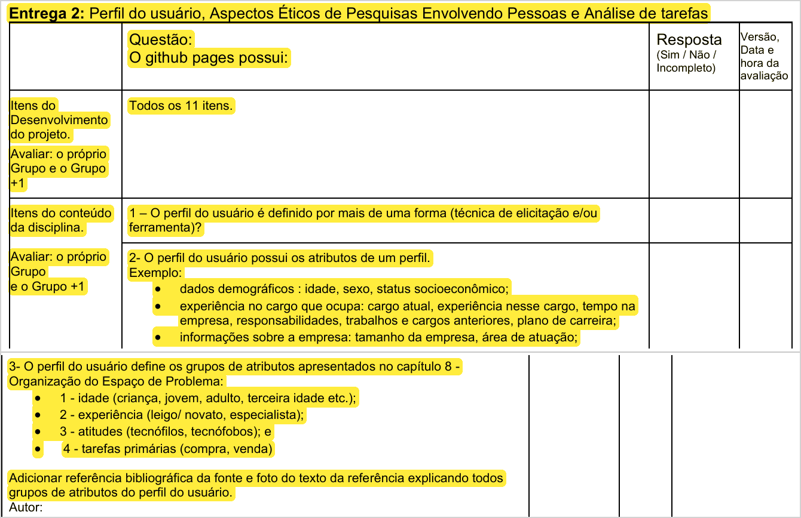

<em>Fonte: SALES (2026, Plano de Ensino, pp. 9–10). Itens que usam esta figura: C1, C2, C3.</em>

---

<strong>Figura 3</strong>: Técnicas para coletar dados e levantar requisitos dos usuários

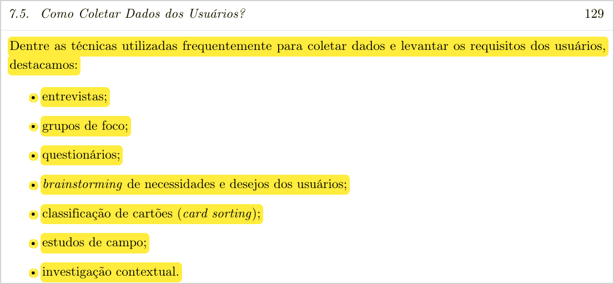

<em>Fonte: BARBOSA et al. (2021, p. 129). Itens que usam esta figura: C1, C8.</em>

---

<strong>Figura 4</strong>: Tipos de dados coletados sobre os usuários (Barbosa et al., 2021)

<em>Fonte: BARBOSA et al. (2021, pp. 123–124). Itens que usam esta figura: C2.</em>

---

<strong>Figura 5</strong>: Perfil de usuário: definição e grupos de atributos

<em>Fonte: BARBOSA et al. (2021, pp. 151–152). Itens que usam esta figura: C3.</em>

---

<strong>Figura 6</strong>: Itens de conteúdo 4 a 9 da Entrega 2 (ética, TCLE, técnicas de coleta e cenários)

<em>Fonte: SALES (2026, Plano de Ensino, p. 10). Itens que usam esta figura: C4, C5, C6, C7, C8.</em>

---

<strong>Figura 7</strong>: Confidencialidade dos dados e anonimato dos participantes

<em>Fonte: BARBOSA et al. (2021, p. 127). Itens que usam esta figura: C4.</em>

---

<strong>Figura 8</strong>: Os quatro princípios éticos (Resolução CNS nº 466/2012)

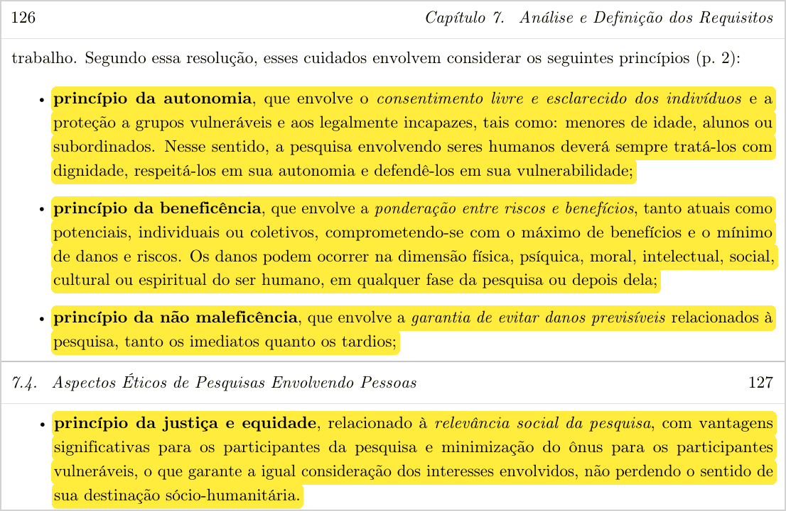

<em>Fonte: BARBOSA et al. (2021, pp. 126–127). Itens que usam esta figura: C5.</em>

---

<strong>Figura 9</strong>: Permissão para gravação e consentimento livre e esclarecido

<em>Fonte: BARBOSA et al. (2021, p. 127). Itens que usam esta figura: C6, C7.</em>

---

<strong>Figura 10</strong>: Itens de conteúdo 9 a 12 da Entrega 2 (cenários e análise de tarefas)

<em>Fonte: SALES (2026, Plano de Ensino, p. 11). Itens que usam esta figura: C9, C10, C11, C12.</em>

---

<strong>Figura 11</strong>: Cenários: definição, ator e objetivo principais

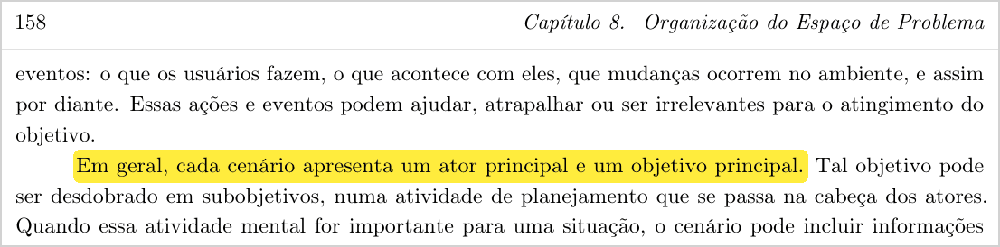

<em>Fonte: BARBOSA et al. (2021, p. 158). Itens que usam esta figura: C9.</em>

---

<strong>Figura 12</strong>: Métodos de análise de tarefas: HTA, GOMS e CTT

<em>Fonte: BARBOSA et al. (2021, p. 164). Itens que usam esta figura: C10, C12, G7.</em>

---

<strong>Figura 13</strong>: HTA: diagrama, representação em tabela e critério de parada

<em>Fonte: BARBOSA et al. (2021, pp. 165–166). Itens que usam esta figura: C11.</em>

---

<strong>Figura 14</strong>: GOMS: objetivos, operadores, métodos e regras de seleção

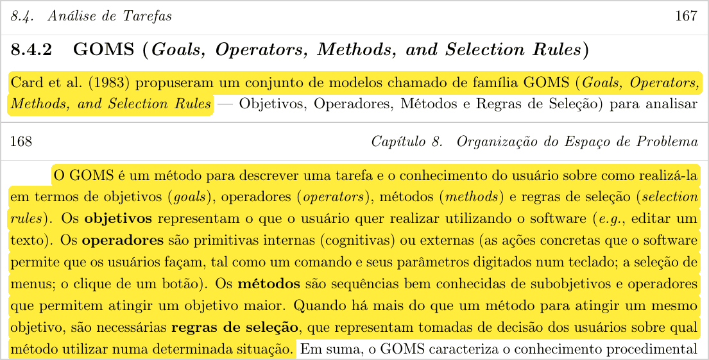

<em>Fonte: BARBOSA et al. (2021, pp. 167–168). Itens que usam esta figura: C11.</em>

---

<strong>Figura 15</strong>: CTT: tipos de tarefas e relações temporais

<em>Fonte: BARBOSA et al. (2021, p. 173). Itens que usam esta figura: C11.</em>

---

<strong>Figura 16</strong>: Usuários primários, secundários e stakeholders

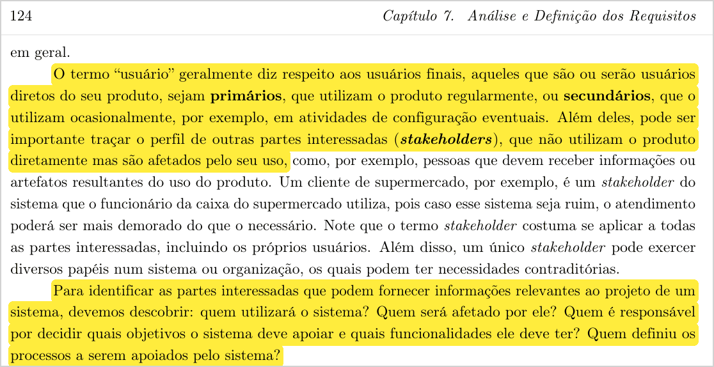

<em>Fonte: BARBOSA et al. (2021, p. 124). Itens que usam esta figura: G1.</em>

---

<strong>Figura 17</strong>: Direito de desistir do estudo e dados livres de viés

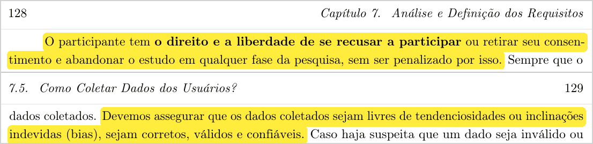

<em>Fonte: BARBOSA et al. (2021, pp. 128–129). Itens que usam esta figura: G2.</em>

---

<strong>Figura 18</strong>: Entrevistas: roteiro, perguntas abertas e fechadas, tipos de entrevista

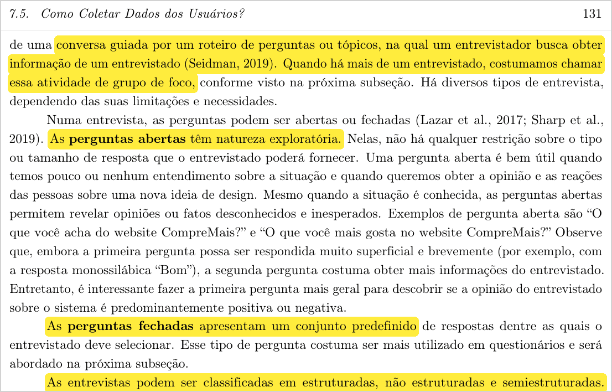

<em>Fonte: BARBOSA et al. (2021, p. 131). Itens que usam esta figura: G3, G4.</em>

---

<strong>Figura 19</strong>: Questionários: faixas de valores sem sobreposição e escalas Likert e de diferencial semântico

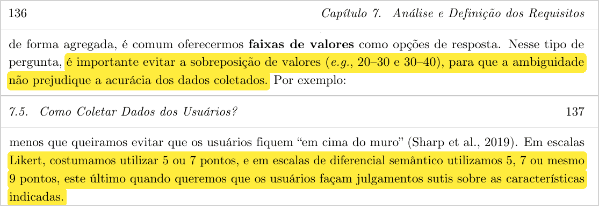

<em>Fonte: BARBOSA et al. (2021, pp. 136–137). Itens que usam esta figura: G4.</em>

---

<strong>Figura 20</strong>: Brainstorming: papel e lápis e sessão-piloto

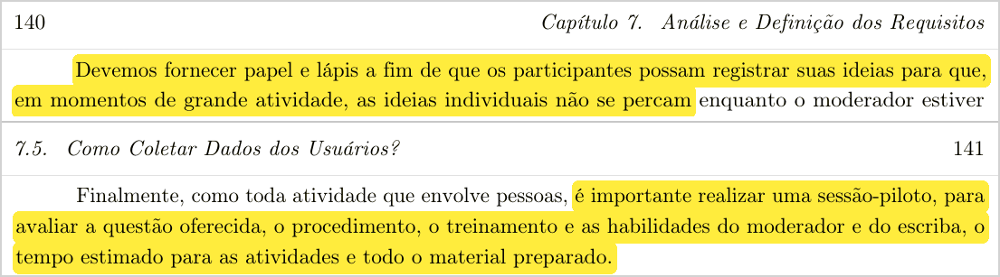

<em>Fonte: BARBOSA et al. (2021, pp. 140–141). Itens que usam esta figura: G5.</em>

---

<strong>Figura 21</strong>: Elenco de personas, persona primária e antipersonas

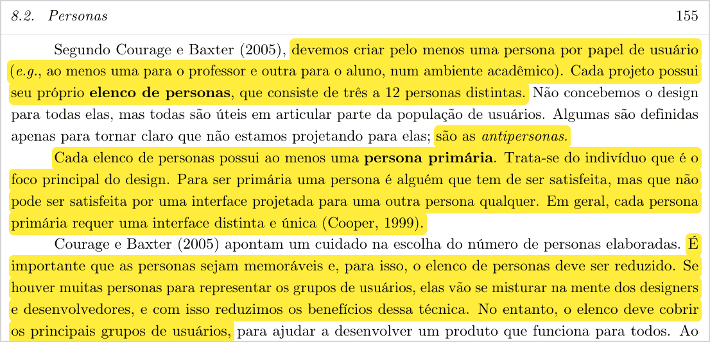

<em>Fonte: BARBOSA et al. (2021, p. 155). Itens que usam esta figura: G6.</em>

---

<strong>Figura 22</strong>: Elementos característicos de um cenário e uso de personas como atores

<em>Fonte: BARBOSA et al. (2021, p. 158). Itens que usam esta figura: G7.</em>

---

## Referências Bibliográficas

* BARBOSA, Simone Diniz Junqueira; SILVA, Bruno Santana da; SILVEIRA, Milene Selbach; GASPARINI, Isabela; DARIN, Ticianne; BARBOSA, Gabriel Diniz Junqueira. **Interação Humano-Computador e Experiência do Usuário**. Rio de Janeiro: Autopublicação, 2021. ISBN 978-65-00-19677-1. Versão de 03/05/2021.
* SALES, André Barros de. **Plano de Ensino: Interação Humano Computador: Turma 01**. Brasília: Universidade de Brasília, Faculdade UnB Gama, 2026. Disponível em: [plano de ensino (PDF)](../../assets/inspecoes/plano-de-ensino-ihc-2026-2-turma01-v1.pdf).
