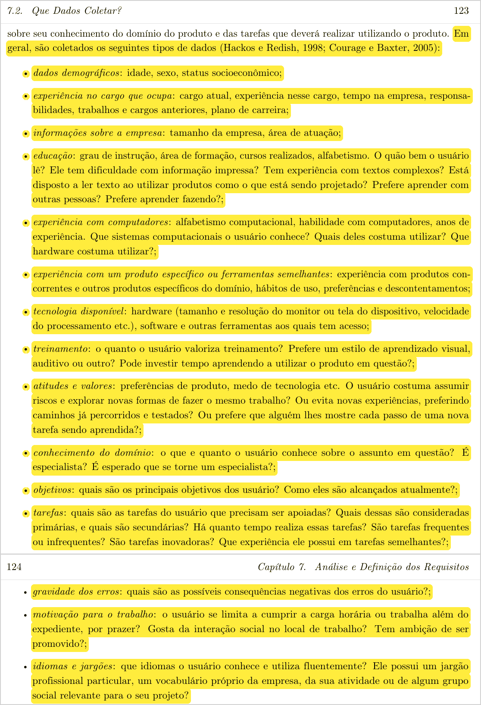
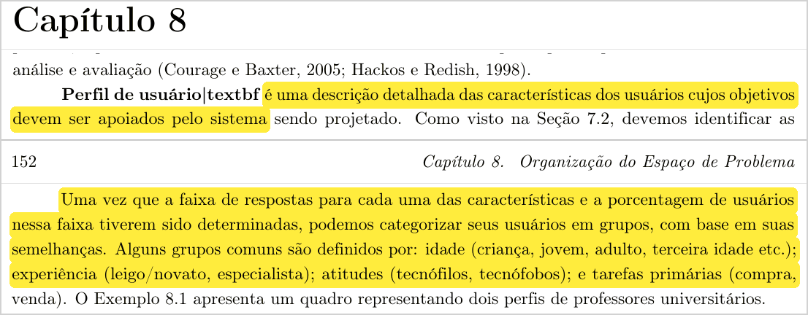
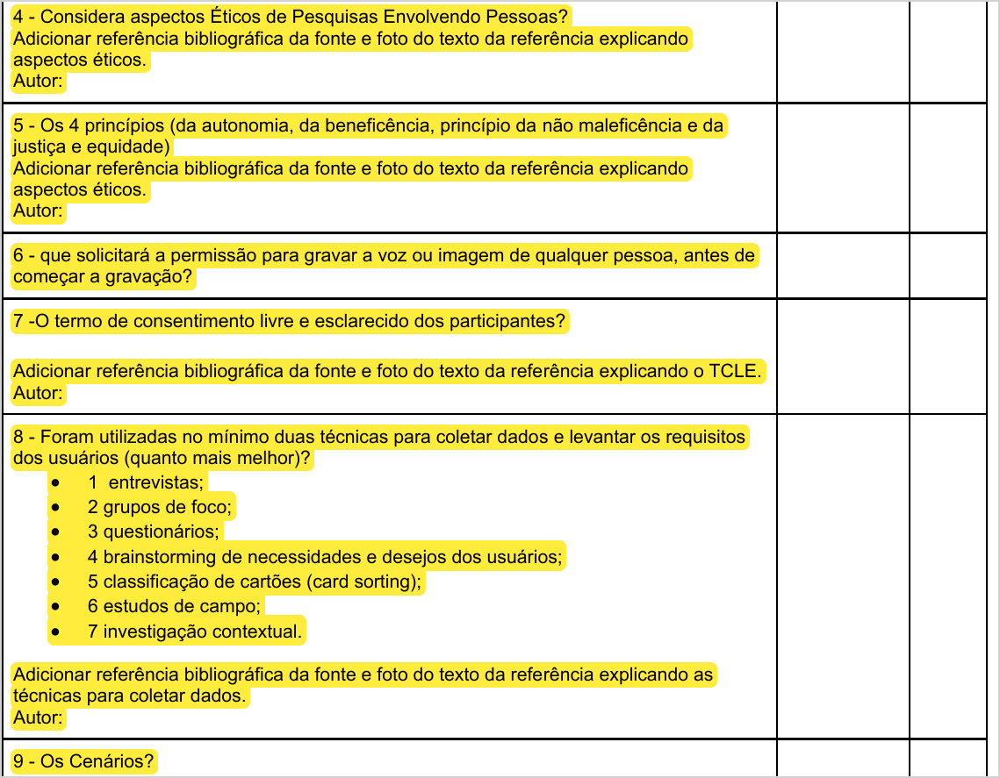
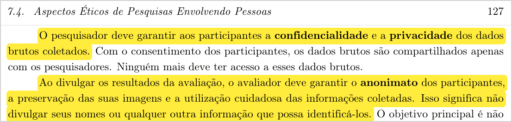
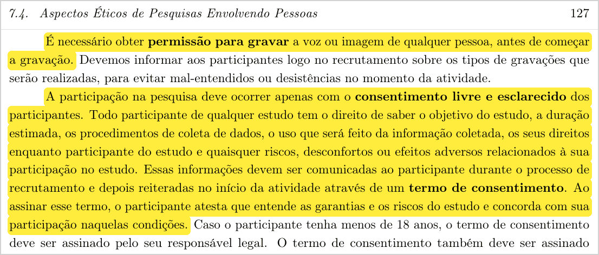
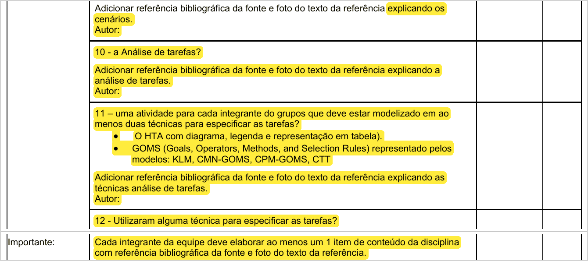
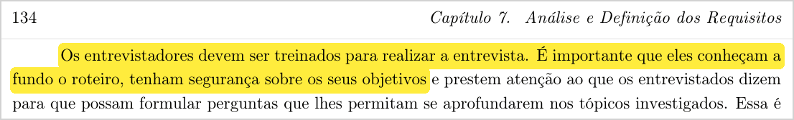
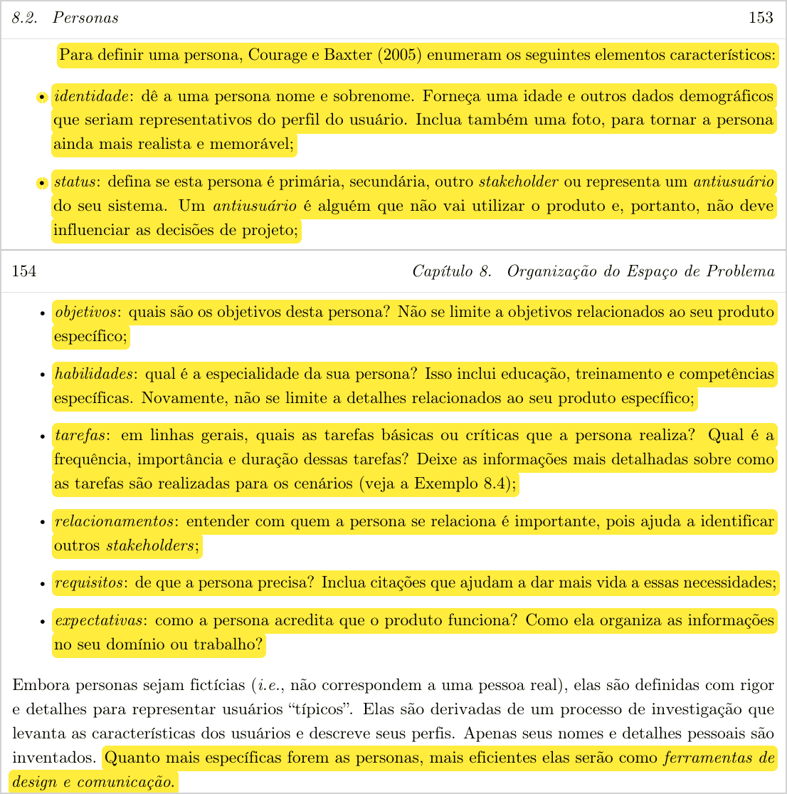
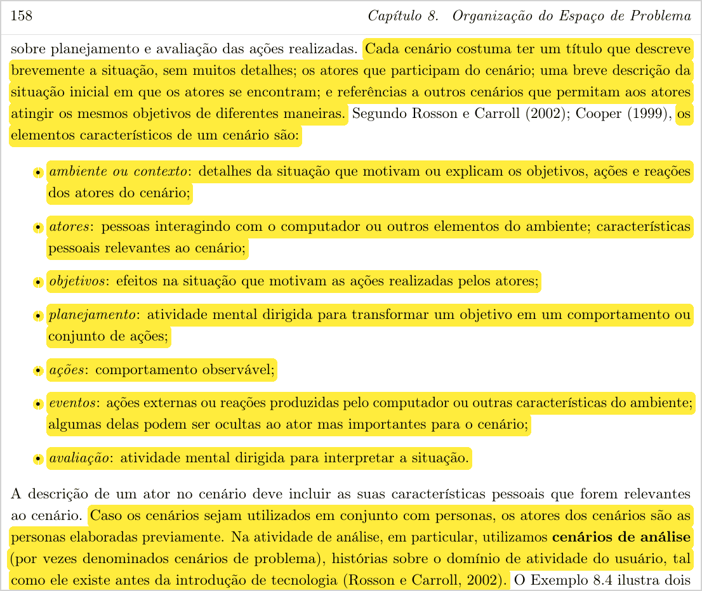

## Histórico de Versão e Contribuição

| Data | Versão | Descrição | Autor(es) | Revisor(es) | Declaração de Uso de IA |
| :---: | :---: | :--- | :--- | :--- | :--- |
| 26/09/2026 | `1.0` | Lista de verificação referente à entrega 2 (publicada em [verif2.md](../verif2.md)). | [Arthur Mariani](https://github.com/arthur-mariani) | [Carlos Costa](https://github.com/carloshfgit) | Claude (Anthropic) — uso declarado pelo autor (sem detalhamento da finalidade) |
| 19/11/2026 | `2.0` | Inclusão dos Itens do Desenvolvimento do Projeto e dos 12 itens de conteúdo do Plano de Ensino; autoria por item de acordo com o conteúdo; correção de itens; novos itens de cenários, GOMS e perfil; prints das referências. | [Gabriel Melo](https://github.com/gabriellcardone-06) | Pendente de revisão | Claude (Anthropic) — uso declarado pelo autor (sem detalhamento da finalidade) |
| 19/11/2026 | `2.1` | Padronização da estrutura (histórico no topo, conteúdo, fotos de referência e referências ao final); declaração de IA levada para o histórico. | [Gabriel Melo](https://github.com/gabriellcardone-06) | Pendente de revisão | Claude (Anthropic) — apoio na padronização da estrutura do artefato, na revisão das referências e na formatação em Markdown. |

!!! warning "Observação para correção manual"
    Há versões sem revisor no histórico. Indicar o revisor de cada versão.

---

# Lista de Verificação — Entrega 2 (versão 2.0)

!!! info "Versão 2.0 — rastreabilidade"
    Esta é a **versão 2.0** da lista. A versão 1.0 continua disponível, sem alterações de conteúdo, em [verif2.md](../verif2.md). O [índice das listas de verificação](../index.md) mostra onde está cada versão.

## Introdução

Esta lista verifica os artefatos da **Entrega 2: Perfil do usuário, Aspectos Éticos de Pesquisas Envolvendo Pessoas e Análise de Tarefas (com personas e cenários)**. A versão 1.0 tinha 79 itens, numerados de 1 a 79, sobre coleta de dados, ética, entrevistas, questionários, brainstorming, CTT, personas e HTA. Na versão 2.0 eles mantêm o mesmo número com o prefixo G (o item 23 da v1.0 é o G23), e os itens novos começam no G80. Os itens G1–G79 foram redigidos por Arthur Mariani na v1.0; agora cada um indica também o integrante responsável pelo conteúdo verificado.

Para cada item, quem avalia marca **Sim**, **Não** ou **Incompleto**, como no Plano de Ensino (SALES, 2026). Quando um item não se aplica ao artefato avaliado, escreva *N/A* na linha e explique em *Observações* no registro da avaliação. A coluna *Autor(es) do item* indica quem escreveu a pergunta e quem é responsável pelo conteúdo verificado. Nos itens do professor, a pergunta é de André Barros de Sales e o integrante indicado é quem produziu o conteúdo e a evidência. A coluna *Referência* leva ao print grifado da fonte, no fim da página. As páginas do livro são as páginas impressas do *IHC.pdf* (BARBOSA et al., 2021, versão de 03/05/2021).

Os itens estão organizados assim: primeiro os **Itens do Desenvolvimento do Projeto (D1–D11)**, que se repetem em todas as listas; depois os itens de conteúdo do professor (quando a entrega tem lista no Plano de Ensino); por fim, os itens de conteúdo elaborados pelo grupo (código G).

## 1. Itens do Desenvolvimento do Projeto

O Plano de Ensino define onze itens de desenvolvimento que valem para todos os artefatos (SALES, 2026, pp. 8–9). Eles aparecem primeiro em todas as listas do grupo, da Entrega 1 à Entrega 7 (veja a Tabela 1). Nas Entregas 3 e 4, o Plano fala em “Todos os 10 itens”, mas a lista do professor tem 11; por isso os 11 foram mantidos.

<strong>Tabela 1</strong> — Itens do Desenvolvimento do Projeto (Avaliar: o próprio grupo e o grupo +1)

| Código | Pergunta de verificação | Autor(es) do item | Referência | Sim | Não | Incompleto |
| :---: | :--- | :--- | :---: | :---: | :---: | :---: |
| D1 | O histórico de versão padronizado? | **Pergunta:** André Barros de Sales (Plano de Ensino) **Inclusão na lista:** [Gabriel Melo](https://github.com/gabriellcardone-06) | [Fig. 1](#figura-1) | ☐ | ☐ | ☐ |
| D2 | O(s) autor(es) e o(s) revisor(es) para cada artefato? | **Pergunta:** André Barros de Sales (Plano de Ensino) **Inclusão na lista:** [Gabriel Melo](https://github.com/gabriellcardone-06) | [Fig. 1](#figura-1) | ☐ | ☐ | ☐ |
| D3 | Referências bibliográficas e/ou bibliografia em todos os artefatos? | **Pergunta:** André Barros de Sales (Plano de Ensino) **Inclusão na lista:** [Gabriel Melo](https://github.com/gabriellcardone-06) | [Fig. 1](#figura-1) | ☐ | ☐ | ☐ |
| D4 | As tabelas e imagens possuem legenda e fonte e são chamadas dentro do texto? | **Pergunta:** André Barros de Sales (Plano de Ensino) **Inclusão na lista:** [Gabriel Melo](https://github.com/gabriellcardone-06) | [Fig. 1](#figura-1) | ☐ | ☐ | ☐ |
| D5 | Um texto fazendo uma introdução dos artefatos? | **Pergunta:** André Barros de Sales (Plano de Ensino) **Inclusão na lista:** [Gabriel Melo](https://github.com/gabriellcardone-06) | [Fig. 1](#figura-1) | ☐ | ☐ | ☐ |
| D6 | O cronograma executado com quem realizou cada artefato/atividade, com as datas de início e fim da construção/realização do artefato/atividade? | **Pergunta:** André Barros de Sales (Plano de Ensino) **Inclusão na lista:** [Gabriel Melo](https://github.com/gabriellcardone-06) | [Fig. 1](#figura-1) | ☐ | ☐ | ☐ |
| D7 | Ata(s) da(s) reunião(ões) (com data, horário de início e do final, participantes, objetivo, atividades definidas etc.)? | **Pergunta:** André Barros de Sales (Plano de Ensino) **Inclusão na lista:** [Gabriel Melo](https://github.com/gabriellcardone-06) | [Fig. 1](#figura-1) | ☐ | ☐ | ☐ |
| D8 | A gravação da reunião do grupo? | **Pergunta:** André Barros de Sales (Plano de Ensino) **Inclusão na lista:** [Gabriel Melo](https://github.com/gabriellcardone-06) | [Fig. 1](#figura-1) | ☐ | ☐ | ☐ |
| D9 | Vídeo de apresentação na categoria “não listado” no YouTube? | **Pergunta:** André Barros de Sales (Plano de Ensino) **Inclusão na lista:** [Gabriel Melo](https://github.com/gabriellcardone-06) | [Fig. 1](#figura-1) | ☐ | ☐ | ☐ |
| D10 | Tabela de contribuição no início do artefato com o nome de todos os integrantes, com a contribuição de cada integrante e hiperligação para a atividade e para a gravação, se houver? | **Pergunta:** André Barros de Sales (Plano de Ensino) **Inclusão na lista:** [Gabriel Melo](https://github.com/gabriellcardone-06) | [Fig. 1](#figura-1) | ☐ | ☐ | ☐ |
| D11 | A seção de agradecimentos apresentando o uso de Inteligência Artificial (IA) Generativa no artefato? | **Pergunta:** André Barros de Sales (Plano de Ensino) **Inclusão na lista:** [Gabriel Melo](https://github.com/gabriellcardone-06) | [Fig. 1](#figura-1) | ☐ | ☐ | ☐ |

<em>Fonte: SALES (2026, Plano de Ensino, pp. 8–9), lista de verificação sugerida — Itens do Desenvolvimento do projeto.</em>

## 2. Itens de conteúdo da disciplina (Plano de Ensino)

A Tabela 2 traz os 12 itens de conteúdo da Entrega 2 do Plano de Ensino. A versão 1.0 não tinha esses itens.

<strong>Tabela 2</strong> — Itens de conteúdo da Entrega 2 definidos pelo professor

| Código | Pergunta de verificação | Autor(es) do item | Referência | Sim | Não | Incompleto |
| :---: | :--- | :--- | :---: | :---: | :---: | :---: |
| C1 | O perfil do usuário é definido por mais de uma forma (técnica de elicitação e/ou ferramenta)? | **Pergunta:** André Barros de Sales (Plano de Ensino) **Conteúdo e evidência:** [Gabriel Melo](https://github.com/gabriellcardone-06) e [Rodrigo Carvalho](https://github.com/RodrigoCBarbosa) | [Fig. 2](#figura-2) [Fig. 3](#figura-3) | ☐ | ☐ | ☐ |
| C2 | O perfil do usuário possui os atributos de um perfil (dados demográficos; experiência no cargo; informações sobre a empresa; educação etc.), com referência e foto do texto da referência (Barbosa et al., 2021)? | **Pergunta:** André Barros de Sales (Plano de Ensino) **Conteúdo e evidência:** [Gabriel Melo](https://github.com/gabriellcardone-06) | [Fig. 2](#figura-2) [Fig. 4](#figura-4) | ☐ | ☐ | ☐ |
| C3 | O perfil do usuário define os grupos de atributos do capítulo 8 — Organização do Espaço de Problema: idade; experiência; atitudes; tarefas primárias? | **Pergunta:** André Barros de Sales (Plano de Ensino) **Conteúdo e evidência:** [Carlos Costa](https://github.com/carloshfgit) | [Fig. 2](#figura-2) [Fig. 5](#figura-5) | ☐ | ☐ | ☐ |
| C4 | Considera os aspectos éticos de pesquisas envolvendo pessoas? | **Pergunta:** André Barros de Sales (Plano de Ensino) **Conteúdo e evidência:** [Igor Dantas](https://github.com/IgorDARAUJO) | [Fig. 6](#figura-6) [Fig. 7](#figura-7) | ☐ | ☐ | ☐ |
| C5 | Apresenta os 4 princípios (da autonomia, da beneficência, da não maleficência e da justiça e equidade)? | **Pergunta:** André Barros de Sales (Plano de Ensino) **Conteúdo e evidência:** [Igor Dantas](https://github.com/IgorDARAUJO) | [Fig. 6](#figura-6) [Fig. 8](#figura-8) | ☐ | ☐ | ☐ |
| C6 | Informa que solicitará a permissão para gravar a voz ou a imagem de qualquer pessoa antes de começar a gravação? | **Pergunta:** André Barros de Sales (Plano de Ensino) **Conteúdo e evidência:** [Arthur Mariani](https://github.com/arthur-mariani) | [Fig. 6](#figura-6) [Fig. 9](#figura-9) | ☐ | ☐ | ☐ |
| C7 | Apresenta o termo de consentimento livre e esclarecido (TCLE) dos participantes? | **Pergunta:** André Barros de Sales (Plano de Ensino) **Conteúdo e evidência:** [Arthur Mariani](https://github.com/arthur-mariani) e [Igor Dantas](https://github.com/IgorDARAUJO) | [Fig. 6](#figura-6) [Fig. 9](#figura-9) | ☐ | ☐ | ☐ |
| C8 | Foram utilizadas no mínimo duas técnicas para coletar dados e levantar os requisitos dos usuários (entrevistas, grupos de foco, questionários, brainstorming, card sorting, estudos de campo, investigação contextual)? | **Pergunta:** André Barros de Sales (Plano de Ensino) **Conteúdo e evidência:** [Carlos Costa](https://github.com/carloshfgit) e [Lucas Araújo](https://github.com/Lucasaraujoszz) | [Fig. 6](#figura-6) [Fig. 3](#figura-3) | ☐ | ☐ | ☐ |
| C9 | Os cenários? | **Pergunta:** André Barros de Sales (Plano de Ensino) **Conteúdo e evidência:** [Igor Dantas](https://github.com/IgorDARAUJO) | [Fig. 10](#figura-10) [Fig. 11](#figura-11) | ☐ | ☐ | ☐ |
| C10 | A análise de tarefas? | **Pergunta:** André Barros de Sales (Plano de Ensino) **Conteúdo e evidência:** [Gabriel Melo](https://github.com/gabriellcardone-06) | [Fig. 10](#figura-10) [Fig. 12](#figura-12) | ☐ | ☐ | ☐ |
| C11 | Uma atividade para cada integrante do grupo, modelada em ao menos duas técnicas para especificar as tarefas (HTA com diagrama, legenda e representação em tabela; GOMS: KLM, CMN-GOMS, CPM-GOMS; CTT)? | **Pergunta:** André Barros de Sales (Plano de Ensino) **Conteúdo e evidência:** [Tomás Rocho](https://github.com/TomasRocho) | [Fig. 10](#figura-10) [Fig. 13](#figura-13) [Fig. 14](#figura-14) [Fig. 15](#figura-15) | ☐ | ☐ | ☐ |
| C12 | Utilizaram alguma técnica para especificar as tarefas? | **Pergunta:** André Barros de Sales (Plano de Ensino) **Conteúdo e evidência:** [Arthur Mariani](https://github.com/arthur-mariani) | [Fig. 10](#figura-10) [Fig. 12](#figura-12) | ☐ | ☐ | ☐ |

<em>Fonte: SALES (2026, Plano de Ensino, pp. 9–11); referências do conteúdo em BARBOSA et al. (2021).</em>

## 3. Itens de conteúdo elaborados pelo grupo

As seções 3.1 a 3.12 trazem os itens do grupo. As referências estão nos capítulos 7 e 8 de Barbosa et al. (2021).

### 3.1 Que dados coletar (perfil de usuário)

Os itens desta seção estão na Tabela 3.

<strong>Tabela 3</strong> — Que dados coletar (perfil de usuário)

| Código | Pergunta de verificação | Autor(es) do item | Referência | Sim | Não | Incompleto |
| :---: | :--- | :--- | :---: | :---: | :---: | :---: |
| G1 | Foram coletados dados demográficos, como idade, sexo e status socioeconômico? | [Gabriel Melo](https://github.com/gabriellcardone-06) | [Fig. 4](#figura-4) | ☐ | ☐ | ☐ |
| G2 | Foram coletados dados sobre a experiência no cargo atual, como cargo, experiência, tempo na organização, responsabilidades, cargos anteriores e plano de carreira? | [Gabriel Melo](https://github.com/gabriellcardone-06) | [Fig. 4](#figura-4) | ☐ | ☐ | ☐ |
| G3 | Foram coletados dados sobre a organização, como tamanho e área de atuação? | [Gabriel Melo](https://github.com/gabriellcardone-06) | [Fig. 4](#figura-4) | ☐ | ☐ | ☐ |
| G4 | Foram coletados dados sobre educação, incluindo formação, cursos, alfabetismo, leitura, experiência com textos complexos e preferências de aprendizagem? | [Gabriel Melo](https://github.com/gabriellcardone-06) | [Fig. 4](#figura-4) | ☐ | ☐ | ☐ |
| G5 | Foram coletados dados sobre a experiência do usuário com computadores, como alfabetismo computacional, habilidade, anos de experiência, sistemas e hardware utilizados? | [Gabriel Melo](https://github.com/gabriellcardone-06) | [Fig. 4](#figura-4) | ☐ | ☐ | ☐ |
| G6 | Foram coletados dados sobre a experiência com o produto específico ou ferramentas semelhantes, incluindo produtos concorrentes, hábitos de uso, preferências e descontentamentos? | [Rodrigo Carvalho](https://github.com/RodrigoCBarbosa) | [Fig. 4](#figura-4) | ☐ | ☐ | ☐ |
| G7 | Foram coletados dados sobre a tecnologia disponível ao usuário, como hardware, software e outras ferramentas às quais tem acesso? | [Rodrigo Carvalho](https://github.com/RodrigoCBarbosa) | [Fig. 4](#figura-4) | ☐ | ☐ | ☐ |
| G8 | Foram coletados dados sobre o treinamento do usuário, suas preferências de aprendizagem e o tempo que pode investir para aprender a utilizar o produto? | [Rodrigo Carvalho](https://github.com/RodrigoCBarbosa) | [Fig. 4](#figura-4) | ☐ | ☐ | ☐ |
| G9 | Foram coletados dados sobre atitudes e valores do usuário, como disposição para assumir riscos, explorar alternativas e aprender novas tarefas? | [Rodrigo Carvalho](https://github.com/RodrigoCBarbosa) | [Fig. 4](#figura-4) | ☐ | ☐ | ☐ |
| G10 | Foram coletados dados sobre o conhecimento do usuário no domínio, incluindo o que conhece, seu nível de especialização e a expectativa de se tornar especialista? | [Rodrigo Carvalho](https://github.com/RodrigoCBarbosa) | [Fig. 4](#figura-4) | ☐ | ☐ | ☐ |
| G11 | Foram coletados dados sobre os objetivos do usuário e como eles são alcançados atualmente? | [Carlos Costa](https://github.com/carloshfgit) | [Fig. 4](#figura-4) | ☐ | ☐ | ☐ |
| G12 | Foram coletados dados sobre as tarefas do usuário, incluindo tarefas apoiadas, primárias e secundárias, frequência, inovação e experiência com tarefas semelhantes? | [Carlos Costa](https://github.com/carloshfgit) | [Fig. 4](#figura-4) | ☐ | ☐ | ☐ |
| G13 | Foram coletados dados sobre a gravidade dos erros e suas possíveis consequências para o usuário? | [Carlos Costa](https://github.com/carloshfgit) | [Fig. 4](#figura-4) | ☐ | ☐ | ☐ |
| G14 | Foram coletados dados sobre a motivação para o trabalho, como carga horária, prazer, interação social e ambição de promoção? | [Carlos Costa](https://github.com/carloshfgit) | [Fig. 4](#figura-4) | ☐ | ☐ | ☐ |
| G15 | Foram coletados dados sobre idiomas e jargões usados pelo usuário, pela organização, pela atividade ou por grupos sociais relevantes? | [Carlos Costa](https://github.com/carloshfgit) | [Fig. 4](#figura-4) | ☐ | ☐ | ☐ |

<em>Fonte: itens G1–G79: Arthur Mariani (2026, v1.0), revisados e com autoria por conteúdo na v2.0; itens G80–G87: Grupo 05 (2026). Base: BARBOSA et al. (2021).</em>

### 3.2 De quem coletar dados

Os itens desta seção estão na Tabela 4.

<strong>Tabela 4</strong> — De quem coletar dados

| Código | Pergunta de verificação | Autor(es) do item | Referência | Sim | Não | Incompleto |
| :---: | :--- | :--- | :---: | :---: | :---: | :---: |
| G16 | Os dados foram coletados identificando o tipo de usuário: primário, secundário e demais stakeholders? | [Gabriel Melo](https://github.com/gabriellcardone-06) | [Fig. 16](#figura-16) | ☐ | ☐ | ☐ |
| G17 | Foram identificados todos os stakeholders afetados pelo sistema, e não apenas os usuários finais? | [Gabriel Melo](https://github.com/gabriellcardone-06) | [Fig. 16](#figura-16) | ☐ | ☐ | ☐ |
| G18 | Foi feito o mapeamento das diferenças entre usuários primários e usuários secundários? | [Gabriel Melo](https://github.com/gabriellcardone-06) | [Fig. 16](#figura-16) | ☐ | ☐ | ☐ |
| G19 | A equipe considerou uma análise competitiva de IHC para mapear pontos fortes e fracos de produtos concorrentes ou substitutos? | [Gabriel Melo](https://github.com/gabriellcardone-06) | [Fig. 17](#figura-17) | ☐ | ☐ | ☐ |
| G20 | Foram consideradas as limitações do uso de arquivos de log para evitar conclusões equivocadas sobre tempo de uso e conclusão de objetivos? | [Gabriel Melo](https://github.com/gabriellcardone-06) | [Fig. 17](#figura-17) | ☐ | ☐ | ☐ |

<em>Fonte: itens G1–G79: Arthur Mariani (2026, v1.0), revisados e com autoria por conteúdo na v2.0; itens G80–G87: Grupo 05 (2026). Base: BARBOSA et al. (2021).</em>

### 3.3 Aspectos éticos de pesquisas envolvendo pessoas

Os itens desta seção estão na Tabela 5.

<strong>Tabela 5</strong> — Aspectos éticos de pesquisas envolvendo pessoas

| Código | Pergunta de verificação | Autor(es) do item | Referência | Sim | Não | Incompleto |
| :---: | :--- | :--- | :---: | :---: | :---: | :---: |
| G21 | Os participantes assinaram o Termo de Consentimento Livre e Esclarecido (TCLE), com uma via para o participante e outra para o pesquisador? | [Igor Dantas](https://github.com/IgorDARAUJO) | [Fig. 9](#figura-9) | ☐ | ☐ | ☐ |
| G22 | Foram garantidos o anonimato dos participantes e a confidencialidade dos dados brutos coletados? | [Igor Dantas](https://github.com/IgorDARAUJO) | [Fig. 7](#figura-7) | ☐ | ☐ | ☐ |
| G23 | A pesquisa respeita o princípio da autonomia, permitindo que o participante decida participar, interromper ou abandonar o estudo sem penalidades? | [Arthur Mariani](https://github.com/arthur-mariani) | [Fig. 8](#figura-8) [Fig. 18](#figura-18) | ☐ | ☐ | ☐ |
| G24 | Foram evitadas perguntas ou condutas que possam induzir viés nas respostas dos participantes? | [Arthur Mariani](https://github.com/arthur-mariani) | [Fig. 18](#figura-18) | ☐ | ☐ | ☐ |
| G25 | A pesquisa ponderou riscos e benefícios, maximizando os benefícios e minimizando possíveis danos aos participantes (princípio da beneficência)? | [Igor Dantas](https://github.com/IgorDARAUJO) | [Fig. 8](#figura-8) | ☐ | ☐ | ☐ |

<em>Fonte: itens G1–G79: Arthur Mariani (2026, v1.0), revisados e com autoria por conteúdo na v2.0; itens G80–G87: Grupo 05 (2026). Base: BARBOSA et al. (2021).</em>

### 3.4 Técnica de entrevista

Os itens desta seção estão na Tabela 6.

<strong>Tabela 6</strong> — Técnica de entrevista

| Código | Pergunta de verificação | Autor(es) do item | Referência | Sim | Não | Incompleto |
| :---: | :--- | :--- | :---: | :---: | :---: | :---: |
| G26 | A pesquisa apresenta um roteiro para a entrevista? | [Carlos Costa](https://github.com/carloshfgit) | [Fig. 19](#figura-19) | ☐ | ☐ | ☐ |
| G27 | A pesquisa especifica se a entrevista utiliza perguntas abertas ou fechadas? | [Carlos Costa](https://github.com/carloshfgit) | [Fig. 19](#figura-19) | ☐ | ☐ | ☐ |
| G28 | A pesquisa especifica se a entrevista é estruturada, não estruturada ou semiestruturada? | [Carlos Costa](https://github.com/carloshfgit) | [Fig. 19](#figura-19) | ☐ | ☐ | ☐ |
| G29 | A entrevista é realizada individualmente com o participante (com mais de um entrevistado, a técnica passa a ser grupo de foco)? | [Carlos Costa](https://github.com/carloshfgit) | [Fig. 19](#figura-19) | ☐ | ☐ | ☐ |
| G30 | A pesquisa especifica se o entrevistador recebeu treinamento antes de realizar a entrevista? | [Carlos Costa](https://github.com/carloshfgit) | [Fig. 20](#figura-20) | ☐ | ☐ | ☐ |

<em>Fonte: itens G1–G79: Arthur Mariani (2026, v1.0), revisados e com autoria por conteúdo na v2.0; itens G80–G87: Grupo 05 (2026). Base: BARBOSA et al. (2021).</em>

### 3.5 Técnica de questionários

Os itens desta seção estão na Tabela 7.

<strong>Tabela 7</strong> — Técnica de questionários

| Código | Pergunta de verificação | Autor(es) do item | Referência | Sim | Não | Incompleto |
| :---: | :--- | :--- | :---: | :---: | :---: | :---: |
| G31 | O questionário priorizou perguntas fechadas, sem excesso de perguntas abertas que possa reduzir o interesse e a taxa de resposta? | [Rodrigo Carvalho](https://github.com/RodrigoCBarbosa) | [Fig. 19](#figura-19) [Fig. 21](#figura-21) | ☐ | ☐ | ☐ |
| G32 | A escala de Likert foi utilizada de forma clara e sem ambiguidades (em geral com 5 ou 7 pontos)? | [Rodrigo Carvalho](https://github.com/RodrigoCBarbosa) | [Fig. 21](#figura-21) | ☐ | ☐ | ☐ |
| G33 | As opções de adjetivos opostos foram bem definidas ao aplicar uma escala de diferencial semântico? | [Rodrigo Carvalho](https://github.com/RodrigoCBarbosa) | [Fig. 21](#figura-21) | ☐ | ☐ | ☐ |
| G34 | As faixas de valores foram elaboradas sem sobreposição de números e sem gerar dúvidas no respondente? | [Rodrigo Carvalho](https://github.com/RodrigoCBarbosa) | [Fig. 21](#figura-21) | ☐ | ☐ | ☐ |

<em>Fonte: itens G1–G79: Arthur Mariani (2026, v1.0), revisados e com autoria por conteúdo na v2.0; itens G80–G87: Grupo 05 (2026). Base: BARBOSA et al. (2021).</em>

### 3.6 Técnica de brainstorming

Os itens desta seção estão na Tabela 8.

<strong>Tabela 8</strong> — Técnica de brainstorming

| Código | Pergunta de verificação | Autor(es) do item | Referência | Sim | Não | Incompleto |
| :---: | :--- | :--- | :---: | :---: | :---: | :---: |
| G35 | A sessão de brainstorming contou com 8 a 12 participantes? | [Lucas Araújo](https://github.com/Lucasaraujoszz) | [Fig. 22](#figura-22) | ☐ | ☐ | ☐ |
| G36 | A sessão teve um moderador previamente definido? | [Lucas Araújo](https://github.com/Lucasaraujoszz) | [Fig. 22](#figura-22) | ☐ | ☐ | ☐ |
| G37 | A sessão contou com um secretário responsável por documentar o encontro? | [Lucas Araújo](https://github.com/Lucasaraujoszz) | [Fig. 22](#figura-22) | ☐ | ☐ | ☐ |
| G38 | Foi realizada uma sessão-piloto para testar a pergunta, o procedimento, a moderação e o tempo previsto? | [Lucas Araújo](https://github.com/Lucasaraujoszz) | [Fig. 23](#figura-23) | ☐ | ☐ | ☐ |
| G39 | O moderador manteve o foco no objetivo da sessão, sem oferecer opiniões próprias nem influenciar as respostas dos participantes? | [Arthur Mariani](https://github.com/arthur-mariani) | [Fig. 22](#figura-22) | ☐ | ☐ | ☐ |
| G40 | A sessão foi iniciada com uma pergunta focada no sistema ideal, sem limitar os participantes às tecnologias atuais? | [Arthur Mariani](https://github.com/arthur-mariani) | [Fig. 22](#figura-22) | ☐ | ☐ | ☐ |
| G41 | Os participantes selecionados possuíam perfil semelhante, com sessões separadas quando havia mais de um perfil? | [Arthur Mariani](https://github.com/arthur-mariani) | [Fig. 22](#figura-22) | ☐ | ☐ | ☐ |
| G42 | Foram fornecidos papel e lápis para que os participantes registrassem suas ideias durante a discussão? | [Arthur Mariani](https://github.com/arthur-mariani) | [Fig. 23](#figura-23) | ☐ | ☐ | ☐ |

<em>Fonte: itens G1–G79: Arthur Mariani (2026, v1.0), revisados e com autoria por conteúdo na v2.0; itens G80–G87: Grupo 05 (2026). Base: BARBOSA et al. (2021).</em>

### 3.7 Árvores de Tarefas Concorrentes (CTT)

Os itens desta seção estão na Tabela 9.

<strong>Tabela 9</strong> — Árvores de Tarefas Concorrentes (CTT)

| Código | Pergunta de verificação | Autor(es) do item | Referência | Sim | Não | Incompleto |
| :---: | :--- | :--- | :---: | :---: | :---: | :---: |
| G43 | As tarefas foram classificadas como do usuário, do sistema, interativas ou abstratas? | [Igor Dantas](https://github.com/IgorDARAUJO) | [Fig. 15](#figura-15) | ☐ | ☐ | ☐ |
| G44 | A decomposição hierárquica está coerente entre tarefas superiores e subordinadas? | [Igor Dantas](https://github.com/IgorDARAUJO) | [Fig. 15](#figura-15) | ☐ | ☐ | ☐ |
| G45 | As relações de ativação (>>) indicam corretamente quando uma tarefa depende do término de outra? | [Gabriel Melo](https://github.com/gabriellcardone-06) | [Fig. 15](#figura-15) | ☐ | ☐ | ☐ |
| G46 | Dependências de informação entre tarefas foram representadas com ativação com passagem de informação ([]>>)? | [Gabriel Melo](https://github.com/gabriellcardone-06) | [Fig. 15](#figura-15) | ☐ | ☐ | ☐ |
| G47 | As escolhas entre tarefas alternativas ([]) foram representadas corretamente? | [Carlos Costa](https://github.com/carloshfgit) | [Fig. 15](#figura-15) | ☐ | ☐ | ☐ |
| G48 | Tarefas simultâneas ou realizáveis em qualquer ordem foram identificadas como concorrentes (|||)? | [Carlos Costa](https://github.com/carloshfgit) | [Fig. 15](#figura-15) | ☐ | ☐ | ☐ |
| G49 | A comunicação entre tarefas concorrentes (|[]|) foi explicitamente representada quando necessária? | [Arthur Mariani](https://github.com/arthur-mariani) | [Fig. 15](#figura-15) | ☐ | ☐ | ☐ |
| G50 | As tarefas independentes (|=|) permitem execução em qualquer ordem, mas sem sobreposição? | [Arthur Mariani](https://github.com/arthur-mariani) | [Fig. 15](#figura-15) | ☐ | ☐ | ☐ |
| G51 | As relações de interrupção distinguem desativação ([>) de suspensão e retomada (|>)? | [Tomás Rocho](https://github.com/TomasRocho) | [Fig. 15](#figura-15) | ☐ | ☐ | ☐ |
| G52 | O artefato reconhece que o CTT não representa mecanismos de prevenção e tratamento de erros e, quando necessário, trata esses casos de outra forma? | [Tomás Rocho](https://github.com/TomasRocho) | [Fig. 24](#figura-24) | ☐ | ☐ | ☐ |

<em>Fonte: itens G1–G79: Arthur Mariani (2026, v1.0), revisados e com autoria por conteúdo na v2.0; itens G80–G87: Grupo 05 (2026). Base: BARBOSA et al. (2021).</em>

### 3.8 Elenco de personas

Os itens desta seção estão na Tabela 10.

<strong>Tabela 10</strong> — Elenco de personas

| Código | Pergunta de verificação | Autor(es) do item | Referência | Sim | Não | Incompleto |
| :---: | :--- | :--- | :---: | :---: | :---: | :---: |
| G53 | Há ao menos uma persona para cada papel de usuário relevante? | [Igor Dantas](https://github.com/IgorDARAUJO) | [Fig. 25](#figura-25) | ☐ | ☐ | ☐ |
| G54 | Há ao menos uma persona primária, foco principal das decisões de design? | [Igor Dantas](https://github.com/IgorDARAUJO) | [Fig. 25](#figura-25) | ☐ | ☐ | ☐ |
| G55 | Cada persona primária tem necessidades que não seriam satisfeitas por uma interface projetada para outra persona? | [Igor Dantas](https://github.com/IgorDARAUJO) | [Fig. 25](#figura-25) | ☐ | ☐ | ☐ |
| G56 | O número de personas é reduzido o suficiente para que sejam memoráveis e diferenciadas? | [Gabriel Melo](https://github.com/gabriellcardone-06) | [Fig. 25](#figura-25) | ☐ | ☐ | ☐ |
| G57 | O elenco cobre os principais grupos de usuários? | [Gabriel Melo](https://github.com/gabriellcardone-06) | [Fig. 25](#figura-25) | ☐ | ☐ | ☐ |
| G58 | O elenco tem de três a 12 personas, suficientemente distintas entre si? | [Gabriel Melo](https://github.com/gabriellcardone-06) | [Fig. 25](#figura-25) | ☐ | ☐ | ☐ |
| G59 | Foram incluídas antipersonas quando necessário? | [Gabriel Melo](https://github.com/gabriellcardone-06) | [Fig. 25](#figura-25) | ☐ | ☐ | ☐ |

<em>Fonte: itens G1–G79: Arthur Mariani (2026, v1.0), revisados e com autoria por conteúdo na v2.0; itens G80–G87: Grupo 05 (2026). Base: BARBOSA et al. (2021).</em>

### 3.9 Análise Hierárquica de Tarefas (HTA)

Os itens desta seção estão na Tabela 11.

<strong>Tabela 11</strong> — Análise Hierárquica de Tarefas (HTA)

| Código | Pergunta de verificação | Autor(es) do item | Referência | Sim | Não | Incompleto |
| :---: | :--- | :--- | :---: | :---: | :---: | :---: |
| G60 | Os objetivos principais foram identificados antes das ações? | [Rodrigo Carvalho](https://github.com/RodrigoCBarbosa) | [Fig. 26](#figura-26) | ☐ | ☐ | ☐ |
| G61 | Objetivos de alto nível foram decompostos hierarquicamente em subobjetivos? | [Rodrigo Carvalho](https://github.com/RodrigoCBarbosa) | [Fig. 26](#figura-26) | ☐ | ☐ | ☐ |
| G62 | Os planos definem os subobjetivos e a ordem de realização (sequência 1>2, seleção 1/2 ou paralelo 1+2)? | [Rodrigo Carvalho](https://github.com/RodrigoCBarbosa) | [Fig. 26](#figura-26) | ☐ | ☐ | ☐ |
| G63 | As operações de mais baixo nível descrevem input, ações e feedback? | [Lucas Araújo](https://github.com/Lucasaraujoszz) | [Fig. 26](#figura-26) [Fig. 27](#figura-27) | ☐ | ☐ | ☐ |
| G64 | Os subobjetivos são mutuamente exclusivos e exaustivos? | [Lucas Araújo](https://github.com/Lucasaraujoszz) | [Fig. 27](#figura-27) | ☐ | ☐ | ☐ |
| G65 | Problemas e dificuldades potenciais foram identificados, com recomendações para evitá-los? | [Lucas Araújo](https://github.com/Lucasaraujoszz) | [Fig. 26](#figura-26) | ☐ | ☐ | ☐ |
| G66 | Há critério para interromper a decomposição da tarefa (por exemplo, o critério p × c)? | [Tomás Rocho](https://github.com/TomasRocho) | [Fig. 13](#figura-13) | ☐ | ☐ | ☐ |
| G67 | A decomposição foi validada com as partes interessadas? | [Tomás Rocho](https://github.com/TomasRocho) | [Fig. 27](#figura-27) | ☐ | ☐ | ☐ |

<em>Fonte: itens G1–G79: Arthur Mariani (2026, v1.0), revisados e com autoria por conteúdo na v2.0; itens G80–G87: Grupo 05 (2026). Base: BARBOSA et al. (2021).</em>

### 3.10 Personas

Os itens desta seção estão na Tabela 12.

<strong>Tabela 12</strong> — Personas

| Código | Pergunta de verificação | Autor(es) do item | Referência | Sim | Não | Incompleto |
| :---: | :--- | :--- | :---: | :---: | :---: | :---: |
| G68 | A persona possui identidade clara (nome, sobrenome, idade, dados demográficos) e, quando possível, foto? | [Gabriel Melo](https://github.com/gabriellcardone-06) | [Fig. 28](#figura-28) | ☐ | ☐ | ☐ |
| G69 | A persona representa características de usuários reais, levantadas na investigação? | [Gabriel Melo](https://github.com/gabriellcardone-06) | [Fig. 28](#figura-28) | ☐ | ☐ | ☐ |
| G70 | O status da persona foi definido como primária, secundária, outro stakeholder ou antiusuário? | [Carlos Costa](https://github.com/carloshfgit) | [Fig. 28](#figura-28) | ☐ | ☐ | ☐ |
| G71 | Os objetivos da persona estão claramente identificados? | [Carlos Costa](https://github.com/carloshfgit) | [Fig. 28](#figura-28) | ☐ | ☐ | ☐ |
| G72 | Objetivos e tarefas foram diferenciados? | [Lucas Araújo](https://github.com/Lucasaraujoszz) | [Fig. 28](#figura-28) | ☐ | ☐ | ☐ |
| G73 | Formação, experiência, treinamento e competências foram descritos? | [Lucas Araújo](https://github.com/Lucasaraujoszz) | [Fig. 28](#figura-28) | ☐ | ☐ | ☐ |
| G74 | As principais tarefas, frequência, importância e duração foram identificadas? | [Arthur Mariani](https://github.com/arthur-mariani) | [Fig. 28](#figura-28) | ☐ | ☐ | ☐ |
| G75 | Os relacionamentos com pessoas, grupos ou stakeholders foram identificados? | [Arthur Mariani](https://github.com/arthur-mariani) | [Fig. 28](#figura-28) | ☐ | ☐ | ☐ |
| G76 | Os requisitos da persona foram registrados, com citações que dão vida às necessidades? | [Rodrigo Carvalho](https://github.com/RodrigoCBarbosa) | [Fig. 28](#figura-28) | ☐ | ☐ | ☐ |
| G77 | As expectativas da persona sobre o sistema foram identificadas? | [Rodrigo Carvalho](https://github.com/RodrigoCBarbosa) | [Fig. 28](#figura-28) | ☐ | ☐ | ☐ |
| G78 | A persona é específica o suficiente para orientar decisões de design? | [Tomás Rocho](https://github.com/TomasRocho) | [Fig. 28](#figura-28) | ☐ | ☐ | ☐ |
| G79 | O conjunto de personas é pequeno, memorável e cobre os grupos principais? | [Tomás Rocho](https://github.com/TomasRocho) | [Fig. 25](#figura-25) | ☐ | ☐ | ☐ |

<em>Fonte: itens G1–G79: Arthur Mariani (2026, v1.0), revisados e com autoria por conteúdo na v2.0; itens G80–G87: Grupo 05 (2026). Base: BARBOSA et al. (2021).</em>

### 3.11 Cenários (itens novos)

Os itens desta seção estão na Tabela 13.

<strong>Tabela 13</strong> — Cenários (itens novos)

| Código | Pergunta de verificação | Autor(es) do item | Referência | Sim | Não | Incompleto |
| :---: | :--- | :--- | :---: | :---: | :---: | :---: |
| G80 | Cada cenário apresenta um ator principal e um objetivo principal? | [Igor Dantas](https://github.com/IgorDARAUJO) | [Fig. 11](#figura-11) | ☐ | ☐ | ☐ |
| G81 | Os atores dos cenários são as personas elaboradas previamente? | [Gabriel Melo](https://github.com/gabriellcardone-06) | [Fig. 29](#figura-29) | ☐ | ☐ | ☐ |
| G82 | Cada cenário tem título, atores, descrição da situação inicial e, quando houver, referência a outros cenários com o mesmo objetivo? | [Lucas Araújo](https://github.com/Lucasaraujoszz) | [Fig. 29](#figura-29) | ☐ | ☐ | ☐ |
| G83 | Os cenários contemplam os elementos característicos: ambiente ou contexto, atores, objetivos, planejamento, ações, eventos e avaliação? | [Carlos Costa](https://github.com/carloshfgit) | [Fig. 29](#figura-29) | ☐ | ☐ | ☐ |
| G84 | Os cenários de análise (de problema) descrevem a atividade do usuário como ela existe antes da introdução da nova tecnologia? | [Rodrigo Carvalho](https://github.com/RodrigoCBarbosa) | [Fig. 29](#figura-29) | ☐ | ☐ | ☐ |

<em>Fonte: elaborado pelo Grupo 05 (2026), com base em BARBOSA et al. (2021).</em>

### 3.12 GOMS, perfil e rastreabilidade das tarefas (itens novos)

Os itens desta seção estão na Tabela 14.

<strong>Tabela 14</strong> — GOMS, perfil e rastreabilidade das tarefas (itens novos)

| Código | Pergunta de verificação | Autor(es) do item | Referência | Sim | Não | Incompleto |
| :---: | :--- | :--- | :---: | :---: | :---: | :---: |
| G85 | Quando o GOMS (ou o KLM) é utilizado, o modelo identifica objetivos, operadores e métodos e apresenta regras de seleção quando há mais de um método para o mesmo objetivo? | [Rodrigo Carvalho](https://github.com/RodrigoCBarbosa) | [Fig. 14](#figura-14) | ☐ | ☐ | ☐ |
| G86 | O perfil apresenta, para as características levantadas, a faixa de respostas e a proporção de usuários em cada faixa, agrupando os usuários por semelhança? | [Gabriel Melo](https://github.com/gabriellcardone-06) | [Fig. 5](#figura-5) | ☐ | ☐ | ☐ |
| G87 | Cada persona e cada cenário estão ligados a uma análise de tarefa (TAR) correspondente, de modo que a atividade de cada integrante possa ser rastreada do cenário ao modelo de tarefa? | [Tomás Rocho](https://github.com/TomasRocho) | [Fig. 12](#figura-12) [Fig. 29](#figura-29) | ☐ | ☐ | ☐ |

<em>Fonte: elaborado pelo Grupo 05 (2026), com base em BARBOSA et al. (2021).</em>

## Tabela de contribuição

A Tabela 15 mostra o que cada integrante fez nesta lista. A autoria dos itens segue o conteúdo que cada integrante produziu no projeto: quem fez o artefato é autor dos itens que o verificam. Os links levam ao artefato correspondente. As gravações das reuniões estão na página de [atas](../../atas/ata1.md) e de [gravações](../../apresentacoes/index.md).

<strong>Tabela 15</strong> — Contribuição de cada integrante nesta lista

| Integrante | Contribuição nesta lista | Artefato(s) relacionado(s) |
| :--- | :--- | :--- |
| [Arthur Mariani](https://github.com/arthur-mariani) | Autor da versão 1.0 (redação dos itens G1–G79). Conteúdo dos itens C6, C7 e C12 e dos itens G23–G24, G39–G42, G49–G50 e G74–G75. | [Aspectos éticos](../../analise-de-requisitos/aspectos-eticos.md), [Brainstorming](../../analise-de-requisitos/brainstorm.md), [TAR-03](../../analise-de-requisitos/analise-de-tarefas/tar-03-planejamento-rota.md), [TAR-07](../../analise-de-requisitos/analise-de-tarefas/tar-07-credito-vale-transporte.md), [Maria Eduarda](../../analise-de-requisitos/personas/maria-eduarda-santos.md) |
| [Carlos Costa](https://github.com/carloshfgit) | Revisor da versão 1.0. Conteúdo dos itens C3 e C8 e dos itens G11–G15, G26–G30, G47–G48, G70–G71 e G83. | [Entrevistas](../../analise-de-requisitos/entrevistas.md), [Perfil do motorista](../../analise-de-requisitos/perfis-de-usuario/perfil-motorista.md), [TAR-04 e TAR-05](../../analise-de-requisitos/analise-de-tarefas/analise-hta-ctt-motorista.md), [Valdir](../../analise-de-requisitos/personas/valdir-soares.md), [Cenários 5 a 8](../../analise-de-requisitos/cenarios/cenario-5-consulta-escala.md) |
| [Gabriel Melo](https://github.com/gabriellcardone-06) | Autor da versão 2.0 (reestruturação, itens D1–D11 e C1–C12, autoria por conteúdo, itens novos e prints). Conteúdo dos itens C1, C2 e C10 e dos itens G1–G5, G16–G20, G45–G46, G56–G59, G68–G69, G81 e G86. | [Perfis de usuário](../../analise-de-requisitos/perfis-de-usuario/index.md), [Análise de documentos](../../analise-de-requisitos/analise-de-documentos.md), [TAR-02](../../analise-de-requisitos/analise-de-tarefas/tar-02-df-acessivel.md), [Larissa](../../analise-de-requisitos/personas/larissa-ferreira-lima.md), [Cenário 1](../../analise-de-requisitos/cenarios/cenario-1-pre-agendamento-df-acessivel.md) |
| [Igor Dantas](https://github.com/IgorDARAUJO) | Conteúdo dos itens C4, C5, C7 e C9 e dos itens G21–G22, G25, G43–G44, G53–G55 e G80. | [Aspectos éticos](../../analise-de-requisitos/aspectos-eticos.md), [Personas](../../analise-de-requisitos/personas/index.md), [Cenários](../../analise-de-requisitos/cenarios/index.md), [TAR-01](../../analise-de-requisitos/analise-de-tarefas/tar-01-alerta-saida.md) |
| [Lucas Araújo](https://github.com/Lucasaraujoszz) | Conteúdo do item C8 e dos itens G35–G38, G63–G65, G72–G73 e G82. | [Brainstorming](../../analise-de-requisitos/brainstorm.md), [TAR-03](../../analise-de-requisitos/analise-de-tarefas/tar-03-planejamento-rota.md), [Marcos Paulo](../../analise-de-requisitos/personas/marcos-paulo-vieira.md), [Cenário 3](../../analise-de-requisitos/cenarios/cenario-3-planejamento-origem-destino.md) |
| [Rodrigo Carvalho](https://github.com/RodrigoCBarbosa) | Conteúdo do item C1 e dos itens G6–G10, G31–G34, G60–G62, G76–G77, G84 e G85. | [Perfil secundário (questionário)](../../analise-de-requisitos/perfis-de-usuario/perfil-secundario.md), [TAR-06](../../analise-de-requisitos/analise-de-tarefas/tar-06-df-no-ponto.md), [TAR-08](../../analise-de-requisitos/analise-de-tarefas/tar-08-reclamacao-onibus.md), [Mariana](../../analise-de-requisitos/personas/mariana-borges-almeida.md), [Cláudia](../../analise-de-requisitos/personas/claudia-regina-santos.md) |
| [Tomás Rocho](https://github.com/TomasRocho) | Conteúdo do item C11 e dos itens G51–G52, G66–G67, G78–G79 e G87. | [TAR-09](../../analise-de-requisitos/analise-de-tarefas/tar-09-limite-vale-transporte.md), [Heitor](../../analise-de-requisitos/personas/heitor-santos-junior.md), [Cenário 9](../../analise-de-requisitos/cenarios/cenario-9-limite-vale-transporte.md) |
| André Barros de Sales (professor) | Autor das perguntas dos Itens do Desenvolvimento do Projeto (D1–D11) e dos itens de conteúdo C1–C12, retiradas da lista de verificação sugerida no Plano de Ensino. | [Plano de Ensino (PDF)](../../assets/inspecoes/plano-de-ensino-ihc-2026-2-turma01-v1.pdf) |

<em>Fonte: elaborado pelo Grupo 05 (2026).</em>

## Rastreabilidade v1.0 → v2.0

A versão 1.0 continua publicada em [verif2.md](../verif2.md) e não foi apagada. A Tabela 16 indica onde cada item da versão 1.0 está nesta versão e o que mudou.

<strong>Tabela 16</strong> — Rastreabilidade entre a versão 1.0 e a versão 2.0

| Item na v1.0 | Item na v2.0 | Alteração |
| :---: | :---: | :--- |
| 1–79 | G1–G79 | Mesmo número com prefixo G. Autoria por conteúdo acrescentada; referência e print acrescentados a todos os itens. |
| 16 | G16 | Redação ajustada: o item verifica se os dados identificam o tipo de usuário (primário, secundário, stakeholders). |
| 21 | G21 | Acrescentado que o TCLE é assinado em duas vias (BARBOSA et al., 2021, pp. 127–128). |
| 22 | G22 | “Confidencialidade das informações” passou a “confidencialidade dos dados brutos”, como no livro (p. 127). |
| 28 | G28 | Corrigido: o livro classifica as entrevistas em estruturadas, não estruturadas e semiestruturadas (p. 131); a v1.0 citava só duas. |
| 29 | G29 | Acrescentado que, com mais de um entrevistado, a técnica é grupo de foco (p. 131). |
| 32 | G32 | Acrescentado o número usual de pontos da escala (5 ou 7; p. 137). |
| 36 | G36 | Removido “neutro/facilitador”: o livro define o papel do moderador sem esses termos (p. 139). |
| 38 | G38 | Ajustado para o que o livro diz que a sessão-piloto avalia: a questão, o procedimento, a moderação e o tempo (p. 141). |
| 39 | G39 | Corrigido: o livro pede foco no objetivo da sessão e que o moderador não ofereça opiniões nem influencie respostas (p. 139); “antecipar soluções de design” não consta. |
| 41 | G41 | Ajustado: com mais de um perfil, o livro recomenda mais de uma sessão (p. 139). |
| 45–51 | G45–G51 | Acrescentada a notação de cada relação do CTT (p. 173). |
| 52 | G52 | Reescrito: a ausência de tratamento de erros é uma limitação da notação CTT (p. 175), não algo que o modelo deva “explicitar”. |
| 55 | G55 | Reescrito com a definição de persona primária do livro (p. 155). |
| 58 | G58 | Acrescentado o tamanho do elenco (3 a 12 personas; p. 155). |
| 62 | G62 | Acrescentada a notação dos planos HTA (1>2, 1/2, 1+2; p. 165). |
| 70 | G70 | “Antipersona” passou a “antiusuário”, termo usado no livro para o status da persona (p. 153). |
| — | C1–C12 | Novos: itens de conteúdo da Entrega 2 do Plano de Ensino. |
| — | G80–G87 | Novos: cenários (não havia itens na v1.0), GOMS, faixas do perfil e rastreabilidade cenário → tarefa. |
| Bibliografia (Barbosa et al., 2021, caps. 5 e 6) | Referências | Atualizada para BARBOSA et al. (2021, caps. 7 e 8) e SALES (2026), com prints. |
| Histórico de versão | Histórico de versão | Corrigida a tabela do histórico, que estava sem a linha separadora do cabeçalho. |

<em>Fonte: elaborado pelo Grupo 05 (2026).</em>

## Registro da avaliação

O Plano de Ensino pede a resposta (Sim / Não / Incompleto) e a versão, a data e a hora da avaliação. Cada aplicação desta lista deve ser registrada na Tabela 17.

<strong>Tabela 17</strong> — Registro das avaliações feitas com esta lista

| Artefato e versão avaliada | Data e hora | Avaliador(es) | Grupo avaliador (próprio ou +1) | Observações |
| :--- | :---: | :--- | :---: | :--- |
| | | | | |

<em>Fonte: elaborado pelo Grupo 05 (2026), a partir de SALES (2026).</em>

---

## Fotos de Referência

As figuras a seguir são recortes das fontes citadas nos itens desta lista, com o trecho que fundamenta cada item grifado em amarelo. Os recortes do livro foram retirados do arquivo *IHC.pdf* (BARBOSA et al., 2021, versão de 03/05/2021) e a numeração indicada é a numeração impressa nas páginas. Os recortes do Plano de Ensino foram retirados da versão disponibilizada pelo professor na turma 01 (SALES, 2026), com o número da página do PDF.

---

<strong>Figura 1</strong> — Itens do Desenvolvimento do projeto (1 a 11) da lista de verificação sugerida pelo professor

<em>Fonte: SALES (2026, Plano de Ensino, pp. 8–9). Recorte e grifo: [Gabriel Melo](https://github.com/gabriellcardone-06) (2026). Itens que usam esta figura: D1, D2, D3, D4, D5, D6, D7, D8, D9, D10, D11.</em>

---

<strong>Figura 2</strong> — Itens de conteúdo 1 a 3 da Entrega 2 (perfil de usuário)

<em>Fonte: SALES (2026, Plano de Ensino, pp. 9–10). Recorte e grifo: [Gabriel Melo](https://github.com/gabriellcardone-06) (2026). Itens que usam esta figura: C1, C2, C3.</em>

---

<strong>Figura 3</strong> — Técnicas para coletar dados e levantar requisitos dos usuários

<em>Fonte: BARBOSA et al. (2021, p. 129). Recorte e grifo: [Gabriel Melo](https://github.com/gabriellcardone-06) (2026). Itens que usam esta figura: C1, C8.</em>

---

<strong>Figura 4</strong> — Tipos de dados coletados sobre os usuários (Barbosa et al., 2021)

<em>Fonte: BARBOSA et al. (2021, pp. 123–124). Recorte e grifo: [Gabriel Melo](https://github.com/gabriellcardone-06) (2026). Itens que usam esta figura: C2, G1, G2, G3, G4, G5, G6, G7, G8, G9, G10, G11, G12, G13, G14, G15.</em>

---

<strong>Figura 5</strong> — Perfil de usuário: definição e grupos de atributos

<em>Fonte: BARBOSA et al. (2021, pp. 151–152). Recorte e grifo: [Gabriel Melo](https://github.com/gabriellcardone-06) (2026). Itens que usam esta figura: C3, G86.</em>

---

<strong>Figura 6</strong> — Itens de conteúdo 4 a 9 da Entrega 2 (ética, TCLE, técnicas de coleta e cenários)

<em>Fonte: SALES (2026, Plano de Ensino, p. 10). Recorte e grifo: [Gabriel Melo](https://github.com/gabriellcardone-06) (2026). Itens que usam esta figura: C4, C5, C6, C7, C8.</em>

---

<strong>Figura 7</strong> — Confidencialidade dos dados e anonimato dos participantes

<em>Fonte: BARBOSA et al. (2021, p. 127). Recorte e grifo: [Gabriel Melo](https://github.com/gabriellcardone-06) (2026). Itens que usam esta figura: C4, G22.</em>

---

<strong>Figura 8</strong> — Os quatro princípios éticos (Resolução CNS nº 466/2012)

<em>Fonte: BARBOSA et al. (2021, pp. 126–127). Recorte e grifo: [Gabriel Melo](https://github.com/gabriellcardone-06) (2026). Itens que usam esta figura: C5, G23, G25.</em>

---

<strong>Figura 9</strong> — Permissão para gravação e consentimento livre e esclarecido

<em>Fonte: BARBOSA et al. (2021, p. 127). Recorte e grifo: [Gabriel Melo](https://github.com/gabriellcardone-06) (2026). Itens que usam esta figura: C6, C7, G21.</em>

---

<strong>Figura 10</strong> — Itens de conteúdo 9 a 12 da Entrega 2 (cenários e análise de tarefas)

<em>Fonte: SALES (2026, Plano de Ensino, p. 11). Recorte e grifo: [Gabriel Melo](https://github.com/gabriellcardone-06) (2026). Itens que usam esta figura: C9, C10, C11, C12.</em>

---

<strong>Figura 11</strong> — Cenários: definição, ator e objetivo principais

<em>Fonte: BARBOSA et al. (2021, p. 158). Recorte e grifo: [Gabriel Melo](https://github.com/gabriellcardone-06) (2026). Itens que usam esta figura: C9, G80.</em>

---

<strong>Figura 12</strong> — Métodos de análise de tarefas: HTA, GOMS e CTT

<em>Fonte: BARBOSA et al. (2021, p. 164). Recorte e grifo: [Gabriel Melo](https://github.com/gabriellcardone-06) (2026). Itens que usam esta figura: C10, C12, G87.</em>

---

<strong>Figura 13</strong> — HTA: diagrama, representação em tabela e critério de parada

<em>Fonte: BARBOSA et al. (2021, pp. 165–166). Recorte e grifo: [Gabriel Melo](https://github.com/gabriellcardone-06) (2026). Itens que usam esta figura: C11, G66.</em>

---

<strong>Figura 14</strong> — GOMS: objetivos, operadores, métodos e regras de seleção

<em>Fonte: BARBOSA et al. (2021, pp. 167–168). Recorte e grifo: [Gabriel Melo](https://github.com/gabriellcardone-06) (2026). Itens que usam esta figura: C11, G85.</em>

---

<strong>Figura 15</strong> — CTT: tipos de tarefas e relações temporais

<em>Fonte: BARBOSA et al. (2021, p. 173). Recorte e grifo: [Gabriel Melo](https://github.com/gabriellcardone-06) (2026). Itens que usam esta figura: C11, G43, G44, G45, G46, G47, G48, G49, G50, G51.</em>

---

<strong>Figura 16</strong> — Usuários primários, secundários e stakeholders

<em>Fonte: BARBOSA et al. (2021, p. 124). Recorte e grifo: [Gabriel Melo](https://github.com/gabriellcardone-06) (2026). Itens que usam esta figura: G16, G17, G18.</em>

---

<strong>Figura 17</strong> — Limitações dos arquivos de log e análise competitiva

<em>Fonte: BARBOSA et al. (2021, p. 125). Recorte e grifo: [Gabriel Melo](https://github.com/gabriellcardone-06) (2026). Itens que usam esta figura: G19, G20.</em>

---

<strong>Figura 18</strong> — Direito de desistir do estudo e dados livres de viés

<em>Fonte: BARBOSA et al. (2021, pp. 128–129). Recorte e grifo: [Gabriel Melo](https://github.com/gabriellcardone-06) (2026). Itens que usam esta figura: G23, G24.</em>

---

<strong>Figura 19</strong> — Entrevistas: roteiro, perguntas abertas e fechadas, tipos de entrevista

<em>Fonte: BARBOSA et al. (2021, p. 131). Recorte e grifo: [Gabriel Melo](https://github.com/gabriellcardone-06) (2026). Itens que usam esta figura: G26, G27, G28, G29, G31.</em>

---

<strong>Figura 20</strong> — Treinamento dos entrevistadores

<em>Fonte: BARBOSA et al. (2021, p. 134). Recorte e grifo: [Gabriel Melo](https://github.com/gabriellcardone-06) (2026). Itens que usam esta figura: G30.</em>

---

<strong>Figura 21</strong> — Questionários: faixas de valores sem sobreposição e escalas Likert e de diferencial semântico

<em>Fonte: BARBOSA et al. (2021, pp. 136–137). Recorte e grifo: [Gabriel Melo](https://github.com/gabriellcardone-06) (2026). Itens que usam esta figura: G31, G32, G33, G34.</em>

---

<strong>Figura 22</strong> — Brainstorming de necessidades e desejos dos usuários

<em>Fonte: BARBOSA et al. (2021, p. 139). Recorte e grifo: [Gabriel Melo](https://github.com/gabriellcardone-06) (2026). Itens que usam esta figura: G35, G36, G37, G39, G40, G41.</em>

---

<strong>Figura 23</strong> — Brainstorming: papel e lápis e sessão-piloto

<em>Fonte: BARBOSA et al. (2021, pp. 140–141). Recorte e grifo: [Gabriel Melo](https://github.com/gabriellcardone-06) (2026). Itens que usam esta figura: G38, G42.</em>

---

<strong>Figura 24</strong> — CTT: vantagens e limitação quanto ao tratamento de erros

<em>Fonte: BARBOSA et al. (2021, p. 175). Recorte e grifo: [Gabriel Melo](https://github.com/gabriellcardone-06) (2026). Itens que usam esta figura: G52.</em>

---

<strong>Figura 25</strong> — Elenco de personas, persona primária e antipersonas

<em>Fonte: BARBOSA et al. (2021, p. 155). Recorte e grifo: [Gabriel Melo](https://github.com/gabriellcardone-06) (2026). Itens que usam esta figura: G53, G54, G55, G56, G57, G58, G59, G79.</em>

---

<strong>Figura 26</strong> — 8.4.1 HTA: objetivos antes das ações, decomposição, planos e operações

<em>Fonte: BARBOSA et al. (2021, p. 165). Recorte e grifo: [Gabriel Melo](https://github.com/gabriellcardone-06) (2026). Itens que usam esta figura: G60, G61, G62, G63, G65.</em>

---

<strong>Figura 27</strong> — Passos da Análise Hierárquica de Tarefas (Barbosa et al., 2021)

<em>Fonte: BARBOSA et al. (2021, pp. 166–167). Recorte e grifo: [Gabriel Melo](https://github.com/gabriellcardone-06) (2026). Itens que usam esta figura: G63, G64, G67.</em>

---

<strong>Figura 28</strong> — Elementos que compõem a descrição de uma persona

<em>Fonte: BARBOSA et al. (2021, pp. 153–154). Recorte e grifo: [Gabriel Melo](https://github.com/gabriellcardone-06) (2026). Itens que usam esta figura: G68, G69, G70, G71, G72, G73, G74, G75, G76, G77, G78.</em>

---

<strong>Figura 29</strong> — Elementos característicos de um cenário e uso de personas como atores

<em>Fonte: BARBOSA et al. (2021, p. 158). Recorte e grifo: [Gabriel Melo](https://github.com/gabriellcardone-06) (2026). Itens que usam esta figura: G81, G82, G83, G84, G87.</em>

---

## Referências Bibliográficas

* BARBOSA, Simone Diniz Junqueira; SILVA, Bruno Santana da; SILVEIRA, Milene Selbach; GASPARINI, Isabela; DARIN, Ticianne; BARBOSA, Gabriel Diniz Junqueira. **Interação Humano-Computador e Experiência do Usuário**. Rio de Janeiro: Autopublicação, 2021. ISBN 978-65-00-19677-1. Versão de 03/05/2021.
* SALES, André Barros de. **Plano de Ensino: Interação Humano Computador — Turma 01**. Brasília: Universidade de Brasília, Faculdade UnB Gama, 2026. Disponível em: [plano de ensino (PDF)](../../assets/inspecoes/plano-de-ensino-ihc-2026-2-turma01-v1.pdf).
