# Lista de Verificação — Entrega 3 (versão 2.0)

!!! info "Versão 2.0 — rastreabilidade"
    Esta é a **versão 2.0** da lista. A versão 1.0 continua disponível, sem alterações de conteúdo, em [verif3.md](../verif3.md). O [índice das listas de verificação](../index.md) mostra onde está cada versão.

## Histórico de versão

| Data | Versão | Descrição | Autor(es) | Revisor(es) |
| :---: | :---: | :--- | :--- | :--- |
| 06/10/2026 | 1.0 | Elaboração dos itens para os Princípios Gerais de IHC, as Metas de Usabilidade e o Guia de Estilo (publicada em [verif3.md](../verif3.md)). | [Carlos Costa](https://github.com/carloshfgit), [Lucas Araújo](https://github.com/Lucasaraujoszz), [Gabriel Melo](https://github.com/gabriellcardone-06), [Igor Dantas](https://github.com/IgorDARAUJO), [Rodrigo Carvalho](https://github.com/RodrigoCBarbosa) e [Arthur Mariani](https://github.com/arthur-mariani) | [Arthur Mariani](https://github.com/arthur-mariani) e [Carlos Costa](https://github.com/carloshfgit) |
| 19/11/2026 | 2.0 | Inclusão dos Itens do Desenvolvimento do Projeto e dos itens de conteúdo 10–17 do Plano de Ensino; itens de Tomás Rocho; referências e prints para todos os itens, refeitos a partir do IHC.pdf. | [Gabriel Melo](https://github.com/gabriellcardone-06) | Pendente de revisão |

## Introdução

Esta lista verifica os artefatos da **Entrega 3: Princípios Gerais de Projeto, Metas de Usabilidade, Guia de Estilo e características da plataforma (fase de análise de requisitos)**. A versão 1.0 tinha 39 itens com autor, mas só os itens 1 a 5 tinham print, e esses prints vinham de outra revisão do livro (pp. 239–241). Na versão 2.0, os 39 itens mantêm número (G1–G39) e autor, todos ganham referência no IHC.pdf, e os itens de Tomás Rocho, que não tinha item na v1.0, entram como G40–G41.

Para cada item, quem avalia marca **Sim**, **Não** ou **Incompleto**, como no Plano de Ensino (SALES, 2026). Quando um item não se aplica ao artefato avaliado, escreva *N/A* na linha e explique em *Observações* no registro da avaliação. A coluna *Autor(es) do item* indica quem escreveu a pergunta e quem é responsável pelo conteúdo verificado. Nos itens do professor, a pergunta é de André Barros de Sales e o integrante indicado é quem produziu o conteúdo e a evidência. A coluna *Referência* leva ao print grifado da fonte, no fim da página. As páginas do livro são as páginas impressas do *IHC.pdf* (BARBOSA et al., 2021, versão de 03/05/2021).

Os itens estão organizados assim: primeiro os **Itens do Desenvolvimento do Projeto (D1–D11)**, que se repetem em todas as listas; depois os itens de conteúdo do professor (quando a entrega tem lista no Plano de Ensino); por fim, os itens de conteúdo elaborados pelo grupo (código G).

## 1. Itens do Desenvolvimento do Projeto

O Plano de Ensino define onze itens de desenvolvimento que valem para todos os artefatos (SALES, 2026, pp. 8–9). Eles aparecem primeiro em todas as listas do grupo, da Entrega 1 à Entrega 7 (veja a Tabela 1). Nas Entregas 3 e 4, o Plano fala em “Todos os 10 itens”, mas a lista do professor tem 11; por isso os 11 foram mantidos.

<strong>Tabela 1</strong> — Itens do Desenvolvimento do Projeto (Avaliar: o próprio grupo e o grupo +1)

| Código | Pergunta de verificação | Autor(es) do item | Referência | Sim | Não | Incompleto |
| :---: | :--- | :--- | :---: | :---: | :---: | :---: |
| D1 | O histórico de versão padronizado? | **Pergunta:** André Barros de Sales (Plano de Ensino) **Inclusão na lista:** [Gabriel Melo](https://github.com/gabriellcardone-06) | [Fig. 1](#figura-1) | ☐ | ☐ | ☐ |
| D2 | O(s) autor(es) e o(s) revisor(es) para cada artefato? | **Pergunta:** André Barros de Sales (Plano de Ensino) **Inclusão na lista:** [Gabriel Melo](https://github.com/gabriellcardone-06) | [Fig. 1](#figura-1) | ☐ | ☐ | ☐ |
| D3 | Referências bibliográficas e/ou bibliografia em todos os artefatos? | **Pergunta:** André Barros de Sales (Plano de Ensino) **Inclusão na lista:** [Gabriel Melo](https://github.com/gabriellcardone-06) | [Fig. 1](#figura-1) | ☐ | ☐ | ☐ |
| D4 | As tabelas e imagens possuem legenda e fonte e são chamadas dentro do texto? | **Pergunta:** André Barros de Sales (Plano de Ensino) **Inclusão na lista:** [Gabriel Melo](https://github.com/gabriellcardone-06) | [Fig. 1](#figura-1) | ☐ | ☐ | ☐ |
| D5 | Um texto fazendo uma introdução dos artefatos? | **Pergunta:** André Barros de Sales (Plano de Ensino) **Inclusão na lista:** [Gabriel Melo](https://github.com/gabriellcardone-06) | [Fig. 1](#figura-1) | ☐ | ☐ | ☐ |
| D6 | O cronograma executado com quem realizou cada artefato/atividade, com as datas de início e fim da construção/realização do artefato/atividade? | **Pergunta:** André Barros de Sales (Plano de Ensino) **Inclusão na lista:** [Gabriel Melo](https://github.com/gabriellcardone-06) | [Fig. 1](#figura-1) | ☐ | ☐ | ☐ |
| D7 | Ata(s) da(s) reunião(ões) (com data, horário de início e do final, participantes, objetivo, atividades definidas etc.)? | **Pergunta:** André Barros de Sales (Plano de Ensino) **Inclusão na lista:** [Gabriel Melo](https://github.com/gabriellcardone-06) | [Fig. 1](#figura-1) | ☐ | ☐ | ☐ |
| D8 | A gravação da reunião do grupo? | **Pergunta:** André Barros de Sales (Plano de Ensino) **Inclusão na lista:** [Gabriel Melo](https://github.com/gabriellcardone-06) | [Fig. 1](#figura-1) | ☐ | ☐ | ☐ |
| D9 | Vídeo de apresentação na categoria “não listado” no YouTube? | **Pergunta:** André Barros de Sales (Plano de Ensino) **Inclusão na lista:** [Gabriel Melo](https://github.com/gabriellcardone-06) | [Fig. 1](#figura-1) | ☐ | ☐ | ☐ |
| D10 | Tabela de contribuição no início do artefato com o nome de todos os integrantes, com a contribuição de cada integrante e hiperligação para a atividade e para a gravação, se houver? | **Pergunta:** André Barros de Sales (Plano de Ensino) **Inclusão na lista:** [Gabriel Melo](https://github.com/gabriellcardone-06) | [Fig. 1](#figura-1) | ☐ | ☐ | ☐ |
| D11 | A seção de agradecimentos apresentando o uso de Inteligência Artificial (IA) Generativa no artefato? | **Pergunta:** André Barros de Sales (Plano de Ensino) **Inclusão na lista:** [Gabriel Melo](https://github.com/gabriellcardone-06) | [Fig. 1](#figura-1) | ☐ | ☐ | ☐ |

<em>Fonte: SALES (2026, Plano de Ensino, pp. 8–9), lista de verificação sugerida — Itens do Desenvolvimento do projeto.</em>

## 2. Itens de conteúdo da disciplina (Plano de Ensino)

A Tabela 2 reproduz os itens 10 a 17 da Entrega 3 do Plano de Ensino, com a numeração do professor. A versão 1.0 não tinha esses itens. O item C10 não tem artefato próprio no repositório até esta versão; a característica da plataforma aparece na fase de análise de requisitos do ciclo de Mayhew (BARBOSA et al., 2021, p. 105).

<strong>Tabela 2</strong> — Itens de conteúdo da Entrega 3 definidos pelo professor

| Código | Pergunta de verificação | Autor(es) do item | Referência | Sim | Não | Incompleto |
| :---: | :--- | :--- | :---: | :---: | :---: | :---: |
| C10 | As características da plataforma para o projeto? | **Pergunta:** André Barros de Sales (Plano de Ensino) **Conteúdo e evidência:** [Gabriel Melo](https://github.com/gabriellcardone-06) | [Fig. 2](#figura-2) [Fig. 3](#figura-3) | ☐ | ☐ | ☐ |
| C11 | Os Princípios Gerais do Projeto que serão utilizados no projeto? (com referência e foto do texto da referência) | **Pergunta:** André Barros de Sales (Plano de Ensino) **Conteúdo e evidência:** [Lucas Araújo](https://github.com/Lucasaraujoszz) | [Fig. 2](#figura-2) [Fig. 4](#figura-4) | ☐ | ☐ | ☐ |
| C12 | Os Princípios Gerais do Projeto contêm os tópicos: correspondência com as expectativas dos usuários; simplicidade nas estruturas das tarefas; equilíbrio entre controle e liberdade do usuário; consistência e padronização; promoção da eficiência do usuário; antecipação das necessidades do usuário; visibilidade e reconhecimento; conteúdo relevante e expressão adequada; projeto para erros? | **Pergunta:** André Barros de Sales (Plano de Ensino) **Conteúdo e evidência:** [Lucas Araújo](https://github.com/Lucasaraujoszz), [Carlos Costa](https://github.com/carloshfgit), [Igor Dantas](https://github.com/IgorDARAUJO), [Arthur Mariani](https://github.com/arthur-mariani), [Tomás Rocho](https://github.com/TomasRocho) e [Gabriel Melo](https://github.com/gabriellcardone-06) | [Fig. 2](#figura-2) [Fig. 5](#figura-5) [Fig. 6](#figura-6) [Fig. 7](#figura-7) [Fig. 8](#figura-8) [Fig. 9](#figura-9) [Fig. 10](#figura-10) [Fig. 11](#figura-11) [Fig. 12](#figura-12) [Fig. 13](#figura-13) | ☐ | ☐ | ☐ |
| C13 | As metas de usabilidade que devem ser alcançadas no projeto ou os objetivos de uma avaliação de IHC? (com referência e foto) | **Pergunta:** André Barros de Sales (Plano de Ensino) **Conteúdo e evidência:** [Arthur Mariani](https://github.com/arthur-mariani) | [Fig. 14](#figura-14) [Fig. 15](#figura-15) | ☐ | ☐ | ☐ |
| C14 | A razão da seleção das metas de usabilidade? | **Pergunta:** André Barros de Sales (Plano de Ensino) **Conteúdo e evidência:** [Arthur Mariani](https://github.com/arthur-mariani) | [Fig. 14](#figura-14) [Fig. 15](#figura-15) | ☐ | ☐ | ☐ |
| C15 | O Guia de Estilo do projeto? (com referência e foto) | **Pergunta:** André Barros de Sales (Plano de Ensino) **Conteúdo e evidência:** [Gabriel Melo](https://github.com/gabriellcardone-06) | [Fig. 14](#figura-14) [Fig. 16](#figura-16) | ☐ | ☐ | ☐ |
| C16 | O Guia de Estilo possui a estrutura: 1. Introdução; 2. Resultados de análise; 3. Elementos de interface; 4. Elementos de interação; 5. Elementos de ação; 6. Vocabulário e padrões? | **Pergunta:** André Barros de Sales (Plano de Ensino) **Conteúdo e evidência:** [Gabriel Melo](https://github.com/gabriellcardone-06), [Igor Dantas](https://github.com/IgorDARAUJO), [Rodrigo Carvalho](https://github.com/RodrigoCBarbosa) e [Arthur Mariani](https://github.com/arthur-mariani) | [Fig. 14](#figura-14) [Fig. 17](#figura-17) | ☐ | ☐ | ☐ |
| C17 | O Guia de Estilo corresponde ao site avaliado? | **Pergunta:** André Barros de Sales (Plano de Ensino) **Conteúdo e evidência:** [Igor Dantas](https://github.com/IgorDARAUJO) | [Fig. 14](#figura-14) | ☐ | ☐ | ☐ |

<em>Fonte: SALES (2026, Plano de Ensino, pp. 11–12); referências do conteúdo em BARBOSA et al. (2021).</em>

## 3. Itens de conteúdo elaborados pelo grupo

Os itens do grupo estão na Tabela 3. A autoria é a mesma da versão 1.0, em que cada integrante escreveu os próprios itens; Tomás Rocho entra com os itens G40 e G41, sobre os princípios que ele desenvolveu (antecipação e projeto para erros).

<strong>Tabela 3</strong> — Itens do Grupo 05 para Princípios Gerais, Guia de Estilo e Metas de Usabilidade

| Código | Pergunta de verificação | Autor(es) do item | Referência | Sim | Não | Incompleto |
| :---: | :--- | :--- | :---: | :---: | :---: | :---: |
| G1 | O sistema simplifica a estrutura das tarefas, reduzindo a quantidade de planejamento prévio e de resolução de problemas, fornecendo apoios para aprender e realizar a tarefa ou tornando visível o que seria invisível? | [Carlos Costa](https://github.com/carloshfgit) | [Fig. 6](#figura-6) | ☐ | ☐ | ☐ |
| G2 | Caso o sistema automatize etapas ou tarefas completas, essa automação preserva o controle do usuário, evitando retirar autonomia excessiva e prevenindo dependência cega da tecnologia? | [Carlos Costa](https://github.com/carloshfgit) | [Fig. 6](#figura-6) | ☐ | ☐ | ☐ |
| G3 | O sistema oferece flexibilidade de percurso sem confinar o usuário a um fluxo de interação rígido e unidirecional, disponibilizando um caminho preferencial claro, mas viabilizando percursos alternativos? | [Carlos Costa](https://github.com/carloshfgit) | [Fig. 7](#figura-7) | ☐ | ☐ | ☐ |
| G4 | O sistema disponibiliza saídas de emergência claramente marcadas, visíveis e de fácil acionamento, permitindo que o usuário abandone estados indesejados rapidamente e sem diálogos extensos? | [Carlos Costa](https://github.com/carloshfgit) | [Fig. 7](#figura-7) | ☐ | ☐ | ☐ |
| G5 | O sistema assegura a reversibilidade de ações (como desfazer/refazer digitação ou limpar entradas de dados), reduzindo o medo do erro e evitando o uso excessivo de diálogos de confirmação? | [Carlos Costa](https://github.com/carloshfgit) | [Fig. 7](#figura-7) [Fig. 18](#figura-18) | ☐ | ☐ | ☐ |
| G6 | Os princípios e as diretrizes selecionados foram contextualizados de acordo com o domínio da SEMOB-DF, os perfis de usuário e as atividades realizadas por esses usuários? | [Lucas Araújo](https://github.com/Lucasaraujoszz) | [Fig. 4](#figura-4) | ☐ | ☐ | ☐ |
| G7 | Para cada problema identificado, o artefato apresenta a evidência encontrada, o princípio violado, a recomendação de correção e as possíveis consequências caso o problema permaneça? | [Lucas Araújo](https://github.com/Lucasaraujoszz) | [Fig. 4](#figura-4) | ☐ | ☐ | ☐ |
| G8 | As recomendações propostas explicam como o princípio analisado deverá aparecer concretamente no redesign ou no protótipo da SEMOB-DF? | [Lucas Araújo](https://github.com/Lucasaraujoszz) | [Fig. 4](#figura-4) | ☐ | ☐ | ☐ |
| G9 | Os textos, instruções, mensagens, links e botões seguem as máximas de qualidade, quantidade, relevância e clareza, evitando informações desnecessárias, ambiguidades e termos pouco compreensíveis? | [Lucas Araújo](https://github.com/Lucasaraujoszz) | [Fig. 12](#figura-12) | ☐ | ☐ | ☐ |
| G10 | As decisões de apresentação garantem legibilidade, com contraste adequado, tamanho de fonte suficiente, destaque para dados importantes e pistas adicionais quando cores são usadas para transmitir informação? | [Lucas Araújo](https://github.com/Lucasaraujoszz) | [Fig. 11](#figura-11) [Fig. 16](#figura-16) | ☐ | ☐ | ☐ |
| G11 | O projeto prevê prevenção e recuperação de erros, com operações reversíveis e mensagens que indiquem claramente o problema, suas consequências e uma possível solução? | [Lucas Araújo](https://github.com/Lucasaraujoszz) | [Fig. 13](#figura-13) | ☐ | ☐ | ☐ |
| G12 | O Guia de Estilo declara claramente seu escopo, indicando se foi elaborado para uma plataforma, organização, família de produtos ou especificamente para o redesign da SEMOB-DF? | [Lucas Araújo](https://github.com/Lucasaraujoszz) | [Fig. 16](#figura-16) | ☐ | ☐ | ☐ |
| G13 | O Guia de Estilo registra as decisões de design de forma fácil de consultar, reutilizar, atualizar e comunicar entre as equipes de design e desenvolvimento? | [Lucas Araújo](https://github.com/Lucasaraujoszz) | [Fig. 16](#figura-16) | ☐ | ☐ | ☐ |
| G14 | O Guia de Estilo define orientações para layout e grid, tipografia, ícones e símbolos, cores, visualização de informações e componentes de interface? | [Lucas Araújo](https://github.com/Lucasaraujoszz) | [Fig. 16](#figura-16) [Fig. 17](#figura-17) | ☐ | ☐ | ☐ |
| G15 | O Guia de Estilo apresenta padrões para estilos de interação, ações, preenchimento de campos, terminologia, tipos de tela e sequências de diálogo, relacionando essas decisões aos resultados da análise dos usuários? | [Lucas Araújo](https://github.com/Lucasaraujoszz) | [Fig. 17](#figura-17) | ☐ | ☐ | ☐ |
| G16 | As sequências de navegação do site da SEMOB-DF seguem uma ordem natural e lógica para o cidadão (por exemplo, consultar linhas, horários e itinerários sem exigir identificação prévia, solicitando dados pessoais apenas quando o serviço realmente os requer)? | [Gabriel Melo](https://github.com/gabriellcardone-06) | [Fig. 5](#figura-5) | ☐ | ☐ | ☐ |
| G17 | Os serviços do site (como solicitação de Passe Livre, Cartão Mobilidade ou registro na Ouvidoria) estão organizados em etapas com início, meio e fim, fornecendo um fechamento claro e um feedback informativo ao término de cada tarefa? | [Gabriel Melo](https://github.com/gabriellcardone-06) | [Fig. 11](#figura-11) | ☐ | ☐ | ☐ |
| G18 | A interface utiliza o vocabulário do cidadão, evitando siglas, termos jurídicos ou administrativos internos (como nomes de portarias, setores ou sistemas) sem explicação? | [Gabriel Melo](https://github.com/gabriellcardone-06) | [Fig. 5](#figura-5) [Fig. 19](#figura-19) | ☐ | ☐ | ☐ |
| G19 | O usuário dispõe de “saídas de emergência” claramente marcadas (voltar, cancelar, limpar filtros, retornar à página inicial) e pode explorar diferentes caminhos sem ficar preso a um fluxo único? | [Gabriel Melo](https://github.com/gabriellcardone-06) | [Fig. 7](#figura-7) | ☐ | ☐ | ☐ |
| G20 | Ações semelhantes funcionam da mesma forma e recebem o mesmo rótulo em todo o site (por exemplo, “Consultar”, “Buscar” e “Pesquisar” não são usados indiscriminadamente), e elementos com comportamentos diferentes têm aparências distintas (links, botões e textos simples)? | [Gabriel Melo](https://github.com/gabriellcardone-06) | [Fig. 8](#figura-8) | ☐ | ☐ | ☐ |
| G21 | O site antecipa as necessidades do usuário, oferecendo informações complementares úteis (por exemplo, ao exibir uma linha de ônibus, apresentar também horários, itinerário, pontos de parada e tarifa) e valores padrão adequados e facilmente alteráveis em formulários e filtros? | [Igor Dantas](https://github.com/IgorDARAUJO) | [Fig. 10](#figura-10) [Fig. 18](#figura-18) | ☐ | ☐ | ☐ |
| G22 | O usuário consegue identificar, a qualquer momento, em que parte do site se encontra e por qual caminho chegou até ela (por exemplo, por meio de breadcrumbs, destaque do item de menu ativo e títulos de página coerentes)? | [Igor Dantas](https://github.com/IgorDARAUJO) | [Fig. 11](#figura-11) [Fig. 19](#figura-19) | ☐ | ☐ | ☐ |
| G23 | O sistema fornece feedback adequado e no tempo certo durante operações demoradas (carregamento de mapas, consultas de itinerário, envio de formulários ou downloads de documentos), com indicação de progresso, estimativa de tempo e possibilidade de cancelamento? | [Igor Dantas](https://github.com/IgorDARAUJO) | [Fig. 9](#figura-9) [Fig. 19](#figura-19) | ☐ | ☐ | ☐ |
| G24 | A ajuda e a documentação disponíveis (FAQ, Carta de Serviços, tutoriais) são fáceis de encontrar, focadas nas tarefas do cidadão, apresentam passos concretos e não são excessivamente extensas? | [Igor Dantas](https://github.com/IgorDARAUJO) | [Fig. 19](#figura-19) | ☐ | ☐ | ☐ |
| G25 | O site está livre de dark patterns, como pop-ups ou banners insistentes (incômodo repetitivo), exigência de dados desnecessários para acessar um serviço (ação forçada/obstrução), opções pré-selecionadas sem aviso ou links disfarçados de texto simples (interferência na interface)? | [Igor Dantas](https://github.com/IgorDARAUJO) | [Fig. 20](#figura-20) | ☐ | ☐ | ☐ |
| G26 | Disposição espacial e grid: o guia de estilo define claramente os grids e o arranjo espacial, garantindo alinhamento, consistência e uma organização visual lógica das informações no portal da SEMOB-DF? | [Rodrigo Carvalho](https://github.com/RodrigoCBarbosa) | [Fig. 17](#figura-17) | ☐ | ☐ | ☐ |
| G27 | Janelas: o documento estabelece padrões para a apresentação, comportamento, dimensionamento e controle das janelas (como caixas de diálogo, modais ou pop-ups) utilizadas no sistema? | [Rodrigo Carvalho](https://github.com/RodrigoCBarbosa) | [Fig. 17](#figura-17) | ☐ | ☐ | ☐ |
| G28 | Tipografia: as famílias tipográficas, tamanhos, estilos (negrito, itálico) e espaçamentos estão padronizados para assegurar a legibilidade e a correta hierarquia visual do texto? | [Rodrigo Carvalho](https://github.com/RodrigoCBarbosa) | [Fig. 17](#figura-17) | ☐ | ☐ | ☐ |
| G29 | Símbolos não tipográficos: o guia fornece orientações sobre o uso de ícones e símbolos, garantindo que sejam de fácil reconhecimento e possuam significados consistentes e culturalmente adequados para os usuários? | [Rodrigo Carvalho](https://github.com/RodrigoCBarbosa) | [Fig. 17](#figura-17) [Fig. 16](#figura-16) | ☐ | ☐ | ☐ |
| G30 | Cores: a paleta de cores está definida com regras de aplicação para fundos, textos e estados de componentes, respeitando recomendações de contraste e acessibilidade? | [Rodrigo Carvalho](https://github.com/RodrigoCBarbosa) | [Fig. 17](#figura-17) [Fig. 16](#figura-16) | ☐ | ☐ | ☐ |
| G31 | Animações: existem diretrizes para o uso de animações e transições de tela que ajudem a fornecer feedback de estados do sistema sem causar distrações ou sobrecarga cognitiva? | [Rodrigo Carvalho](https://github.com/RodrigoCBarbosa) | [Fig. 17](#figura-17) | ☐ | ☐ | ☐ |
| G32 | Estilos de interação: o documento descreve e padroniza os estilos de interação adotados no sistema (por exemplo, menus, preenchimento de formulários, manipulação direta) de acordo com as atividades dos usuários? | [Rodrigo Carvalho](https://github.com/RodrigoCBarbosa) | [Fig. 17](#figura-17) | ☐ | ☐ | ☐ |
| G33 | Seleção de um estilo: o guia apresenta critérios ou orientações claras para ajudar os designers a escolherem o estilo de interação mais apropriado para cada tarefa específica ou contexto de uso? | [Rodrigo Carvalho](https://github.com/RodrigoCBarbosa) | [Fig. 17](#figura-17) | ☐ | ☐ | ☐ |
| G34 | Aceleradores (teclas de atalho): estão previstos e documentados atalhos de teclado e outros aceleradores para flexibilizar a interação e torná-la mais eficiente para usuários frequentes ou experientes? | [Rodrigo Carvalho](https://github.com/RodrigoCBarbosa) | [Fig. 17](#figura-17) | ☐ | ☐ | ☐ |
| G35 | O documento informa quais fatores de usabilidade serão priorizados, como eficácia, eficiência, facilidade de aprendizado, facilidade de recordação, segurança e satisfação, e explica a razão dessa seleção com base nas necessidades dos usuários e no contexto de uso da SEMOB-DF? | [Arthur Mariani](https://github.com/arthur-mariani) | [Fig. 15](#figura-15) | ☐ | ☐ | ☐ |
| G36 | Cada meta possui pelo menos um indicador claramente definido, isto é, uma medida que permita verificar seu atendimento, como quantidade de usuários que concluem a tarefa, quantidade de abandonos, tempo necessário para conclusão ou número de erros cometidos? | [Arthur Mariani](https://github.com/arthur-mariani) | [Fig. 15](#figura-15) | ☐ | ☐ | ☐ |
| G37 | Para cada indicador, o documento prevê três faixas de resultado (inaceitável, aceitável e ideal) e informa que esses valores devem considerar o desempenho atual dos usuários, ou seja, os resultados obtidos no sistema antes do redesign? | [Arthur Mariani](https://github.com/arthur-mariani) | [Fig. 15](#figura-15) | ☐ | ☐ | ☐ |
| G38 | O planejamento da avaliação informa quais tarefas serão executadas, quais características os participantes devem possuir, como as interações serão observadas e registradas e se será realizado um teste-piloto antes das sessões definitivas? | [Arthur Mariani](https://github.com/arthur-mariani) | [Fig. 21](#figura-21) [Fig. 22](#figura-22) | ☐ | ☐ | ☐ |
| G39 | O documento explica como os resultados dos testes serão comparados com as metas estabelecidas, considerando medidas como quantidade de participantes que alcançaram o resultado esperado, tempo médio, porcentagens, erros, consultas à ajuda e satisfação dos usuários? | [Arthur Mariani](https://github.com/arthur-mariani) | [Fig. 21](#figura-21) | ☐ | ☐ | ☐ |
| G40 | O site fornece ao usuário todas as informações e ferramentas necessárias para cada passo do processo, sem exigir que ele as procure em outras páginas (antecipação)? | [Tomás Rocho](https://github.com/TomasRocho) | [Fig. 10](#figura-10) | ☐ | ☐ | ☐ |
| G41 | Controles de funções usadas com frequência não ficam ao lado de controles perigosos ou raramente usados (por exemplo, “Enviar” ao lado de “Apagar formulário”), evitando acionamentos por engano (projeto para erros)? | [Tomás Rocho](https://github.com/TomasRocho) | [Fig. 13](#figura-13) | ☐ | ☐ | ☐ |

<em>Fonte: itens G1–G39: Carlos Costa, Lucas Araújo, Gabriel Melo, Igor Dantas, Rodrigo Carvalho e Arthur Mariani (2026, v1.0); itens G40–G41: Tomás Rocho (2026, v2.0). Base: BARBOSA et al. (2021, caps. 6, 10 e 12).</em>

## Tabela de contribuição

A Tabela 4 mostra o que cada integrante fez nesta lista. A autoria dos itens segue o conteúdo que cada integrante produziu no projeto: quem fez o artefato é autor dos itens que o verificam. Os links levam ao artefato correspondente. As gravações das reuniões estão na página de [atas](../../atas/ata1.md) e de [gravações](../../apresentacoes/index.md).

<strong>Tabela 4</strong> — Contribuição de cada integrante nesta lista

| Integrante | Contribuição nesta lista | Artefato(s) relacionado(s) |
| :--- | :--- | :--- |
| [Arthur Mariani](https://github.com/arthur-mariani) | Coautor e revisor da versão 1.0. Itens G35–G39 (metas de usabilidade). Conteúdo dos itens C13, C14 e C16 (metas; elementos de ação e vocabulário do guia). | [Metas de usabilidade](../../analise-de-requisitos/principios-gerais/metas-de-usabilidade.md), [Eficiência](../../analise-de-requisitos/principios-gerais/promocao-da-eficiencia-do-usuario.md), [Elementos de ação](../../analise-de-requisitos/guia-de-estilo/elementos-de-acao.md), [Vocabulário e padrões](../../analise-de-requisitos/guia-de-estilo/vocabulario-e-padroes.md) |
| [Carlos Costa](https://github.com/carloshfgit) | Coautor e revisor da versão 1.0. Itens G1–G5 (simplicidade; controle e liberdade). | [Simplicidade](../../analise-de-requisitos/principios-gerais/simplicidade-nas-estruturas-das-tarefas.md), [Controle e liberdade](../../analise-de-requisitos/principios-gerais/equilibrio-controle-liberdade.md) |
| [Gabriel Melo](https://github.com/gabriellcardone-06) | Coautor da versão 1.0, itens G16–G20. Autor da versão 2.0 (itens D1–D11 e C10–C17, prints refeitos no IHC.pdf, rastreabilidade). Conteúdo dos itens C10, C15 e C16. | [Visibilidade e reconhecimento](../../analise-de-requisitos/principios-gerais/visibilidade-e-reconhecimento.md), [Guia — Introdução](../../analise-de-requisitos/guia-de-estilo/introducao.md) |
| [Igor Dantas](https://github.com/IgorDARAUJO) | Coautor da versão 1.0, itens G21–G25. Conteúdo dos itens C16 e C17 (resultados de análise do guia). | [Consistência e padronização](../../analise-de-requisitos/principios-gerais/consistencia-e-padronizacao.md), [Guia — Resultados de análise](../../analise-de-requisitos/guia-de-estilo/resultados-de-analise.md) |
| [Lucas Araújo](https://github.com/Lucasaraujoszz) | Coautor da versão 1.0, itens G6–G15. Conteúdo dos itens C11 e C12. | [Correspondência com as expectativas](../../analise-de-requisitos/principios-gerais/correspondencia-com-as-expectativas-dos-usuarios.md), [Conteúdo relevante](../../analise-de-requisitos/principios-gerais/conteudo-relevante-e-expressao-adequada.md) |
| [Rodrigo Carvalho](https://github.com/RodrigoCBarbosa) | Coautor da versão 1.0, itens G26–G34. Conteúdo do item C16 (elementos de interface e de interação). | [Elementos de interface](../../analise-de-requisitos/guia-de-estilo/elementos-de-interface.md), [Elementos de interação](../../analise-de-requisitos/guia-de-estilo/elementos-de-interacao.md) |
| [Tomás Rocho](https://github.com/TomasRocho) | Itens G40 e G41, novos na versão 2.0. Conteúdo do item C12 (antecipação e projeto para erros). | [Antecipação](../../analise-de-requisitos/principios-gerais/antecipacao.md), [Projeto para erros](../../analise-de-requisitos/principios-gerais/projeto-para-erros.md) |
| André Barros de Sales (professor) | Autor das perguntas dos Itens do Desenvolvimento do Projeto (D1–D11) e dos itens de conteúdo C10–C17, retiradas da lista de verificação sugerida no Plano de Ensino. | [Plano de Ensino (PDF)](../../assets/inspecoes/plano-de-ensino-ihc-2026-2-turma01-v1.pdf) |

<em>Fonte: elaborado pelo Grupo 05 (2026).</em>

## Rastreabilidade v1.0 → v2.0

A versão 1.0 continua publicada em [verif3.md](../verif3.md) e não foi apagada. A Tabela 5 indica onde cada item da versão 1.0 está nesta versão e o que mudou.

<strong>Tabela 5</strong> — Rastreabilidade entre a versão 1.0 e a versão 2.0

| Item na v1.0 | Item na v2.0 | Alteração |
| :---: | :---: | :--- |
| 1–39 | G1–G39 | Mesmo número e mesmo autor, com prefixo G. Todos os itens ganharam referência e print do IHC.pdf (na v1.0 só os itens 1–5 tinham print). |
| Figuras 1–5 | Figuras desta página | Os prints da v1.0 (BARBOSA et al., 2021, pp. 239–241) vêm de outra revisão do livro. Os da v2.0 foram refeitos no IHC.pdf da disciplina (pp. 223–225). Os arquivos antigos continuam na v1.0. |
| 4 | G4 | “Sem diálogos burocráticos” passou a “sem diálogos extensos”, como no livro (p. 224). |
| 5 | G5 | “Diálogos bloqueantes de confirmação” passou a “excesso de diálogos de confirmação”, como no livro (p. 225). |
| — | G40–G41 | Novos: itens de Tomás Rocho, que não tinha item na v1.0. |
| — | C10–C17 | Novos: itens de conteúdo da Entrega 3 do Plano de Ensino. |
| Histórico de versão | Tabela de contribuição | A v1.0 não listava Tomás Rocho entre os autores; a v2.0 registra a contribuição de todos os integrantes. |

<em>Fonte: elaborado pelo Grupo 05 (2026).</em>

## Registro da avaliação

O Plano de Ensino pede a resposta (Sim / Não / Incompleto) e a versão, a data e a hora da avaliação. Cada aplicação desta lista deve ser registrada na Tabela 6.

<strong>Tabela 6</strong> — Registro das avaliações feitas com esta lista

| Artefato e versão avaliada | Data e hora | Avaliador(es) | Grupo avaliador (próprio ou +1) | Observações |
| :--- | :---: | :--- | :---: | :--- |
| | | | | |

<em>Fonte: elaborado pelo Grupo 05 (2026), a partir de SALES (2026).</em>

## Agradecimentos e uso de IA generativa

Agradecemos ao professor André Barros de Sales pela lista de verificação sugerida no Plano de Ensino, que serve de base para os itens D1–D11 e para os itens de conteúdo marcados como do professor.

Na versão 2.0, o assistente de IA generativa *Claude* (Anthropic) foi usado para: comparar os itens da versão 1.0 com o livro-texto e com o Plano de Ensino; sugerir correções e novos itens; localizar no livro as páginas citadas; e gerar os recortes grifados das referências. A atribuição de autoria por conteúdo, o texto final dos itens e a revisão são responsabilidade dos integrantes do grupo. A versão 1.0 declarou o uso do assistente *Gemini* na estruturação e formatação em Markdown; essa declaração continua válida para os itens G1–G39.

## Prints das referências

As figuras a seguir são recortes das fontes citadas nos itens desta lista, com o trecho que fundamenta cada item grifado em amarelo. Os recortes do livro foram retirados do arquivo *IHC.pdf* (BARBOSA et al., 2021, versão de 03/05/2021) e a numeração indicada é a numeração impressa nas páginas. Os recortes do Plano de Ensino foram retirados da versão disponibilizada pelo professor na turma 01 (SALES, 2026), com o número da página do PDF.

---

<strong>Figura 1</strong> — Itens do Desenvolvimento do projeto (1 a 11) da lista de verificação sugerida pelo professor

<em>Fonte: SALES (2026, Plano de Ensino, pp. 8–9). Recorte e grifo: [Gabriel Melo](https://github.com/gabriellcardone-06) (2026). Itens que usam esta figura: D1, D2, D3, D4, D5, D6, D7, D8, D9, D10, D11.</em>

---

<strong>Figura 2</strong> — Itens de conteúdo 10 a 12 da Entrega 3 (plataforma e Princípios Gerais)

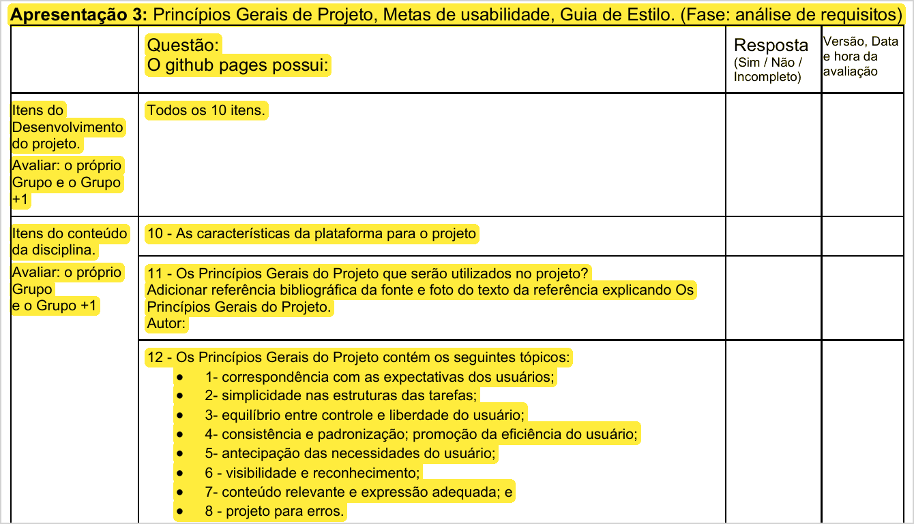

<em>Fonte: SALES (2026, Plano de Ensino, p. 11). Recorte e grifo: [Gabriel Melo](https://github.com/gabriellcardone-06) (2026). Itens que usam esta figura: C10, C11, C12.</em>

---

<strong>Figura 3</strong> — Ciclo de vida da engenharia de usabilidade de Mayhew: fases e três níveis de design

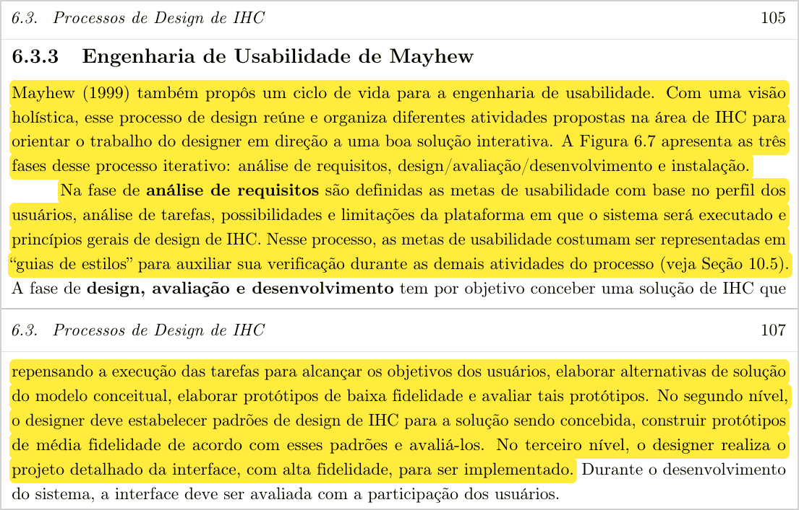

<em>Fonte: BARBOSA et al. (2021, pp. 105, 107). Recorte e grifo: [Gabriel Melo](https://github.com/gabriellcardone-06) (2026). Itens que usam esta figura: C10.</em>

---

<strong>Figura 4</strong> — Contextualização de princípios e diretrizes ao domínio, aos usuários e às atividades

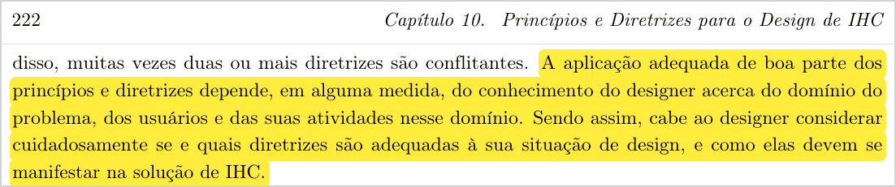

<em>Fonte: BARBOSA et al. (2021, p. 222). Recorte e grifo: [Gabriel Melo](https://github.com/gabriellcardone-06) (2026). Itens que usam esta figura: C11, G6, G7, G8.</em>

---

<strong>Figura 5</strong> — 10.2.1 Correspondência com as expectativas dos usuários

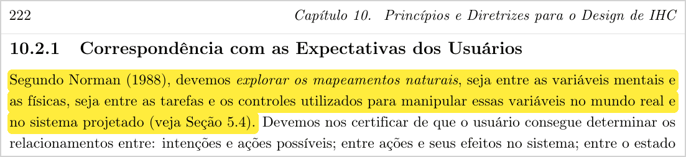

<em>Fonte: BARBOSA et al. (2021, p. 222). Recorte e grifo: [Gabriel Melo](https://github.com/gabriellcardone-06) (2026). Itens que usam esta figura: C12, G16, G18.</em>

---

<strong>Figura 6</strong> — 10.2.2 Simplicidade nas estruturas das tarefas

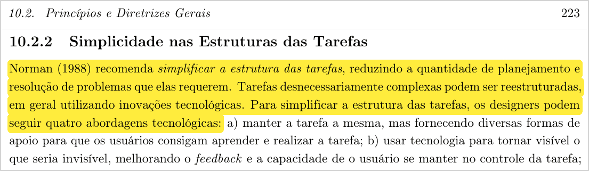

<em>Fonte: BARBOSA et al. (2021, p. 223). Recorte e grifo: [Gabriel Melo](https://github.com/gabriellcardone-06) (2026). Itens que usam esta figura: C12, G1, G2.</em>

---

<strong>Figura 7</strong> — 10.2.3 Equilíbrio entre controle e liberdade do usuário

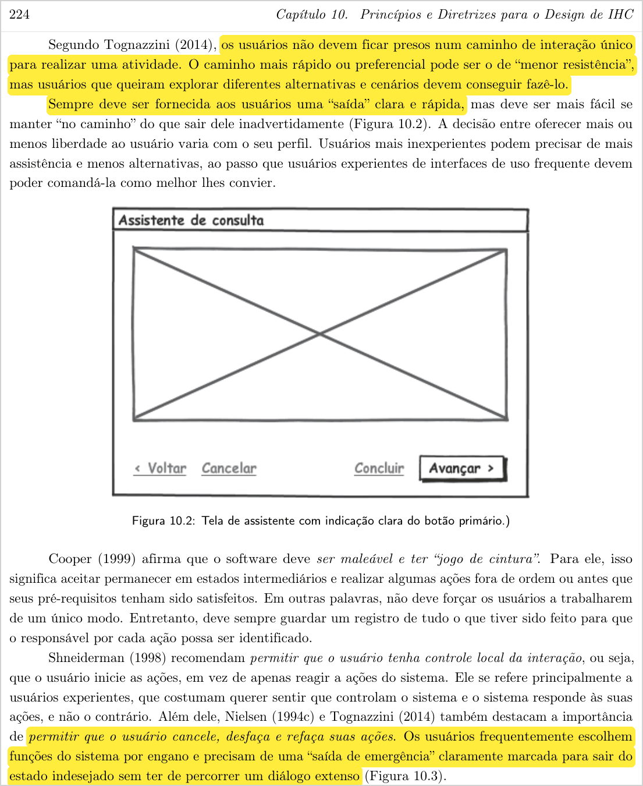

<em>Fonte: BARBOSA et al. (2021, p. 224). Recorte e grifo: [Gabriel Melo](https://github.com/gabriellcardone-06) (2026). Itens que usam esta figura: C12, G3, G4, G5, G19.</em>

---

<strong>Figura 8</strong> — 10.2.4 Consistência e padronização

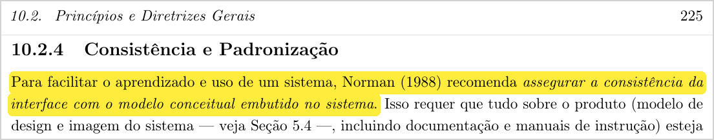

<em>Fonte: BARBOSA et al. (2021, p. 225). Recorte e grifo: [Gabriel Melo](https://github.com/gabriellcardone-06) (2026). Itens que usam esta figura: C12, G20.</em>

---

<strong>Figura 9</strong> — 10.2.5 Promovendo a eficiência do usuário

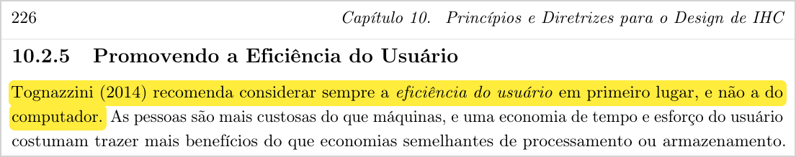

<em>Fonte: BARBOSA et al. (2021, p. 226). Recorte e grifo: [Gabriel Melo](https://github.com/gabriellcardone-06) (2026). Itens que usam esta figura: C12, G23.</em>

---

<strong>Figura 10</strong> — 10.2.6 Antecipação das necessidades do usuário

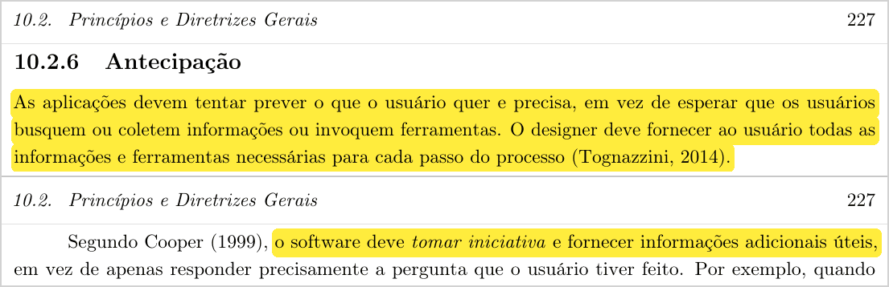

<em>Fonte: BARBOSA et al. (2021, p. 227). Recorte e grifo: [Gabriel Melo](https://github.com/gabriellcardone-06) (2026). Itens que usam esta figura: C12, G21, G40.</em>

---

<strong>Figura 11</strong> — 10.2.7 Visibilidade e reconhecimento

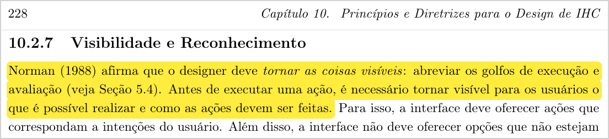

<em>Fonte: BARBOSA et al. (2021, p. 228). Recorte e grifo: [Gabriel Melo](https://github.com/gabriellcardone-06) (2026). Itens que usam esta figura: C12, G10, G17, G22.</em>

---

<strong>Figura 12</strong> — 10.2.8 Conteúdo relevante e expressão adequada (máximas de Grice)

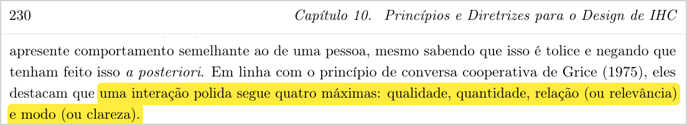

<em>Fonte: BARBOSA et al. (2021, p. 230). Recorte e grifo: [Gabriel Melo](https://github.com/gabriellcardone-06) (2026). Itens que usam esta figura: C12, G9.</em>

---

<strong>Figura 13</strong> — 10.2.9 Projeto para erros

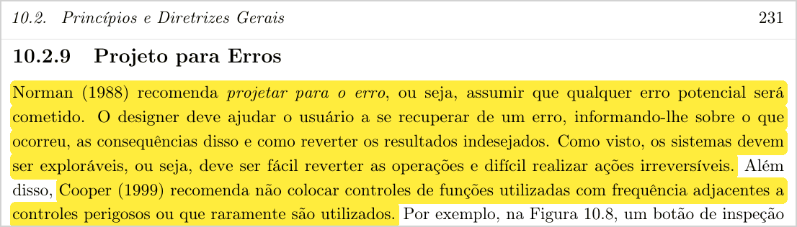

<em>Fonte: BARBOSA et al. (2021, p. 231). Recorte e grifo: [Gabriel Melo](https://github.com/gabriellcardone-06) (2026). Itens que usam esta figura: C12, G11, G41.</em>

---

<strong>Figura 14</strong> — Itens de conteúdo 13 a 17 da Entrega 3 (metas de usabilidade e Guia de Estilo)

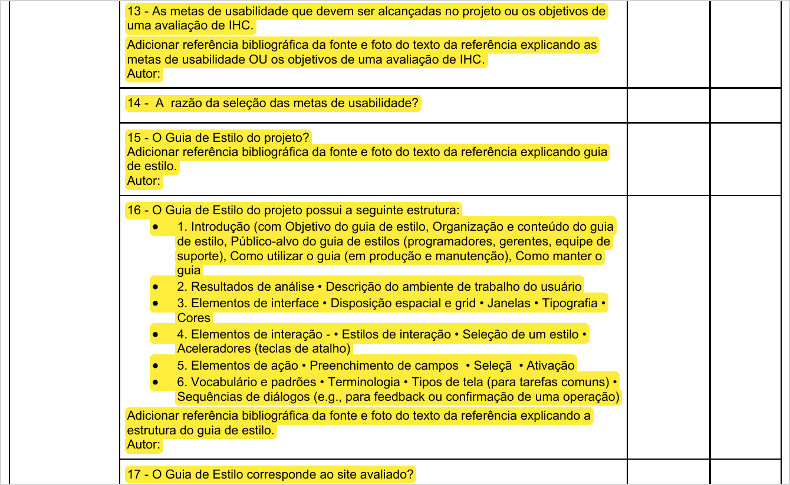

<em>Fonte: SALES (2026, Plano de Ensino, p. 12). Recorte e grifo: [Gabriel Melo](https://github.com/gabriellcardone-06) (2026). Itens que usam esta figura: C13, C14, C15, C16, C17.</em>

---

<strong>Figura 15</strong> — Definição de metas de usabilidade, indicadores e faixas de valores

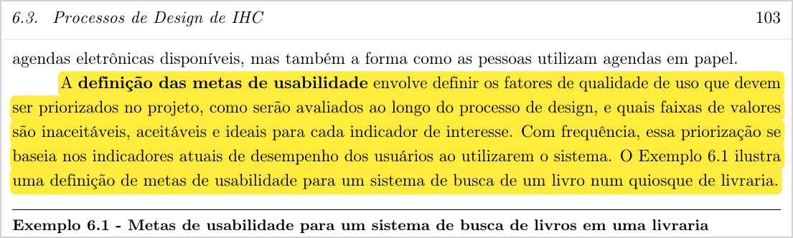

<em>Fonte: BARBOSA et al. (2021, p. 103). Recorte e grifo: [Gabriel Melo](https://github.com/gabriellcardone-06) (2026). Itens que usam esta figura: C13, C14, G35, G36, G37.</em>

---

<strong>Figura 16</strong> — 10.5 Guias de estilo: finalidade e escopos

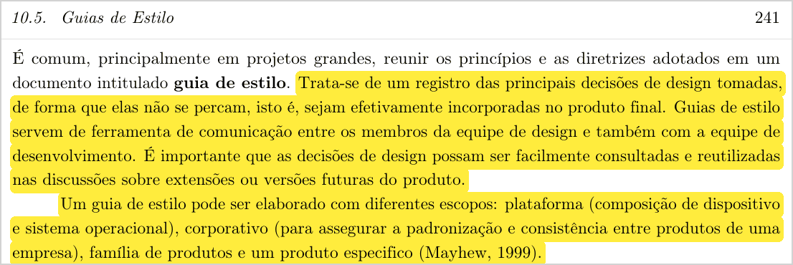

<em>Fonte: BARBOSA et al. (2021, p. 241). Recorte e grifo: [Gabriel Melo](https://github.com/gabriellcardone-06) (2026). Itens que usam esta figura: C15, G10, G12, G13, G14, G29, G30.</em>

---

<strong>Figura 17</strong> — 10.5 Estrutura comum de um guia de estilo (Marcus, 1991; Mayhew, 1999)

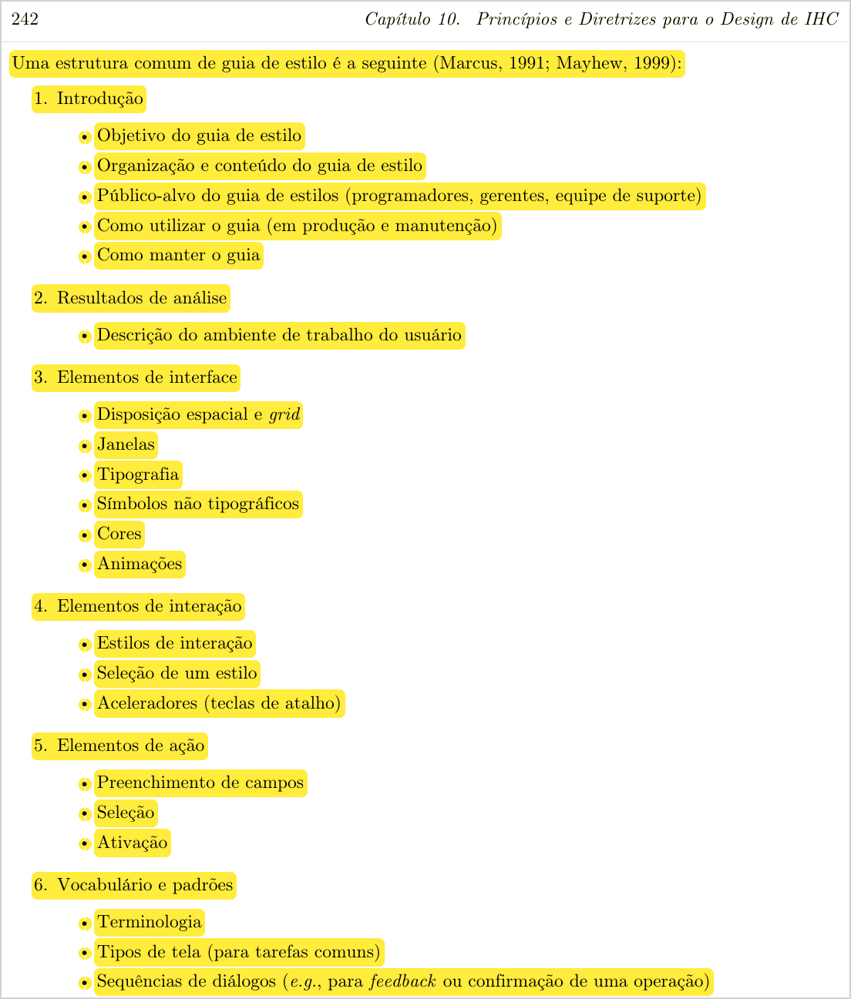

<em>Fonte: BARBOSA et al. (2021, p. 242). Recorte e grifo: [Gabriel Melo](https://github.com/gabriellcardone-06) (2026). Itens que usam esta figura: C16, G14, G15, G26, G27, G28, G29, G30, G31, G32, G33, G34.</em>

---

<strong>Figura 18</strong> — 10.2.3 Desfazer ações em vez de excesso de diálogos de confirmação

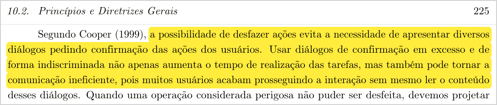

<em>Fonte: BARBOSA et al. (2021, p. 225). Recorte e grifo: [Gabriel Melo](https://github.com/gabriellcardone-06) (2026). Itens que usam esta figura: G5, G21.</em>

---

<strong>Figura 19</strong> — 12.1.1 Avaliação heurística: base nas heurísticas de Nielsen

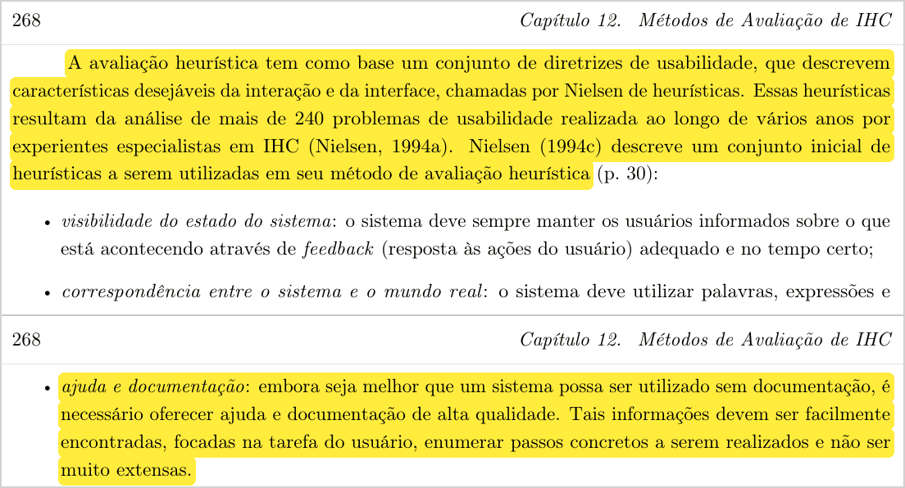

<em>Fonte: BARBOSA et al. (2021, p. 268). Recorte e grifo: [Gabriel Melo](https://github.com/gabriellcardone-06) (2026). Itens que usam esta figura: G18, G22, G23, G24.</em>

---

<strong>Figura 20</strong> — 10.4 Dark patterns

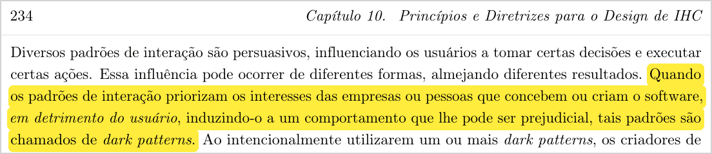

<em>Fonte: BARBOSA et al. (2021, p. 234). Recorte e grifo: [Gabriel Melo](https://github.com/gabriellcardone-06) (2026). Itens que usam esta figura: G25.</em>

---

<strong>Figura 21</strong> — 12.2.1 Teste de usabilidade: objetivo, atividades e medidas por tarefa

<em>Fonte: BARBOSA et al. (2021, pp. 288–289). Recorte e grifo: [Gabriel Melo](https://github.com/gabriellcardone-06) (2026). Itens que usam esta figura: G38, G39.</em>

---

<strong>Figura 22</strong> — 11.7.2 Teste-piloto: objetivo e descarte dos dados

<em>Fonte: BARBOSA et al. (2021, p. 260). Recorte e grifo: [Gabriel Melo](https://github.com/gabriellcardone-06) (2026). Itens que usam esta figura: G38.</em>

## Referências bibliográficas

- BARBOSA, Simone Diniz Junqueira; SILVA, Bruno Santana da; SILVEIRA, Milene Selbach; GASPARINI, Isabela; DARIN, Ticianne; BARBOSA, Gabriel Diniz Junqueira. **Interação Humano-Computador e Experiência do Usuário**. Rio de Janeiro: Autopublicação, 2021. ISBN 978-65-00-19677-1. Versão de 03/05/2021.
- SALES, André Barros de. **Plano de Ensino: Interação Humano Computador — Turma 01**. Brasília: Universidade de Brasília, Faculdade UnB Gama, 2026. Disponível em: [plano de ensino (PDF)](../../assets/inspecoes/plano-de-ensino-ihc-2026-2-turma01-v1.pdf).
