## Histórico de Versão e Contribuição

| Data | Versão | Descrição | Autor(es) | Revisor(es) | Declaração de Uso de IA |
| :---: | :---: | :--- | :--- | :--- | :--- |
| 26/09/2026 | `1.0` | Itens G1–G20, redigidos na versão 1.0 da lista da Entrega 1 (planejamento da avaliação e métodos de avaliação), publicada em [verif1.md](../verif1.md). | [Arthur Mariani](https://github.com/arthur-mariani) | [Carlos Costa](https://github.com/carloshfgit) | Claude (Anthropic): uso declarado pelo autor (sem detalhamento da finalidade) |
| 19/11/2026 | `2.0` | Criação da lista da Entrega 4, que não existia: Itens do Desenvolvimento do Projeto, itens de conteúdo 2–13 do Plano de Ensino, itens G1–G20 transferidos da v1.0 da Entrega 1 (com correções), itens novos G21–G28 e prints. | [Gabriel Melo](https://github.com/gabriellcardone-06) | [Arthur Mariani](https://github.com/arthur-mariani) | Claude (Anthropic): uso declarado pelo autor (sem detalhamento da finalidade) |

---

# Lista de Verificação: Entrega 4 (versão 2.0)

!!! info "Versão 2.0 — rastreabilidade"
    Esta é a **versão 2.0** da lista. O [índice das listas de verificação](../index.md) mostra onde está cada versão. Não havia versão 1.0 desta lista. Os itens G1–G20 vieram da versão 1.0 da lista da Entrega 1.

## Introdução

Esta lista verifica os artefatos da **Entrega 4: Planejamento da Avaliação do Storyboard e da Análise de Tarefas e planejamento do relato dos resultados dessas avaliações**. O grupo não tinha lista própria para a Entrega 4; na inspeção dessa entrega foi usada a lista do Plano de Ensino (SALES, 2026, pp. 12–13). Esta versão reúne a lista do professor, os 20 itens sobre planejamento da avaliação que estavam na versão 1.0 da [lista da Entrega 1](../verif1.md) e itens novos sobre storyboard e análise de tarefas.

Para cada item, quem avalia marca **Sim**, **Não** ou **Incompleto**, como no Plano de Ensino (SALES, 2026). Quando um item não se aplica ao artefato avaliado, escreva *N/A* na linha e explique em *Observações* no registro da avaliação. A coluna *Autor(es) do item* indica quem escreveu a pergunta e quem é responsável pelo conteúdo verificado. Nos itens do professor, a pergunta é de André Barros de Sales e o integrante indicado é quem produziu o conteúdo e a evidência. A coluna *Referência* leva ao print grifado da fonte, no fim da página. As páginas do livro são as páginas impressas do *IHC.pdf* (BARBOSA et al., 2021, versão de 03/05/2021).

Os itens estão organizados assim: primeiro os **Itens do Desenvolvimento do Projeto (D1–D11)**, que se repetem em todas as listas; depois os itens de conteúdo do professor (quando a entrega tem lista no Plano de Ensino); por fim, os itens de conteúdo elaborados pelo grupo (código G).

## 1. Itens do Desenvolvimento do Projeto

O Plano de Ensino define onze itens de desenvolvimento que valem para todos os artefatos (SALES, 2026, pp. 8–9). Eles aparecem primeiro em todas as listas do grupo, da Entrega 1 à Entrega 7 (veja a Tabela 1). Nas Entregas 3 e 4, o Plano fala em “Todos os 10 itens”, mas a lista do professor tem 11; por isso os 11 foram mantidos.

<strong>Tabela 1</strong>: Itens do Desenvolvimento do Projeto (Avaliar: o próprio grupo e o grupo +1)

| Código | Pergunta de verificação | Autor(es) do item | Referência | Sim | Não | Incompleto |
| :---: | :--- | :--- | :---: | :---: | :---: | :---: |
| D1 | O histórico de versão padronizado? | **Pergunta:** André Barros de Sales (Plano de Ensino) **Inclusão na lista:** [Gabriel Melo](https://github.com/gabriellcardone-06) | [Fig. 1](#figura-1) | ☐ | ☐ | ☐ |
| D2 | O(s) autor(es) e o(s) revisor(es) para cada artefato? | **Pergunta:** André Barros de Sales (Plano de Ensino) **Inclusão na lista:** [Gabriel Melo](https://github.com/gabriellcardone-06) | [Fig. 1](#figura-1) | ☐ | ☐ | ☐ |
| D3 | Referências bibliográficas e/ou bibliografia em todos os artefatos? | **Pergunta:** André Barros de Sales (Plano de Ensino) **Inclusão na lista:** [Gabriel Melo](https://github.com/gabriellcardone-06) | [Fig. 1](#figura-1) | ☐ | ☐ | ☐ |
| D4 | As tabelas e imagens possuem legenda e fonte e são chamadas dentro do texto? | **Pergunta:** André Barros de Sales (Plano de Ensino) **Inclusão na lista:** [Gabriel Melo](https://github.com/gabriellcardone-06) | [Fig. 1](#figura-1) | ☐ | ☐ | ☐ |
| D5 | Um texto fazendo uma introdução dos artefatos? | **Pergunta:** André Barros de Sales (Plano de Ensino) **Inclusão na lista:** [Gabriel Melo](https://github.com/gabriellcardone-06) | [Fig. 1](#figura-1) | ☐ | ☐ | ☐ |
| D6 | O cronograma executado com quem realizou cada artefato/atividade, com as datas de início e fim da construção/realização do artefato/atividade? | **Pergunta:** André Barros de Sales (Plano de Ensino) **Inclusão na lista:** [Gabriel Melo](https://github.com/gabriellcardone-06) | [Fig. 1](#figura-1) | ☐ | ☐ | ☐ |
| D7 | Ata(s) da(s) reunião(ões) (com data, horário de início e do final, participantes, objetivo, atividades definidas etc.)? | **Pergunta:** André Barros de Sales (Plano de Ensino) **Inclusão na lista:** [Gabriel Melo](https://github.com/gabriellcardone-06) | [Fig. 1](#figura-1) | ☐ | ☐ | ☐ |
| D8 | A gravação da reunião do grupo? | **Pergunta:** André Barros de Sales (Plano de Ensino) **Inclusão na lista:** [Gabriel Melo](https://github.com/gabriellcardone-06) | [Fig. 1](#figura-1) | ☐ | ☐ | ☐ |
| D9 | Vídeo de apresentação na categoria “não listado” no YouTube? | **Pergunta:** André Barros de Sales (Plano de Ensino) **Inclusão na lista:** [Gabriel Melo](https://github.com/gabriellcardone-06) | [Fig. 1](#figura-1) | ☐ | ☐ | ☐ |
| D10 | Tabela de contribuição no início do artefato com o nome de todos os integrantes, com a contribuição de cada integrante e hiperligação para a atividade e para a gravação, se houver? | **Pergunta:** André Barros de Sales (Plano de Ensino) **Inclusão na lista:** [Gabriel Melo](https://github.com/gabriellcardone-06) | [Fig. 1](#figura-1) | ☐ | ☐ | ☐ |
| D11 | A seção de agradecimentos apresentando o uso de Inteligência Artificial (IA) Generativa no artefato? | **Pergunta:** André Barros de Sales (Plano de Ensino) **Inclusão na lista:** [Gabriel Melo](https://github.com/gabriellcardone-06) | [Fig. 1](#figura-1) | ☐ | ☐ | ☐ |

<em>Fonte: SALES (2026, Plano de Ensino, pp. 8–9), lista de verificação sugerida — Itens do Desenvolvimento do projeto.</em>

## 2. Itens de conteúdo da disciplina (Plano de Ensino)

A Tabela 2 reproduz os itens de conteúdo da Entrega 4. O Plano de Ensino numera esses itens a partir do 2, e a numeração foi mantida.

<strong>Tabela 2</strong>: Itens de conteúdo da Entrega 4 definidos pelo professor

| Código | Pergunta de verificação | Autor(es) do item | Referência | Sim | Não | Incompleto |
| :---: | :--- | :--- | :---: | :---: | :---: | :---: |
| C2 | O planejamento da avaliação segue o Framework DECIDE? | **Pergunta:** André Barros de Sales (Plano de Ensino) **Conteúdo e evidência:** [Carlos Costa](https://github.com/carloshfgit) e [Gabriel Melo](https://github.com/gabriellcardone-06) | [Fig. 2](#figura-2) [Fig. 3](#figura-3) | ☐ | ☐ | ☐ |
| C3 | Descreve o(s) objetivo(s) da avaliação (apropriação de tecnologia pelos usuários; ideias e alternativas de design; conformidade com um padrão; e/ou problemas na interação e na interface na fase do modelo conceitual)? | **Pergunta:** André Barros de Sales (Plano de Ensino) **Conteúdo e evidência:** [Carlos Costa](https://github.com/carloshfgit) | [Fig. 2](#figura-2) [Fig. 4](#figura-4) | ☐ | ☐ | ☐ |
| C4 | Os métodos de avaliação a serem utilizados? (com referência e foto do texto da referência) | **Pergunta:** André Barros de Sales (Plano de Ensino) **Conteúdo e evidência:** [Gabriel Melo](https://github.com/gabriellcardone-06) | [Fig. 2](#figura-2) [Fig. 5](#figura-5) | ☐ | ☐ | ☐ |
| C5 | As questões práticas da avaliação: recrutamento dos usuários (onde e o perfil), quantos usuários participarão e a razão dessa quantidade, presencial ou remota, preparação e uso dos equipamentos, prazos, orçamento e mão de obra necessária? | **Pergunta:** André Barros de Sales (Plano de Ensino) **Conteúdo e evidência:** [Lucas Araújo](https://github.com/Lucasaraujoszz) | [Fig. 2](#figura-2) [Fig. 3](#figura-3) [Fig. 6](#figura-6) [Fig. 7](#figura-7) | ☐ | ☐ | ☐ |
| C6 | As questões éticas: os participantes devem ser respeitados e não podem ser prejudicados direta ou indiretamente, nem durante os experimentos, nem após a divulgação dos resultados? | **Pergunta:** André Barros de Sales (Plano de Ensino) **Conteúdo e evidência:** [Lucas Araújo](https://github.com/Lucasaraujoszz) | [Fig. 2](#figura-2) [Fig. 3](#figura-3) [Fig. 8](#figura-8) | ☐ | ☐ | ☐ |
| C7 | A estrutura do relatório do resultado da avaliação (objetivos; breve descrição do método; número e perfil de avaliadores e participantes; tarefas executadas; lista de problemas encontrados etc.)? | **Pergunta:** André Barros de Sales (Plano de Ensino) **Conteúdo e evidência:** [Arthur Mariani](https://github.com/arthur-mariani) e [Rodrigo Carvalho](https://github.com/RodrigoCBarbosa) | [Fig. 2](#figura-2) [Fig. 9](#figura-9) | ☐ | ☐ | ☐ |
| C8 | Um cronograma (data e horário) e local para a realização da avaliação do Storyboard e da Análise de Tarefas? | **Pergunta:** André Barros de Sales (Plano de Ensino) **Conteúdo e evidência:** [Tomás Rocho](https://github.com/TomasRocho) | [Fig. 2](#figura-2) | ☐ | ☐ | ☐ |
| C9 | Cada desenho do Storyboard está relacionado a uma especificação do artefato da Análise de Tarefas? | **Pergunta:** André Barros de Sales (Plano de Ensino) **Conteúdo e evidência:** [Igor Dantas](https://github.com/IgorDARAUJO) | [Fig. 2](#figura-2) | ☐ | ☐ | ☐ |
| C10 | A quantidade de storyboards é igual à quantidade de integrantes do grupo? | **Pergunta:** André Barros de Sales (Plano de Ensino) **Conteúdo e evidência:** [Igor Dantas](https://github.com/IgorDARAUJO) | [Fig. 2](#figura-2) | ☐ | ☐ | ☐ |
| C11 | A definição do teste-piloto e a data para a sua realização antes da avaliação? (com referência e foto) | **Pergunta:** André Barros de Sales (Plano de Ensino) **Conteúdo e evidência:** [Igor Dantas](https://github.com/IgorDARAUJO) | [Fig. 2](#figura-2) [Fig. 10](#figura-10) | ☐ | ☐ | ☐ |
| C12 | O resultado do teste-piloto não será apresentado no resultado da avaliação? | **Pergunta:** André Barros de Sales (Plano de Ensino) **Conteúdo e evidência:** [Igor Dantas](https://github.com/IgorDARAUJO) | [Fig. 2](#figura-2) [Fig. 10](#figura-10) | ☐ | ☐ | ☐ |
| C13 | Os itens que o avaliador deve realizar/anotar durante a avaliação (listar os problemas encontrados, priorizar a correção dos problemas não resolvidos)? | **Pergunta:** André Barros de Sales (Plano de Ensino) **Conteúdo e evidência:** [Rodrigo Carvalho](https://github.com/RodrigoCBarbosa) | [Fig. 2](#figura-2) [Fig. 11](#figura-11) | ☐ | ☐ | ☐ |

<em>Fonte: SALES (2026, Plano de Ensino, pp. 12–13); referências do conteúdo em BARBOSA et al. (2021, caps. 11 e 12).</em>

## 3. Itens de conteúdo elaborados pelo grupo

A Tabela 3 traz os itens do grupo. G1–G10 e G11–G20 correspondem às duas tabelas da versão 1.0 da lista da Entrega 1, de Arthur Mariani; G21–G28 são novos e verificam o conteúdo produzido por cada integrante na Entrega 4.

<strong>Tabela 3</strong>: Itens do Grupo 05 para o planejamento das avaliações do Storyboard e da Análise de Tarefas

| Código | Pergunta de verificação | Autor(es) do item | Referência | Sim | Não | Incompleto |
| :---: | :--- | :--- | :---: | :---: | :---: | :---: |
| G1 | O planejamento escolhe pelo menos um objetivo de avaliação, como analisar a apropriação da tecnologia pelos usuários, comparar ideias e alternativas de design, verificar a conformidade com um padrão ou identificar problemas na interação e na interface? | [Arthur Mariani](https://github.com/arthur-mariani) | [Fig. 4](#figura-4) | ☐ | ☐ | ☐ |
| G2 | Para o objetivo de analisar a apropriação da tecnologia, o planejamento apresenta perguntas específicas a serem respondidas, por exemplo, sobre a forma de uso do sistema, a comunicação entre usuários ou a exploração de novas funcionalidades? | [Arthur Mariani](https://github.com/arthur-mariani) | [Fig. 4](#figura-4) [Fig. 3](#figura-3) | ☐ | ☐ | ☐ |
| G3 | Para o objetivo de comparar ideias e alternativas de design, o planejamento apresenta perguntas específicas a serem respondidas, por exemplo, sobre eficiência, facilidade de aprendizado, tempo de construção ou impacto da adoção? | [Arthur Mariani](https://github.com/arthur-mariani) | [Fig. 4](#figura-4) [Fig. 3](#figura-3) | ☐ | ☐ | ☐ |
| G4 | Para o objetivo de verificar a conformidade com padrões, o planejamento apresenta perguntas específicas a serem respondidas, por exemplo, sobre padrões de acessibilidade, convenções do sistema operacional ou termos usados na interface? | [Arthur Mariani](https://github.com/arthur-mariani) | [Fig. 4](#figura-4) [Fig. 3](#figura-3) | ☐ | ☐ | ☐ |
| G5 | Para o objetivo de identificar problemas na interação e na interface, o planejamento apresenta perguntas específicas a serem respondidas, por exemplo, sobre a capacidade de operar o sistema, atingir objetivos, eficiência, erros e insatisfação do usuário? | [Arthur Mariani](https://github.com/arthur-mariani) | [Fig. 4](#figura-4) [Fig. 3](#figura-3) | ☐ | ☐ | ☐ |
| G6 | O planejamento determina ao menos um tipo de método de avaliação: investigação, observação de uso ou inspeção? | [Arthur Mariani](https://github.com/arthur-mariani) | [Fig. 5](#figura-5) | ☐ | ☐ | ☐ |
| G7 | O planejamento define um cronograma para as atividades de avaliação, incluindo recrutamento de participantes, teste-piloto, sessões de coleta, análise dos dados e entrega do relato? | [Arthur Mariani](https://github.com/arthur-mariani) | [Fig. 3](#figura-3) [Fig. 7](#figura-7) | ☐ | ☐ | ☐ |
| G8 | O planejamento deixa claro o cumprimento dos princípios éticos, incluindo a utilização do Termo de Consentimento Livre e Esclarecido (TCLE), quando aplicável? | [Arthur Mariani](https://github.com/arthur-mariani) | [Fig. 3](#figura-3) [Fig. 12](#figura-12) | ☐ | ☐ | ☐ |
| G9 | O planejamento especifica como os dados coletados serão classificados e apresentados, distinguindo dados qualitativos de quantitativos e dados subjetivos de objetivos? | [Arthur Mariani](https://github.com/arthur-mariani) | [Fig. 13](#figura-13) | ☐ | ☐ | ☐ |
| G10 | O planejamento prevê o relato consolidado dos resultados: objetivos e escopo da avaliação, método empregado, número e perfil de usuários e avaliadores, sumário dos dados, interpretação e análise, problemas encontrados e planejamento do reprojeto? | [Arthur Mariani](https://github.com/arthur-mariani) | [Fig. 9](#figura-9) | ☐ | ☐ | ☐ |
| G11 | A escolha do método é justificada pelos objetivos e perguntas da avaliação e também pelo prazo, orçamento, equipamentos disponíveis e experiência dos avaliadores? | [Arthur Mariani](https://github.com/arthur-mariani) | [Fig. 3](#figura-3) | ☐ | ☐ | ☐ |
| G12 | Caso o método escolhido seja de inspeção, o planejamento determina qual será utilizado: avaliação heurística, percurso cognitivo ou inspeção semiótica? | [Arthur Mariani](https://github.com/arthur-mariani) | [Fig. 14](#figura-14) | ☐ | ☐ | ☐ |
| G13 | Caso o método escolhido seja de observação, o planejamento determina qual será utilizado: teste de usabilidade, avaliação de comunicabilidade ou prototipação em papel? | [Arthur Mariani](https://github.com/arthur-mariani) | [Fig. 14](#figura-14) | ☐ | ☐ | ☐ |
| G14 | Caso o método escolhido seja de investigação, o planejamento determina qual será utilizado: entrevistas, questionários, grupos de foco ou estudos de campo? | [Arthur Mariani](https://github.com/arthur-mariani) | [Fig. 5](#figura-5) | ☐ | ☐ | ☐ |
| G15 | O escopo da avaliação delimita quais partes da interface, caminhos de interação, tarefas e perfis de usuário serão avaliados? | [Arthur Mariani](https://github.com/arthur-mariani) | [Fig. 6](#figura-6) | ☐ | ☐ | ☐ |
| G16 | O método escolhido é adequado ao objetivo definido (por exemplo, inspeção para conformidade com um padrão; observação ou investigação, com participação dos usuários, para apropriação de tecnologia)? | [Arthur Mariani](https://github.com/arthur-mariani) | [Fig. 15](#figura-15) | ☐ | ☐ | ☐ |
| G17 | Caso o método escolhido seja a avaliação heurística, são utilizadas as heurísticas de Nielsen? | [Arthur Mariani](https://github.com/arthur-mariani) | [Fig. 16](#figura-16) | ☐ | ☐ | ☐ |
| G18 | Caso o método escolhido seja a avaliação heurística, as atividades de preparação, coleta de dados, interpretação, consolidação e relato dos resultados estão definidas? | [Arthur Mariani](https://github.com/arthur-mariani) | [Fig. 17](#figura-17) | ☐ | ☐ | ☐ |
| G19 | Caso o método escolhido seja a avaliação heurística, os problemas encontrados são julgados pela escala de severidade de Nielsen (frequência, impacto e persistência; de problema cosmético a catastrófico)? | [Arthur Mariani](https://github.com/arthur-mariani) | [Fig. 18](#figura-18) | ☐ | ☐ | ☐ |
| G20 | Caso o método escolhido seja a avaliação heurística, o relato apresenta objetivos e escopo, descrição do método, conjunto de diretrizes utilizado, número e perfil dos avaliadores, problemas encontrados, severidade e sugestões de solução? | [Arthur Mariani](https://github.com/arthur-mariani) | [Fig. 17](#figura-17) | ☐ | ☐ | ☐ |
| G21 | O planejamento da avaliação do Storyboard trata o storyboard como artefato de avaliação formativa e define o que se quer aprender com ele antes de construir o protótipo? | [Gabriel Melo](https://github.com/gabriellcardone-06) | [Fig. 19](#figura-19) | ☐ | ☐ | ☐ |
| G22 | O planejamento da avaliação da Análise de Tarefas compara os caminhos previstos nos modelos (HTA, CTT ou GOMS) com o que os participantes de fato fazem ou relatam? | [Carlos Costa](https://github.com/carloshfgit) | [Fig. 20](#figura-20) | ☐ | ☐ | ☐ |
| G23 | O planejamento define o perfil e a quantidade de participantes e justifica essa quantidade (por exemplo, de cinco a 12 usuários)? | [Lucas Araújo](https://github.com/Lucasaraujoszz) | [Fig. 6](#figura-6) | ☐ | ☐ | ☐ |
| G24 | O planejamento prepara o material de apoio (TCLE, questionário pré-teste, roteiro de entrevista pós-teste, instruções e cenários das tarefas, roteiro de observação) e garante que todos os participantes recebam o mesmo material? | [Tomás Rocho](https://github.com/TomasRocho) | [Fig. 7](#figura-7) | ☐ | ☐ | ☐ |
| G25 | A duração prevista de cada tarefa não ultrapassa 20 minutos e a sessão completa fica em torno de uma hora? | [Tomás Rocho](https://github.com/TomasRocho) | [Fig. 21](#figura-21) | ☐ | ☐ | ☐ |
| G26 | O participante do teste-piloto não se envolveu no planejamento e na preparação da avaliação? | [Igor Dantas](https://github.com/IgorDARAUJO) | [Fig. 10](#figura-10) | ☐ | ☐ | ☐ |
| G27 | O planejamento do relato prevê consolidar os resultados pelas recorrências entre participantes e apresentá-los como tendências, e não como certezas? | [Rodrigo Carvalho](https://github.com/RodrigoCBarbosa) | [Fig. 9](#figura-9) | ☐ | ☐ | ☐ |
| G28 | O planejamento prevê pelo menos dois avaliadores na coleta (um acompanha o participante e outro observa e anota), sem interromper o participante durante as tarefas? | [Arthur Mariani](https://github.com/arthur-mariani) | [Fig. 22](#figura-22) | ☐ | ☐ | ☐ |

<em>Fonte: itens G1–G20: Arthur Mariani (2026, v1.0 da lista da Entrega 1), com correções na v2.0; itens G21–G28: Grupo 05 (2026). Base: BARBOSA et al. (2021, caps. 7, 11 e 12).</em>

## Tabela de contribuição

A Tabela 4 mostra o que cada integrante fez nesta lista. A autoria dos itens segue o conteúdo que cada integrante produziu no projeto: quem fez o artefato é autor dos itens que o verificam. Os links levam ao artefato correspondente. As gravações das reuniões estão na página de [atas](../../atas/ata1.md) e de [gravações](../../apresentacoes/index.md).

<strong>Tabela 4</strong>: Contribuição de cada integrante nesta lista

| Integrante | Contribuição nesta lista | Artefato(s) relacionado(s) |
| :--- | :--- | :--- |
| [Arthur Mariani](https://github.com/arthur-mariani) | Autor dos itens G1–G20 (escritos na v1.0 da lista da Entrega 1) e do item G28. Conteúdo do item C7 (planejamento do relato da análise de tarefas). | [Planejamento do relato da análise de tarefas](../../design-avaliacao-desenvolvimento/nivel1/planejamentos-individuais/Arthur/planejamento-relato-analise-tarefas.md) |
| [Carlos Costa](https://github.com/carloshfgit) | Revisor da v1.0 dos itens G1–G20. Item G22. Conteúdo dos itens C2 e C3 (planejamento DECIDE da avaliação da análise de tarefas). | [Planejamento da avaliação da análise de tarefas](../../design-avaliacao-desenvolvimento/nivel1/planejamentos-individuais/Carlos/planejamento-avaliacao-analise-tarefas.md) |
| [Gabriel Melo](https://github.com/gabriellcardone-06) | Autor da versão 2.0 (criação da lista, inclusão de D1–D11 e C2–C13, transferência e correção de G1–G20, prints). Item G21. Conteúdo dos itens C2 e C4. | [Planejamento da avaliação do Storyboard](../../design-avaliacao-desenvolvimento/nivel1/planejamentos-individuais/Gabriel/gabriel-planejamento-avaliacao.md) |
| [Igor Dantas](https://github.com/IgorDARAUJO) | Item G26. Conteúdo dos itens C9–C12 (storyboards e teste-piloto). | [Storyboards](../../design-avaliacao-desenvolvimento/nivel1/storyboards.md), [Teste-piloto](../../design-avaliacao-desenvolvimento/nivel1/planejamento-e-protocolo-do-teste-piloto.md) |
| [Lucas Araújo](https://github.com/Lucasaraujoszz) | Item G23. Conteúdo dos itens C5 e C6 (questões práticas e éticas). | [Questões práticas e éticas](../../design-avaliacao-desenvolvimento/nivel1/planejamentos-individuais/Lucas/questoes-praticas-e-eticas.md) |
| [Rodrigo Carvalho](https://github.com/RodrigoCBarbosa) | Item G27. Conteúdo dos itens C7 e C13 (planejamento do relato do Storyboard). | [Planejamento do relato](../../design-avaliacao-desenvolvimento/nivel1/planejamentos-individuais/Rodrigo/rodrigo-planejamento-relato-resultados-avaliacao.md) |
| [Tomás Rocho](https://github.com/TomasRocho) | Itens G24 e G25. Conteúdo do item C8 (cronograma e local das sessões). | [Cronograma e logística das sessões](../../design-avaliacao-desenvolvimento/nivel1/cronograma-e-logistica-das-sessoes.md) |
| André Barros de Sales (professor) | Autor das perguntas dos Itens do Desenvolvimento do Projeto (D1–D11) e dos itens de conteúdo C2–C13, retiradas da lista de verificação sugerida no Plano de Ensino. | [Plano de Ensino (PDF)](../../assets/inspecoes/plano-de-ensino-ihc-2026-2-turma01-v1.pdf) |

<em>Fonte: elaborado pelo Grupo 05 (2026).</em>

## Rastreabilidade v1.0 → v2.0

A versão 1.0 continua publicada em [versão 1.0 da lista da Entrega 1](../verif1.md) e não foi apagada. A Tabela 5 indica onde cada item da versão 1.0 está nesta versão e o que mudou.

<strong>Tabela 5</strong>: Origem dos itens desta lista

| Item na v1.0 | Item na v2.0 | Alteração |
| :---: | :---: | :--- |
| Entrega 1, Tabela 1, item 1 | G1 | Transferido da lista da Entrega 1, texto mantido. |
| Entrega 1, Tabela 1, item 2 | G2 | Transferido da lista da Entrega 1, texto mantido. |
| Entrega 1, Tabela 1, item 3 | G3 | Transferido da lista da Entrega 1, texto mantido. |
| Entrega 1, Tabela 1, item 4 | G4 | Transferido da lista da Entrega 1, texto mantido. |
| Entrega 1, Tabela 1, item 5 | G5 | Transferido da lista da Entrega 1, texto mantido. |
| Entrega 1, Tabela 1, item 6 | G6 | Transferido; “método de avaliação” passou a “tipo de método” (investigação, observação de uso ou inspeção), classificação do livro (p. 256). |
| Entrega 1, Tabela 1, item 7 | G7 | Transferido; “entrega final” passou a “entrega do relato”. |
| Entrega 1, Tabela 1, item 8 | G8 | Transferido da lista da Entrega 1, texto mantido. |
| Entrega 1, Tabela 1, item 9 | G9 | Transferido; a classificação dos dados segue o livro: qualitativos/quantitativos e subjetivos/objetivos (p. 253). |
| Entrega 1, Tabela 1, item 10 | G10 | Transferido; a lista de conteúdo do relato segue o livro (p. 263). |
| Entrega 1, Tabela 2, item 1 | G11 | Reescrito: repetia o item 6 da Tabela 1. Passou a verificar a justificativa da escolha do método (DECIDE, p. 264). |
| Entrega 1, Tabela 2, item 2 | G12 | Transferido, texto mantido. |
| Entrega 1, Tabela 2, item 3 | G13 | Corrigido: o livro apresenta como métodos de observação o teste de usabilidade, a avaliação de comunicabilidade e a prototipação em papel (p. 288). Estudo de campo foi retirado daqui. |
| Entrega 1, Tabela 2, item 4 | G14 | Corrigido: estudos de campo entram nos métodos de investigação, como no livro (p. 256). |
| Entrega 1, Tabela 2, item 5 | G15 | Reescrito: repetia o item 1 da Tabela 1. Passou a verificar o escopo da avaliação (p. 258). |
| Entrega 1, Tabela 2, item 6 | G16 | Reescrito com exemplos do livro de adequação entre método e objetivo (p. 257). |
| Entrega 1, Tabela 2, itens 7–10 | G17–G20 | Transferidos; G19 e G20 completados com os fatores de severidade e o conteúdo do relato da avaliação heurística (pp. 270–271). |
| — | C2–C13 | Novos: itens de conteúdo da Entrega 4 do Plano de Ensino. |
| — | G21–G28 | Novos: itens de storyboard, análise de tarefas, participantes, material, duração, teste-piloto, relato e coleta. |

<em>Fonte: elaborado pelo Grupo 05 (2026).</em>

## Registro da avaliação

O Plano de Ensino pede a resposta (Sim / Não / Incompleto) e a versão, a data e a hora da avaliação. Cada aplicação desta lista deve ser registrada na Tabela 6.

<strong>Tabela 6</strong>: Registro das avaliações feitas com esta lista

| Artefato e versão avaliada | Data e hora | Avaliador(es) | Grupo avaliador (próprio ou +1) | Observações |
| :--- | :---: | :--- | :---: | :--- |
| | | | | |

<em>Fonte: elaborado pelo Grupo 05 (2026), a partir de SALES (2026).</em>

---

## Fotos de Referência

As figuras a seguir são recortes das fontes citadas nos itens desta lista, com o trecho que fundamenta cada item grifado em amarelo. Os recortes do livro foram retirados do arquivo *IHC.pdf* (BARBOSA et al., 2021, versão de 03/05/2021) e a numeração indicada é a numeração impressa nas páginas. Os recortes do Plano de Ensino foram retirados da versão disponibilizada pelo professor na turma 01 (SALES, 2026), com o número da página do PDF.

---

<strong>Figura 1</strong>: Itens do Desenvolvimento do projeto (1 a 11) da lista de verificação sugerida pelo professor

<em>Fonte: SALES (2026, Plano de Ensino, pp. 8–9). Itens que usam esta figura: D1, D2, D3, D4, D5, D6, D7, D8, D9, D10, D11.</em>

---

<strong>Figura 2</strong>: Itens de conteúdo 2 a 13 da Entrega 4 (planejamento da avaliação do Storyboard e da Análise de Tarefas)

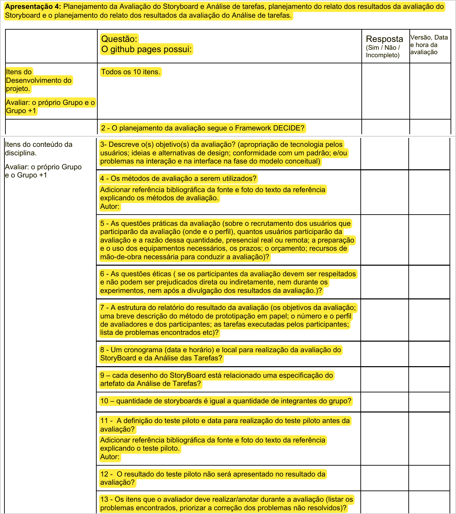

<em>Fonte: SALES (2026, Plano de Ensino, pp. 12–13). Itens que usam esta figura: C2, C3, C4, C5, C6, C7, C8, C9, C10, C11, C12, C13.</em>

---

<strong>Figura 3</strong>: 11.8 Framework DECIDE

<em>Fonte: BARBOSA et al. (2021, p. 264). Itens que usam esta figura: C2, C5, C6, G2, G3, G4, G5, G7, G8, G11.</em>

---

<strong>Figura 4</strong>: 11.2 Principais aspectos (objetivos) avaliados em IHC

<em>Fonte: BARBOSA et al. (2021, p. 248). Itens que usam esta figura: C3, G1, G2, G3, G4, G5.</em>

---

<strong>Figura 5</strong>: 11.6 Classificação dos métodos de avaliação: investigação, observação e inspeção

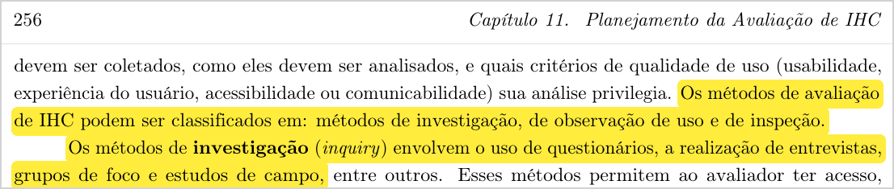

<em>Fonte: BARBOSA et al. (2021, p. 256). Itens que usam esta figura: C4, G6, G14.</em>

---

<strong>Figura 6</strong>: 11.7.2 Escopo da avaliação, perfil e número de participantes

<em>Fonte: BARBOSA et al. (2021, p. 258). Itens que usam esta figura: C5, G15, G23.</em>

---

<strong>Figura 7</strong>: 11.7.2 Questões práticas e material de apoio da avaliação

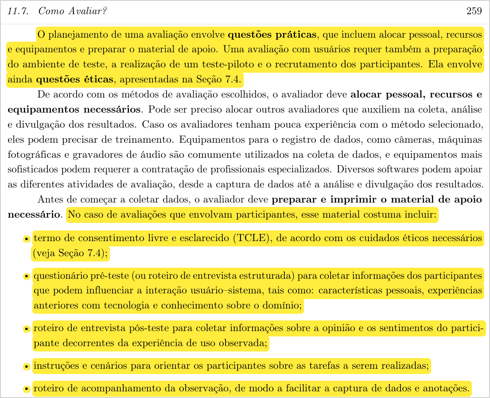

<em>Fonte: BARBOSA et al. (2021, p. 259). Itens que usam esta figura: C5, G7, G24.</em>

---

<strong>Figura 8</strong>: Os quatro princípios éticos (Resolução CNS nº 466/2012)

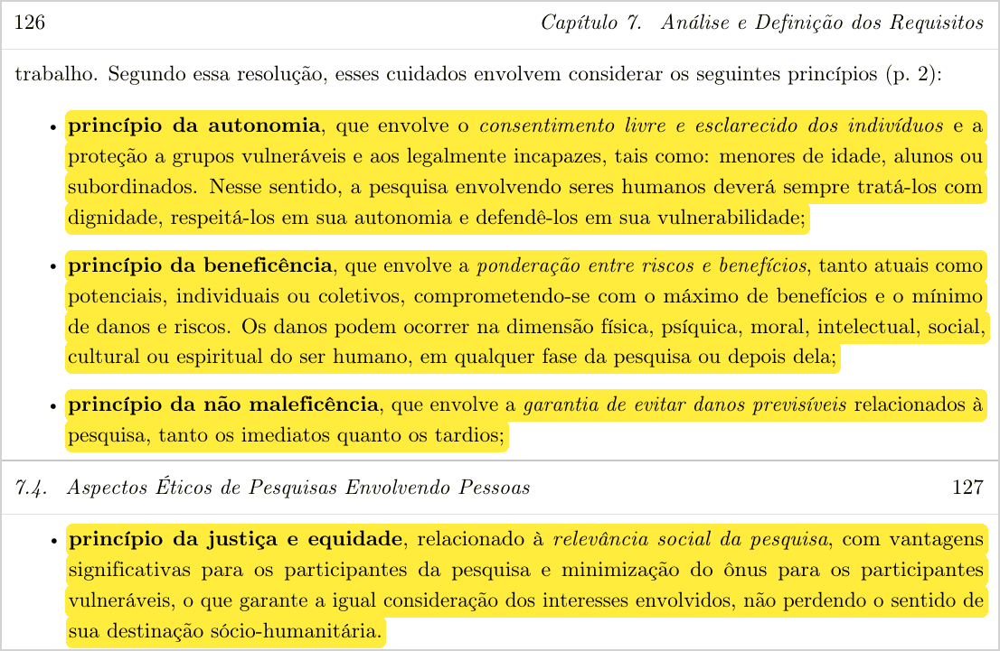

<em>Fonte: BARBOSA et al. (2021, pp. 126–127). Itens que usam esta figura: C6.</em>

---

<strong>Figura 9</strong>: 11.7.5 Consolidação e relato dos resultados

<em>Fonte: BARBOSA et al. (2021, p. 263). Itens que usam esta figura: C7, G10, G27.</em>

---

<strong>Figura 10</strong>: 11.7.2 Teste-piloto: objetivo e descarte dos dados

<em>Fonte: BARBOSA et al. (2021, p. 260). Itens que usam esta figura: C11, C12, G26.</em>

---

<strong>Figura 11</strong>: Tabela 12.9 – Atividades do método de prototipação em papel

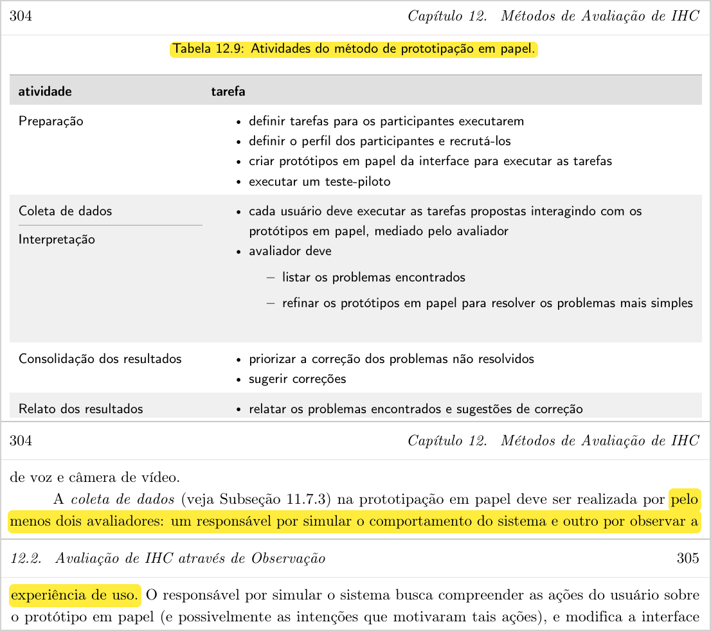

<em>Fonte: BARBOSA et al. (2021, pp. 304–305). Itens que usam esta figura: C13.</em>

---

<strong>Figura 12</strong>: Permissão para gravação e consentimento livre e esclarecido

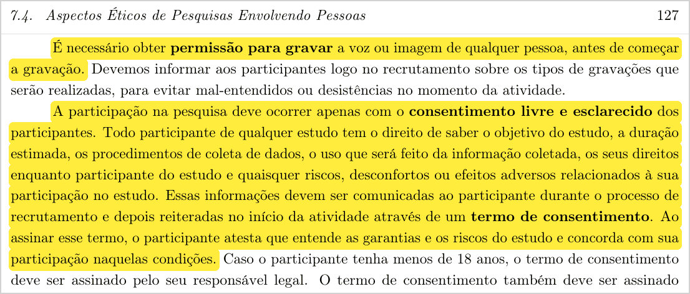

<em>Fonte: BARBOSA et al. (2021, p. 127). Itens que usam esta figura: G8.</em>

---

<strong>Figura 13</strong>: 11.5 Classificação dos dados coletados e produzidos em uma avaliação

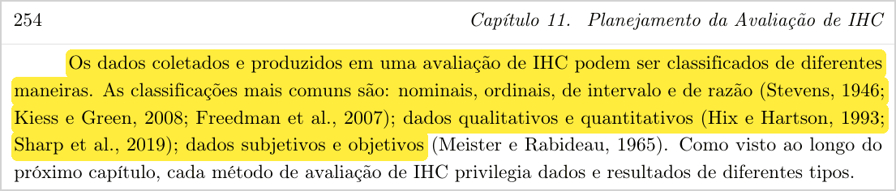

<em>Fonte: BARBOSA et al. (2021, p. 254). Itens que usam esta figura: G9.</em>

---

<strong>Figura 14</strong>: Métodos de avaliação por inspeção e por observação apresentados no Capítulo 12

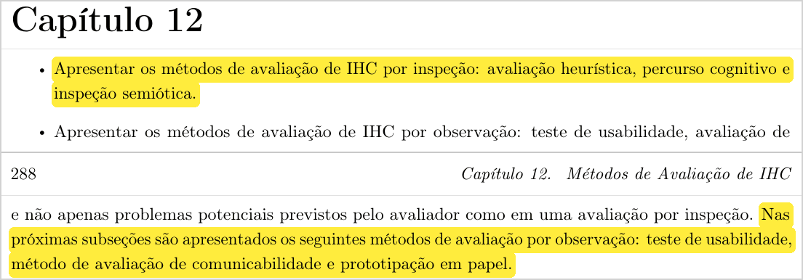

<em>Fonte: BARBOSA et al. (2021, pp. 267, 288). Itens que usam esta figura: G12, G13.</em>

---

<strong>Figura 15</strong>: Escolha do método de avaliação de acordo com o objetivo

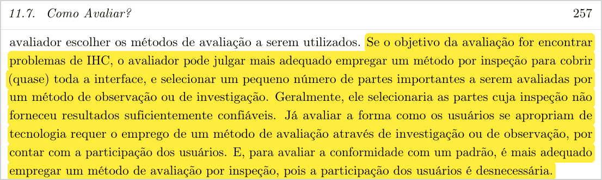

<em>Fonte: BARBOSA et al. (2021, p. 257). Itens que usam esta figura: G16.</em>

---

<strong>Figura 16</strong>: 12.1.1 Avaliação heurística: base nas heurísticas de Nielsen

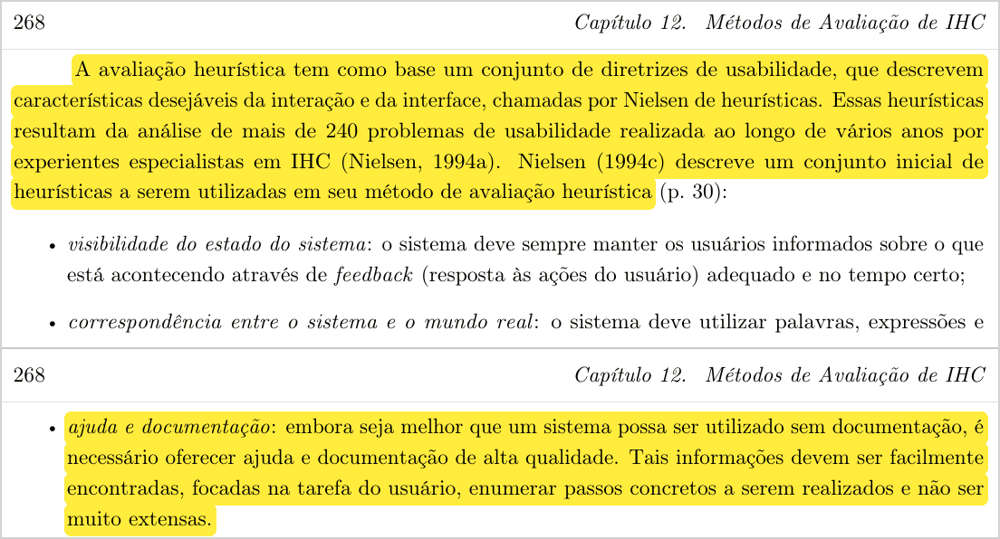

<em>Fonte: BARBOSA et al. (2021, p. 268). Itens que usam esta figura: G17.</em>

---

<strong>Figura 17</strong>: Tabela 12.1 e conteúdo do relato de uma avaliação heurística

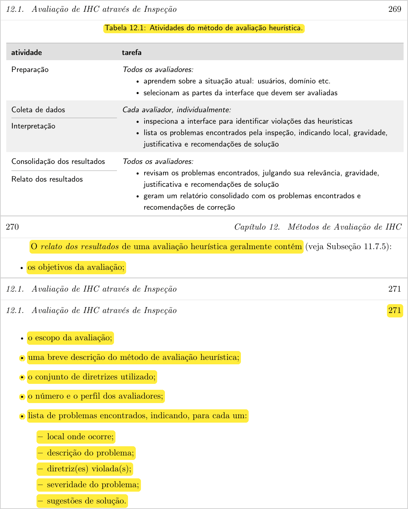

<em>Fonte: BARBOSA et al. (2021, pp. 269–271). Itens que usam esta figura: G18, G20.</em>

---

<strong>Figura 18</strong>: 12.1.1 Avaliação heurística: escala de severidade de Nielsen

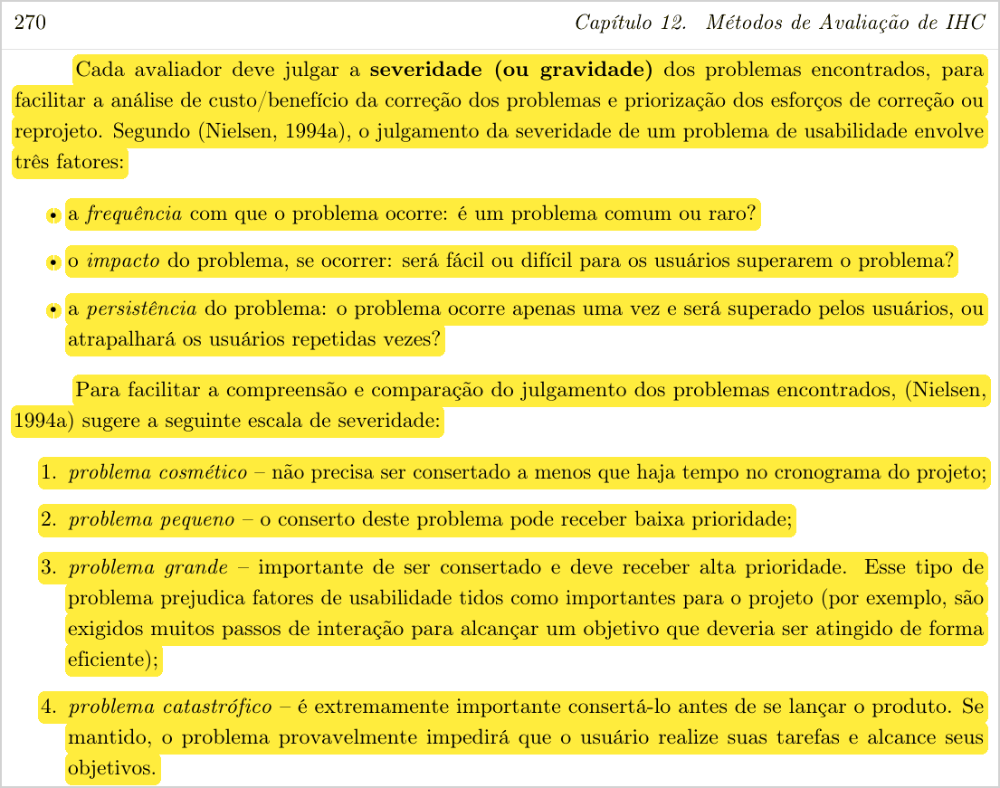

<em>Fonte: BARBOSA et al. (2021, p. 270). Itens que usam esta figura: G19.</em>

---

<strong>Figura 19</strong>: Artefatos que podem ser avaliados de forma formativa (incluindo storyboards)

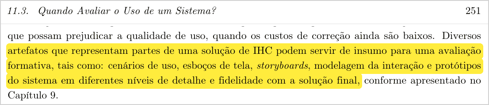

<em>Fonte: BARBOSA et al. (2021, p. 251). Itens que usam esta figura: G21.</em>

---

<strong>Figura 20</strong>: Comparação entre o uso esperado (modelo de tarefas) e o uso observado

<em>Fonte: BARBOSA et al. (2021, p. 262). Itens que usam esta figura: G22.</em>

---

<strong>Figura 21</strong>: 11.7.2 Duração das tarefas e das sessões de avaliação

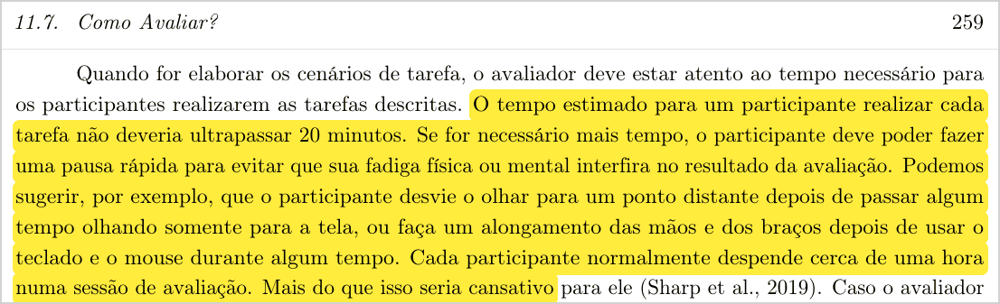

<em>Fonte: BARBOSA et al. (2021, p. 259). Itens que usam esta figura: G25.</em>

---

<strong>Figura 22</strong>: 11.7.3 Coleta de dados: dois avaliadores, anotações e não interferência

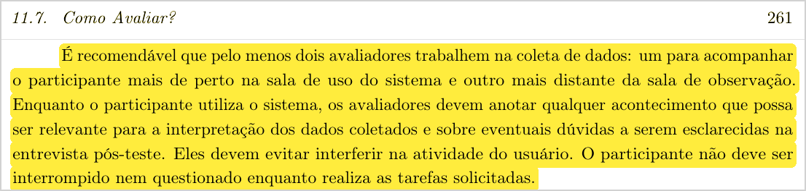

<em>Fonte: BARBOSA et al. (2021, p. 261). Itens que usam esta figura: G28.</em>

---

## Referências Bibliográficas

* BARBOSA, Simone Diniz Junqueira; SILVA, Bruno Santana da; SILVEIRA, Milene Selbach; GASPARINI, Isabela; DARIN, Ticianne; BARBOSA, Gabriel Diniz Junqueira. **Interação Humano-Computador e Experiência do Usuário**. Rio de Janeiro: Autopublicação, 2021. ISBN 978-65-00-19677-1. Versão de 03/05/2021.
* SALES, André Barros de. **Plano de Ensino: Interação Humano Computador: Turma 01**. Brasília: Universidade de Brasília, Faculdade UnB Gama, 2026. Disponível em: [plano de ensino (PDF)](../../assets/inspecoes/plano-de-ensino-ihc-2026-2-turma01-v1.pdf).
