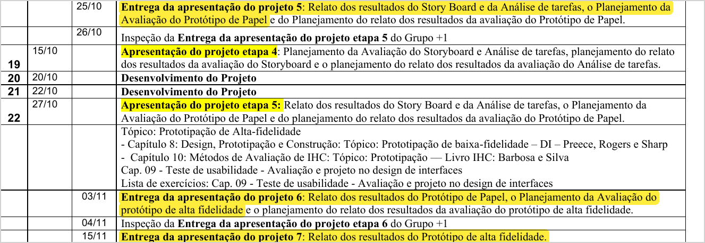
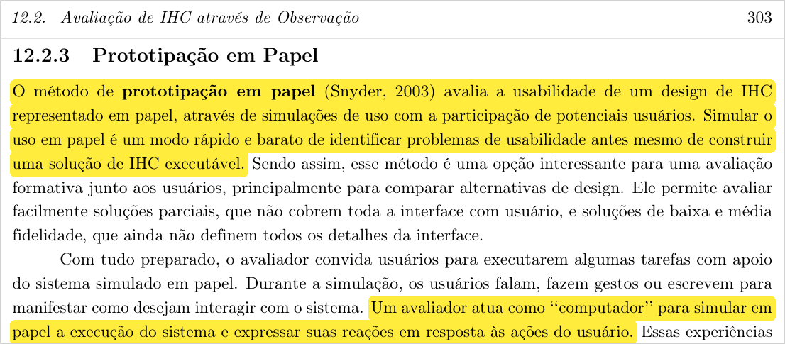
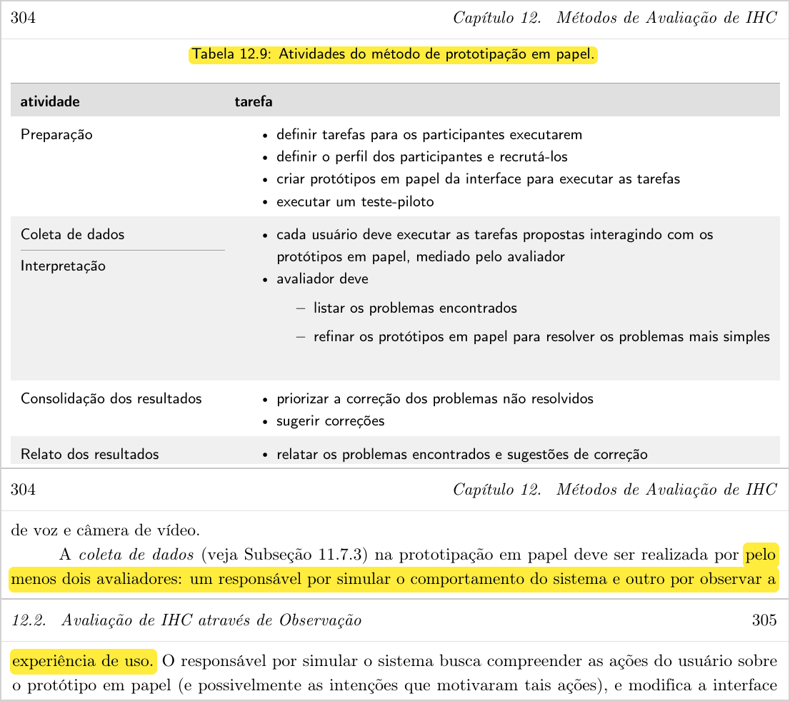
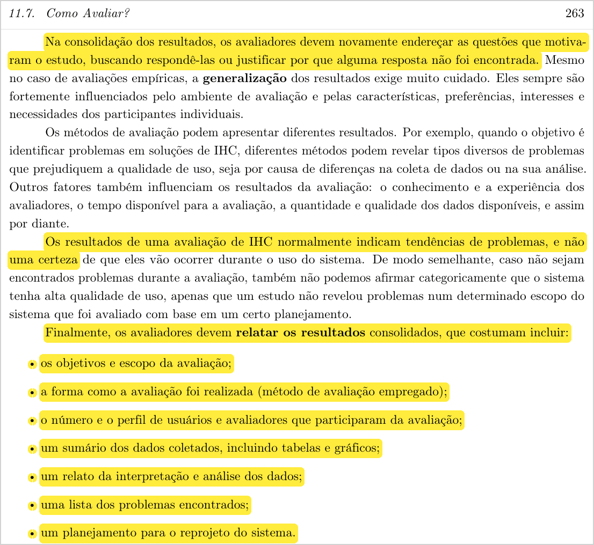

## Histórico de Versão e Contribuição

| Data | Versão | Descrição | Autor(es) | Revisor(es) | Declaração de Uso de IA |
| :---: | :---: | :--- | :--- | :--- | :--- |
| 25/10/2026 | `1.0` | Elaboração da lista de verificação do planejamento da avaliação e do planejamento do relato de resultados do protótipo de papel (publicada em [verif5.md](../verif5.md)). | [Carlos Costa](https://github.com/carloshfgit), [Lucas Araújo](https://github.com/Lucasaraujoszz), [Gabriel Melo](https://github.com/gabriellcardone-06), [Igor Dantas](https://github.com/IgorDARAUJO), [Rodrigo Carvalho](https://github.com/RodrigoCBarbosa) e [Arthur Mariani](https://github.com/arthur-mariani) | [Arthur Mariani](https://github.com/arthur-mariani) | Claude (Anthropic): uso declarado pelo autor (sem detalhamento da finalidade) |
| 19/11/2026 | `2.0` | Inclusão dos Itens do Desenvolvimento do Projeto; nova seção sobre o relato dos resultados do Storyboard e da Análise de Tarefas; correções de redação e de autoria; referências e prints do IHC.pdf. | [Gabriel Melo](https://github.com/gabriellcardone-06) | [Arthur Mariani](https://github.com/arthur-mariani) | Claude (Anthropic): uso declarado pelo autor (sem detalhamento da finalidade) |
| 22/11/2026 | `2.1` | Redução dos itens do grupo para um item por integrante (G1–G7, renumerados); Itens do Desenvolvimento do Projeto (D1–D11) mantidos sem alteração; remoção das figuras que só fundamentavam itens retirados; atualização da tabela de contribuição e da rastreabilidade. | [Gabriel Melo](https://github.com/gabriellcardone-06) | — | Claude (Anthropic): apoio na seleção dos itens mantidos, na renumeração e na atualização das referências cruzadas. |

---

# Lista de Verificação: Entrega 5 (versão 2.0)

!!! info "Versão 2.0 — rastreabilidade"
    Esta é a **versão 2.0** da lista. A versão 1.0 continua disponível, sem alterações de conteúdo, em [verif5.md](../verif5.md). O [índice das listas de verificação](../index.md) mostra onde está cada versão.

## Introdução

Esta lista verifica os artefatos da **Entrega 5: Relato dos resultados do Storyboard e da Análise de Tarefas, Planejamento da Avaliação do Protótipo de Papel e Planejamento do relato dos resultados dessa avaliação**. O conteúdo da entrega está no cronograma do Plano de Ensino ([Figura 2](#figura-2)). A versão 1.0 cobria o planejamento da avaliação do protótipo de papel e o planejamento do relato (itens 1–14), mas não o relato dos resultados do Storyboard e da Análise de Tarefas, que também faz parte da Entrega 5. Na versão 2.0, os itens 1–14 mantêm número (G1–G14) e autor, e a nova seção tem os itens G15–G24. Na versão 2.1, os itens do grupo foram reduzidos a um por integrante (G1–G7); a correspondência com a versão 2.0 está na [Tabela 6](#reducao-v21).

Para cada item, quem avalia marca **Sim**, **Não** ou **Incompleto**, como no Plano de Ensino (SALES, 2026). Quando um item não se aplica ao artefato avaliado, escreva *N/A* na linha e explique em *Observações* no registro da avaliação. A coluna *Autor(es) do item* indica quem escreveu a pergunta e quem é responsável pelo conteúdo verificado. Nos itens do professor, a pergunta é de André Barros de Sales e o integrante indicado é quem produziu o conteúdo e a evidência. A coluna *Referência* leva ao print grifado da fonte, no fim da página. As páginas do livro são as páginas impressas do *IHC.pdf* (BARBOSA et al., 2021, versão de 03/05/2021).

Os itens estão organizados assim: primeiro os **Itens do Desenvolvimento do Projeto (D1–D11)**, que se repetem em todas as listas; depois os itens de conteúdo do professor (quando a entrega tem lista no Plano de Ensino); por fim, os itens de conteúdo elaborados pelo grupo (código G).

## 1. Itens do Desenvolvimento do Projeto

O Plano de Ensino define onze itens de desenvolvimento que valem para todos os artefatos (SALES, 2026, pp. 8–9). Eles aparecem primeiro em todas as listas do grupo, da Entrega 1 à Entrega 7 (veja a Tabela 1). Nas Entregas 3 e 4, o Plano fala em “Todos os 10 itens”, mas a lista do professor tem 11; por isso os 11 foram mantidos.

<strong>Tabela 1</strong>: Itens do Desenvolvimento do Projeto (Avaliar: o próprio grupo e o grupo +1)

| Código | Pergunta de verificação | Autor(es) do item | Referência | Sim | Não | Incompleto |
| :---: | :--- | :--- | :---: | :---: | :---: | :---: |
| D1 | O histórico de versão padronizado? | **Pergunta:** André Barros de Sales (Plano de Ensino) **Inclusão na lista:** [Gabriel Melo](https://github.com/gabriellcardone-06) | [Fig. 1](#figura-1) | ☐ | ☐ | ☐ |
| D2 | O(s) autor(es) e o(s) revisor(es) para cada artefato? | **Pergunta:** André Barros de Sales (Plano de Ensino) **Inclusão na lista:** [Gabriel Melo](https://github.com/gabriellcardone-06) | [Fig. 1](#figura-1) | ☐ | ☐ | ☐ |
| D3 | Referências bibliográficas e/ou bibliografia em todos os artefatos? | **Pergunta:** André Barros de Sales (Plano de Ensino) **Inclusão na lista:** [Gabriel Melo](https://github.com/gabriellcardone-06) | [Fig. 1](#figura-1) | ☐ | ☐ | ☐ |
| D4 | As tabelas e imagens possuem legenda e fonte e são chamadas dentro do texto? | **Pergunta:** André Barros de Sales (Plano de Ensino) **Inclusão na lista:** [Gabriel Melo](https://github.com/gabriellcardone-06) | [Fig. 1](#figura-1) | ☐ | ☐ | ☐ |
| D5 | Um texto fazendo uma introdução dos artefatos? | **Pergunta:** André Barros de Sales (Plano de Ensino) **Inclusão na lista:** [Gabriel Melo](https://github.com/gabriellcardone-06) | [Fig. 1](#figura-1) | ☐ | ☐ | ☐ |
| D6 | O cronograma executado com quem realizou cada artefato/atividade, com as datas de início e fim da construção/realização do artefato/atividade? | **Pergunta:** André Barros de Sales (Plano de Ensino) **Inclusão na lista:** [Gabriel Melo](https://github.com/gabriellcardone-06) | [Fig. 1](#figura-1) | ☐ | ☐ | ☐ |
| D7 | Ata(s) da(s) reunião(ões) (com data, horário de início e do final, participantes, objetivo, atividades definidas etc.)? | **Pergunta:** André Barros de Sales (Plano de Ensino) **Inclusão na lista:** [Gabriel Melo](https://github.com/gabriellcardone-06) | [Fig. 1](#figura-1) | ☐ | ☐ | ☐ |
| D8 | A gravação da reunião do grupo? | **Pergunta:** André Barros de Sales (Plano de Ensino) **Inclusão na lista:** [Gabriel Melo](https://github.com/gabriellcardone-06) | [Fig. 1](#figura-1) | ☐ | ☐ | ☐ |
| D9 | Vídeo de apresentação na categoria “não listado” no YouTube? | **Pergunta:** André Barros de Sales (Plano de Ensino) **Inclusão na lista:** [Gabriel Melo](https://github.com/gabriellcardone-06) | [Fig. 1](#figura-1) | ☐ | ☐ | ☐ |
| D10 | Tabela de contribuição no início do artefato com o nome de todos os integrantes, com a contribuição de cada integrante e hiperligação para a atividade e para a gravação, se houver? | **Pergunta:** André Barros de Sales (Plano de Ensino) **Inclusão na lista:** [Gabriel Melo](https://github.com/gabriellcardone-06) | [Fig. 1](#figura-1) | ☐ | ☐ | ☐ |
| D11 | A seção de agradecimentos apresentando o uso de Inteligência Artificial (IA) Generativa no artefato? | **Pergunta:** André Barros de Sales (Plano de Ensino) **Inclusão na lista:** [Gabriel Melo](https://github.com/gabriellcardone-06) | [Fig. 1](#figura-1) | ☐ | ☐ | ☐ |

<em>Fonte: SALES (2026, Plano de Ensino, pp. 8–9), lista de verificação sugerida — Itens do Desenvolvimento do projeto.</em>

## 2. Planejamento da avaliação do protótipo de papel e do relato

A Tabela 2 traz os itens de Arthur Mariani, Igor Dantas, Lucas Araújo e Tomás Rocho, um de cada, escolhidos entre os itens 1–14 da versão 1.0 e mantidos com os mesmos autores.

<strong>Tabela 2</strong>: Itens para o planejamento da avaliação do protótipo de papel e o planejamento do relato

| Código | Pergunta de verificação | Autor(es) do item | Referência | Sim | Não | Incompleto |
| :---: | :--- | :--- | :---: | :---: | :---: | :---: |
| G1 | O planejamento define objetivos de avaliação claros, explicando o que se deseja descobrir sobre o uso do protótipo? | [Arthur Mariani](https://github.com/arthur-mariani) | [Fig. 4](#figura-4) | ☐ | ☐ | ☐ |
| G2 | O planejamento define quem atuará como “computador” durante a simulação e quem observará e registrará a sessão? | [Igor Dantas](https://github.com/IgorDARAUJO) | [Fig. 3](#figura-3) [Fig. 5](#figura-5) | ☐ | ☐ | ☐ |
| G3 | O planejamento prevê um teste-piloto para verificar o roteiro, os materiais, o tempo e a forma de registrar os dados antes da sessão definitiva? | [Lucas Araújo](https://github.com/Lucasaraujoszz) | [Fig. 6](#figura-6) [Fig. 5](#figura-5) | ☐ | ☐ | ☐ |
| G4 | O planejamento do relato prevê uma tabela para registrar problemas de usabilidade, a tela ou peça afetada, o impacto, a prioridade e a recomendação de correção? | [Tomás Rocho](https://github.com/TomasRocho) | [Fig. 8](#figura-8) [Fig. 9](#figura-9) | ☐ | ☐ | ☐ |

<em>Fonte: Grupo 05 (2026, v1.0), revisado na v2.0. Base: BARBOSA et al. (2021, caps. 7, 11 e 12).</em>

## 3. Relato dos resultados da avaliação do Storyboard e da Análise de Tarefas

A Tabela 3 traz os itens de Gabriel Melo, Rodrigo Carvalho e Carlos Costa sobre o relato dos resultados, um de cada. Os autores publicaram relatos individuais de nível 1.

<strong>Tabela 3</strong>: Itens para o relato dos resultados da avaliação do Storyboard e da Análise de Tarefas

| Código | Pergunta de verificação | Autor(es) do item | Referência | Sim | Não | Incompleto |
| :---: | :--- | :--- | :---: | :---: | :---: | :---: |
| G5 | O relato apresenta a lista de problemas encontrados e um planejamento do reprojeto do storyboard ou do modelo de tarefas? | [Gabriel Melo](https://github.com/gabriellcardone-06) | [Fig. 10](#figura-10) | ☐ | ☐ | ☐ |
| G6 | O relato compara o que os participantes fizeram ou disseram com os caminhos previstos nos modelos de tarefa (HTA, CTT ou GOMS) do storyboard avaliado? | [Rodrigo Carvalho](https://github.com/RodrigoCBarbosa) | [Fig. 11](#figura-11) | ☐ | ☐ | ☐ |
| G7 | O relato preserva o anonimato dos participantes (nomes fictícios ou códigos) e não expõe falhas de um participante específico? | [Carlos Costa](https://github.com/carloshfgit) | [Fig. 7](#figura-7) | ☐ | ☐ | ☐ |

<em>Fonte: elaborado pelo Grupo 05 (2026, v2.0), com base em BARBOSA et al. (2021, caps. 7 e 11).</em>

## Tabela de contribuição

A Tabela 4 mostra o que cada integrante fez nesta lista. A autoria dos itens segue o conteúdo que cada integrante produziu no projeto: quem fez o artefato é autor dos itens que o verificam. Os links levam ao artefato correspondente. As gravações das reuniões estão na página de [atas](../../atas/ata1.md) e de [gravações](../../apresentacoes/index.md).

<strong>Tabela 4</strong>: Contribuição de cada integrante nesta lista

| Integrante | Contribuição nesta lista | Artefato(s) relacionado(s) |
| :--- | :--- | :--- |
| [Arthur Mariani](https://github.com/arthur-mariani) | Coautor e revisor da versão 1.0. Item G1. | [Planejamento da avaliação do protótipo de papel](../../design-avaliacao-desenvolvimento/nivel2/planejamentos-individuais/Arthur/arthur-planejamento-avaliacao-prototipo-papel.md) |
| [Carlos Costa](https://github.com/carloshfgit) | Coautor da versão 1.0. Item G7. | [Relato do storyboard e da análise de tarefas](../../design-avaliacao-desenvolvimento/nivel1/relatos-individuais/carlos/relato-resultados-storyboard-tarefas.md), [Planejamento do protótipo de papel](../../design-avaliacao-desenvolvimento/nivel2/planejamentos-individuais/Carlos/carlos-planejamento-av-prototipo-papel.md) |
| [Gabriel Melo](https://github.com/gabriellcardone-06) | Coautor da versão 1.0. Item G5. Autor da versão 2.0 (D1–D11, nova seção, correções, prints) e da versão 2.1 (um item por integrante). | [Relato do storyboard e da análise de tarefas](../../design-avaliacao-desenvolvimento/nivel1/relatos-individuais/gabriel/relato-resultados-storyboard-tarefas.md), [Planejamento do protótipo de papel](../../design-avaliacao-desenvolvimento/nivel2/planejamentos-individuais/Gabriel/gabriel-planejamento-av-prototipo-papel.md) |
| [Igor Dantas](https://github.com/IgorDARAUJO) | Coautor da versão 1.0. Item G2. | [Relato do storyboard e da análise de tarefas](../../design-avaliacao-desenvolvimento/nivel1/relatos-individuais/igor/relato-resultados-storyboard-tarefas.md), [Planejamento do protótipo de papel](../../design-avaliacao-desenvolvimento/nivel2/planejamentos-individuais/Igor/igor-planejamento-av-prototipo-papel.md) |
| [Lucas Araújo](https://github.com/Lucasaraujoszz) | Coautor da versão 1.0. Item G3. | [Relato do storyboard e da análise de tarefas](../../design-avaliacao-desenvolvimento/nivel1/relatos-individuais/lucas/relato-resultados-storyboard-tarefas.md), [Planejamento do protótipo de papel](../../design-avaliacao-desenvolvimento/nivel2/planejamentos-individuais/Lucas/lucas-planejamento-av-prototipo-papel.md) |
| [Rodrigo Carvalho](https://github.com/RodrigoCBarbosa) | Coautor da versão 1.0. Item G6. | [Relato do storyboard e da análise de tarefas](../../design-avaliacao-desenvolvimento/nivel1/relatos-individuais/rodrigo/relato-resultados-storyboard-tarefas.md), [Planejamento do protótipo de papel](../../design-avaliacao-desenvolvimento/nivel2/planejamentos-individuais/Rodrigo/rodrigo-planejamento-av-prototipo-papel.md) |
| [Tomás Rocho](https://github.com/TomasRocho) | Item G4 (já era dele na v1.0, mas o histórico não o listava como autor). | [Planejamento do relato do protótipo de papel](../../design-avaliacao-desenvolvimento/nivel2/planejamentos-individuais/Tomas/tomas-planejamento-relato-prot-papel.md) |
| André Barros de Sales (professor) | Autor das perguntas dos Itens do Desenvolvimento do Projeto (D1–D11), retiradas da lista de verificação sugerida no Plano de Ensino. | [Plano de Ensino (PDF)](../../assets/inspecoes/plano-de-ensino-ihc-2026-2-turma01-v1.pdf) |

<em>Fonte: elaborado pelo Grupo 05 (2026).</em>

## Rastreabilidade v1.0 → v2.0

A versão 1.0 continua publicada em [verif5.md](../verif5.md) e não foi apagada. A Tabela 5 indica onde cada item da versão 1.0 está nesta versão e o que mudou. Os códigos G desta tabela são os da versão 2.0; a numeração atual está na [Tabela 6](#reducao-v21).

<strong>Tabela 5</strong>: Rastreabilidade entre a versão 1.0 e a versão 2.0

| Item na v1.0 | Item na v2.0 | Alteração |
| :---: | :---: | :--- |
| 1–14 | G1–G14 | Mesmo número e mesmo autor, com prefixo G; referência e print acrescentados. |
| 3, 4 | G3, G4 | Autor exibido como “Carlos Henrique” na v1.0; padronizado como Carlos Costa, nome usado nas demais listas (mesmo perfil do GitHub). |
| 11 | G11 | “Protege a participante” passou a “protege os participantes”: o item vale para qualquer participante. |
| — | G15–G24 | Novos: seção do relato dos resultados do Storyboard e da Análise de Tarefas, que fazia parte da Entrega 5 e não tinha itens. |
| Histórico de versão | Tabela de contribuição | A v1.0 não listava Tomás Rocho entre os autores, embora ele fosse autor dos itens 13 e 14. |
| Bibliografia (Barbosa et al., 2021e 358–361) | Referências | Atualizada para BARBOSA et al. (2021, pp. 258–264 e 303–306), com prints. |

<em>Fonte: elaborado pelo Grupo 05 (2026).</em>

## Redução para um item por integrante (versão 2.1) { #reducao-v21 }

Na versão 2.1, os itens de conteúdo elaborados pelo grupo foram reduzidos a um item por integrante. O Plano de Ensino pede que cada integrante elabore ao menos um item de conteúdo da disciplina, com referência e foto do texto da referência (SALES, 2026, pp. 11–13). Os Itens do Desenvolvimento do Projeto (D1–D11) não mudaram; o Plano de Ensino não traz itens de conteúdo para esta entrega. Para cada integrante, ficou o item que verifica o artefato produzido por ele. Os itens mantidos foram renumerados de G1 a G7, e as figuras que só fundamentavam itens retirados saíram da página. O texto completo da versão 2.0 continua no [histórico do repositório](https://github.com/Interacao-Humano-Computador/2026.2-Grupo05/blob/6fdf400a9ceec5605bcfc45c13ad3723865a2c8c/docs/verificacao/v2/verif5.md). A Tabela 6 mostra a correspondência.

<strong>Tabela 6</strong>: Itens do grupo mantidos e removidos na versão 2.1

| Integrante | Item mantido (v2.0 → v2.1) | Itens removidos (códigos da v2.0) |
| :--- | :---: | :---: |
| [Arthur Mariani](https://github.com/arthur-mariani) | G2 → G1 | G1 |
| [Carlos Costa](https://github.com/carloshfgit) | G24 → G7 | G3, G4, G16 |
| [Gabriel Melo](https://github.com/gabriellcardone-06) | G21 → G5 | G5, G6, G15 |
| [Igor Dantas](https://github.com/IgorDARAUJO) | G7 → G2 | G8, G17, G20 |
| [Lucas Araújo](https://github.com/Lucasaraujoszz) | G9 → G3 | G10, G18, G22 |
| [Rodrigo Carvalho](https://github.com/RodrigoCBarbosa) | G23 → G6 | G11, G12, G19 |
| [Tomás Rocho](https://github.com/TomasRocho) | G13 → G4 | G14 |

<em>Fonte: elaborado pelo Grupo 05 (2026).</em>

## Registro da avaliação

O Plano de Ensino pede a resposta (Sim / Não / Incompleto) e a versão, a data e a hora da avaliação. Cada aplicação desta lista deve ser registrada na Tabela 7.

<strong>Tabela 7</strong>: Registro das avaliações feitas com esta lista

| Artefato e versão avaliada | Data e hora | Avaliador(es) | Grupo avaliador (próprio ou +1) | Observações |
| :--- | :---: | :--- | :---: | :--- |
| | | | | |

<em>Fonte: elaborado pelo Grupo 05 (2026), a partir de SALES (2026).</em>

---

## Fotos de Referência

As figuras a seguir são recortes das fontes citadas nos itens desta lista, com o trecho que fundamenta cada item grifado em amarelo. Os recortes do livro foram retirados do arquivo *IHC.pdf* (BARBOSA et al., 2021, versão de 03/05/2021) e a numeração indicada é a numeração impressa nas páginas. Os recortes do Plano de Ensino foram retirados da versão disponibilizada pelo professor na turma 01 (SALES, 2026), com o número da página do PDF.

---

<strong>Figura 1</strong>: Itens do Desenvolvimento do projeto (1 a 11) da lista de verificação sugerida pelo professor

<em>Fonte: SALES (2026, Plano de Ensino, pp. 8–9). Itens que usam esta figura: D1, D2, D3, D4, D5, D6, D7, D8, D9, D10, D11.</em>

---

<strong>Figura 2</strong>: Conteúdo das Entregas 5, 6 e 7 no cronograma do Plano de Ensino

<em>Fonte: SALES (2026, Plano de Ensino, p. 5). Itens que usam esta figura: Introdução.</em>

---

<strong>Figura 3</strong>: 12.2.3 Prototipação em papel: método e papel do avaliador como ‘computador’

<em>Fonte: BARBOSA et al. (2021, p. 303). Itens que usam esta figura: G2.</em>

---

<strong>Figura 4</strong>: 11.8 Framework DECIDE

<em>Fonte: BARBOSA et al. (2021, p. 264). Itens que usam esta figura: G1.</em>

---

<strong>Figura 5</strong>: Tabela 12.9 – Atividades do método de prototipação em papel

<em>Fonte: BARBOSA et al. (2021, pp. 304–305). Itens que usam esta figura: G2, G3.</em>

---

<strong>Figura 6</strong>: 11.7.2 Teste-piloto: objetivo e descarte dos dados

<em>Fonte: BARBOSA et al. (2021, p. 260). Itens que usam esta figura: G3.</em>

---

<strong>Figura 7</strong>: Confidencialidade dos dados e anonimato dos participantes

<em>Fonte: BARBOSA et al. (2021, p. 127). Itens que usam esta figura: G7.</em>

---

<strong>Figura 8</strong>: 12.2.3 Prototipação em papel: refinamento, priorização e relato

<em>Fonte: BARBOSA et al. (2021, pp. 305–306). Itens que usam esta figura: G4.</em>

---

<strong>Figura 9</strong>: Prototipação em papel: conteúdo do relato dos resultados

<em>Fonte: BARBOSA et al. (2021, pp. 305–306). Itens que usam esta figura: G4.</em>

---

<strong>Figura 10</strong>: 11.7.5 Consolidação e relato dos resultados

<em>Fonte: BARBOSA et al. (2021, p. 263). Itens que usam esta figura: G5.</em>

---

<strong>Figura 11</strong>: Comparação entre o uso esperado (modelo de tarefas) e o uso observado

<em>Fonte: BARBOSA et al. (2021, p. 262). Itens que usam esta figura: G6.</em>

---

## Referências Bibliográficas

* BARBOSA, Simone Diniz Junqueira; SILVA, Bruno Santana da; SILVEIRA, Milene Selbach; GASPARINI, Isabela; DARIN, Ticianne; BARBOSA, Gabriel Diniz Junqueira. **Interação Humano-Computador e Experiência do Usuário**. Rio de Janeiro: Autopublicação, 2021. ISBN 978-65-00-19677-1. Versão de 03/05/2021.
* SALES, André Barros de. **Plano de Ensino: Interação Humano Computador: Turma 01**. Brasília: Universidade de Brasília, Faculdade UnB Gama, 2026. Disponível em: [plano de ensino (PDF)](../../assets/inspecoes/plano-de-ensino-ihc-2026-2-turma01-v1.pdf).
