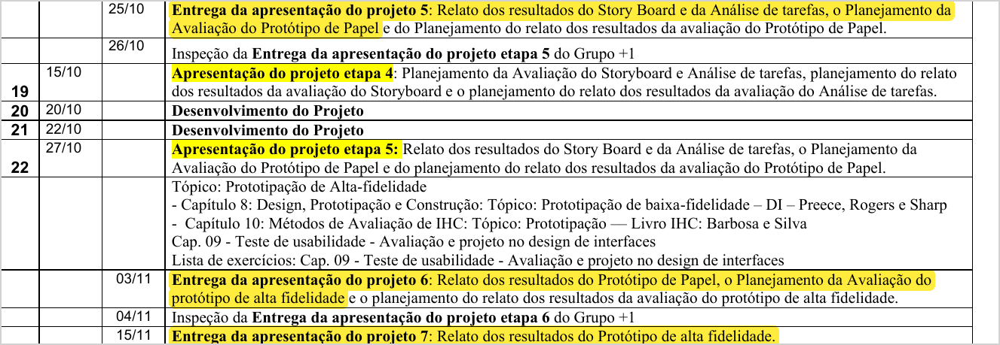
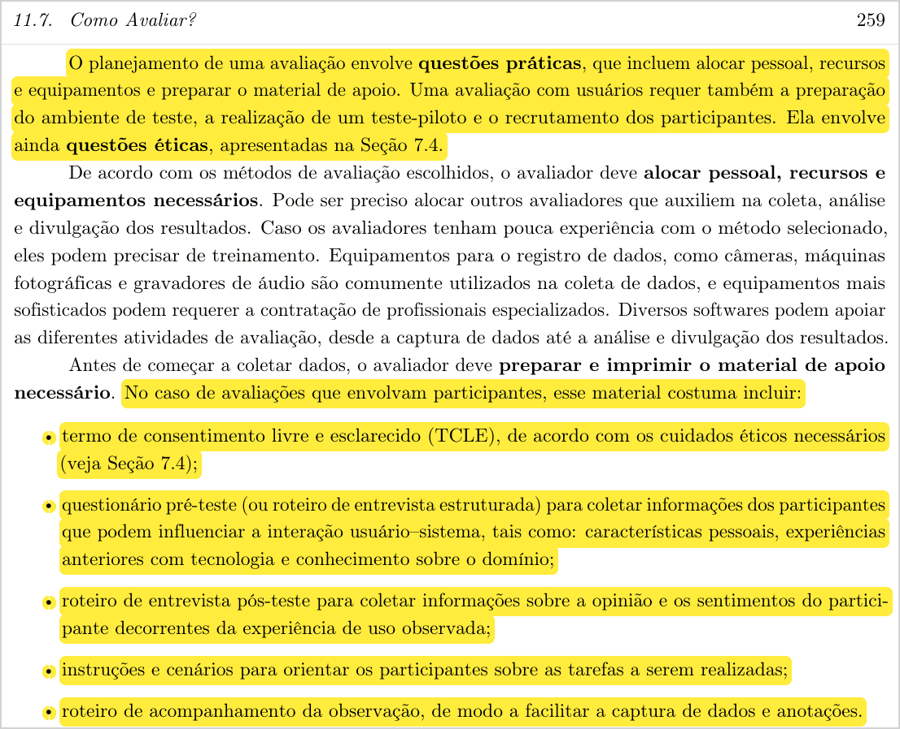
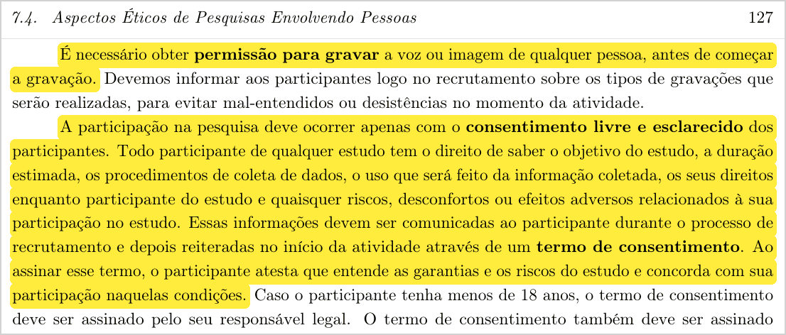
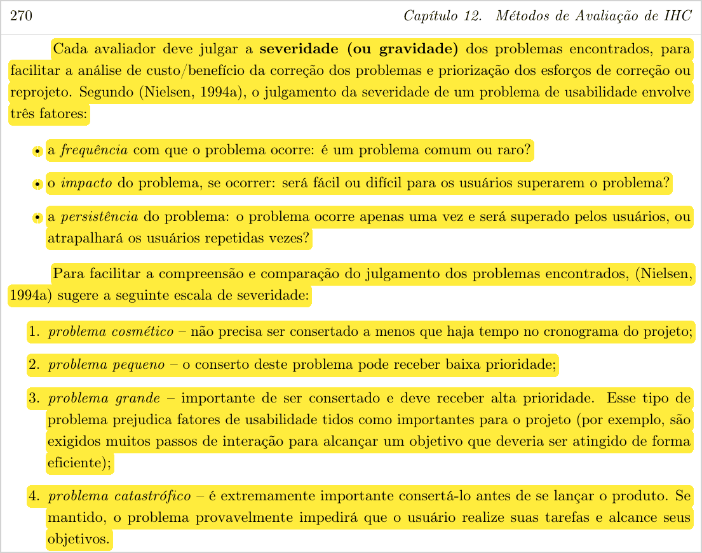
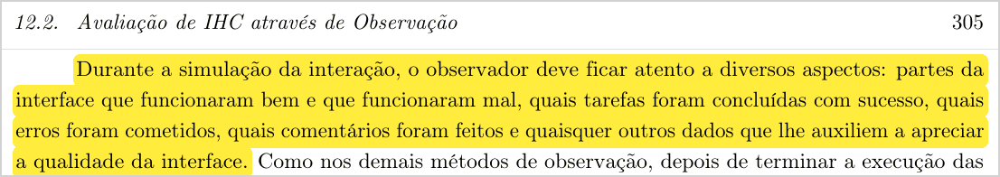

## Histórico de Versão e Contribuição

| Data | Versão | Descrição | Autor(es) | Revisor(es) | Declaração de Uso de IA |
| :---: | :---: | :--- | :--- | :--- | :--- |
| 02/11/2026 | `1.0` | Elaboração da lista de verificação do planejamento da avaliação e do planejamento do relato de resultados do protótipo de alta fidelidade (publicada em [verif6.md](../verif6.md)). | [Carlos Costa](https://github.com/carloshfgit), [Lucas Araújo](https://github.com/Lucasaraujoszz), [Gabriel Melo](https://github.com/gabriellcardone-06), [Igor Dantas](https://github.com/IgorDARAUJO), [Rodrigo Carvalho](https://github.com/RodrigoCBarbosa) e [Arthur Mariani](https://github.com/arthur-mariani) | [Arthur Mariani](https://github.com/arthur-mariani) | Claude (Anthropic): uso declarado pelo autor (sem detalhamento da finalidade) |

---

# Lista de Verificação: Entrega 6 (versão 2.0)

!!! info "Versão 2.0 — rastreabilidade"
    Esta é a **versão 2.0** da lista. A versão 1.0 continua disponível, sem alterações de conteúdo, em [verif6.md](../verif6.md). O [índice das listas de verificação](../index.md) mostra onde está cada versão.

## Introdução

Esta lista verifica os artefatos da **Entrega 6: Relato dos resultados do Protótipo de Papel, Planejamento da Avaliação do protótipo de alta fidelidade e Planejamento do relato dos resultados dessa avaliação**. O conteúdo da entrega está no cronograma do Plano de Ensino ([Figura 2](#figura-2)). A versão 1.0 cobria o planejamento da avaliação do protótipo de alta fidelidade (itens 1–7) e o planejamento do relato (itens 8–14), mas não o relato dos resultados do protótipo de papel, que também faz parte da Entrega 6. Na versão 2.0, os itens 1–14 mantêm número (G1–G14) e autor, e a nova seção tem os itens G15–G21, um por integrante.

Para cada item, quem avalia marca **Sim**, **Não** ou **Incompleto**, como no Plano de Ensino (SALES, 2026). Quando um item não se aplica ao artefato avaliado, escreva *N/A* na linha e explique em *Observações* no registro da avaliação. A coluna *Autor(es) do item* indica quem escreveu a pergunta e quem é responsável pelo conteúdo verificado. Nos itens do professor, a pergunta é de André Barros de Sales e o integrante indicado é quem produziu o conteúdo e a evidência. A coluna *Referência* leva ao print grifado da fonte, no fim da página. As páginas do livro são as páginas impressas do *IHC.pdf* (BARBOSA et al., 2021, versão de 03/05/2021).

Os itens estão organizados assim: primeiro os **Itens do Desenvolvimento do Projeto (D1–D11)**, que se repetem em todas as listas; depois os itens de conteúdo do professor (quando a entrega tem lista no Plano de Ensino); por fim, os itens de conteúdo elaborados pelo grupo (código G).

## 1. Itens do Desenvolvimento do Projeto

O Plano de Ensino define onze itens de desenvolvimento que valem para todos os artefatos (SALES, 2026, pp. 8–9). Eles aparecem primeiro em todas as listas do grupo, da Entrega 1 à Entrega 7 (veja a Tabela 1). Nas Entregas 3 e 4, o Plano fala em “Todos os 10 itens”, mas a lista do professor tem 11; por isso os 11 foram mantidos.

<strong>Tabela 1</strong>: Itens do Desenvolvimento do Projeto (Avaliar: o próprio grupo e o grupo +1)

| Código | Pergunta de verificação | Autor(es) do item | Referência | Sim | Não | Incompleto |
| :---: | :--- | :--- | :---: | :---: | :---: | :---: |
| D1 | O histórico de versão padronizado? | **Pergunta:** André Barros de Sales (Plano de Ensino) **Inclusão na lista:** [Gabriel Melo](https://github.com/gabriellcardone-06) | [Fig. 1](#figura-1) | ☐ | ☐ | ☐ |
| D2 | O(s) autor(es) e o(s) revisor(es) para cada artefato? | **Pergunta:** André Barros de Sales (Plano de Ensino) **Inclusão na lista:** [Gabriel Melo](https://github.com/gabriellcardone-06) | [Fig. 1](#figura-1) | ☐ | ☐ | ☐ |
| D3 | Referências bibliográficas e/ou bibliografia em todos os artefatos? | **Pergunta:** André Barros de Sales (Plano de Ensino) **Inclusão na lista:** [Gabriel Melo](https://github.com/gabriellcardone-06) | [Fig. 1](#figura-1) | ☐ | ☐ | ☐ |
| D4 | As tabelas e imagens possuem legenda e fonte e são chamadas dentro do texto? | **Pergunta:** André Barros de Sales (Plano de Ensino) **Inclusão na lista:** [Gabriel Melo](https://github.com/gabriellcardone-06) | [Fig. 1](#figura-1) | ☐ | ☐ | ☐ |
| D5 | Um texto fazendo uma introdução dos artefatos? | **Pergunta:** André Barros de Sales (Plano de Ensino) **Inclusão na lista:** [Gabriel Melo](https://github.com/gabriellcardone-06) | [Fig. 1](#figura-1) | ☐ | ☐ | ☐ |
| D6 | O cronograma executado com quem realizou cada artefato/atividade, com as datas de início e fim da construção/realização do artefato/atividade? | **Pergunta:** André Barros de Sales (Plano de Ensino) **Inclusão na lista:** [Gabriel Melo](https://github.com/gabriellcardone-06) | [Fig. 1](#figura-1) | ☐ | ☐ | ☐ |
| D7 | Ata(s) da(s) reunião(ões) (com data, horário de início e do final, participantes, objetivo, atividades definidas etc.)? | **Pergunta:** André Barros de Sales (Plano de Ensino) **Inclusão na lista:** [Gabriel Melo](https://github.com/gabriellcardone-06) | [Fig. 1](#figura-1) | ☐ | ☐ | ☐ |
| D8 | A gravação da reunião do grupo? | **Pergunta:** André Barros de Sales (Plano de Ensino) **Inclusão na lista:** [Gabriel Melo](https://github.com/gabriellcardone-06) | [Fig. 1](#figura-1) | ☐ | ☐ | ☐ |
| D9 | Vídeo de apresentação na categoria “não listado” no YouTube? | **Pergunta:** André Barros de Sales (Plano de Ensino) **Inclusão na lista:** [Gabriel Melo](https://github.com/gabriellcardone-06) | [Fig. 1](#figura-1) | ☐ | ☐ | ☐ |
| D10 | Tabela de contribuição no início do artefato com o nome de todos os integrantes, com a contribuição de cada integrante e hiperligação para a atividade e para a gravação, se houver? | **Pergunta:** André Barros de Sales (Plano de Ensino) **Inclusão na lista:** [Gabriel Melo](https://github.com/gabriellcardone-06) | [Fig. 1](#figura-1) | ☐ | ☐ | ☐ |
| D11 | A seção de agradecimentos apresentando o uso de Inteligência Artificial (IA) Generativa no artefato? | **Pergunta:** André Barros de Sales (Plano de Ensino) **Inclusão na lista:** [Gabriel Melo](https://github.com/gabriellcardone-06) | [Fig. 1](#figura-1) | ☐ | ☐ | ☐ |

<em>Fonte: SALES (2026, Plano de Ensino, pp. 8–9), lista de verificação sugerida — Itens do Desenvolvimento do projeto.</em>

## 2. Planejamento da avaliação do protótipo de alta fidelidade e do relato

A Tabela 2 traz os itens 1–14 da versão 1.0, com os mesmos autores.

<strong>Tabela 2</strong>: Itens para o planejamento da avaliação do protótipo de alta fidelidade e o planejamento do relato

| Código | Pergunta de verificação | Autor(es) do item | Referência | Sim | Não | Incompleto |
| :---: | :--- | :--- | :---: | :---: | :---: | :---: |
| G1 | O planejamento define com clareza o objetivo e o escopo da avaliação do protótipo? | [Arthur Mariani](https://github.com/arthur-mariani) | [Fig. 3](#figura-3) [Fig. 4](#figura-4) | ☐ | ☐ | ☐ |
| G2 | O planejamento apresenta perguntas específicas que a avaliação deverá responder? | [Carlos Costa](https://github.com/carloshfgit) | [Fig. 3](#figura-3) | ☐ | ☐ | ☐ |
| G3 | O método de avaliação escolhido é adequado às perguntas e aos recursos disponíveis? | [Gabriel Melo](https://github.com/gabriellcardone-06) | [Fig. 3](#figura-3) [Fig. 5](#figura-5) | ☐ | ☐ | ☐ |
| G4 | O planejamento define o perfil e a quantidade de participantes compatíveis com o público-alvo? | [Igor Dantas](https://github.com/IgorDARAUJO) | [Fig. 4](#figura-4) | ☐ | ☐ | ☐ |
| G5 | O planejamento descreve as tarefas que os participantes executarão no protótipo? | [Lucas Araújo](https://github.com/Lucasaraujoszz) | [Fig. 6](#figura-6) [Fig. 5](#figura-5) | ☐ | ☐ | ☐ |
| G6 | O planejamento prevê um teste-piloto para conferir as instruções, o protótipo, o registro dos dados e o tempo das tarefas? | [Rodrigo Carvalho](https://github.com/RodrigoCBarbosa) | [Fig. 7](#figura-7) | ☐ | ☐ | ☐ |
| G7 | O planejamento prevê consentimento, anonimato, participação voluntária e autorização para gravações? | [Tomás Rocho](https://github.com/TomasRocho) | [Fig. 8](#figura-8) [Fig. 9](#figura-9) | ☐ | ☐ | ☐ |
| G8 | O planejamento do relato prevê apresentar os objetivos, o escopo e o método usado na avaliação? | [Arthur Mariani](https://github.com/arthur-mariani) | [Fig. 10](#figura-10) | ☐ | ☐ | ☐ |
| G9 | O planejamento do relato prevê informar a quantidade e o perfil dos participantes e dos avaliadores? | [Carlos Costa](https://github.com/carloshfgit) | [Fig. 10](#figura-10) | ☐ | ☐ | ☐ |
| G10 | O planejamento do relato prevê resumir, por tarefa, dados como conclusão, tempo, erros e uso de ajuda? | [Gabriel Melo](https://github.com/gabriellcardone-06) | [Fig. 5](#figura-5) | ☐ | ☐ | ☐ |
| G11 | O planejamento do relato prevê interpretar os dados de cada participante para responder às perguntas da avaliação? | [Igor Dantas](https://github.com/IgorDARAUJO) | [Fig. 11](#figura-11) | ☐ | ☐ | ☐ |
| G12 | O planejamento do relato prevê reunir os resultados dos participantes e indicar quais perguntas ficaram sem resposta? | [Lucas Araújo](https://github.com/Lucasaraujoszz) | [Fig. 10](#figura-10) | ☐ | ☐ | ☐ |
| G13 | O planejamento do relato prevê listar cada problema com sua localização, seu impacto e uma sugestão de solução? | [Rodrigo Carvalho](https://github.com/RodrigoCBarbosa) | [Fig. 10](#figura-10) [Fig. 12](#figura-12) | ☐ | ☐ | ☐ |
| G14 | O planejamento do relato prevê apresentar as limitações dos resultados e um plano de reprojeto? | [Tomás Rocho](https://github.com/TomasRocho) | [Fig. 10](#figura-10) | ☐ | ☐ | ☐ |

<em>Fonte: Grupo 05 (2026, v1.0), revisado na v2.0. Base: BARBOSA et al. (2021, caps. 7, 11 e 12).</em>

## 3. Relato dos resultados da avaliação do protótipo de papel

A Tabela 3 traz os itens novos. Todos os integrantes publicaram relato individual do protótipo de papel, e cada um é autor de um item.

<strong>Tabela 3</strong>: Itens para o relato dos resultados da avaliação do protótipo de papel

| Código | Pergunta de verificação | Autor(es) do item | Referência | Sim | Não | Incompleto |
| :---: | :--- | :--- | :---: | :---: | :---: | :---: |
| G15 | O relato informa os objetivos da avaliação e descreve brevemente o método de prototipação em papel? | [Arthur Mariani](https://github.com/arthur-mariani) | [Fig. 13](#figura-13) | ☐ | ☐ | ☐ |
| G16 | O relato informa o número e o perfil dos avaliadores e dos participantes? | [Carlos Costa](https://github.com/carloshfgit) | [Fig. 13](#figura-13) | ☐ | ☐ | ☐ |
| G17 | O relato apresenta as tarefas executadas pelos participantes? | [Gabriel Melo](https://github.com/gabriellcardone-06) | [Fig. 13](#figura-13) | ☐ | ☐ | ☐ |
| G18 | O relato lista os problemas corrigidos durante os ciclos de avaliação e reprojeto, com local, fatores de usabilidade prejudicados, descrição, correção feita e se o problema voltou a ocorrer? | [Igor Dantas](https://github.com/IgorDARAUJO) | [Fig. 13](#figura-13) [Fig. 14](#figura-14) | ☐ | ☐ | ☐ |
| G19 | O relato lista os problemas ainda não corrigidos, com prioridade para correção definida pela gravidade e pela frequência? | [Lucas Araújo](https://github.com/Lucasaraujoszz) | [Fig. 13](#figura-13) [Fig. 14](#figura-14) | ☐ | ☐ | ☐ |
| G20 | Para cada problema não corrigido, o relato apresenta sugestões de correção e indica partes do sistema que podem ser mais bem elaboradas? | [Rodrigo Carvalho](https://github.com/RodrigoCBarbosa) | [Fig. 13](#figura-13) | ☐ | ☐ | ☐ |
| G21 | O relato registra o que o observador anotou: partes da interface que funcionaram bem ou mal, tarefas concluídas, erros cometidos e comentários dos participantes? | [Tomás Rocho](https://github.com/TomasRocho) | [Fig. 15](#figura-15) | ☐ | ☐ | ☐ |

<em>Fonte: elaborado pelo Grupo 05 (2026, v2.0), com base em BARBOSA et al. (2021, pp. 305–306).</em>

## Tabela de contribuição

A Tabela 4 mostra o que cada integrante fez nesta lista. A autoria dos itens segue o conteúdo que cada integrante produziu no projeto: quem fez o artefato é autor dos itens que o verificam. Os links levam ao artefato correspondente. As gravações das reuniões estão na página de [atas](../../atas/ata1.md) e de [gravações](../../apresentacoes/index.md).

<strong>Tabela 4</strong>: Contribuição de cada integrante nesta lista

| Integrante | Contribuição nesta lista | Artefato(s) relacionado(s) |
| :--- | :--- | :--- |
| [Arthur Mariani](https://github.com/arthur-mariani) | Coautor e revisor da versão 1.0. Itens G1, G8 e G15. | [Relato do protótipo de papel](../../design-avaliacao-desenvolvimento/nivel2/relatos-individuais/arthur/relato-resultados-prototipo-papel.md), [Planejamento da alta fidelidade](../../design-avaliacao-desenvolvimento/nivel3/planejamentos-individuais/Arthur/arthur-planejamento-avaliacao-prototipo-alta-fidelidade.md) |
| [Carlos Costa](https://github.com/carloshfgit) | Coautor da versão 1.0. Itens G2, G9 e G16. | [Relato do protótipo de papel](../../design-avaliacao-desenvolvimento/nivel2/relatos-individuais/carlos/relato-resultados-prot-papel.md), [Planejamento da alta fidelidade](../../design-avaliacao-desenvolvimento/nivel3/planejamentos-individuais/carlos/carlos-planejamento-av-prot-alta-fidel.md) |
| [Gabriel Melo](https://github.com/gabriellcardone-06) | Coautor da versão 1.0. Itens G3, G10 e G17. Autor da versão 2.0 (D1–D11, nova seção, prints). | [Relato do protótipo de papel](../../design-avaliacao-desenvolvimento/nivel2/relatos-individuais/gabriel/relato-resultado-prot-papel.md), [Planejamento da alta fidelidade](../../design-avaliacao-desenvolvimento/nivel3/planejamentos-individuais/gabriel/planejamento-av-prot-alta-fidel.md) |
| [Igor Dantas](https://github.com/IgorDARAUJO) | Coautor da versão 1.0. Itens G4, G11 e G18. | [Relato do protótipo de papel](../../design-avaliacao-desenvolvimento/nivel2/relatos-individuais/igor/relato-resultados-prot-papel.md), [Planejamento da alta fidelidade](../../design-avaliacao-desenvolvimento/nivel3/planejamentos-individuais/igor/planejamento-av-prot-alta-fidel.md) |
| [Lucas Araújo](https://github.com/Lucasaraujoszz) | Coautor da versão 1.0. Itens G5, G12 e G19. | [Relato do protótipo de papel](../../design-avaliacao-desenvolvimento/nivel2/relatos-individuais/lucas/relato-resultados-prot-papel.md), [Planejamento da alta fidelidade](../../design-avaliacao-desenvolvimento/nivel3/planejamentos-individuais/lucas/planejamento-av-prot-alta-fidel.md) |
| [Rodrigo Carvalho](https://github.com/RodrigoCBarbosa) | Coautor da versão 1.0. Itens G6, G13 e G20. | [Relato do protótipo de papel](../../design-avaliacao-desenvolvimento/nivel2/relatos-individuais/rodrigo/relato-resultado-prot-papel.md), [Planejamento da alta fidelidade](../../design-avaliacao-desenvolvimento/nivel3/planejamentos-individuais/rodrigo/rodrigo-planejamento-av-prot-alta-fidel.md) |
| [Tomás Rocho](https://github.com/TomasRocho) | Itens G7, G14 e G21 (G7 e G14 já eram dele na v1.0, mas o histórico não o listava como autor). | [Relato do protótipo de papel](../../design-avaliacao-desenvolvimento/nivel2/relatos-individuais/tomas/relato-resultados-prot-papel.md), [Planejamento da alta fidelidade](../../design-avaliacao-desenvolvimento/nivel3/planejamentos-individuais/tomas/tomas-planejamento-av-prot-alta-fidel.md) |
| André Barros de Sales (professor) | Autor das perguntas dos Itens do Desenvolvimento do Projeto (D1–D11), retiradas da lista de verificação sugerida no Plano de Ensino. | [Plano de Ensino (PDF)](../../assets/inspecoes/plano-de-ensino-ihc-2026-2-turma01-v1.pdf) |

<em>Fonte: elaborado pelo Grupo 05 (2026).</em>

## Rastreabilidade v1.0 → v2.0

A versão 1.0 continua publicada em [verif6.md](../verif6.md) e não foi apagada. A Tabela 5 indica onde cada item da versão 1.0 está nesta versão e o que mudou.

<strong>Tabela 5</strong>: Rastreabilidade entre a versão 1.0 e a versão 2.0

| Item na v1.0 | Item na v2.0 | Alteração |
| :---: | :---: | :--- |
| 1–14 | G1–G14 | Mesmo número e mesmo autor, com prefixo G; referência e print acrescentados. |
| 2, 9 | G2, G9 | Autor exibido como “Carlos Henrique” na v1.0; padronizado como Carlos Costa (mesmo perfil do GitHub). |
| — | G15–G21 | Novos: seção do relato dos resultados do protótipo de papel, que fazia parte da Entrega 6 e não tinha itens. |
| Histórico de versão | Tabela de contribuição | A v1.0 não listava Tomás Rocho entre os autores, embora ele fosse autor dos itens 7 e 14. |
| Bibliografia (Barbosa et al., 2021e 341–343) | Referências | Atualizada para BARBOSA et al. (2021, pp. 127–128, 258–264, 288–289 e 305–306), com prints. |

<em>Fonte: elaborado pelo Grupo 05 (2026).</em>

## Registro da avaliação

O Plano de Ensino pede a resposta (Sim / Não / Incompleto) e a versão, a data e a hora da avaliação. Cada aplicação desta lista deve ser registrada na Tabela 6.

<strong>Tabela 6</strong>: Registro das avaliações feitas com esta lista

| Artefato e versão avaliada | Data e hora | Avaliador(es) | Grupo avaliador (próprio ou +1) | Observações |
| :--- | :---: | :--- | :---: | :--- |
| | | | | |

<em>Fonte: elaborado pelo Grupo 05 (2026), a partir de SALES (2026).</em>

---

## Fotos de Referência

As figuras a seguir são recortes das fontes citadas nos itens desta lista, com o trecho que fundamenta cada item grifado em amarelo. Os recortes do livro foram retirados do arquivo *IHC.pdf* (BARBOSA et al., 2021, versão de 03/05/2021) e a numeração indicada é a numeração impressa nas páginas. Os recortes do Plano de Ensino foram retirados da versão disponibilizada pelo professor na turma 01 (SALES, 2026), com o número da página do PDF.

---

<strong>Figura 1</strong>: Itens do Desenvolvimento do projeto (1 a 11) da lista de verificação sugerida pelo professor

<em>Fonte: SALES (2026, Plano de Ensino, pp. 8–9). Itens que usam esta figura: D1, D2, D3, D4, D5, D6, D7, D8, D9, D10, D11.</em>

---

<strong>Figura 2</strong>: Conteúdo das Entregas 5, 6 e 7 no cronograma do Plano de Ensino

<em>Fonte: SALES (2026, Plano de Ensino, p. 5). Itens que usam esta figura: Introdução.</em>

---

<strong>Figura 3</strong>: 11.8 Framework DECIDE

<em>Fonte: BARBOSA et al. (2021, p. 264). Itens que usam esta figura: G1, G2, G3.</em>

---

<strong>Figura 4</strong>: 11.7.2 Escopo da avaliação, perfil e número de participantes

<em>Fonte: BARBOSA et al. (2021, p. 258). Itens que usam esta figura: G1, G4.</em>

---

<strong>Figura 5</strong>: 12.2.1 Teste de usabilidade: objetivo, atividades e medidas por tarefa

<em>Fonte: BARBOSA et al. (2021, pp. 288–289). Itens que usam esta figura: G3, G5, G10.</em>

---

<strong>Figura 6</strong>: 11.7.2 Questões práticas e material de apoio da avaliação

<em>Fonte: BARBOSA et al. (2021, p. 259). Itens que usam esta figura: G5.</em>

---

<strong>Figura 7</strong>: 11.7.2 Teste-piloto: objetivo e descarte dos dados

<em>Fonte: BARBOSA et al. (2021, p. 260). Itens que usam esta figura: G6.</em>

---

<strong>Figura 8</strong>: Permissão para gravação e consentimento livre e esclarecido

<em>Fonte: BARBOSA et al. (2021, p. 127). Itens que usam esta figura: G7.</em>

---

<strong>Figura 9</strong>: Confidencialidade dos dados e anonimato dos participantes

<em>Fonte: BARBOSA et al. (2021, p. 127). Itens que usam esta figura: G7.</em>

---

<strong>Figura 10</strong>: 11.7.5 Consolidação e relato dos resultados

<em>Fonte: BARBOSA et al. (2021, p. 263). Itens que usam esta figura: G8, G9, G12, G13, G14.</em>

---

<strong>Figura 11</strong>: 11.7.4 Interpretação dos dados de cada participante

<em>Fonte: BARBOSA et al. (2021, p. 262). Itens que usam esta figura: G11.</em>

---

<strong>Figura 12</strong>: 12.1.1 Avaliação heurística: escala de severidade de Nielsen

<em>Fonte: BARBOSA et al. (2021, p. 270). Itens que usam esta figura: G13.</em>

---

<strong>Figura 13</strong>: Prototipação em papel: conteúdo do relato dos resultados

<em>Fonte: BARBOSA et al. (2021, pp. 305–306). Itens que usam esta figura: G15, G16, G17, G18, G19, G20.</em>

---

<strong>Figura 14</strong>: 12.2.3 Prototipação em papel: refinamento, priorização e relato

<em>Fonte: BARBOSA et al. (2021, pp. 305–306). Itens que usam esta figura: G18, G19.</em>

---

<strong>Figura 15</strong>: Prototipação em papel: o que o observador deve registrar

<em>Fonte: BARBOSA et al. (2021, p. 305). Itens que usam esta figura: G21.</em>

---

## Referências Bibliográficas

* BARBOSA, Simone Diniz Junqueira; SILVA, Bruno Santana da; SILVEIRA, Milene Selbach; GASPARINI, Isabela; DARIN, Ticianne; BARBOSA, Gabriel Diniz Junqueira. **Interação Humano-Computador e Experiência do Usuário**. Rio de Janeiro: Autopublicação, 2021. ISBN 978-65-00-19677-1. Versão de 03/05/2021.
* SALES, André Barros de. **Plano de Ensino: Interação Humano Computador: Turma 01**. Brasília: Universidade de Brasília, Faculdade UnB Gama, 2026. Disponível em: [plano de ensino (PDF)](../../assets/inspecoes/plano-de-ensino-ihc-2026-2-turma01-v1.pdf).
