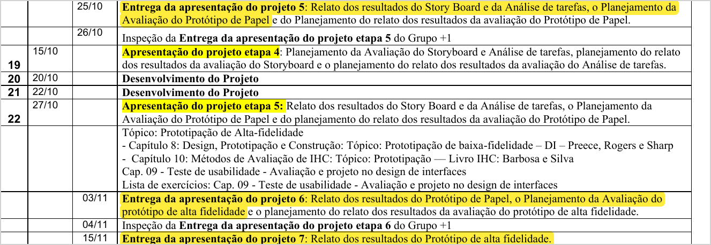
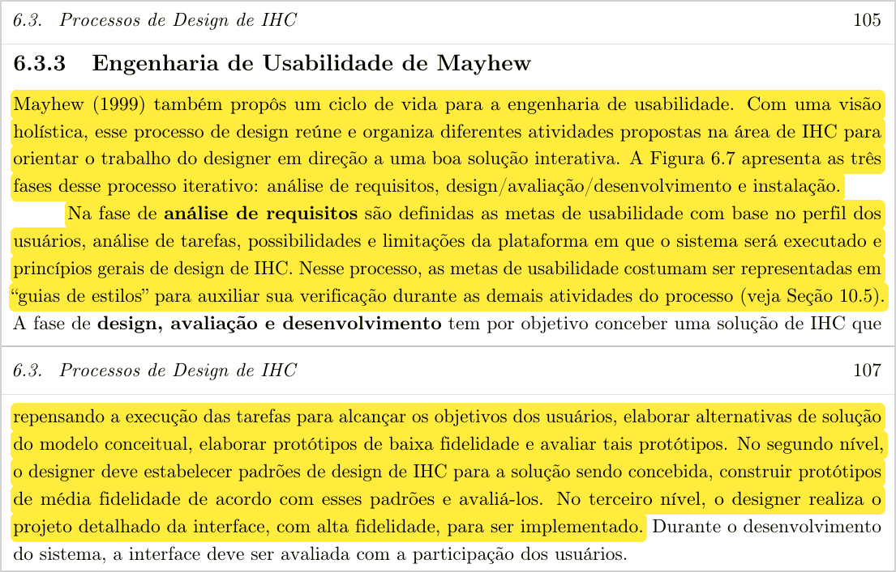
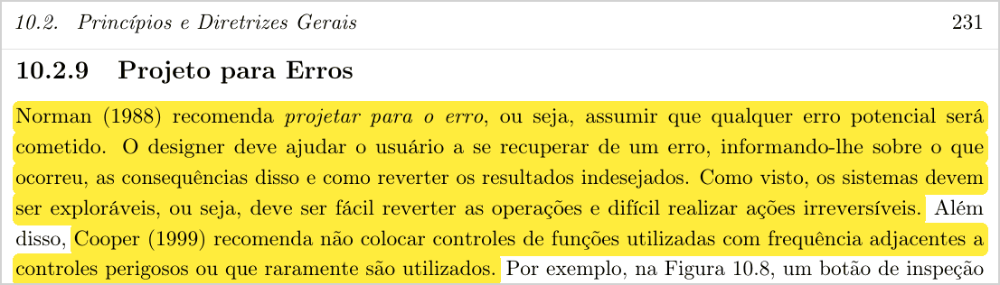
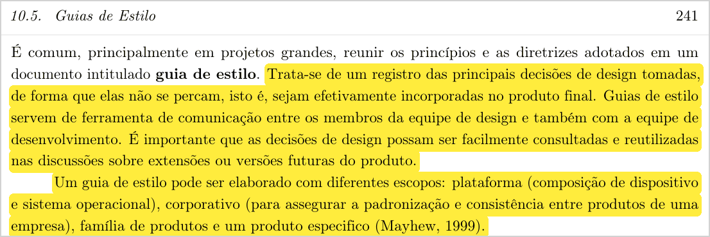
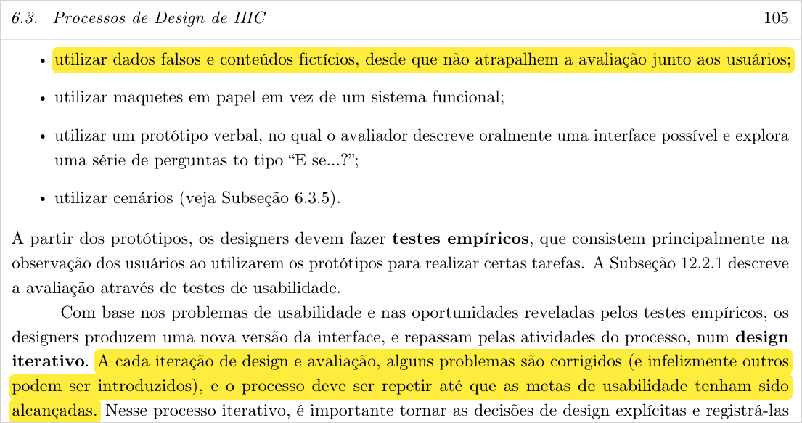
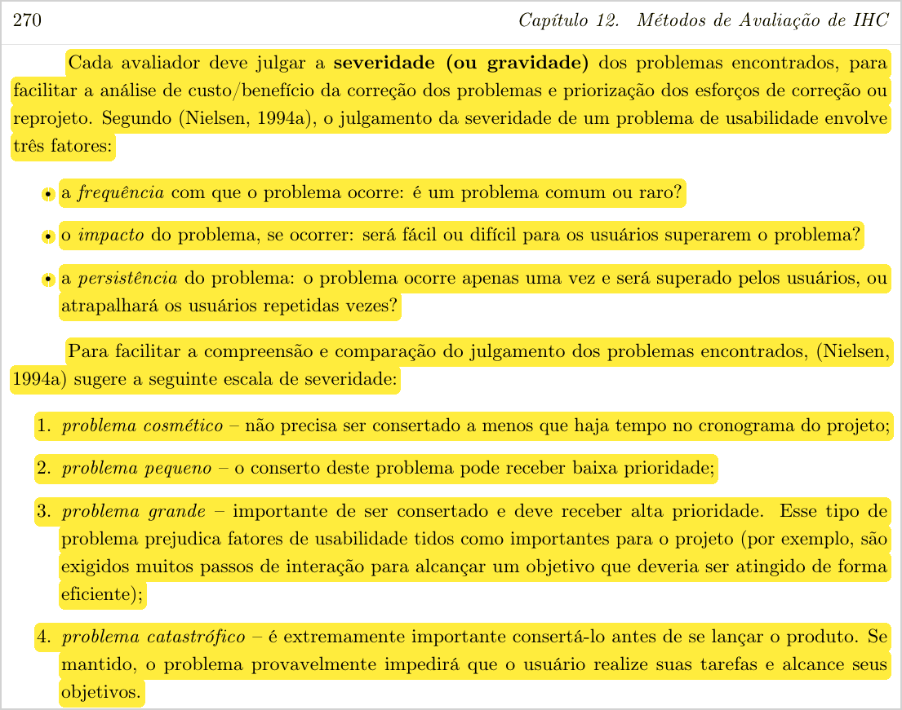
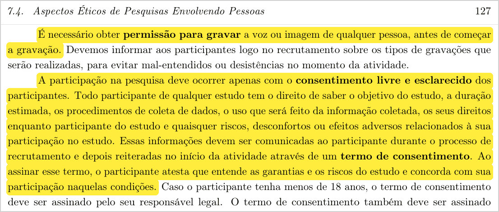
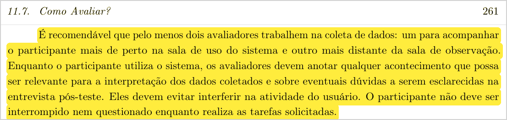
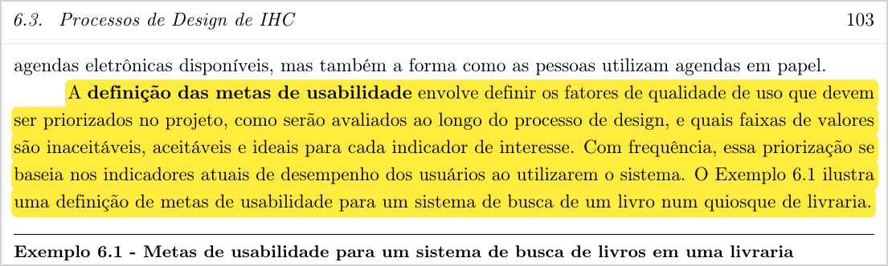

# Lista de Verificação — Entrega 7 (versão 2.0)

!!! info "Versão 2.0 — rastreabilidade"
    Esta é a **versão 2.0** da lista. A versão 1.0 continua disponível, sem alterações de conteúdo, em [verif7.md](../verif7.md). O [índice das listas de verificação](../index.md) mostra onde está cada versão.

## Histórico de versão

| Data | Versão | Descrição | Autor(es) | Revisor(es) |
| :---: | :---: | :--- | :--- | :--- |
| 16/11/2026 | 1.0 | Elaboração da lista de verificação do protótipo de alta fidelidade e do relato dos resultados da sua avaliação (publicada em [verif7.md](../verif7.md)). | [Tomás Rocho](https://github.com/TomasRocho) | [Rodrigo Carvalho](https://github.com/RodrigoCBarbosa) |
| 19/11/2026 | 2.0 | Inclusão dos Itens do Desenvolvimento do Projeto; item sobre metas de usabilidade; padronização de autoria; referências e prints do IHC.pdf no lugar das referências sem print. | [Gabriel Melo](https://github.com/gabriellcardone-06) | Pendente de revisão |

## Introdução

Esta lista verifica os artefatos da **Entrega 7: Relato dos resultados da avaliação do protótipo de alta fidelidade**. O conteúdo da entrega está no cronograma do Plano de Ensino ([Figura 2](#figura-2)). A versão 1.0 tinha 14 itens: o protótipo de alta fidelidade (1–4) e o relato dos resultados (5–14). Na versão 2.0 eles mantêm número (G1–G14) e autor, e o item G15 liga o relato às metas de usabilidade da Entrega 3.

Para cada item, quem avalia marca **Sim**, **Não** ou **Incompleto**, como no Plano de Ensino (SALES, 2026). Quando um item não se aplica ao artefato avaliado, escreva *N/A* na linha e explique em *Observações* no registro da avaliação. A coluna *Autor(es) do item* indica quem escreveu a pergunta e quem é responsável pelo conteúdo verificado. Nos itens do professor, a pergunta é de André Barros de Sales e o integrante indicado é quem produziu o conteúdo e a evidência. A coluna *Referência* leva ao print grifado da fonte, no fim da página. As páginas do livro são as páginas impressas do *IHC.pdf* (BARBOSA et al., 2021, versão de 03/05/2021).

Os itens estão organizados assim: primeiro os **Itens do Desenvolvimento do Projeto (D1–D11)**, que se repetem em todas as listas; depois os itens de conteúdo do professor (quando a entrega tem lista no Plano de Ensino); por fim, os itens de conteúdo elaborados pelo grupo (código G).

## 1. Itens do Desenvolvimento do Projeto

O Plano de Ensino define onze itens de desenvolvimento que valem para todos os artefatos (SALES, 2026, pp. 8–9). Eles aparecem primeiro em todas as listas do grupo, da Entrega 1 à Entrega 7 (veja a Tabela 1). Nas Entregas 3 e 4, o Plano fala em “Todos os 10 itens”, mas a lista do professor tem 11; por isso os 11 foram mantidos.

<strong>Tabela 1</strong> — Itens do Desenvolvimento do Projeto (Avaliar: o próprio grupo e o grupo +1)

| Código | Pergunta de verificação | Autor(es) do item | Referência | Sim | Não | Incompleto |
| :---: | :--- | :--- | :---: | :---: | :---: | :---: |
| D1 | O histórico de versão padronizado? | **Pergunta:** André Barros de Sales (Plano de Ensino) **Inclusão na lista:** [Gabriel Melo](https://github.com/gabriellcardone-06) | [Fig. 1](#figura-1) | ☐ | ☐ | ☐ |
| D2 | O(s) autor(es) e o(s) revisor(es) para cada artefato? | **Pergunta:** André Barros de Sales (Plano de Ensino) **Inclusão na lista:** [Gabriel Melo](https://github.com/gabriellcardone-06) | [Fig. 1](#figura-1) | ☐ | ☐ | ☐ |
| D3 | Referências bibliográficas e/ou bibliografia em todos os artefatos? | **Pergunta:** André Barros de Sales (Plano de Ensino) **Inclusão na lista:** [Gabriel Melo](https://github.com/gabriellcardone-06) | [Fig. 1](#figura-1) | ☐ | ☐ | ☐ |
| D4 | As tabelas e imagens possuem legenda e fonte e são chamadas dentro do texto? | **Pergunta:** André Barros de Sales (Plano de Ensino) **Inclusão na lista:** [Gabriel Melo](https://github.com/gabriellcardone-06) | [Fig. 1](#figura-1) | ☐ | ☐ | ☐ |
| D5 | Um texto fazendo uma introdução dos artefatos? | **Pergunta:** André Barros de Sales (Plano de Ensino) **Inclusão na lista:** [Gabriel Melo](https://github.com/gabriellcardone-06) | [Fig. 1](#figura-1) | ☐ | ☐ | ☐ |
| D6 | O cronograma executado com quem realizou cada artefato/atividade, com as datas de início e fim da construção/realização do artefato/atividade? | **Pergunta:** André Barros de Sales (Plano de Ensino) **Inclusão na lista:** [Gabriel Melo](https://github.com/gabriellcardone-06) | [Fig. 1](#figura-1) | ☐ | ☐ | ☐ |
| D7 | Ata(s) da(s) reunião(ões) (com data, horário de início e do final, participantes, objetivo, atividades definidas etc.)? | **Pergunta:** André Barros de Sales (Plano de Ensino) **Inclusão na lista:** [Gabriel Melo](https://github.com/gabriellcardone-06) | [Fig. 1](#figura-1) | ☐ | ☐ | ☐ |
| D8 | A gravação da reunião do grupo? | **Pergunta:** André Barros de Sales (Plano de Ensino) **Inclusão na lista:** [Gabriel Melo](https://github.com/gabriellcardone-06) | [Fig. 1](#figura-1) | ☐ | ☐ | ☐ |
| D9 | Vídeo de apresentação na categoria “não listado” no YouTube? | **Pergunta:** André Barros de Sales (Plano de Ensino) **Inclusão na lista:** [Gabriel Melo](https://github.com/gabriellcardone-06) | [Fig. 1](#figura-1) | ☐ | ☐ | ☐ |
| D10 | Tabela de contribuição no início do artefato com o nome de todos os integrantes, com a contribuição de cada integrante e hiperligação para a atividade e para a gravação, se houver? | **Pergunta:** André Barros de Sales (Plano de Ensino) **Inclusão na lista:** [Gabriel Melo](https://github.com/gabriellcardone-06) | [Fig. 1](#figura-1) | ☐ | ☐ | ☐ |
| D11 | A seção de agradecimentos apresentando o uso de Inteligência Artificial (IA) Generativa no artefato? | **Pergunta:** André Barros de Sales (Plano de Ensino) **Inclusão na lista:** [Gabriel Melo](https://github.com/gabriellcardone-06) | [Fig. 1](#figura-1) | ☐ | ☐ | ☐ |

<em>Fonte: SALES (2026, Plano de Ensino, pp. 8–9), lista de verificação sugerida — Itens do Desenvolvimento do projeto.</em>

## 2. Protótipo de alta fidelidade e relato dos resultados da avaliação

A Tabela 2 traz os itens 1–14 da versão 1.0, com os mesmos autores, e o item novo G15, de Arthur Mariani, autor das metas de usabilidade.

<strong>Tabela 2</strong> — Itens para o protótipo de alta fidelidade (G1–G4) e o relato dos resultados (G5–G15)

| Código | Pergunta de verificação | Autor(es) do item | Referência | Sim | Não | Incompleto |
| :---: | :--- | :--- | :---: | :---: | :---: | :---: |
| G1 | O protótipo pode ser aberto por um link e usado pelo próprio participante, sem que o avaliador precise trocar as telas? | [Arthur Mariani](https://github.com/arthur-mariani) | [Fig. 3](#figura-3) [Fig. 4](#figura-4) | ☐ | ☐ | ☐ |
| G2 | O protótipo tem as telas, mensagens e estados de erro necessários para executar todas as tarefas do roteiro? | [Arthur Mariani](https://github.com/arthur-mariani) | [Fig. 3](#figura-3) [Fig. 5](#figura-5) | ☐ | ☐ | ☐ |
| G3 | O protótipo segue o Guia de Estilo do Grupo 05 (rótulos que dizem o efeito da ação, mensagens de erro com caminho de recuperação e alvos de toque adequados ao celular)? | [Carlos Costa](https://github.com/carloshfgit) | [Fig. 6](#figura-6) | ☐ | ☐ | ☐ |
| G4 | O protótipo usa apenas dados fictícios e deixa claro o que é simulado (por exemplo, câmera, notificações ou respostas de outras instituições)? | [Carlos Costa](https://github.com/carloshfgit) | [Fig. 7](#figura-7) | ☐ | ☐ | ☐ |
| G5 | O relato informa o objetivo, o escopo, o método usado e a versão do protótipo que foi avaliada? | [Gabriel Melo](https://github.com/gabriellcardone-06) | [Fig. 8](#figura-8) | ☐ | ☐ | ☐ |
| G6 | O relato informa a quantidade e o perfil dos participantes e quem atuou como avaliador? | [Gabriel Melo](https://github.com/gabriellcardone-06) | [Fig. 8](#figura-8) | ☐ | ☐ | ☐ |
| G7 | O relato registra o que mudou em relação ao planejamento (datas, número de participantes, papéis da equipe ou medições) e o efeito dessas mudanças? | [Igor Dantas](https://github.com/IgorDARAUJO) | [Fig. 9](#figura-9) [Fig. 8](#figura-8) | ☐ | ☐ | ☐ |
| G8 | O relato apresenta, por tarefa, a conclusão, os erros, os pedidos de ajuda e o tempo (exato ou aproximado)? | [Igor Dantas](https://github.com/IgorDARAUJO) | [Fig. 10](#figura-10) | ☐ | ☐ | ☐ |
| G9 | O relato responde a cada pergunta da avaliação e indica quais ficaram sem resposta, explicando o motivo? | [Lucas Araújo](https://github.com/Lucasaraujoszz) | [Fig. 8](#figura-8) | ☐ | ☐ | ☐ |
| G10 | Cada problema de usabilidade é descrito com a tela onde aconteceu, o impacto, a severidade e uma recomendação de correção, ou o relato declara que nenhum problema foi observado? | [Lucas Araújo](https://github.com/Lucasaraujoszz) | [Fig. 11](#figura-11) [Fig. 8](#figura-8) | ☐ | ☐ | ☐ |
| G11 | O relato compara os resultados com os da avaliação do protótipo de papel, indicando o que foi resolvido ou continua pendente? | [Rodrigo Carvalho](https://github.com/RodrigoCBarbosa) | [Fig. 7](#figura-7) | ☐ | ☐ | ☐ |
| G12 | O relato confirma que houve consentimento (TCLE), autorização de gravação e anonimato dos participantes? | [Rodrigo Carvalho](https://github.com/RodrigoCBarbosa) | [Fig. 12](#figura-12) [Fig. 13](#figura-13) | ☐ | ☐ | ☐ |
| G13 | O relato disponibiliza as evidências da avaliação, como a gravação das sessões ou o registro das observações? | [Tomás Rocho](https://github.com/TomasRocho) | [Fig. 10](#figura-10) [Fig. 14](#figura-14) | ☐ | ☐ | ☐ |
| G14 | O relato apresenta as limitações dos resultados e um plano de reprojeto, mesmo que conclua que não há correção obrigatória? | [Tomás Rocho](https://github.com/TomasRocho) | [Fig. 8](#figura-8) | ☐ | ☐ | ☐ |
| G15 | O relato verifica se as metas de usabilidade definidas na Entrega 3 foram atingidas, comparando os indicadores medidos com as faixas inaceitável, aceitável e ideal? | [Arthur Mariani](https://github.com/arthur-mariani) | [Fig. 10](#figura-10) [Fig. 15](#figura-15) | ☐ | ☐ | ☐ |

<em>Fonte: itens G1–G14: Grupo 05 (2026, v1.0), revisados na v2.0; item G15: Arthur Mariani (2026, v2.0). Base: BARBOSA et al. (2021, caps. 6, 7, 9, 11 e 12).</em>

## Tabela de contribuição

A Tabela 3 mostra o que cada integrante fez nesta lista. A autoria dos itens segue o conteúdo que cada integrante produziu no projeto: quem fez o artefato é autor dos itens que o verificam. Os links levam ao artefato correspondente. As gravações das reuniões estão na página de [atas](../../atas/ata1.md) e de [gravações](../../apresentacoes/index.md).

<strong>Tabela 3</strong> — Contribuição de cada integrante nesta lista

| Integrante | Contribuição nesta lista | Artefato(s) relacionado(s) |
| :--- | :--- | :--- |
| [Arthur Mariani](https://github.com/arthur-mariani) | Itens G1, G2 e G15. | [Relato da alta fidelidade](../../design-avaliacao-desenvolvimento/nivel3/relatos-individuais/arthur/relato-resultados-prot-alta-fidel.md), [Metas de usabilidade](../../analise-de-requisitos/principios-gerais/metas-de-usabilidade.md) |
| [Carlos Costa](https://github.com/carloshfgit) | Itens G3 e G4. | [Relato da alta fidelidade](../../design-avaliacao-desenvolvimento/nivel3/relatos-individuais/carlos/relato-resultados-prot-alta-fidel.md) |
| [Gabriel Melo](https://github.com/gabriellcardone-06) | Itens G5 e G6. Autor da versão 2.0 (D1–D11, referências do IHC.pdf, prints). | [Relato da alta fidelidade](../../design-avaliacao-desenvolvimento/nivel3/relatos-individuais/gabriel/relato-resultados-prot-alta-fidel.md) |
| [Igor Dantas](https://github.com/IgorDARAUJO) | Itens G7 e G8. | [Relato da alta fidelidade](../../design-avaliacao-desenvolvimento/nivel3/relatos-individuais/igor/relato-resultados-prot-alta-fidel.md) |
| [Lucas Araújo](https://github.com/Lucasaraujoszz) | Itens G9 e G10. | [Relato da alta fidelidade](../../design-avaliacao-desenvolvimento/nivel3/relatos-individuais/lucas/relato-resultados-prot-alta-fidel.md) |
| [Rodrigo Carvalho](https://github.com/RodrigoCBarbosa) | Revisor da versão 1.0. Itens G11 e G12. | [Relato da alta fidelidade](../../design-avaliacao-desenvolvimento/nivel3/relatos-individuais/rodrigo/relato-resultados-prot-alta-fidel.md) |
| [Tomás Rocho](https://github.com/TomasRocho) | Autor da versão 1.0 (organização da lista). Itens G13 e G14. | [Relato da alta fidelidade](../../design-avaliacao-desenvolvimento/nivel3/relatos-individuais/tomas/relato-resultados-prot-alta-fidel.md) |
| André Barros de Sales (professor) | Autor das perguntas dos Itens do Desenvolvimento do Projeto (D1–D11), retiradas da lista de verificação sugerida no Plano de Ensino. | [Plano de Ensino (PDF)](../../assets/inspecoes/plano-de-ensino-ihc-2026-2-turma01-v1.pdf) |

<em>Fonte: elaborado pelo Grupo 05 (2026).</em>

## Rastreabilidade v1.0 → v2.0

A versão 1.0 continua publicada em [verif7.md](../verif7.md) e não foi apagada. A Tabela 4 indica onde cada item da versão 1.0 está nesta versão e o que mudou.

<strong>Tabela 4</strong> — Rastreabilidade entre a versão 1.0 e a versão 2.0

| Item na v1.0 | Item na v2.0 | Alteração |
| :---: | :---: | :--- |
| 1–14 | G1–G14 | Mesmo número e mesmo autor, com prefixo G; referência e print do IHC.pdf acrescentados. |
| 3, 4 | G3, G4 | Autor exibido como “Carlos Henrique” na v1.0; padronizado como Carlos Costa (mesmo perfil do GitHub). |
| Orientações (Preece, Rogers e Sharp, 2005, pp. 265–266) | G1–G4 | Os itens do protótipo passaram a citar o livro-texto da disciplina, que tem print nesta página: alta fidelidade (p. 210), nível 3 de Mayhew (p. 107) e uso de dados fictícios (p. 105). Preece et al. (2005) segue nas referências como leitura complementar, sem print. |
| — | G15 | Novo: verificação das metas de usabilidade da Entrega 3 no relato. |
| Histórico de versão | Tabela de contribuição | A v1.0 listava apenas Tomás Rocho como autor; a v2.0 registra o autor de cada item. |

<em>Fonte: elaborado pelo Grupo 05 (2026).</em>

## Registro da avaliação

O Plano de Ensino pede a resposta (Sim / Não / Incompleto) e a versão, a data e a hora da avaliação. Cada aplicação desta lista deve ser registrada na Tabela 5.

<strong>Tabela 5</strong> — Registro das avaliações feitas com esta lista

| Artefato e versão avaliada | Data e hora | Avaliador(es) | Grupo avaliador (próprio ou +1) | Observações |
| :--- | :---: | :--- | :---: | :--- |
| | | | | |

<em>Fonte: elaborado pelo Grupo 05 (2026), a partir de SALES (2026).</em>

## Agradecimentos e uso de IA generativa

Agradecemos ao professor André Barros de Sales pela lista de verificação sugerida no Plano de Ensino, que serve de base para os itens D1–D11 e para os itens de conteúdo marcados como do professor.

Na versão 2.0, o assistente de IA generativa *Claude* (Anthropic) foi usado para: comparar os itens da versão 1.0 com o livro-texto e com o Plano de Ensino; sugerir correções e novos itens; localizar no livro as páginas citadas; e gerar os recortes grifados das referências. A atribuição de autoria por conteúdo, o texto final dos itens e a revisão são responsabilidade dos integrantes do grupo. 

## Prints das referências

As figuras a seguir são recortes das fontes citadas nos itens desta lista, com o trecho que fundamenta cada item grifado em amarelo. Os recortes do livro foram retirados do arquivo *IHC.pdf* (BARBOSA et al., 2021, versão de 03/05/2021) e a numeração indicada é a numeração impressa nas páginas. Os recortes do Plano de Ensino foram retirados da versão disponibilizada pelo professor na turma 01 (SALES, 2026), com o número da página do PDF.

---

<strong>Figura 1</strong> — Itens do Desenvolvimento do projeto (1 a 11) da lista de verificação sugerida pelo professor

<em>Fonte: SALES (2026, Plano de Ensino, pp. 8–9). Recorte e grifo: [Gabriel Melo](https://github.com/gabriellcardone-06) (2026). Itens que usam esta figura: D1, D2, D3, D4, D5, D6, D7, D8, D9, D10, D11.</em>

---

<strong>Figura 2</strong> — Conteúdo das Entregas 5, 6 e 7 no cronograma do Plano de Ensino

<em>Fonte: SALES (2026, Plano de Ensino, p. 5). Recorte e grifo: [Gabriel Melo](https://github.com/gabriellcardone-06) (2026). Itens que usam esta figura: Introdução.</em>

---

<strong>Figura 3</strong> — Representação de interface em alta fidelidade

<em>Fonte: BARBOSA et al. (2021, p. 210). Recorte e grifo: [Gabriel Melo](https://github.com/gabriellcardone-06) (2026). Itens que usam esta figura: G1, G2.</em>

---

<strong>Figura 4</strong> — Ciclo de vida da engenharia de usabilidade de Mayhew: fases e três níveis de design

<em>Fonte: BARBOSA et al. (2021, pp. 105, 107). Recorte e grifo: [Gabriel Melo](https://github.com/gabriellcardone-06) (2026). Itens que usam esta figura: G1.</em>

---

<strong>Figura 5</strong> — 10.2.9 Projeto para erros

<em>Fonte: BARBOSA et al. (2021, p. 231). Recorte e grifo: [Gabriel Melo](https://github.com/gabriellcardone-06) (2026). Itens que usam esta figura: G2.</em>

---

<strong>Figura 6</strong> — 10.5 Guias de estilo: finalidade e escopos

<em>Fonte: BARBOSA et al. (2021, p. 241). Recorte e grifo: [Gabriel Melo](https://github.com/gabriellcardone-06) (2026). Itens que usam esta figura: G3.</em>

---

<strong>Figura 7</strong> — Simplificações aceitáveis em protótipos e design iterativo

<em>Fonte: BARBOSA et al. (2021, p. 105). Recorte e grifo: [Gabriel Melo](https://github.com/gabriellcardone-06) (2026). Itens que usam esta figura: G4, G11.</em>

---

<strong>Figura 8</strong> — 11.7.5 Consolidação e relato dos resultados

<em>Fonte: BARBOSA et al. (2021, p. 263). Recorte e grifo: [Gabriel Melo](https://github.com/gabriellcardone-06) (2026). Itens que usam esta figura: G5, G6, G7, G9, G10, G14.</em>

---

<strong>Figura 9</strong> — 11.8 Framework DECIDE

<em>Fonte: BARBOSA et al. (2021, p. 264). Recorte e grifo: [Gabriel Melo](https://github.com/gabriellcardone-06) (2026). Itens que usam esta figura: G7.</em>

---

<strong>Figura 10</strong> — 12.2.1 Teste de usabilidade: objetivo, atividades e medidas por tarefa

<em>Fonte: BARBOSA et al. (2021, pp. 288–289). Recorte e grifo: [Gabriel Melo](https://github.com/gabriellcardone-06) (2026). Itens que usam esta figura: G8, G13, G15.</em>

---

<strong>Figura 11</strong> — 12.1.1 Avaliação heurística: escala de severidade de Nielsen

<em>Fonte: BARBOSA et al. (2021, p. 270). Recorte e grifo: [Gabriel Melo](https://github.com/gabriellcardone-06) (2026). Itens que usam esta figura: G10.</em>

---

<strong>Figura 12</strong> — Permissão para gravação e consentimento livre e esclarecido

<em>Fonte: BARBOSA et al. (2021, p. 127). Recorte e grifo: [Gabriel Melo](https://github.com/gabriellcardone-06) (2026). Itens que usam esta figura: G12.</em>

---

<strong>Figura 13</strong> — Confidencialidade dos dados e anonimato dos participantes

<em>Fonte: BARBOSA et al. (2021, p. 127). Recorte e grifo: [Gabriel Melo](https://github.com/gabriellcardone-06) (2026). Itens que usam esta figura: G12.</em>

---

<strong>Figura 14</strong> — 11.7.3 Coleta de dados: dois avaliadores, anotações e não interferência

<em>Fonte: BARBOSA et al. (2021, p. 261). Recorte e grifo: [Gabriel Melo](https://github.com/gabriellcardone-06) (2026). Itens que usam esta figura: G13.</em>

---

<strong>Figura 15</strong> — Definição de metas de usabilidade, indicadores e faixas de valores

<em>Fonte: BARBOSA et al. (2021, p. 103). Recorte e grifo: [Gabriel Melo](https://github.com/gabriellcardone-06) (2026). Itens que usam esta figura: G15.</em>

## Referências bibliográficas

- BARBOSA, Simone Diniz Junqueira; SILVA, Bruno Santana da; SILVEIRA, Milene Selbach; GASPARINI, Isabela; DARIN, Ticianne; BARBOSA, Gabriel Diniz Junqueira. **Interação Humano-Computador e Experiência do Usuário**. Rio de Janeiro: Autopublicação, 2021. ISBN 978-65-00-19677-1. Versão de 03/05/2021.
- PREECE, Jennifer; ROGERS, Yvonne; SHARP, Helen. **Design de Interação: além da interação homem-computador**. Porto Alegre: Bookman, 2005. Cap. 8, pp. 265–266 (leitura complementar, citada na v1.0).
- SALES, André Barros de. **Plano de Ensino: Interação Humano Computador — Turma 01**. Brasília: Universidade de Brasília, Faculdade UnB Gama, 2026. Disponível em: [plano de ensino (PDF)](../../assets/inspecoes/plano-de-ensino-ihc-2026-2-turma01-v1.pdf).
